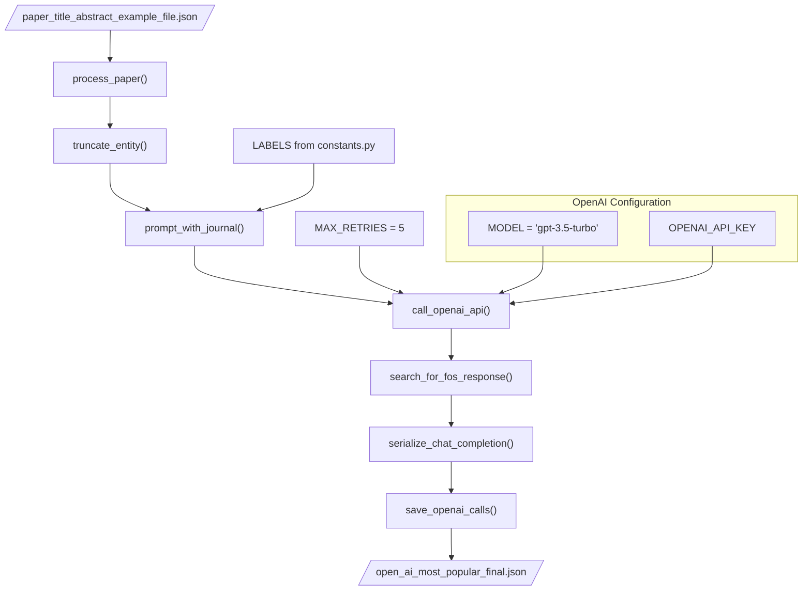
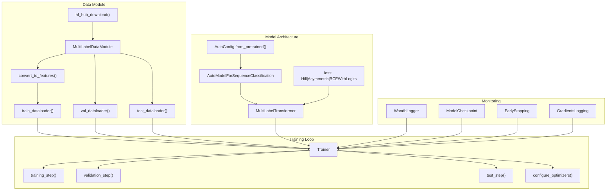
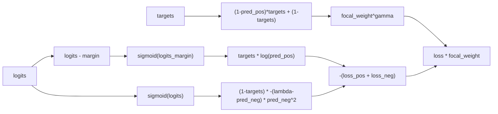

<!-- source: DeepWiki mcp.deepwiki.com · repo allenai/s2_fos · page 4 Training System · fetched 2026-10-26 -->

# Training System

<details>
<summary>Relevant source files</summary>

The following files were used as context for generating this wiki page:

- [src/s2_fos/training/open_ai_prompts.py](src/s2_fos/training/open_ai_prompts.py)
- [src/s2_fos/training/run.sh](src/s2_fos/training/run.sh)
- [src/s2_fos/training/train_net.py](src/s2_fos/training/train_net.py)

</details>


## Purpose and Scope

The Training System encompasses the complete pipeline for fine-tuning SciBERT models for Field of Study classification. This includes data generation using OpenAI's API and model training using PyTorch Lightning. The system produces trained models that are consumed by the Core System for inference (see [Core System](#3)).

For information about using trained models for predictions, see [S2FOS Interface](#3.1). For development and testing of the training pipeline, see [Testing](#5.2).

## Data Generation Pipeline

The data generation component uses OpenAI's GPT-3.5-turbo to create training labels for academic papers. The `open_ai_prompts.py` module handles the complete workflow from raw paper data to labeled training examples.

### OpenAI Integration Architecture



Sources: [src/s2_fos/training/open_ai_prompts.py:1-162]()

### Data Processing Workflow

The system processes academic papers through several stages:

| Stage | Function | Description |
|-------|----------|-------------|
| Input Validation | `truncate_entity()` | Limits text to 800 tokens to fit API constraints |
| Prompt Construction | `prompt_with_journal()` | Creates structured prompts with title, abstract, and journal |
| API Interaction | `call_openai_api()` | Sends requests to GPT-3.5-turbo with retry logic |
| Response Processing | `search_for_fos_response()` | Extracts field of study labels from API responses |
| Persistence | `save_openai_calls()` | Stores results in JSON format for training |

The system implements robust error handling with `MAX_RETRIES = 5` and `RETRY_DELAY = 5` seconds to handle API rate limits and transient failures.

Sources: [src/s2_fos/training/open_ai_prompts.py:23-94]()

## Model Training Pipeline

The training pipeline is orchestrated by `train_net.py` and built on PyTorch Lightning for scalable model fine-tuning. The system fine-tunes SciBERT models for multi-label classification across 23 field of study categories.

### Training Architecture Components



Sources: [src/s2_fos/training/train_net.py:173-461]()

### Data Loading and Processing

The `MultiLabelDataModule` class handles data preparation and loading:

- **Automatic Download**: Downloads training data from `allenai/fos_model_training_data_open_ai_annotations` repository on Hugging Face Hub
- **Data Splitting**: Automatically splits data into train (70%), validation (15%), and test (15%) sets
- **Tokenization**: Uses SciBERT tokenizer (`allenai/scibert_scivocab_uncased`) with `max_seq_length=128`
- **Text Concatenation**: Combines multiple text fields using `tokenizer.sep_token`

The data module supports configurable text fields through the `text_fields` parameter, defaulting to `["title", "normalized_venue_name", "abstract"]`.

Sources: [src/s2_fos/training/train_net.py:173-302]()

### Model Configuration

The `MultiLabelTransformer` class configures the SciBERT model for multi-label classification:

```python
# Key configuration parameters from train_net.py
model_name_or_path = "allenai/scibert_scivocab_uncased"
num_labels = 23  # Field of study categories
hidden_dropout_prob = 0.1
```

The model supports dynamic label mapping through `id2label` and `label2id` dictionaries, enabling interpretable outputs aligned with the field of study categories defined in `constants.py`.

Sources: [src/s2_fos/training/train_net.py:304-353]()

## Loss Functions

The training system implements three loss functions optimized for multi-label classification with potentially missing labels:

### Loss Function Comparison

| Loss Function | Use Case | Key Parameters |
|---------------|----------|----------------|
| `Hill` | Robust to missing labels | `lamb=1.5`, `margin=1.0`, `gamma=2.0` |
| `AsymmetricLoss` | Handles class imbalance | `gamma_neg=4`, `gamma_pos=1`, `clip=0.05` |
| `BCEWithLogitsLoss` | Standard baseline | `reduction="mean"` |

### Hill Loss Implementation

The Hill loss addresses the missing label problem in multi-label learning:



The Hill loss formula combines focal loss weighting with a specialized negative term that reduces the penalty for potentially missing positive labels.

Sources: [src/s2_fos/training/train_net.py:48-108]()

### Asymmetric Loss Implementation

Asymmetric loss provides different focusing for positive and negative samples:

- **Asymmetric Clipping**: `xs_neg.add_(clip).clamp_(max=1)` reduces over-confidence on negative samples
- **Differential Focusing**: Uses `gamma_pos` for positive samples and `gamma_neg` for negative samples
- **Memory Optimization**: Implements in-place operations to minimize GPU memory allocation

Sources: [src/s2_fos/training/train_net.py:110-171]()

## Training Configuration and Execution

### Command Line Interface

The training script accepts comprehensive configuration through command line arguments:

```bash
# Example from run.sh
python train_net.py \
  --text_fields title abstract journal_name \
  --save_path /stage/output/ \
  --train True \
  --batch_size 32 \
  --learning_rate 1e-5 \
  --warmup_ratio 0.06 \
  --loss Asymmetric \
  --asym_gamma_neg 4 \
  --asym_gamma_pos 2 \
  --asym_clip 0.1
```

### Optimizer and Scheduler Configuration

The system supports multiple optimization strategies:

| Component | Options | Default |
|-----------|---------|---------|
| Optimizer | AdamW | `lr=1e-5`, `eps=1e-8`, `weight_decay=0.001` |
| Scheduler | cosine, warmup, linear, constant | cosine with `warmup_ratio=0.06` |
| Training | Early stopping, model checkpointing | `patience=1`, `monitor="val_average_precision"` |

The optimizer implements weight decay only for non-bias and non-LayerNorm parameters, following transformer training best practices.

Sources: [src/s2_fos/training/train_net.py:417-461](), [src/s2_fos/training/run.sh:1-6]()

### Monitoring and Logging

Training progress is tracked through multiple loggers:

- **WandB Logger**: Experiment tracking with gradient histograms via `GradientsLogging` callback
- **CSV Logger**: Local logging for offline analysis
- **Model Checkpointing**: Saves best models based on validation average precision
- **Early Stopping**: Prevents overfitting with configurable patience

The system monitors `MultilabelAUROC` and `MultilabelAveragePrecision` metrics across all 23 field of study categories.

Sources: [src/s2_fos/training/train_net.py:37-46](), [src/s2_fos/training/train_net.py:653-685]()

---

