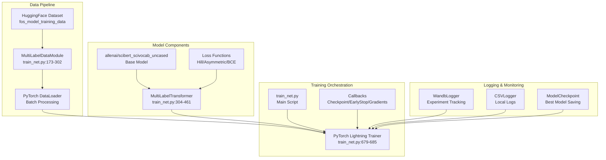
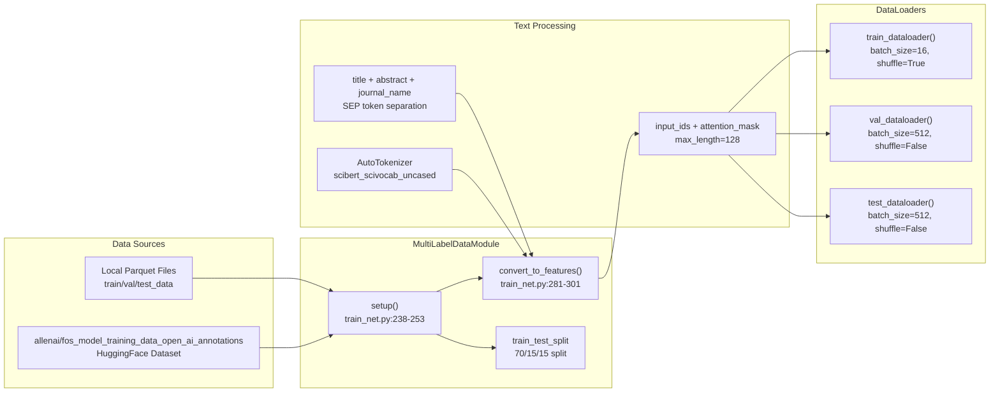
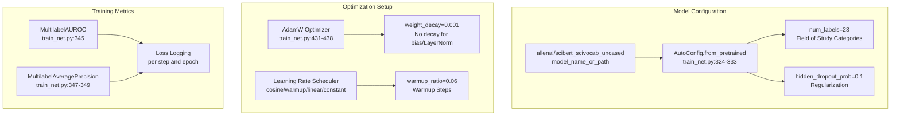
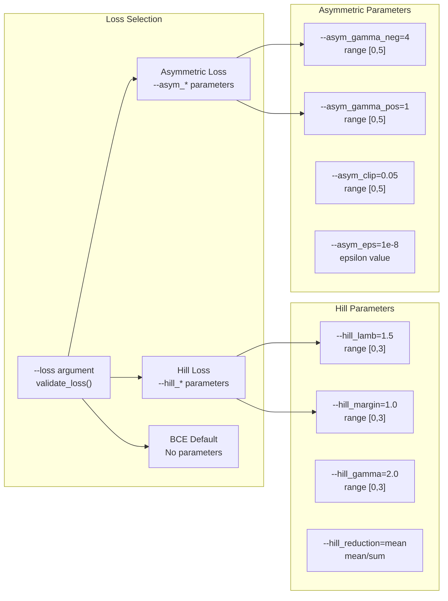

<!-- source: DeepWiki mcp.deepwiki.com · repo allenai/s2_fos · page 4.1 Model Training · fetched 2026-10-26 -->

# Model Training

<details>
<summary>Relevant source files</summary>

The following files were used as context for generating this wiki page:

- [src/s2_fos/training/run.sh](src/s2_fos/training/run.sh)
- [src/s2_fos/training/train_net.py](src/s2_fos/training/train_net.py)

</details>


This document provides a comprehensive guide to training SciBERT models for Field of Study classification using the s2_fos training pipeline. It covers the PyTorch Lightning-based training system, loss function implementations, data handling, and configuration options available through the `train_net.py` script.

For information about generating training data using OpenAI, see [Data Generation](#4.2). For details about the inference system that uses trained models, see [S2FOS Interface](#3.1).

## Training Architecture Overview

The training system is built around PyTorch Lightning and consists of three main components: data handling, model definition, and training orchestration.



**Sources:** [src/s2_fos/training/train_net.py:1-701]()

## Loss Functions

The training system supports three different loss functions for multi-label classification, each designed to handle class imbalance and missing labels effectively.

### Available Loss Functions

| Loss Function | Class | Parameters | Use Case |
|---------------|-------|------------|----------|
| BCE with Logits | `torch.nn.BCEWithLogitsLoss` | `reduction="mean"` | Default baseline |
| Hill Loss | `Hill` | `lamb=1.5`, `margin=1.0`, `gamma=2.0` | Missing labels handling |
| Asymmetric Loss | `AsymmetricLoss` | `gamma_neg=4`, `gamma_pos=1`, `clip=0.05` | Class imbalance |

### Hill Loss Implementation

The `Hill` class implements the loss function described in "Robust Loss Design for Multi-Label Learning with Missing Labels":

```
Loss = y × (1-p_m)^γ log(p_m) + (1-y) × -(λ-p)p²
```

Key features:
- Margin parameter `m` for down-weighting false negatives
- Focal weight `γ` similar to Focal Loss
- Lambda `λ` weighting term for possibly false negatives

**Sources:** [src/s2_fos/training/train_net.py:48-108]()

### Asymmetric Loss Implementation

The `AsymmetricLoss` class provides asymmetric focusing for positive and negative samples with different gamma values and clipping to handle class imbalance.

**Sources:** [src/s2_fos/training/train_net.py:110-171]()

## Data Pipeline

The data pipeline handles loading, preprocessing, and batching of training data through the `MultiLabelDataModule` class.



### Data Loading Configuration

The `MultiLabelDataModule` class handles:
- Automatic dataset download from HuggingFace if local files not provided
- Text field concatenation using SEP tokens
- Tokenization with SciBERT tokenizer
- 23 Field of Study labels (multi-label classification)

**Sources:** [src/s2_fos/training/train_net.py:173-302](), [src/s2_fos/training/train_net.py:214-236]()

## Model Configuration

The `MultiLabelTransformer` class wraps the SciBERT model with training logic and configuration.

### Core Model Setup



### Training Process Methods

The `MultiLabelTransformer` implements:
- `_process_batch()`: Core batch processing for train/val/test
- `training_step()`: Training step implementation
- `validation_step()`: Validation step implementation  
- `configure_optimizers()`: Optimizer and scheduler setup

**Sources:** [src/s2_fos/training/train_net.py:304-461](), [src/s2_fos/training/train_net.py:358-395](), [src/s2_fos/training/train_net.py:417-460]()

## Training Execution

### PyTorch Lightning Trainer Configuration

The training uses PyTorch Lightning's `Trainer` with the following callbacks and configuration:

| Component | Purpose | Configuration |
|-----------|---------|---------------|
| `ModelCheckpoint` | Save best model | Monitor `val_average_precision`, save top 1 |
| `EarlyStopping` | Prevent overfitting | Patience=1, monitor `val_average_precision` |
| `GradientsLogging` | Monitor gradients | Log to WandB as histograms |
| `WandbLogger` | Experiment tracking | Project logging with run descriptions |

**Sources:** [src/s2_fos/training/train_net.py:654-674](), [src/s2_fos/training/train_net.py:37-45]()

### Training Configuration

Default training parameters:
- Max epochs: 5
- Batch size: 16 (training), 512 (evaluation)
- Learning rate: 1e-5
- Warmup ratio: 0.06
- Weight decay: 0.001
- Adam epsilon: 1e-8

**Sources:** [src/s2_fos/training/train_net.py:679-685](), [src/s2_fos/training/train_net.py:643-651]()

## Command Line Interface

The `train_net.py` script provides extensive command line configuration options for training customization.

### Required Arguments

| Argument | Type | Purpose |
|----------|------|---------|
| `--save_path` | str | Directory to save trained model |
| `--train` | bool | Whether to run training or evaluation only |
| `--project_name` | str | WandB project name |

### Data Configuration

| Argument | Default | Purpose |
|----------|---------|---------|
| `--train_data` | None | Path to training parquet file |
| `--val_data` | None | Path to validation parquet file |
| `--test_data` | None | Path to test parquet file |
| `--text_fields` | `["title", "normalized_venue_name", "abstract"]` | Input text fields |

### Loss Function Configuration

The system supports configurable loss functions with validation:



### Example Training Command

The provided run script demonstrates optimal training configuration:

```bash
python train_net.py --text_fields title abstract journal_name \
  --save_path /stage/output/ --train True \
  --project_name <project_name> --batch_size 32 \
  --learning_rate 1e-5 --warmup_ratio 0.06 \
  --loss Asymmetric --asym_gamma_neg 4 \
  --asym_gamma_pos 2 --asym_clip 0.1
```

**Sources:** [src/s2_fos/training/train_net.py:496-585](), [src/s2_fos/training/train_net.py:475-494](), [src/s2_fos/training/run.sh:1-6]()

---

