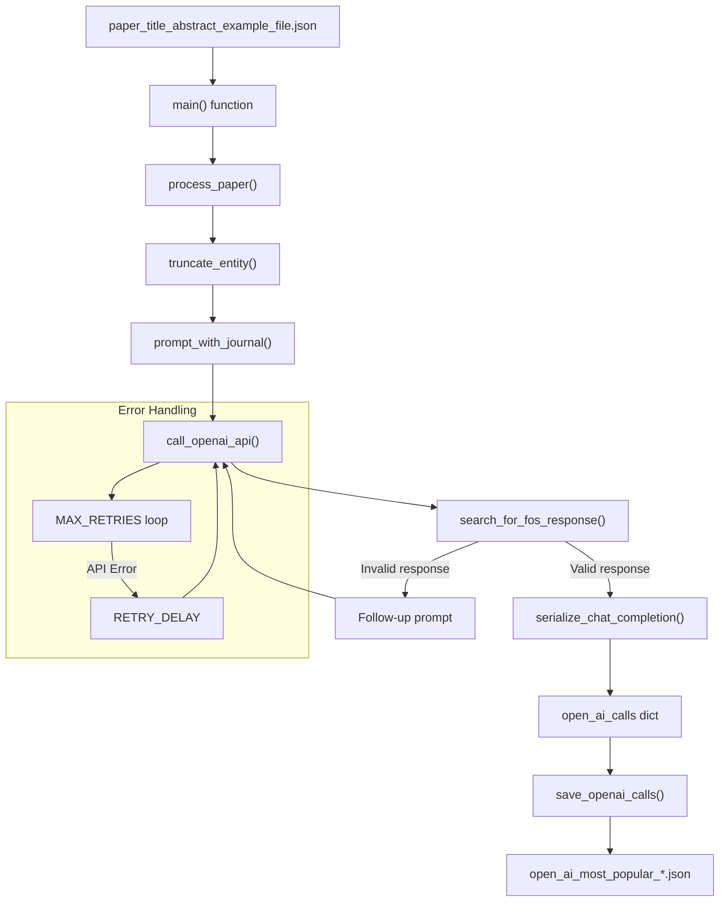
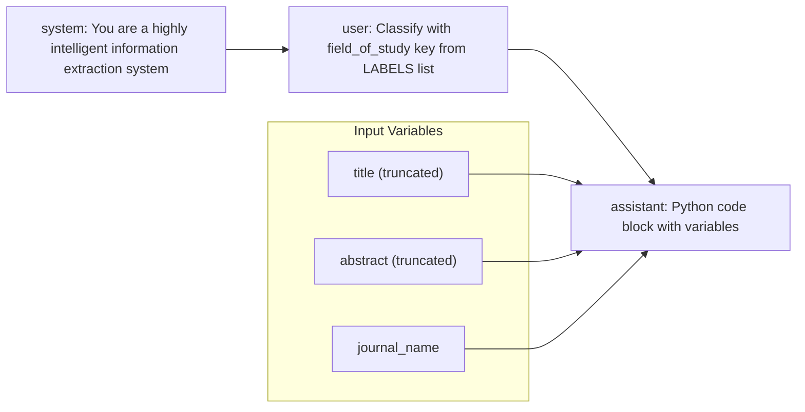
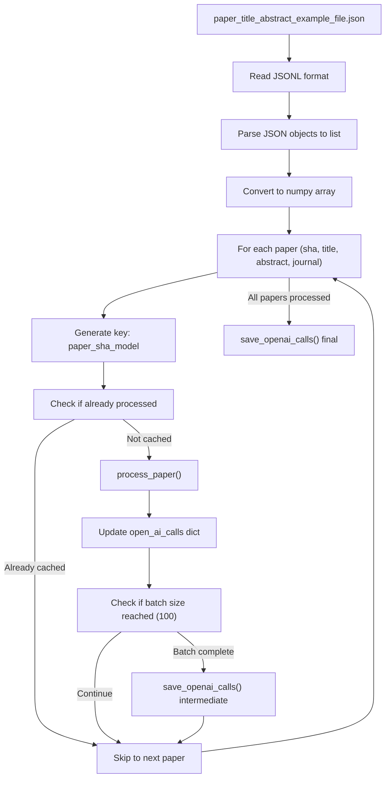
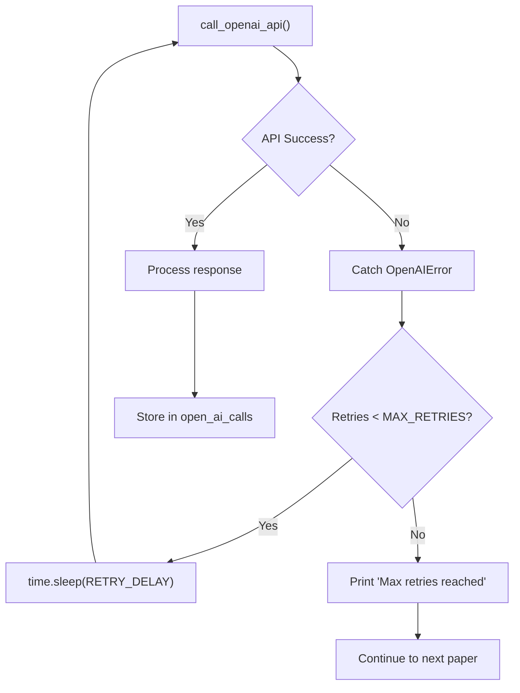

<!-- source: DeepWiki mcp.deepwiki.com · repo allenai/s2_fos · page 4.2 Data Generation · fetched 2026-10-26 -->

# Data Generation

<details>
<summary>Relevant source files</summary>

The following files were used as context for generating this wiki page:

- [src/s2_fos/training/open_ai_prompts.py](src/s2_fos/training/open_ai_prompts.py)

</details>


This document covers the data generation system used to create training labels for field of study classification models. The system leverages OpenAI's GPT-3.5-turbo API to automatically classify academic papers into predefined field of study categories, generating high-quality training data for model fine-tuning.

For information about using this generated data in model training, see [Model Training](#4.1). For details about the field of study constants and labels used in data generation, see [Constants and Labels](#3.3).

## System Overview

The data generation system processes academic papers through an OpenAI API pipeline to produce field of study classifications. The system takes paper metadata (title, abstract, journal name) as input and generates structured training labels as output.

### Data Generation Architecture



Sources: [src/s2_fos/training/open_ai_prompts.py:1-163]()

## OpenAI Integration

The system integrates with OpenAI's GPT-3.5-turbo model to perform field of study classification. The integration includes proper API key management, error handling, and response processing.

### API Configuration

| Configuration | Value | Purpose |
|---------------|-------|---------|
| Model | `gpt-3.5-turbo` | Primary language model for classification |
| Temperature | `0` | Deterministic responses for consistent labeling |
| Max Retries | `5` | Number of retry attempts for failed API calls |
| Retry Delay | `5 seconds` | Wait time between retry attempts |

The system requires the `OPENAI_API_KEY` environment variable to be set and creates an OpenAI client instance for API communication.

Sources: [src/s2_fos/training/open_ai_prompts.py:12-21]()

### API Call Management

```mermaid
sequenceDiagram
    participant PP as "process_paper()"
    participant API as "call_openai_api()"
    participant OpenAI as "OpenAI GPT-3.5-turbo"
    participant Cache as "open_ai_calls dict"
    
    PP->>PP: Check if paper already processed
    PP->>PP: truncate_entity() for title/abstract
    PP->>PP: prompt_with_journal() creates messages
    
    loop "MAX_RETRIES times"
        PP->>API: Send prompt messages
        API->>OpenAI: chat.completions.create()
        OpenAI-->>API: ChatCompletion response
        API-->>PP: Response content
        
        PP->>PP: search_for_fos_response() validation
        alt "Valid FoS found"
            PP->>Cache: Store serialized result
            break
        else "No valid FoS"
            PP->>PP: Create follow-up prompt
            PP->>API: Send follow-up messages
            API->>OpenAI: chat.completions.create()
            OpenAI-->>API: ChatCompletion response
            API-->>PP: Response content
            PP->>Cache: Store serialized result
            break
        end
    end
```

Sources: [src/s2_fos/training/open_ai_prompts.py:32-34](), [src/s2_fos/training/open_ai_prompts.py:63-95]()

## Prompt Engineering

The system uses a structured prompting approach to guide the language model in field of study classification. The prompts are designed to be precise and constrain the model's responses to valid field of study categories.

### Prompt Structure

The `prompt_with_journal()` function creates a three-message conversation structure:

1. **System Message**: Establishes the role as an information extraction system
2. **User Message**: Provides classification instructions and valid field categories
3. **Assistant Message**: Begins a Python code block to structure the response



The system incorporates all 23 field of study labels from the `LABELS` constant, providing the model with explicit category options plus an "Other" fallback category.

Sources: [src/s2_fos/training/open_ai_prompts.py:40-61]()

### Response Validation and Follow-up

The system implements a two-stage validation process:

1. **Initial Response Check**: Uses `search_for_fos_response()` to verify if valid field of study labels appear in the response
2. **Follow-up Prompting**: If no valid labels are found, sends a follow-up prompt requesting explicit mapping to the predefined categories

This approach ensures high-quality label extraction while maintaining flexibility in the model's initial reasoning process.

Sources: [src/s2_fos/training/open_ai_prompts.py:36-38](), [src/s2_fos/training/open_ai_prompts.py:74-86]()

## Processing Pipeline

The data generation pipeline processes academic papers through several stages to produce training labels efficiently and reliably.

### Text Preprocessing

Before sending content to the OpenAI API, the system applies text preprocessing to manage token limits:

| Function | Purpose | Implementation |
|----------|---------|----------------|
| `tokenize()` | Extract word tokens using regex | `re.findall(r"\b\w+\b", text)` |
| `truncate_entity()` | Limit text to 800 tokens maximum | Preserves first 800 tokens if longer |

This preprocessing ensures API calls stay within reasonable token limits while preserving the most important content (beginning of titles/abstracts).

Sources: [src/s2_fos/training/open_ai_prompts.py:23-30]()

### Batch Processing Workflow



The system processes papers sequentially, maintaining a cache (`open_ai_calls` dictionary) to avoid duplicate API calls and implementing periodic saves every 100 processed papers.

Sources: [src/s2_fos/training/open_ai_prompts.py:134-159]()

## Data Output Format

The system produces structured JSON output containing both the prompts sent to OpenAI and the complete API responses for each processed paper.

### Output Structure

Each entry in the output JSON follows this structure:

```
{
  "paper_sha_gpt-3.5-turbo": {
    "prompt": [messages_array],
    "result": {serialized_chat_completion}
  }
}
```

### ChatCompletion Serialization

The `serialize_chat_completion()` function converts OpenAI response objects into JSON-serializable dictionaries, preserving:

| Field | Content |
|-------|---------|
| `id` | Completion ID |
| `choices` | Response choices with content and metadata |
| `created` | Timestamp |
| `model` | Model identifier |
| `usage` | Token consumption statistics |
| `system_fingerprint` | OpenAI system identifier |

This comprehensive serialization enables full reproducibility and detailed analysis of the data generation process.

Sources: [src/s2_fos/training/open_ai_prompts.py:97-127]()

### File Output Pattern

The system generates multiple output files during processing:

- **Intermediate files**: `open_ai_most_popular_100.json`, `open_ai_most_popular_200.json`, etc.
- **Final file**: `open_ai_most_popular_final.json`

This pattern provides checkpoint recovery capability and monitors progress during long-running data generation sessions.

Sources: [src/s2_fos/training/open_ai_prompts.py:154-158]()

## Error Handling and Reliability

The system implements robust error handling to manage API failures, rate limits, and transient network issues that commonly occur during large-scale data generation.

### Retry Mechanism



The retry mechanism provides resilience against temporary API issues while preventing infinite loops through the `MAX_RETRIES` limit.

### Caching Strategy

The system implements intelligent caching using composite keys (`paper_sha_model`) to:

- **Avoid duplicate API calls** for papers already processed
- **Enable resume capability** after interruptions
- **Support different model experiments** without data conflicts

This caching strategy significantly reduces API costs and processing time during iterative development and large-scale data generation.

Sources: [src/s2_fos/training/open_ai_prompts.py:64-65](), [src/s2_fos/training/open_ai_prompts.py:70-94]()

---

