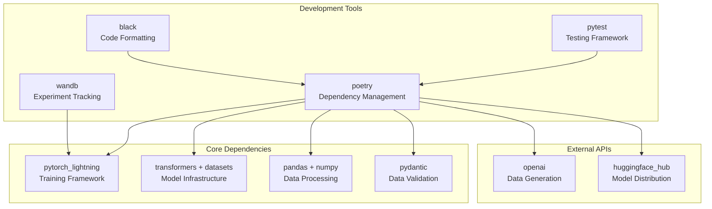
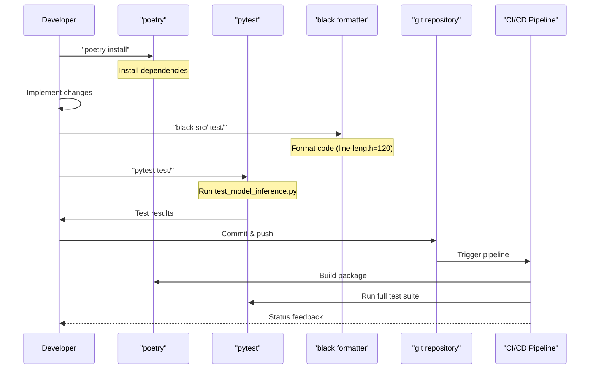
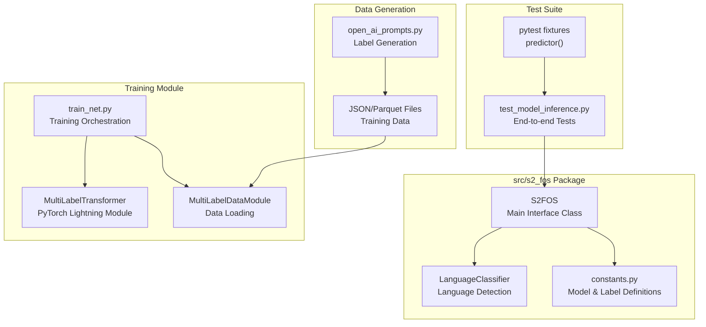
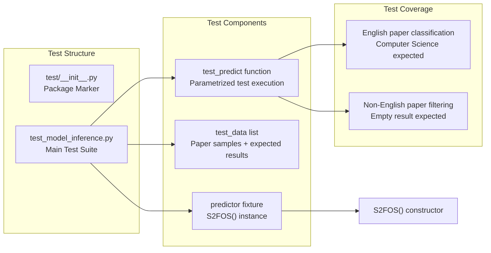

<!-- source: DeepWiki mcp.deepwiki.com · repo allenai/s2_fos · page 5 Development · fetched 2026-10-26 -->

# Development

<details>
<summary>Relevant source files</summary>

The following files were used as context for generating this wiki page:

- [pyproject.toml](pyproject.toml)
- [test/__init__.py](test/__init__.py)
- [test/test_model_inference.py](test/test_model_inference.py)

</details>


This document provides guidance for developers working on or extending the s2_fos system. It covers the development environment setup, code architecture patterns, testing framework, and contribution workflow. For specific configuration details, see [Project Configuration](#5.1). For testing procedures, see [Testing](#5.2). For package organization details, see [Package Structure](#5.3).

## Development Environment Overview

The s2_fos project uses a modern Python development stack centered around Poetry for dependency management and packaging. The system is designed as a machine learning pipeline with clear separation between inference, training, and data generation components.

### Development Stack



**Development Dependencies**
Sources: [pyproject.toml:14-31]()

## Development Workflow

The development process follows a standard machine learning project pattern with separate pipelines for data generation, model training, and inference deployment.

### Code Development Cycle



**Workflow Components**
Sources: [pyproject.toml:43-52](), [test/test_model_inference.py:1-45]()

## Code Architecture for Developers

The system follows a modular architecture with clear interfaces between components. Understanding these patterns is essential for extending the system.

### Core Component Interaction



**Key Development Patterns**
Sources: [test/test_model_inference.py:7-9](), [pyproject.toml:10-12]()

### Testing Architecture

The testing framework uses pytest with modular fixtures and parametrized tests to ensure system reliability.



**Test Execution Pattern**
Sources: [test/test_model_inference.py:6-44](), [pyproject.toml:43-49]()

## Development Configuration

### Project Metadata and Dependencies

| Configuration | Value | Purpose |
|---------------|--------|---------|
| Package Name | `s2_fos` | Main package identifier |
| Version | `0.0.2` | Current release version |
| Python Version | `^3.8` | Minimum Python requirement |
| Source Location | `src/s2_fos` | Package source directory |
| Test Directory | `tests/` | Pytest test discovery path |
| Code Style | Black (120 char line length) | Formatting standard |

**Configuration Management**
Sources: [pyproject.toml:1-12](), [pyproject.toml:43-52]()

### Development Commands

```bash
# Environment setup
poetry install                    # Install all dependencies
poetry install --only dev        # Install only dev dependencies

# Code quality
black src/ test/                 # Format code (120 char limit)
pytest test/                     # Run test suite

# Package management  
poetry build                     # Build distribution packages
poetry publish                   # Publish to PyPI
```

**Command Reference**
Sources: [pyproject.toml:28-31](), [pyproject.toml:51-52]()

## Extension Points

### Adding New Field of Study Categories

1. Update `constants.py` with new label definitions
2. Modify training data generation in `open_ai_prompts.py`
3. Retrain model using `train_net.py`
4. Update test cases in `test_model_inference.py`

### Integrating New Language Models

1. Add model dependencies to `pyproject.toml`
2. Implement new classifier in the core package
3. Update `S2FOS` class to support new models
4. Add comprehensive test coverage

### Custom Training Configurations

1. Extend `MultiLabelTransformer` with new loss functions
2. Add configuration options to `train_net.py`
3. Integrate with WandB for experiment tracking
4. Update data loading pipeline as needed

**Development Patterns**
Sources: [pyproject.toml:14-27](), [test/test_model_inference.py:13-37]()

---

