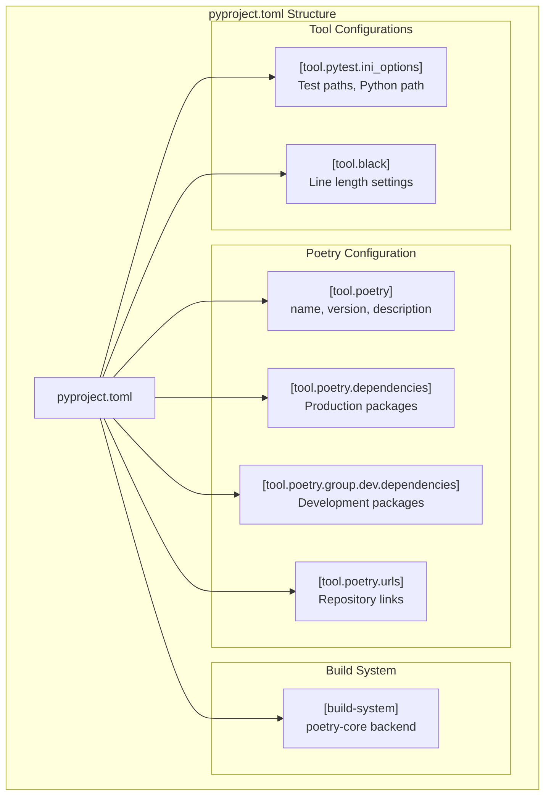
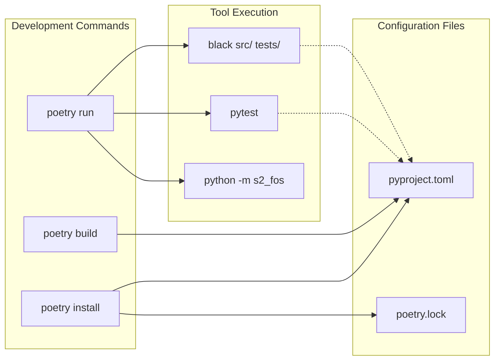

<!-- source: DeepWiki mcp.deepwiki.com · repo allenai/s2_fos · page 5.1 Project Configuration · fetched 2026-10-26 -->

# Project Configuration

<details>
<summary>Relevant source files</summary>

The following files were used as context for generating this wiki page:

- [pyproject.toml](pyproject.toml)

</details>


This document covers the project configuration for the s2_fos system, including package metadata, dependency management, build system setup, and development tooling configuration. The configuration is managed through Poetry and defined in the `pyproject.toml` file.

For information about testing procedures and test suite organization, see [Testing](#5.2). For details about the overall package structure and module organization, see [Package Structure](#5.3).

## Project Metadata

The s2_fos project is configured as a Python package with the following core metadata:

| Property | Value |
|----------|-------|
| Package Name | `s2_fos` |
| Version | `0.0.2` |
| Description | S2FOS: Field of Study Classification for Scholarly Documents |
| License | Apache-2.0 |
| Authors | Allen Institute for Artificial Intelligence |
| Python Version | ^3.8 |

The package structure is organized with source code located in `src/s2_fos/`, following Python packaging best practices defined in [pyproject.toml:10-12]().

**Dependency Architecture Overview**

```mermaid
graph TB
    subgraph "Core ML Dependencies"
        pytorch_lightning["pytorch_lightning"]
        transformers["transformers"] 
        scikit_learn["scikit-learn"]
        datasets["datasets"]
    end
    
    subgraph "Data Processing"
        pandas["pandas"]
        numpy["numpy"]
    end
    
    subgraph "Model & API Integration"
        huggingface_hub["huggingface_hub"]
        openai["openai"]
        wandb["wandb"]
    end
    
    subgraph "Language & Configuration"
        pycld2["pycld2"]
        pydantic["pydantic"]
        pydantic_settings["pydantic-settings"]
    end
    
    subgraph "Development Tools"
        black["black"]
        pytest["pytest"]
    end
    
    subgraph "S2FOS Components"
        S2FOS_Interface["S2FOS Class"]
        LanguageClassifier["LanguageClassifier"]
        train_net["train_net.py"]
        MultiLabelTransformer["MultiLabelTransformer"]
    end
    
    %% Core ML connections
    transformers --> S2FOS_Interface
    transformers --> train_net
    pytorch_lightning --> MultiLabelTransformer
    scikit_learn --> train_net
    datasets --> train_net
    
    %% Data processing connections
    pandas --> train_net
    numpy --> S2FOS_Interface
    
    %% Model integration connections
    huggingface_hub --> S2FOS_Interface
    huggingface_hub --> train_net
    openai --> train_net
    wandb --> train_net
    
    %% Language and config connections
    pycld2 --> LanguageClassifier
    pydantic --> S2FOS_Interface
    pydantic_settings --> train_net
    
    %% Development connections
    black --> S2FOS_Interface
    black --> train_net
    pytest --> S2FOS_Interface
```



Sources: [pyproject.toml:14-31]()

## Dependency Management

The project uses Poetry for dependency management with dependencies categorized into production and development groups.

### Production Dependencies

The production dependencies support the core functionality across different system components:

| Dependency | Purpose | Related Components |
|------------|---------|-------------------|
| `transformers` | SciBERT model loading and tokenization | S2FOS class, training pipeline |
| `pytorch_lightning` | Training framework and model management | MultiLabelTransformer, train_net.py |
| `huggingface_hub` | Model repository integration | Model loading, caching |
| `datasets` | Training data management | Data preprocessing pipeline |
| `pandas` | Data manipulation and processing | Training data handling |
| `scikit-learn` | ML utilities and metrics | Model evaluation, preprocessing |
| `openai` | API integration for data generation | Training data creation |
| `wandb` | Experiment tracking and logging | Training monitoring |
| `pycld2` | Language detection | LanguageClassifier component |
| `pydantic` | Data validation and settings | Configuration management |
| `numpy` | Numerical computations | Array operations |
| `black` | Code formatting | Development workflow |

### Development Dependencies

Development dependencies are defined in a separate group [pyproject.toml:30-31]():

- `pytest`: Testing framework for unit and integration tests

**Configuration File Structure**



Sources: [pyproject.toml:1-52]()

## Build System Configuration

The project uses Poetry's modern build system with the following configuration [pyproject.toml:33-35]():

- **Build Backend**: `poetry.core.masonry.api`
- **Build Requirements**: `poetry-core>=1.0.0`

This configuration enables standard Python packaging workflows including:
- Source distribution creation
- Wheel building
- Dependency resolution
- Virtual environment management

## Project URLs and Links

The project configuration includes several important URLs for project resources [pyproject.toml:37-41]():

| URL Type | Address |
|----------|---------|
| Homepage | https://www.github.com/allenai/s2_fos |
| Repository | https://www.github.com/allenai/s2_fos |
| Bug Tracker | https://www.github.com/allenai/s2_fos/issues |
| Blog Post | https://blog.allenai.org/announcing-s2fos-an-open-source-academic-field-of-study-classifier-9d2f641949e5 |

## Testing Configuration

The pytest configuration is embedded within the `pyproject.toml` file [pyproject.toml:43-49]():

```toml
[tool.pytest.ini_options]
testpaths = ["tests"]
pythonpath = ["src"]
```

This configuration:
- Sets the test discovery path to the `tests/` directory
- Adds `src/` to the Python path for proper import resolution during testing
- Enables pytest to locate and import the `s2_fos` package from the source directory

## Code Formatting Configuration

Black code formatter is configured with project-specific settings [pyproject.toml:51-52]():

```toml
[tool.black]
line-length = 120
```

This extends the default line length from 88 to 120 characters, accommodating longer lines common in machine learning code with extensive parameter lists and model configurations.

**Development Workflow Integration**



Sources: [pyproject.toml:30-31](), [pyproject.toml:43-49](), [pyproject.toml:51-52]()

---

