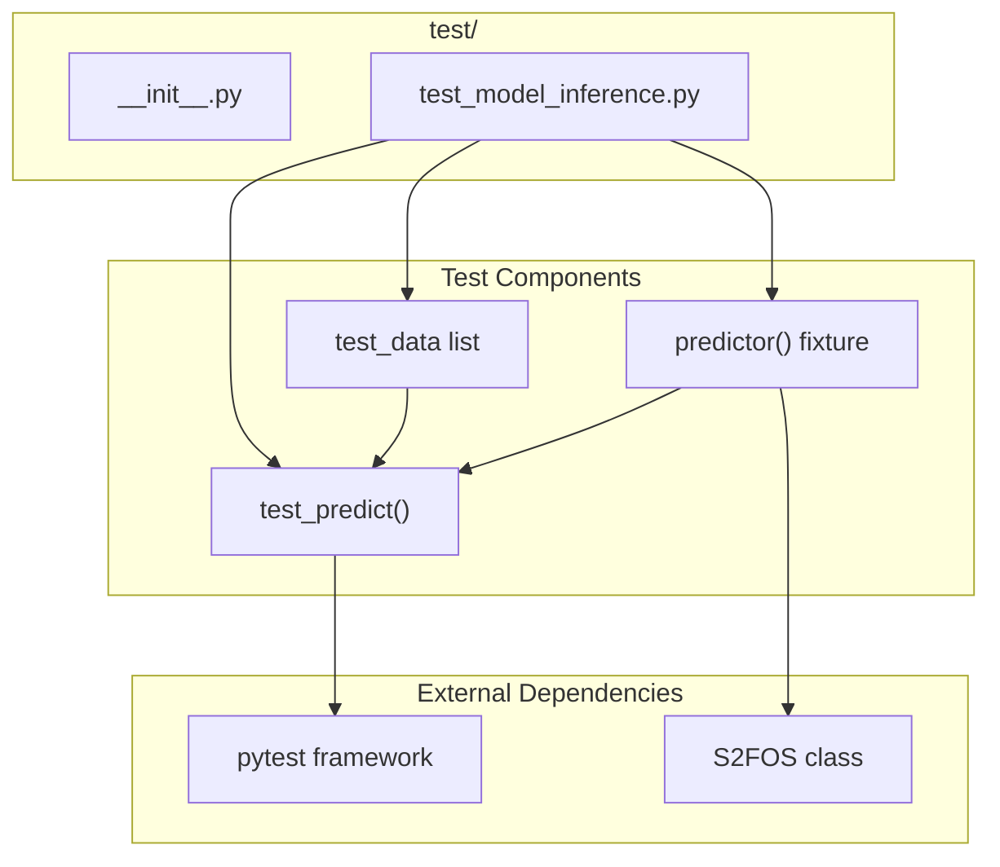
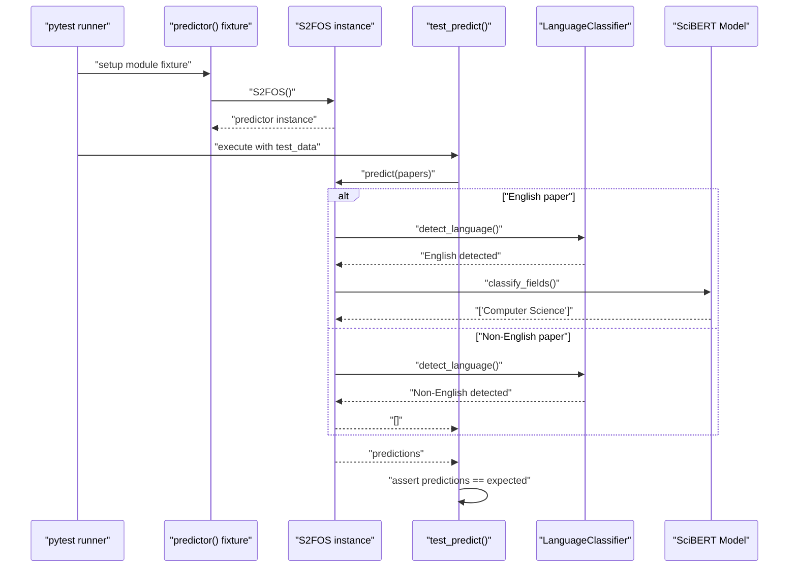

<!-- source: DeepWiki mcp.deepwiki.com · repo allenai/s2_fos · page 5.2 Testing · fetched 2026-10-26 -->

# Testing

<details>
<summary>Relevant source files</summary>

The following files were used as context for generating this wiki page:

- [test/__init__.py](test/__init__.py)
- [test/test_model_inference.py](test/test_model_inference.py)

</details>


This document covers the test suite for the s2_fos system, including the testing framework, test structure, and execution procedures. The tests validate core inference functionality and ensure proper handling of different input types and languages.

For information about development environment setup, see [Project Configuration](#5.1). For details about the core system being tested, see [Core System](#3).

## Test Framework Overview

The s2_fos system uses pytest as its primary testing framework. The test suite focuses on validating model inference capabilities and ensuring proper integration between system components.

The testing architecture centers around the `S2FOS` class interface, testing its ability to correctly classify academic papers and handle edge cases like non-English content.

### Test Organization



*Sources: [test/test_model_inference.py:1-45]()*

## Test Structure and Components

### Pytest Fixtures

The test suite employs a module-scoped fixture to initialize the S2FOS predictor:

| Fixture | Scope | Purpose |
|---------|-------|---------|
| `predictor()` | module | Creates a single S2FOS instance for all tests in the module |

The fixture ensures efficient resource usage by reusing the same predictor instance across multiple test cases, avoiding repeated model loading overhead.

### Test Data Configuration

The test suite includes parametrized test data covering multiple scenarios:

| Test Case | Language | Expected Behavior |
|-----------|----------|-------------------|
| English NER Paper | English | Returns `[['Computer Science']]` |
| Russian Encyclopedia | Russian | Returns `[[]]` (empty due to language filtering) |

The test data structure follows the expected input format for the `S2FOS.predict()` method, with papers containing `title`, `abstract`, `journal_name`, and `venue_name` fields.

*Sources: [test/test_model_inference.py:6-37]()*

## Test Execution Flow

The following diagram illustrates how test execution flows through the system components:



*Sources: [test/test_model_inference.py:8-44]()*

## Test Implementation Details

### Parametrized Testing

The test suite uses pytest's parametrization feature to run the same test logic against multiple input scenarios:

```python
@pytest.mark.parametrize("papers, expected", test_data)
def test_predict(predictor, papers, expected):
```

This approach ensures comprehensive coverage while maintaining clean, readable test code.

### Assertion Strategy

Tests validate the `fields_of_study_predicted` key in the returned prediction dictionary:

```python
assert predictions['fields_of_study_predicted'] == expected
```

The assertion checks that the system correctly identifies field classifications for English papers and returns empty results for non-English content.

*Sources: [test/test_model_inference.py:41-44]()*

## Running Tests

### Local Execution

To execute the test suite locally, use the following pytest command from the project root:

```bash
pytest test/
```

For verbose output including test names and results:

```bash
pytest -v test/
```

### Test Coverage

The current test suite focuses on:

- **Model Inference**: Validates the core `S2FOS.predict()` functionality
- **Language Filtering**: Ensures non-English papers are properly filtered
- **Field Classification**: Verifies correct field of study predictions for English academic papers
- **Integration Testing**: Tests the complete pipeline from input to prediction output

### Test Data Requirements

Tests require:
- Network connectivity for downloading pre-trained models (FastText, SciBERT)
- Sufficient memory for model loading
- Access to Hugging Face Hub for model weights

*Sources: [test/test_model_inference.py:1-45]()*

## Test Limitations and Future Enhancements

The current test suite provides basic functionality validation but could be expanded to include:

- **Performance Testing**: Response time and memory usage validation
- **Error Handling**: Testing invalid inputs and edge cases
- **Model Accuracy**: Validation against known benchmark datasets
- **Configuration Testing**: Testing different model configurations and thresholds

The existing test framework provides a solid foundation for these future enhancements while ensuring core functionality remains validated during development.

*Sources: [test/test_model_inference.py:36-37]()*

---

