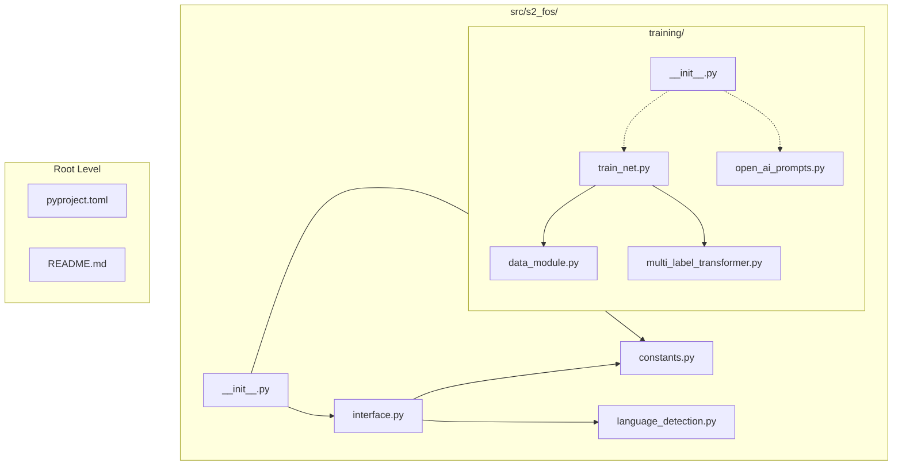
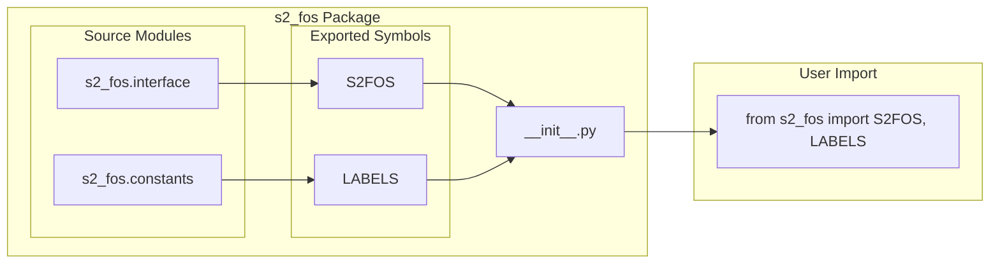
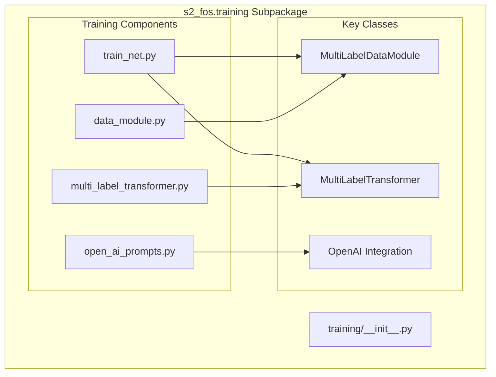
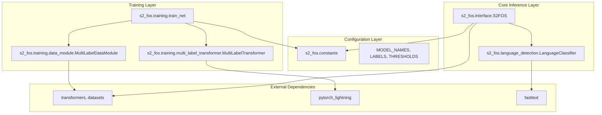

<!-- source: DeepWiki mcp.deepwiki.com · repo allenai/s2_fos · page 5.3 Package Structure · fetched 2026-10-26 -->

# Package Structure

Relevant source files

The following files were used as context for generating this wiki page:

- [src/s2_fos/__init__.py](src/s2_fos/__init__.py)
- [src/s2_fos/training/__init__.py](src/s2_fos/training/__init__.py)

This document provides a comprehensive overview of the Python package organization for the s2_fos system, detailing module interfaces, import relationships, and subpackage structure. For information about project configuration and dependencies, see [Project Configuration](#5.1). For details about testing the package components, see [Testing](#5.2).

## Package Organization

The s2_fos package follows a hierarchical structure that separates core functionality from training components, providing clear interfaces for both end-users and developers extending the system.

### Package Layout

Sources: [src/s2_fos/__init__.py:1-5](), [src/s2_fos/training/__init__.py:1]()

## Main Package Exports

The primary package interface exposes two key symbols through its `__init__.py` file, providing a clean API for end-users while keeping internal implementation details encapsulated.

### Public API Interface

The main package exports are defined in the `__all__` list:

| Symbol | Source Module | Purpose |
|--------|---------------|---------|
| `S2FOS` | `s2_fos.interface` | Primary inference interface class |
| `LABELS` | `s2_fos.constants` | Field of study label definitions |

Sources: [src/s2_fos/__init__.py:1-4]()

## Subpackage Structure

### Training Subpackage

The `s2_fos.training` subpackage contains all components related to model training, data generation, and fine-tuning workflows. This separation ensures that training dependencies do not affect the core inference functionality.

The training subpackage currently has an empty `__init__.py` file, indicating that components are accessed through direct module imports rather than package-level exports.

Sources: [src/s2_fos/training/__init__.py:1]()

## Module Dependencies

### Core Module Relationships

The package implements a layered dependency structure where higher-level modules depend on lower-level utilities and constants, while maintaining separation between inference and training concerns.

### Import Patterns

The package follows these import conventions:

- **Public API**: Users import from the main package: `from s2_fos import S2FOS, LABELS`
- **Internal Components**: Direct module imports for internal use: `from s2_fos.interface import S2FOS`
- **Training Components**: Explicit subpackage imports: `from s2_fos.training.train_net import main`

Sources: [src/s2_fos/__init__.py:1-2]()

## Package Design Principles

### Separation of Concerns

The package structure implements clear separation between:

1. **Inference Components** (`s2_fos.*`): Core prediction functionality with minimal dependencies
2. **Training Components** (`s2_fos.training.*`): Model development tools with heavier dependencies
3. **Constants and Configuration** (`s2_fos.constants`): Shared configuration across components

### Interface Stability

The main package exports (`S2FOS` and `LABELS`) provide a stable public API, while internal module organization can evolve without breaking user code. The training subpackage maintains flexibility for development workflows without impacting production inference code.

Sources: [src/s2_fos/__init__.py:4]()

---

