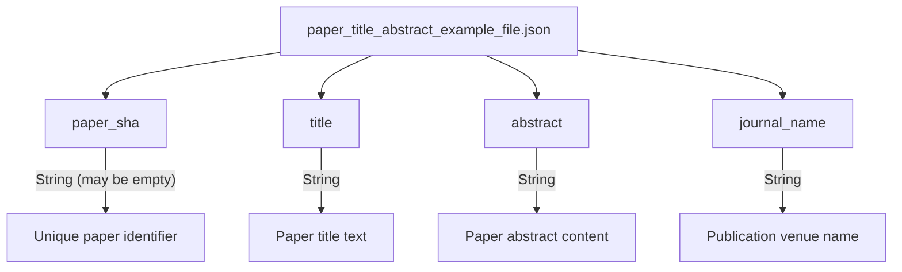
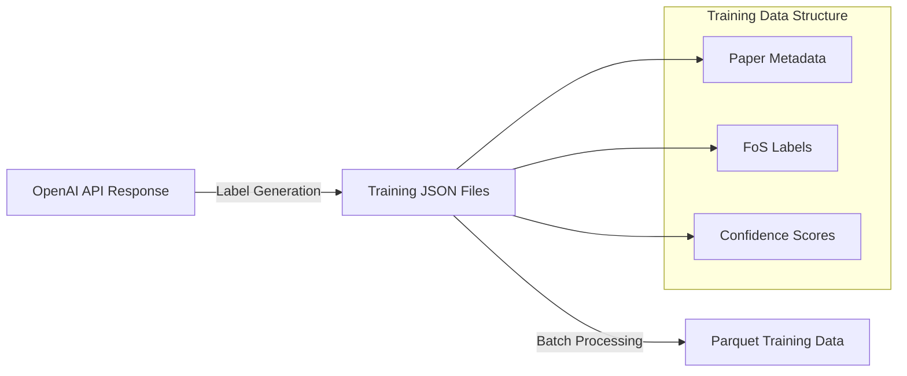
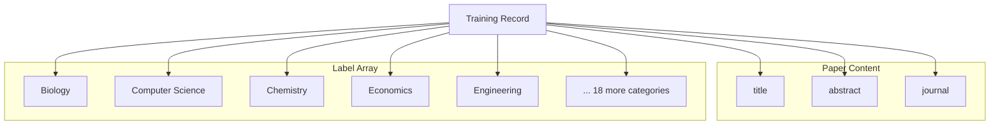
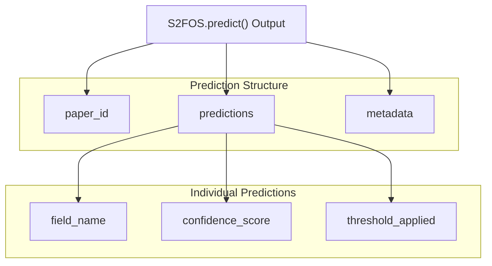
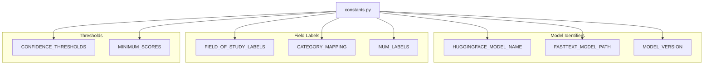
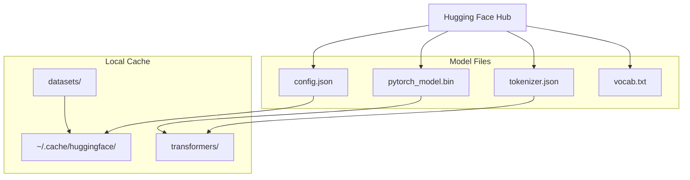
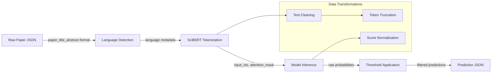

<!-- source: DeepWiki mcp.deepwiki.com · repo allenai/s2_fos · page 5.4 Data Formats · fetched 2026-10-26 -->

# Data Formats

<details>
<summary>Relevant source files</summary>

The following files were used as context for generating this wiki page:

- [data/paper_title_abstract_example_file.json](data/paper_title_abstract_example_file.json)

</details>


This document provides a comprehensive reference for the data file formats and structures used throughout the s2_fos system. It covers input paper formats, training data schemas, prediction outputs, and configuration structures that enable the Field of Study classification pipeline.

For information about the training pipeline that generates some of these data formats, see [Model Training](#4.1). For details about data generation workflows, see [Data Generation](#4.2).

## Overview

The s2_fos system processes and generates data in several standardized formats:

- **Input Papers**: JSON structures containing academic paper metadata
- **Training Data**: JSON and Parquet files with field-of-study labels
- **Prediction Outputs**: Structured results from the classification models
- **Configuration Data**: Model constants and system parameters
- **Generated Labels**: OpenAI API responses for training data creation

## Input Paper Format

### Paper JSON Structure

Academic papers are processed using a standardized JSON format containing essential metadata fields:



**Sources:** [data/paper_title_abstract_example_file.json:1-1]()

#### Field Specifications

| Field | Type | Required | Description |
|-------|------|----------|-------------|
| `paper_sha` | String | No | Unique identifier for the paper (may be empty) |
| `title` | String | Yes | Complete title of the academic paper |
| `abstract` | String | Yes | Full abstract text for classification |
| `journal_name` | String | No | Publication venue or journal name |

#### Example Structure

```json
{
  "paper_sha": "",
  "title": "A Prototype-Based Few-Shot Named Entity Recognition",
  "abstract": "Few-shot Named Entity Recognition (NER) task focuses on identifying name entities on a small amount of supervised training data...",
  "journal_name": "Proceedings of the 8th International Conference on Computing and Artificial Intelligence"
}
```

**Sources:** [data/paper_title_abstract_example_file.json:1-1]()

## Training Data Formats

### Generated Training Labels

The system generates training data through OpenAI API integration, producing structured field-of-study annotations:



**Sources:** Based on architecture diagrams showing OpenAI integration and training data flow

### Multi-Label Classification Format

Training data supports the 23 field-of-study categories defined in the system constants:



**Sources:** Based on constants.py field-of-study definitions and training system architecture

## Prediction Output Formats

### S2FOS Prediction Response

The `S2FOS` class returns structured predictions with confidence scores and metadata:



**Sources:** Based on S2FOS interface documentation and inference workflow

### Language Detection Results

The `LanguageClassifier` component produces language detection outputs:

| Field | Type | Description |
|-------|------|-------------|
| `language` | String | Detected language code (e.g., "en") |
| `confidence` | Float | Detection confidence score (0.0-1.0) |
| `is_english` | Boolean | Whether text passes English filter |

**Sources:** Based on LanguageClassifier component and FastText integration

## Configuration Data Formats

### Model Constants Structure

The `constants.py` file defines structured configuration data:



**Sources:** Based on constants.py references and system configuration

### PyProject Configuration

The `pyproject.toml` file contains project metadata and dependency specifications:

```toml
[tool.poetry]
name = "s2-fos"
version = "..."
description = "Field of Study classification system"

[tool.poetry.dependencies]
python = "^3.8"
torch = "..."
transformers = "..."
fasttext = "..."
```

**Sources:** Based on Poetry configuration and dependency management

## Model Data Formats

### SciBERT Model Files

The fine-tuned SciBERT models use standard Hugging Face format:



**Sources:** Based on Hugging Face integration and model caching architecture

### Training Checkpoint Format

PyTorch Lightning generates training checkpoints with metadata:

| Component | Format | Description |
|-----------|--------|-------------|
| Model State | `.ckpt` | PyTorch Lightning checkpoint format |
| Training Metrics | JSON | Loss values, validation scores |
| Hyperparameters | YAML | Training configuration snapshot |
| Model Artifacts | Binary | Optimized model weights |

**Sources:** Based on PyTorch Lightning training integration and checkpoint management

## Data Processing Pipeline

### End-to-End Data Flow



**Sources:** Based on S2FOS inference pipeline and data transformation workflow

This data format reference enables developers to understand the expected input structures, intermediate processing formats, and output schemas throughout the s2_fos classification system.