# Page: Overview

# Overview

<details>
<summary>Relevant source files</summary>

The following files were used as context for generating this wiki page:

- [.gitignore](.gitignore)
- [README.md](README.md)

</details>


This document provides a high-level overview of the s2_fos system, its architecture, and core components. The s2_fos system is a Field of Study (FoS) classification system designed to predict academic research categories for scholarly papers using machine learning models.

For detailed usage instructions and installation, see [Getting Started](#2). For information about the main inference interface, see [S2FOS Interface](#3.1). For model training procedures, see [Training System](#4).

## Purpose and Scope

The s2_fos system serves as Semantic Scholar's Field of Study classifier, designed to automatically categorize academic papers into predefined research domains. The system processes paper metadata (title, abstract, journal) and outputs probability scores across 23 field of study categories such as Computer Science, Biology, Mathematics, etc.

The system implements a two-stage classification pipeline:
1. **Language Detection**: Filters papers to English-only using FastText language identification
2. **Field Classification**: Applies a fine-tuned SciBERT model to predict field of study categories

**Sources:** [README.md:1-8]()

## System Architecture

The s2_fos system consists of three primary subsystems that work together to provide field of study classification capabilities:

### High-Level System Components

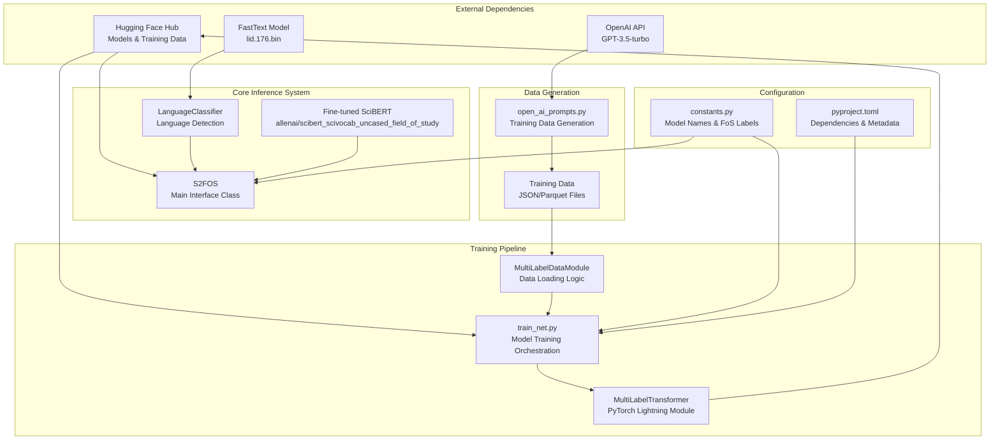

**Sources:** [README.md:44-67](), [README.md:113-145]()

### Core Data Flow

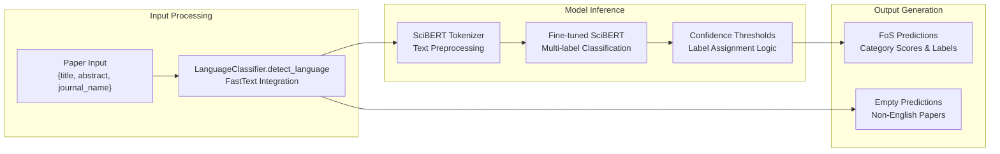

**Sources:** [README.md:6-8](), [README.md:68-95]()

## Key Components

### Primary Interface Components

| Component | File Location | Purpose |
|-----------|---------------|---------|
| `S2FOS` | `src/s2_fos/s2_fos.py` | Main prediction interface class |
| `LanguageClassifier` | `src/s2_fos/language_classifier.py` | Language detection using FastText |
| `constants.py` | `src/s2_fos/constants.py` | Model identifiers and FoS label definitions |

### Training Components

| Component | File Location | Purpose |
|-----------|---------------|---------|
| `train_net.py` | `src/s2_fos/training/train_net.py` | Training orchestration script |
| `MultiLabelTransformer` | Training modules | PyTorch Lightning training logic |
| `open_ai_prompts.py` | `src/s2_fos/training/open_ai_prompts.py` | OpenAI API data generation |

**Sources:** [README.md:113-145]()

## External Dependencies

The system relies on several external services and models:

### Model Dependencies
- **SciBERT Model**: `allenai/scibert_scivocab_uncased_field_of_study` hosted on Hugging Face Hub
- **FastText Language Model**: `lid.176.bin` for language identification  
- **Training Data**: `allenai/fos_model_training_data_open_ai_annotations` dataset on Hugging Face

### API Dependencies  
- **OpenAI API**: GPT-3.5-turbo for generating training data labels
- **Hugging Face Hub**: Model hosting and dataset distribution

**Sources:** [README.md:44-67](), [README.md:37-42]()

## Inference Workflow

The main prediction workflow follows this sequence:

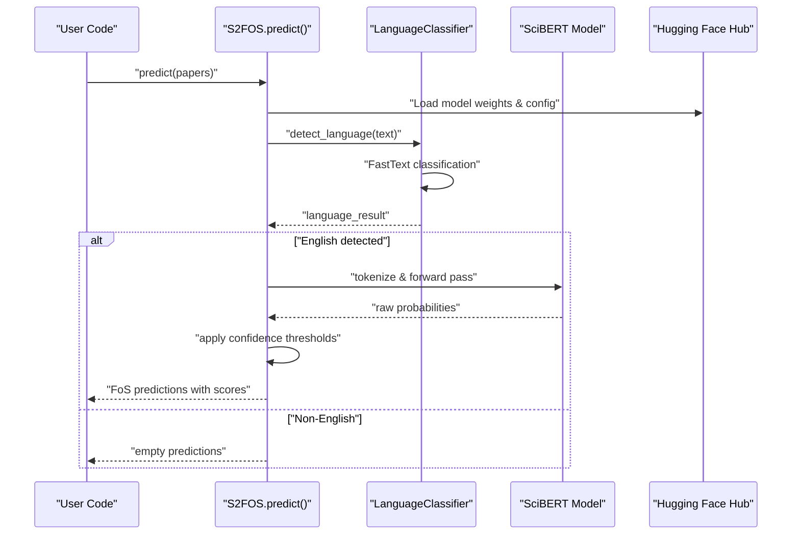

**Sources:** [README.md:6-8](), [README.md:68-95]()

## Field of Study Categories

The system predicts across 23 predefined field of study categories. Each prediction includes both binary labels and confidence scores, allowing users to filter results based on confidence thresholds.

For detailed information about the specific categories and their definitions, see [Constants and Labels](#3.3).

**Sources:** [README.md:4-5]()

## Development and Training

The repository supports both inference and model development workflows:

- **Inference**: Production-ready classification through the `S2FOS` interface
- **Training**: Model fine-tuning capabilities via `train_net.py` with PyTorch Lightning
- **Data Generation**: OpenAI API integration for creating training datasets

For comprehensive development setup instructions, see [Development](#5). For training procedures and configuration options, see [Training System](#4).

**Sources:** [README.md:97-145]()

---

# Page: Getting Started

# Getting Started

<details>
<summary>Relevant source files</summary>

The following files were used as context for generating this wiki page:

- [.gitignore](.gitignore)
- [README.md](README.md)
- [src/s2_fos/interface.py](src/s2_fos/interface.py)

</details>


This document provides installation instructions, prerequisite setup, and basic usage examples for the s2_fos Field of Study classification system. It covers the essential steps to get the system running and performing inference on academic papers.

For detailed documentation of the S2FOS interface and prediction methods, see [S2FOS Interface](#3.1). For information about training models or generating training data, see [Training System](#4). For development environment setup and project configuration, see [Development](#5).

## Overview

The s2_fos system classifies academic papers into field of study categories using a fine-tuned SciBERT model. The system performs language detection first, then applies field of study classification only to English papers.

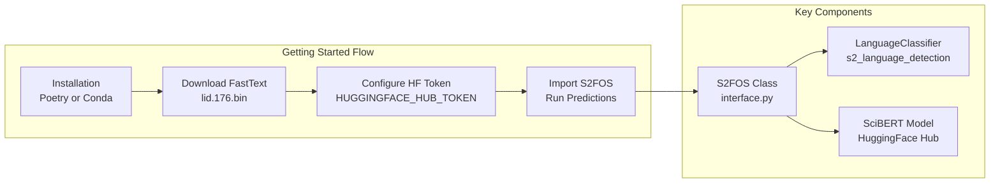

Sources: [README.md:1-68](), [src/s2_fos/interface.py:90-118]()

## Installation

### Method 1: Poetry (Recommended)

Poetry provides better dependency management and virtual environment isolation:

```bash
git clone https://github.com/allenai/s2_fos.git
cd s2_fos
# Install poetry
curl -sSL https://install.python-poetry.org | python3 -
poetry install
# Activate the virtual environment
poetry shell
# Due to the non-compliance of fasttext with PEP 518, 
# we need to install it manually
pip install fasttext
```

### Method 2: Anaconda

Alternative installation using conda environment:

```bash
git clone https://github.com/allenai/s2_fos.git
cd s2_fos
conda create -y --name s2fos python==3.8
conda activate s2fos
pip install -e .
pip install fasttext
```

**Note**: FastText requires manual installation due to PEP 518 non-compliance issues with both installation methods.

Sources: [README.md:9-35]()

## Prerequisites Setup

### FastText Language Detection Model

Download the required language identification model:

```bash
# Download the Language identification model from fasttext
cd data && wget https://dl.fbaipublicfiles.com/fasttext/supervised-models/lid.176.bin
```

This model is used by the `LanguageClassifier` component to filter non-English papers before field of study classification.

### Hugging Face Authentication

The system requires access to protected models and datasets on Hugging Face Hub:

1. Create a [Hugging Face account](https://huggingface.co) if you don't have one
2. Generate [a Hugging Face token](https://huggingface.co/settings/tokens)
3. Accept license agreements for:
   - Model weights: [allenai/scibert_scivocab_uncased_field_of_study](https://huggingface.co/allenai/scibert_scivocab_uncased_field_of_study)
   - Training data: [allenai/fos_model_training_data_open_ai_annotations](https://huggingface.co/datasets/allenai/fos_model_training_data_open_ai_annotations)

4. Set the token as an environment variable:

```bash
export HUGGINGFACE_HUB_TOKEN=<your_token>
```

Or set it programmatically before importing:

```python
import os
os.environ['HUGGINGFACE_HUB_TOKEN'] = '<your_token>'
```

Sources: [README.md:37-66]()

## Basic Usage

### Inference Example

```python
from s2_fos import S2FOS

# Example paper data
# note that journal_name is just a convention - it can be any venue like NeurIPS, arxiv, etc
papers = [{
    'title': "A Prototype-Based Few-Shot Named Entity Recognition",
    'abstract': ("Few-shot Named Entity Recognition (NER) task focuses on identifying named entities with "
                 "a small amount of supervised training data. Work based on prototype networks shows "
                 "strong adaptability for the few-shot NER task. We believe that the core idea of these "
                 "approaches is to learn how to aggregate the representation of token mappings in vector "
                 "space around entity classes. However, to our knowledge, no work has investigated its "
                 "effect. Therefore, we propose ClusLoss and ProEuroLoss, aiming to enhance the model's "
                 "ability to aggregate semantic information spatially, thus helping the model "
                 "better distinguish between entity types. Experimental results show that ProEuroLoss achieves "
                 "state-of-the-art performance on average F1 scores for both 1-shot and 5-shot NER "
                 "tasks, while ClusLoss has competitive performance in such tasks."),
    'journal_name': "Proceedings of the 8th International Conference on Computing and Artificial Intelligence",
}]

# Initialize the predictor
predictor = S2FOS()

# Predict the fields of study
print(predictor.predict(papers))
```

### Expected Output Structure

The `predict` method returns a dictionary with two keys:

| Key | Type | Description |
|-----|------|-------------|
| `fields_of_study_predicted` | List[List[str]] | Field of study labels above threshold for each paper |
| `scores` | List[List[Dict]] | All field of study scores for each paper |

Sources: [README.md:68-95](), [src/s2_fos/interface.py:277-286]()

## Inference Pipeline Architecture

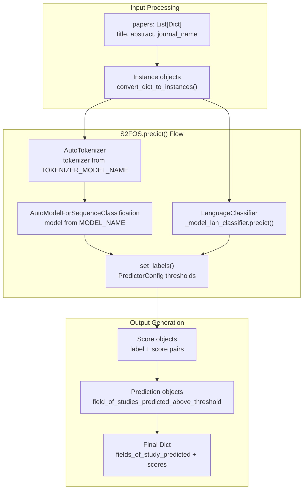

Sources: [src/s2_fos/interface.py:205-286](), [src/s2_fos/interface.py:90-118]()

## Verification

### Test the Installation

Run the test suite to verify everything is working correctly:

**With Poetry:**
```bash
poetry shell
poetry run pytest
```

**With Anaconda:**
```bash
pip install pytest
pytest test
```

### Validate Model Loading

Ensure the system can load models and perform basic inference:

```python
from s2_fos import S2FOS

# This should complete without errors
predictor = S2FOS()

# Test with minimal data
test_paper = [{'title': 'Test Paper', 'abstract': 'Test abstract'}]
result = predictor.predict(test_paper)
print(f"Prediction completed: {len(result['scores'][0])} field scores returned")
```

Sources: [README.md:97-110]()

## Key Configuration Classes

| Class | File | Purpose |
|-------|------|---------|
| `S2FOS` | [src/s2_fos/interface.py:90]() | Main inference interface |
| `Instance` | [src/s2_fos/interface.py:22]() | Input data model for papers |
| `Prediction` | [src/s2_fos/interface.py:57]() | Output prediction model |
| `PredictorConfig` | [src/s2_fos/interface.py:72]() | Threshold configuration |

Sources: [src/s2_fos/interface.py:22-89]()

## Next Steps

- **For detailed API documentation**: See [S2FOS Interface](#3.1) for comprehensive method documentation
- **For model training**: See [Training System](#4) to learn about fine-tuning SciBERT models
- **For development setup**: See [Development](#5) for contributing guidelines and project structure
- **For language detection details**: See [Language Detection](#3.2) for LanguageClassifier specifics

Sources: [README.md:112-145]()

---

# Page: Core System

# Core System

<details>
<summary>Relevant source files</summary>

The following files were used as context for generating this wiki page:

- [src/s2_fos/constants.py](src/s2_fos/constants.py)
- [src/s2_fos/interface.py](src/s2_fos/interface.py)

</details>


This document covers the main inference and prediction components of the s2_fos system. The core system handles the runtime classification of academic papers into Fields of Study categories, consisting of the primary inference interface, language detection, and model prediction logic.

For detailed information about training new models, see [Training System](#4). For setup and basic usage instructions, see [Getting Started](#2).

## System Overview

The core system implements a two-stage classification pipeline that first filters papers by language (English only) and then performs multi-label Field of Study classification using a fine-tuned SciBERT model. The system is designed around the `S2FOS` class which orchestrates language detection, text preprocessing, model inference, and threshold-based label assignment.

## Core Components

The core system consists of three primary components that work together to perform inference:

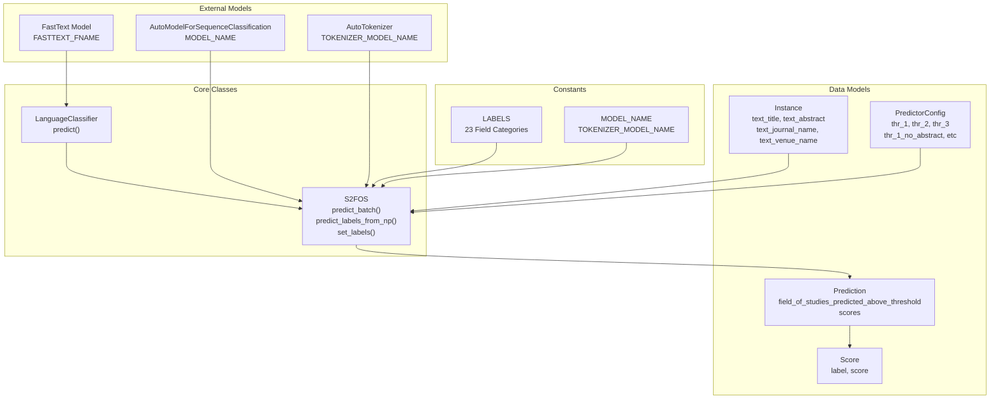

**Sources:** [src/s2_fos/interface.py:22-89](), [src/s2_fos/interface.py:90-118](), [src/s2_fos/constants.py:1-39]()

### Data Models

The system uses Pydantic models to define the interface contracts:

| Model | Purpose | Key Fields |
|-------|---------|------------|
| `Instance` | Input paper data | `text_title`, `text_abstract`, `text_journal_name`, `text_venue_name` |
| `Score` | Individual field prediction | `label`, `score` |
| `Prediction` | Complete prediction result | `field_of_studies_predicted_above_threshold`, `scores` |
| `PredictorConfig` | Threshold configuration | `thr_1`, `thr_2`, `thr_3` with abstract/no-abstract variants |

### Core Classes

- **`S2FOS`**: Main interface class that orchestrates the entire prediction pipeline
- **`LanguageClassifier`**: Handles language detection using FastText models
- **SciBERT Integration**: Uses Hugging Face transformers for the underlying classification model

## Prediction Pipeline

The core system implements a multi-stage prediction pipeline that processes academic papers through language detection, text preprocessing, model inference, and threshold-based filtering:

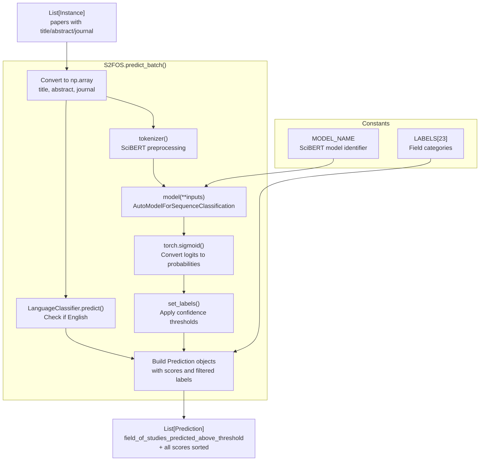

**Sources:** [src/s2_fos/interface.py:205-264](), [src/s2_fos/interface.py:176-203](), [src/s2_fos/interface.py:119-174]()

## Component Integration

The core system integrates multiple components through the `S2FOS` class constructor and prediction methods:

### Initialization Process

1. **Configuration Loading**: `PredictorConfig` loads threshold values from environment or defaults
2. **Language Model Setup**: `LanguageClassifier` initializes with FastText model 
3. **SciBERT Loading**: `AutoModelForSequenceClassification.from_pretrained()` loads the fine-tuned model
4. **Tokenizer Setup**: `AutoTokenizer.from_pretrained()` configures text preprocessing
5. **Device Management**: Automatic GPU/CPU detection and model placement

### Prediction Workflow

The `predict_batch()` method coordinates all components:

1. **Data Preparation**: Convert `Instance` objects to numpy arrays [src/s2_fos/interface.py:222-232]()
2. **Language Filtering**: Use `LanguageClassifier.predict()` to detect non-English papers [src/s2_fos/interface.py:233]()
3. **Model Inference**: Process through SciBERT tokenizer and model [src/s2_fos/interface.py:235]()
4. **Threshold Application**: Apply confidence thresholds via `set_labels()` [src/s2_fos/interface.py:236]()
5. **Result Assembly**: Build `Prediction` objects with filtered labels and all scores [src/s2_fos/interface.py:239-263]()

### Threshold Logic

The `set_labels()` method implements a multi-tier threshold system:

- **Tier 1**: Highest confidence prediction uses `thr_1` threshold
- **Tier 2**: Second through fifth predictions use `thr_2` threshold  
- **Tier 3**: Lower confidence predictions use `thr_3` threshold
- **Abstract-dependent**: Different thresholds for papers with/without abstracts

**Sources:** [src/s2_fos/interface.py:98-118](), [src/s2_fos/interface.py:119-174](), [src/s2_fos/interface.py:205-264](), [src/s2_fos/constants.py:5-31]()

---

# Page: S2FOS Interface

# S2FOS Interface

<details>
<summary>Relevant source files</summary>

The following files were used as context for generating this wiki page:

- [src/s2_fos/constants.py](src/s2_fos/constants.py)
- [src/s2_fos/interface.py](src/s2_fos/interface.py)

</details>


This document covers the `S2FOS` class, which serves as the primary interface for performing Field of Study classification on academic papers. The S2FOS interface handles model loading, text preprocessing, language detection, and inference orchestration to predict academic fields of study from paper metadata.

For information about the underlying language detection system, see [Language Detection](#3.2). For details about the constants and field of study labels used by this interface, see [Constants and Labels](#3.3).

## Overview

The `S2FOS` class in [src/s2_fos/interface.py:90-118]() provides the main entry point for field of study prediction. It integrates a fine-tuned SciBERT model with language detection to classify academic papers into 23 field of study categories.

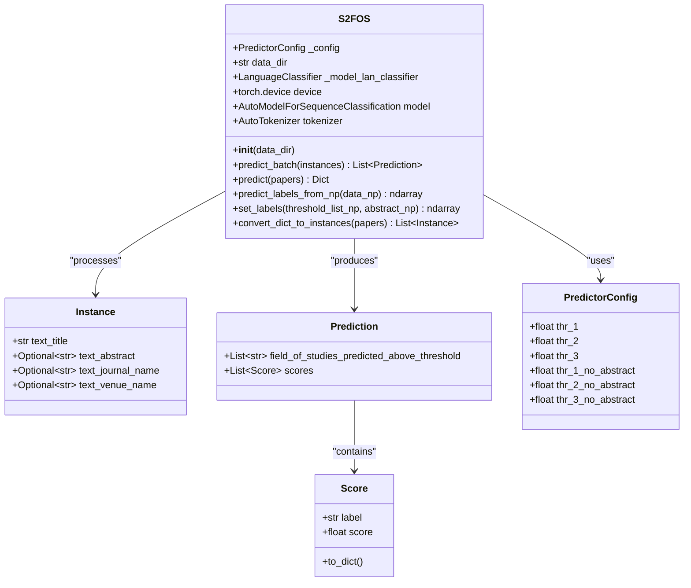

**Sources:** [src/s2_fos/interface.py:22-89](), [src/s2_fos/interface.py:90-118]()

## Data Models

The interface defines several Pydantic models to structure input and output data:

### Instance Model

The `Instance` class [src/s2_fos/interface.py:22-37]() represents input data for a single academic paper:

| Field | Type | Description | Required |
|-------|------|-------------|----------|
| `text_title` | `str` | Paper title | Yes |
| `text_abstract` | `Optional[str]` | Paper abstract | No |
| `text_journal_name` | `Optional[str]` | Journal name | No |
| `text_venue_name` | `Optional[str]` | Venue name | No |

### Score Model

The `Score` class [src/s2_fos/interface.py:39-55]() represents confidence scores for individual field of study predictions:

| Field | Type | Description |
|-------|------|-------------|
| `label` | `str` | Field of study name |
| `score` | `float` | Confidence score (0.0-1.0) |

### Prediction Model

The `Prediction` class [src/s2_fos/interface.py:57-70]() contains the complete prediction output:

| Field | Type | Description |
|-------|------|-------------|
| `field_of_studies_predicted_above_threshold` | `List[str]` | Fields predicted above confidence threshold |
| `scores` | `List[Score]` | All 23 field scores sorted by confidence |

**Sources:** [src/s2_fos/interface.py:22-70]()

## Prediction Workflow

The prediction process follows a multi-stage pipeline that processes input papers through language detection, text preprocessing, model inference, and threshold application:

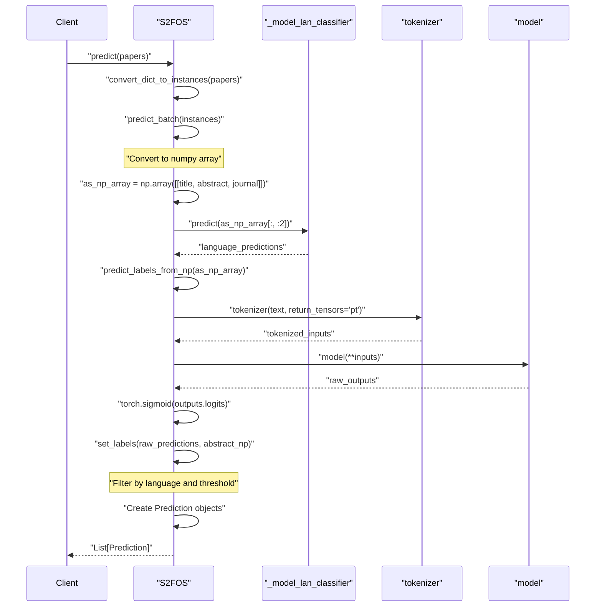

**Sources:** [src/s2_fos/interface.py:205-264](), [src/s2_fos/interface.py:277-286]()

## Configuration and Thresholds

The `PredictorConfig` class [src/s2_fos/interface.py:72-88]() manages confidence thresholds that determine which field of study predictions are considered positive. The system uses different thresholds based on prediction ranking and whether an abstract is present:

### Threshold Configuration

| Parameter | Default | Description |
|-----------|---------|-------------|
| `thr_1` | 0.552 | Threshold for top-ranked prediction (with abstract) |
| `thr_2` | 0.621 | Threshold for 2nd-5th ranked predictions (with abstract) |
| `thr_3` | 0.7 | Threshold for remaining predictions (with abstract) |
| `thr_1_no_abstract` | 0.621 | Threshold for top-ranked prediction (no abstract) |
| `thr_2_no_abstract` | 0.655 | Threshold for 2nd-5th ranked predictions (no abstract) |
| `thr_3_no_abstract` | 0.7 | Threshold for remaining predictions (no abstract) |

The `set_labels` method [src/s2_fos/interface.py:119-174]() applies these thresholds using a ranking-based approach where higher-ranked predictions (by confidence) use lower thresholds.

**Sources:** [src/s2_fos/interface.py:72-88](), [src/s2_fos/interface.py:119-174]()

## Core API Methods

### predict_batch

The `predict_batch` method [src/s2_fos/interface.py:205-264]() processes multiple `Instance` objects in a single batch:

1. Converts instances to numpy array format [src/s2_fos/interface.py:222-232]()
2. Performs language detection on title and abstract [src/s2_fos/interface.py:233]()
3. Generates raw probability predictions [src/s2_fos/interface.py:235]()
4. Applies confidence thresholds [src/s2_fos/interface.py:236]()
5. Filters non-English papers [src/s2_fos/interface.py:249-252]()
6. Returns sorted predictions [src/s2_fos/interface.py:254-263]()

### predict

The `predict` method [src/s2_fos/interface.py:277-286]() provides a dictionary-based interface that:

1. Converts dictionary inputs to `Instance` objects [src/s2_fos/interface.py:278]()
2. Calls `predict_batch` for inference
3. Returns results in dictionary format with `scores` and `fields_of_study_predicted` keys

### predict_labels_from_np

The `predict_labels_from_np` method [src/s2_fos/interface.py:176-203]() handles the core SciBERT inference:

1. Concatenates title, abstract, and journal with `sep_token` [src/s2_fos/interface.py:185-187]()
2. Tokenizes text with 128 token limit [src/s2_fos/interface.py:189-195]()
3. Runs model inference [src/s2_fos/interface.py:201]()
4. Applies sigmoid activation [src/s2_fos/interface.py:202]()

**Sources:** [src/s2_fos/interface.py:176-203](), [src/s2_fos/interface.py:205-264](), [src/s2_fos/interface.py:277-286]()

## Model Integration

The S2FOS interface integrates several external components during initialization [src/s2_fos/interface.py:98-118]():

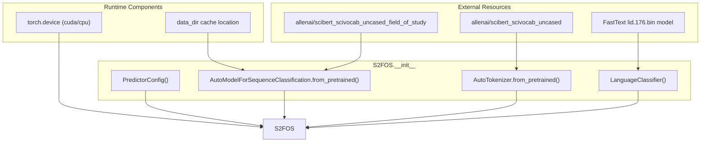

The initialization process loads:
- Configuration thresholds from environment variables or defaults
- Language classifier with FastText model
- Fine-tuned SciBERT model from Hugging Face Hub
- SciBERT tokenizer for text preprocessing
- Appropriate device (CUDA/CPU) for inference

**Sources:** [src/s2_fos/interface.py:98-118](), [src/s2_fos/constants.py:5](), [src/s2_fos/constants.py:38]()

---

# Page: Language Detection

# Language Detection

<details>
<summary>Relevant source files</summary>

The following files were used as context for generating this wiki page:

- [src/s2_language_detection/language_classifier.py](src/s2_language_detection/language_classifier.py)

</details>


This document covers the language detection component of the s2_fos system, which filters academic papers by language before Field of Study classification. The language detection system uses FastText models to identify the language of paper titles and abstracts, with special logic for prioritizing abstracts over titles.

For information about the main inference interface that uses language detection, see [S2FOS Interface](#3.1). For details about system constants and model paths, see [Constants and Labels](#3.3).

## System Overview

The language detection system serves as a preprocessing filter in the s2_fos pipeline, ensuring that only English-language papers proceed to Field of Study classification. The system is implemented through the `LanguageClassifier` class, which wraps a pre-trained FastText language identification model.

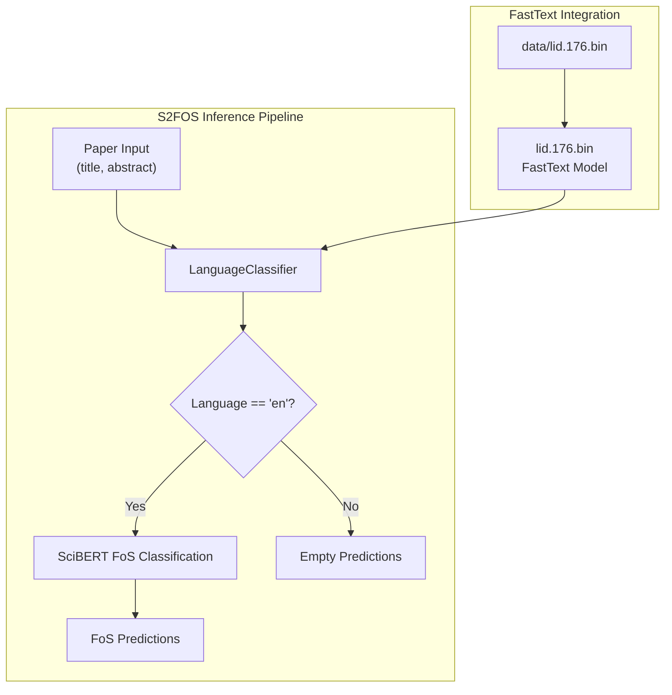

**Language Detection in S2FOS Pipeline**

Sources: [src/s2_language_detection/language_classifier.py:1-73]()

## LanguageClassifier Class

The `LanguageClassifier` class provides the core language detection functionality through a FastText-based implementation. The class handles model loading, text preprocessing, and language prediction with confidence scores.

### Initialization and Model Loading

The classifier loads the FastText model during initialization, with configurable data directory paths:

| Parameter | Type | Default | Description |
|-----------|------|---------|-------------|
| `data_dir` | `str` | `None` | Custom directory for FastText model file |

When `data_dir` is `None`, the model path defaults to `PROJECT_ROOT_PATH/../data/FASTTEXT_FNAME`. The system validates model file existence and raises `FileNotFoundError` with download instructions if the model is missing.

Sources: [src/s2_language_detection/language_classifier.py:12-25]()

### Core Methods

The `LanguageClassifier` exposes three main methods for language detection:

#### predict(input_array)
Batch prediction method for arrays of paper data, where each input contains title and abstract text pairs.

#### detect_language(text_title, text_abstract)
Primary detection method with intelligent text prioritization logic. The method prefers abstract text over title text when available and valid.

#### detect_language_single_entity(text)
Low-level detection for individual text strings, handling edge cases for short text and specific languages.

Sources: [src/s2_language_detection/language_classifier.py:27-72]()

## Language Detection Workflow

The language detection process follows a hierarchical approach, prioritizing different text sources based on content quality and availability.

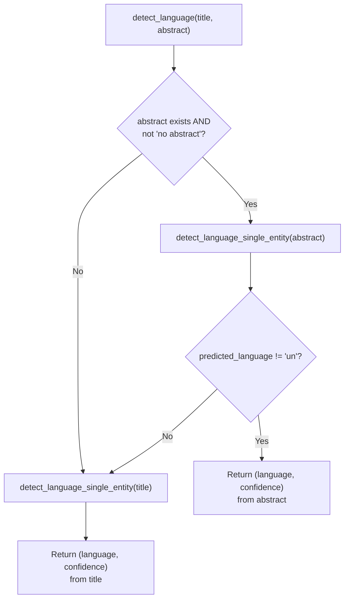

**Language Detection Decision Tree**

### Text Prioritization Logic

1. **Abstract First**: When abstracts are available and don't contain "no abstract", the system attempts detection on abstract text
2. **Fallback to Title**: If abstract detection returns "un" (uncertain) or no abstract exists, the system falls back to title detection
3. **Uncertain Handling**: Single-word texts (except Chinese/Japanese) return "un" with 0.0 confidence

Sources: [src/s2_language_detection/language_classifier.py:38-52]()

## FastText Integration

The language detection system integrates with the FastText library using the pre-trained `lid.176.bin` model for multi-language identification.

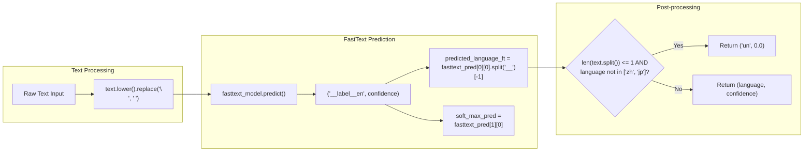

**FastText Processing Pipeline**

### Language Code Handling

The system processes FastText's `__label__` prefixed output to extract standard language codes. Special handling exists for Chinese (`zh`) and Japanese (`jp`) languages, which don't use whitespace for word separation.

### Confidence Scoring

FastText predictions include confidence scores (softmax probabilities) that the system returns alongside language predictions. Uncertain predictions receive a confidence score of 0.0.

Sources: [src/s2_language_detection/language_classifier.py:54-72]()

## Model Requirements

The language detection system requires the FastText language identification model `lid.176.bin`:

| Component | Requirement | Source |
|-----------|-------------|---------|
| Model File | `lid.176.bin` | https://fasttext.cc/docs/en/language-identification.html |
| Model Path | `{PROJECT_ROOT_PATH}/../data/lid.176.bin` | Configurable via `data_dir` parameter |
| Dependencies | `fasttext` Python package | Required for model loading and inference |

The system provides clear error messages with download instructions when the model file is missing, ensuring proper setup guidance for users.

Sources: [src/s2_language_detection/language_classifier.py:18-23]()

---

# Page: Constants and Labels

# Constants and Labels

<details>
<summary>Relevant source files</summary>

The following files were used as context for generating this wiki page:

- [src/s2_fos/constants.py](src/s2_fos/constants.py)

</details>


This page documents the central constants and labels used throughout the s2_fos system. These constants define model identifiers, field of study categories, file paths, and other system-wide configuration values that ensure consistency across the inference and training pipelines.

For information about how these constants are used in the main inference interface, see [S2FOS Interface](#3.1). For details about the training system configuration, see [Model Training](#4.1).

## Model Identifiers

The system relies on several pre-trained models from Hugging Face Hub, each identified by specific model names defined as constants.

| Constant | Value | Purpose |
|----------|-------|---------|
| `MODEL_NAME` | `"allenai/scibert_scivocab_uncased_field_of_study"` | Fine-tuned SciBERT model for field of study classification |
| `TOKENIZER_MODEL_NAME` | `"allenai/scibert_scivocab_uncased"` | Base SciBERT tokenizer for text preprocessing |
| `FASTTEXT_FNAME` | `"lid.176.bin"` | FastText language detection model filename |

### Model Identifier Usage Flow

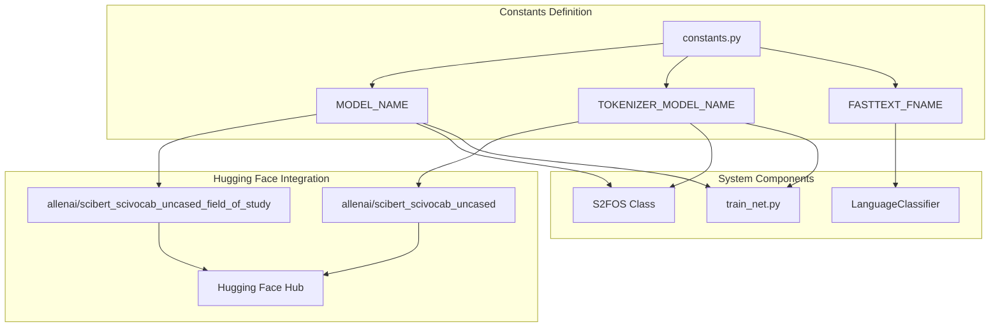

Sources: [src/s2_fos/constants.py:5](), [src/s2_fos/constants.py:38](), [src/s2_fos/constants.py:3]()

## Field of Study Labels

The system classifies academic papers into 23 predefined field of study categories. These labels are defined in the `LABELS` constant as an ordered list that corresponds to the model's output layer.

### Complete Label Set

The 23 field of study categories are:

| Index | Field of Study |
|-------|----------------|
| 0 | Agricultural and Food Sciences |
| 1 | Art |
| 2 | Biology |
| 3 | Business |
| 4 | Chemistry |
| 5 | Computer Science |
| 6 | Economics |
| 7 | Education |
| 8 | Engineering |
| 9 | Environmental Science |
| 10 | Geography |
| 11 | Geology |
| 12 | History |
| 13 | Law |
| 14 | Linguistics |
| 15 | Materials Science |
| 16 | Mathematics |
| 17 | Medicine |
| 18 | Philosophy |
| 19 | Physics |
| 20 | Political Science |
| 21 | Psychology |
| 22 | Sociology |

### Label Classification Hierarchy

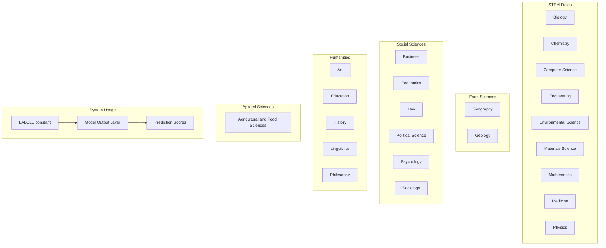

Sources: [src/s2_fos/constants.py:7-31]()

## System Paths

The constants file defines dynamic path resolution for locating project resources and configuration files.

### Project Root Path Resolution

The `PROJECT_ROOT_PATH` constant uses dynamic path calculation to locate the project root directory regardless of the execution context:

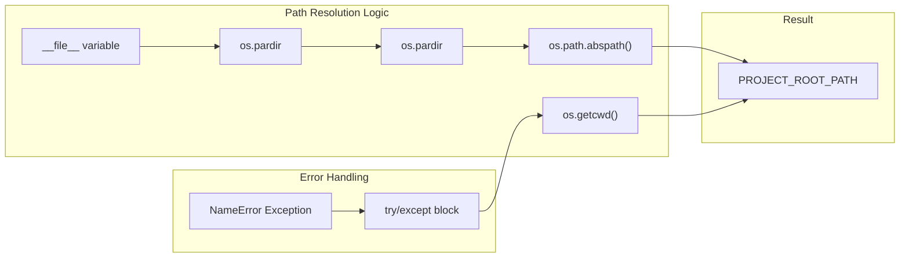

The path resolution follows this logic:
1. Primary: `os.path.abspath(os.path.join(__file__, os.pardir, os.pardir))`
2. Fallback: `os.path.abspath(os.path.join(os.getcwd()))` if `__file__` is undefined

Sources: [src/s2_fos/constants.py:33-36]()

## Usage Patterns

The constants are imported and used throughout the system to ensure consistency in model loading, label mapping, and file path resolution.

### Import and Usage Pattern

```mermaid
graph TB
    subgraph "Constants Module"
        ConstantsFile["src/s2_fos/constants.py"]
        ConstantDefs["LABELS, MODEL_NAME, TOKENIZER_MODEL_NAME, FASTTEXT_FNAME, PROJECT_ROOT_PATH"]
    end
    
    subgraph "Importing Modules"
        S2FOSModule["S2FOS Class"]
        TrainingModule["Training Pipeline"]
        LangModule["LanguageClassifier"]
        TestModule["Test Suites"]
    end
    
    subgraph "Usage Contexts"
        ModelLoading["Model Loading"]
        LabelMapping["Label Index Mapping"]
        PathResolution["File Path Resolution"]
        Tokenization["Text Tokenization"]
    end
    
    ConstantsFile --> ConstantDefs
    ConstantDefs --> S2FOSModule
    ConstantDefs --> TrainingModule
    ConstantDefs --> LangModule
    ConstantDefs --> TestModule
    
    S2FOSModule --> ModelLoading
    S2FOSModule --> LabelMapping
    TrainingModule --> ModelLoading
    TrainingModule --> PathResolution
    LangModule --> PathResolution
    TestModule --> LabelMapping
    
    ModelLoading --> Tokenization
```

Key usage patterns include:
- **Model Initialization**: `MODEL_NAME` and `TOKENIZER_MODEL_NAME` for loading pre-trained models
- **Prediction Mapping**: `LABELS` list for converting model output indices to field of study names
- **Language Detection**: `FASTTEXT_FNAME` for locating the language classification model
- **File Operations**: `PROJECT_ROOT_PATH` for relative path calculations

Sources: [src/s2_fos/constants.py:1-39]()

---

# Page: Training System

# Training System

<details>
<summary>Relevant source files</summary>

The following files were used as context for generating this wiki page:

- [src/s2_fos/training/open_ai_prompts.py](src/s2_fos/training/open_ai_prompts.py)
- [src/s2_fos/training/run.sh](src/s2_fos/training/run.sh)
- [src/s2_fos/training/train_net.py](src/s2_fos/training/train_net.py)

</details>


## Purpose and Scope

The Training System encompasses the complete pipeline for fine-tuning SciBERT models for Field of Study classification. This includes data generation using OpenAI's API and model training using PyTorch Lightning. The system produces trained models that are consumed by the Core System for inference (see [Core System](#3)).

For information about using trained models for predictions, see [S2FOS Interface](#3.1). For development and testing of the training pipeline, see [Testing](#5.2).

## Data Generation Pipeline

The data generation component uses OpenAI's GPT-3.5-turbo to create training labels for academic papers. The `open_ai_prompts.py` module handles the complete workflow from raw paper data to labeled training examples.

### OpenAI Integration Architecture

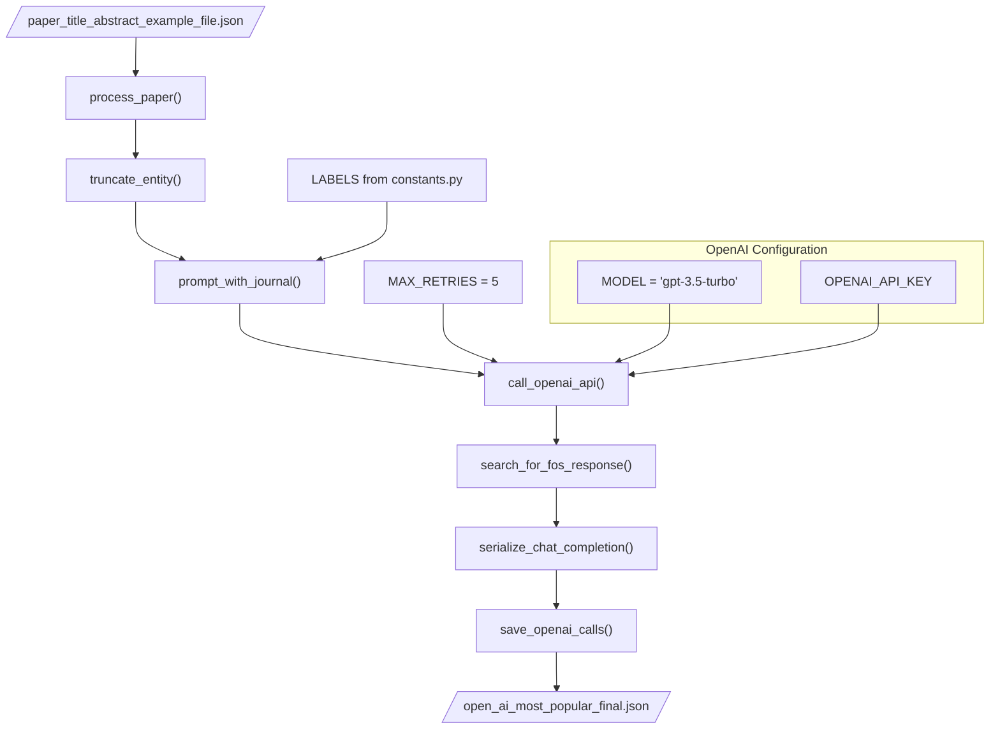

Sources: [src/s2_fos/training/open_ai_prompts.py:1-162]()

### Data Processing Workflow

The system processes academic papers through several stages:

| Stage | Function | Description |
|-------|----------|-------------|
| Input Validation | `truncate_entity()` | Limits text to 800 tokens to fit API constraints |
| Prompt Construction | `prompt_with_journal()` | Creates structured prompts with title, abstract, and journal |
| API Interaction | `call_openai_api()` | Sends requests to GPT-3.5-turbo with retry logic |
| Response Processing | `search_for_fos_response()` | Extracts field of study labels from API responses |
| Persistence | `save_openai_calls()` | Stores results in JSON format for training |

The system implements robust error handling with `MAX_RETRIES = 5` and `RETRY_DELAY = 5` seconds to handle API rate limits and transient failures.

Sources: [src/s2_fos/training/open_ai_prompts.py:23-94]()

## Model Training Pipeline

The training pipeline is orchestrated by `train_net.py` and built on PyTorch Lightning for scalable model fine-tuning. The system fine-tunes SciBERT models for multi-label classification across 23 field of study categories.

### Training Architecture Components

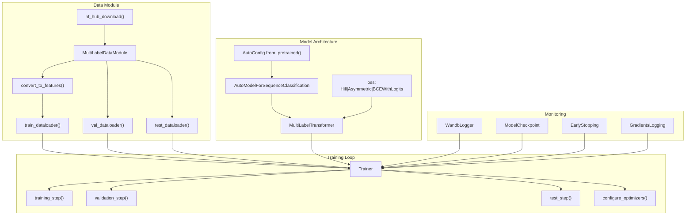

Sources: [src/s2_fos/training/train_net.py:173-461]()

### Data Loading and Processing

The `MultiLabelDataModule` class handles data preparation and loading:

- **Automatic Download**: Downloads training data from `allenai/fos_model_training_data_open_ai_annotations` repository on Hugging Face Hub
- **Data Splitting**: Automatically splits data into train (70%), validation (15%), and test (15%) sets
- **Tokenization**: Uses SciBERT tokenizer (`allenai/scibert_scivocab_uncased`) with `max_seq_length=128`
- **Text Concatenation**: Combines multiple text fields using `tokenizer.sep_token`

The data module supports configurable text fields through the `text_fields` parameter, defaulting to `["title", "normalized_venue_name", "abstract"]`.

Sources: [src/s2_fos/training/train_net.py:173-302]()

### Model Configuration

The `MultiLabelTransformer` class configures the SciBERT model for multi-label classification:

```python
# Key configuration parameters from train_net.py
model_name_or_path = "allenai/scibert_scivocab_uncased"
num_labels = 23  # Field of study categories
hidden_dropout_prob = 0.1
```

The model supports dynamic label mapping through `id2label` and `label2id` dictionaries, enabling interpretable outputs aligned with the field of study categories defined in `constants.py`.

Sources: [src/s2_fos/training/train_net.py:304-353]()

## Loss Functions

The training system implements three loss functions optimized for multi-label classification with potentially missing labels:

### Loss Function Comparison

| Loss Function | Use Case | Key Parameters |
|---------------|----------|----------------|
| `Hill` | Robust to missing labels | `lamb=1.5`, `margin=1.0`, `gamma=2.0` |
| `AsymmetricLoss` | Handles class imbalance | `gamma_neg=4`, `gamma_pos=1`, `clip=0.05` |
| `BCEWithLogitsLoss` | Standard baseline | `reduction="mean"` |

### Hill Loss Implementation

The Hill loss addresses the missing label problem in multi-label learning:

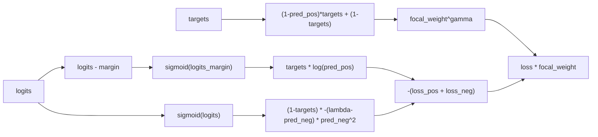

The Hill loss formula combines focal loss weighting with a specialized negative term that reduces the penalty for potentially missing positive labels.

Sources: [src/s2_fos/training/train_net.py:48-108]()

### Asymmetric Loss Implementation

Asymmetric loss provides different focusing for positive and negative samples:

- **Asymmetric Clipping**: `xs_neg.add_(clip).clamp_(max=1)` reduces over-confidence on negative samples
- **Differential Focusing**: Uses `gamma_pos` for positive samples and `gamma_neg` for negative samples
- **Memory Optimization**: Implements in-place operations to minimize GPU memory allocation

Sources: [src/s2_fos/training/train_net.py:110-171]()

## Training Configuration and Execution

### Command Line Interface

The training script accepts comprehensive configuration through command line arguments:

```bash
# Example from run.sh
python train_net.py \
  --text_fields title abstract journal_name \
  --save_path /stage/output/ \
  --train True \
  --batch_size 32 \
  --learning_rate 1e-5 \
  --warmup_ratio 0.06 \
  --loss Asymmetric \
  --asym_gamma_neg 4 \
  --asym_gamma_pos 2 \
  --asym_clip 0.1
```

### Optimizer and Scheduler Configuration

The system supports multiple optimization strategies:

| Component | Options | Default |
|-----------|---------|---------|
| Optimizer | AdamW | `lr=1e-5`, `eps=1e-8`, `weight_decay=0.001` |
| Scheduler | cosine, warmup, linear, constant | cosine with `warmup_ratio=0.06` |
| Training | Early stopping, model checkpointing | `patience=1`, `monitor="val_average_precision"` |

The optimizer implements weight decay only for non-bias and non-LayerNorm parameters, following transformer training best practices.

Sources: [src/s2_fos/training/train_net.py:417-461](), [src/s2_fos/training/run.sh:1-6]()

### Monitoring and Logging

Training progress is tracked through multiple loggers:

- **WandB Logger**: Experiment tracking with gradient histograms via `GradientsLogging` callback
- **CSV Logger**: Local logging for offline analysis
- **Model Checkpointing**: Saves best models based on validation average precision
- **Early Stopping**: Prevents overfitting with configurable patience

The system monitors `MultilabelAUROC` and `MultilabelAveragePrecision` metrics across all 23 field of study categories.

Sources: [src/s2_fos/training/train_net.py:37-46](), [src/s2_fos/training/train_net.py:653-685]()

---

# Page: Model Training

# Model Training

<details>
<summary>Relevant source files</summary>

The following files were used as context for generating this wiki page:

- [src/s2_fos/training/run.sh](src/s2_fos/training/run.sh)
- [src/s2_fos/training/train_net.py](src/s2_fos/training/train_net.py)

</details>


This document provides a comprehensive guide to training SciBERT models for Field of Study classification using the s2_fos training pipeline. It covers the PyTorch Lightning-based training system, loss function implementations, data handling, and configuration options available through the `train_net.py` script.

For information about generating training data using OpenAI, see [Data Generation](#4.2). For details about the inference system that uses trained models, see [S2FOS Interface](#3.1).

## Training Architecture Overview

The training system is built around PyTorch Lightning and consists of three main components: data handling, model definition, and training orchestration.

```mermaid
graph TB
    subgraph "Data Pipeline"
        HFDataset["HuggingFace Dataset<br/>fos_model_training_data"]
        MultiLabelDataModule["MultiLabelDataModule<br/>train_net.py:173-302"]
        DataLoader["PyTorch DataLoader<br/>Batch Processing"]
    end
    
    subgraph "Model Components"
        SciBERT["allenai/scibert_scivocab_uncased<br/>Base Model"]
        MultiLabelTransformer["MultiLabelTransformer<br/>train_net.py:304-461"]
        LossFunctions["Loss Functions<br/>Hill/Asymmetric/BCE"]
    end
    
    subgraph "Training Orchestration"
        TrainNet["train_net.py<br/>Main Script"]
        PLTrainer["PyTorch Lightning Trainer<br/>train_net.py:679-685"]
        Callbacks["Callbacks<br/>Checkpoint/EarlyStop/Gradients"]
    end
    
    subgraph "Logging & Monitoring"
        WandB["WandbLogger<br/>Experiment Tracking"]
        CSVLogger["CSVLogger<br/>Local Logs"]
        ModelCheckpoint["ModelCheckpoint<br/>Best Model Saving"]
    end
    
    HFDataset --> MultiLabelDataModule
    MultiLabelDataModule --> DataLoader
    SciBERT --> MultiLabelTransformer
    LossFunctions --> MultiLabelTransformer
    DataLoader --> PLTrainer
    MultiLabelTransformer --> PLTrainer
    TrainNet --> PLTrainer
    Callbacks --> PLTrainer
    WandB --> PLTrainer
    CSVLogger --> PLTrainer
    ModelCheckpoint --> PLTrainer
```

**Sources:** [src/s2_fos/training/train_net.py:1-701]()

## Loss Functions

The training system supports three different loss functions for multi-label classification, each designed to handle class imbalance and missing labels effectively.

### Available Loss Functions

| Loss Function | Class | Parameters | Use Case |
|---------------|-------|------------|----------|
| BCE with Logits | `torch.nn.BCEWithLogitsLoss` | `reduction="mean"` | Default baseline |
| Hill Loss | `Hill` | `lamb=1.5`, `margin=1.0`, `gamma=2.0` | Missing labels handling |
| Asymmetric Loss | `AsymmetricLoss` | `gamma_neg=4`, `gamma_pos=1`, `clip=0.05` | Class imbalance |

### Hill Loss Implementation

The `Hill` class implements the loss function described in "Robust Loss Design for Multi-Label Learning with Missing Labels":

```
Loss = y × (1-p_m)^γ log(p_m) + (1-y) × -(λ-p)p²
```

Key features:
- Margin parameter `m` for down-weighting false negatives
- Focal weight `γ` similar to Focal Loss
- Lambda `λ` weighting term for possibly false negatives

**Sources:** [src/s2_fos/training/train_net.py:48-108]()

### Asymmetric Loss Implementation

The `AsymmetricLoss` class provides asymmetric focusing for positive and negative samples with different gamma values and clipping to handle class imbalance.

**Sources:** [src/s2_fos/training/train_net.py:110-171]()

## Data Pipeline

The data pipeline handles loading, preprocessing, and batching of training data through the `MultiLabelDataModule` class.

```mermaid
graph LR
    subgraph "Data Sources"
        LocalFiles["Local Parquet Files<br/>train/val/test_data"]
        HFRepo["allenai/fos_model_training_data_open_ai_annotations<br/>HuggingFace Dataset"]
    end
    
    subgraph "MultiLabelDataModule"
        Setup["setup()<br/>train_net.py:238-253"]
        TokenizerStep["convert_to_features()<br/>train_net.py:281-301"]
        SplitData["train_test_split<br/>70/15/15 split"]
    end
    
    subgraph "Text Processing"
        TextFields["title + abstract + journal_name<br/>SEP token separation"]
        SciBERTTokenizer["AutoTokenizer<br/>scibert_scivocab_uncased"]
        Features["input_ids + attention_mask<br/>max_length=128"]
    end
    
    subgraph "DataLoaders"
        TrainLoader["train_dataloader()<br/>batch_size=16, shuffle=True"]
        ValLoader["val_dataloader()<br/>batch_size=512, shuffle=False"]
        TestLoader["test_dataloader()<br/>batch_size=512, shuffle=False"]
    end
    
    LocalFiles --> Setup
    HFRepo --> Setup
    Setup --> TokenizerStep
    Setup --> SplitData
    TextFields --> TokenizerStep
    SciBERTTokenizer --> TokenizerStep
    TokenizerStep --> Features
    Features --> TrainLoader
    Features --> ValLoader
    Features --> TestLoader
```

### Data Loading Configuration

The `MultiLabelDataModule` class handles:
- Automatic dataset download from HuggingFace if local files not provided
- Text field concatenation using SEP tokens
- Tokenization with SciBERT tokenizer
- 23 Field of Study labels (multi-label classification)

**Sources:** [src/s2_fos/training/train_net.py:173-302](), [src/s2_fos/training/train_net.py:214-236]()

## Model Configuration

The `MultiLabelTransformer` class wraps the SciBERT model with training logic and configuration.

### Core Model Setup

```mermaid
graph TB
    subgraph "Model Configuration"
        ModelPath["allenai/scibert_scivocab_uncased<br/>model_name_or_path"]
        AutoConfig["AutoConfig.from_pretrained<br/>train_net.py:324-333"]
        NumLabels["num_labels=23<br/>Field of Study Categories"]
        Dropout["hidden_dropout_prob=0.1<br/>Regularization"]
    end
    
    subgraph "Optimization Setup"
        AdamW["AdamW Optimizer<br/>train_net.py:431-438"]
        WeightDecay["weight_decay=0.001<br/>No decay for bias/LayerNorm"]
        Scheduler["Learning Rate Scheduler<br/>cosine/warmup/linear/constant"]
        WarmupRatio["warmup_ratio=0.06<br/>Warmup Steps"]
    end
    
    subgraph "Training Metrics"
        AUROC["MultilabelAUROC<br/>train_net.py:345"]
        AvgPrecision["MultilabelAveragePrecision<br/>train_net.py:347-349"]
        LossMetric["Loss Logging<br/>per step and epoch"]
    end
    
    ModelPath --> AutoConfig
    AutoConfig --> NumLabels
    AutoConfig --> Dropout
    AdamW --> WeightDecay
    Scheduler --> WarmupRatio
    AUROC --> LossMetric
    AvgPrecision --> LossMetric
```

### Training Process Methods

The `MultiLabelTransformer` implements:
- `_process_batch()`: Core batch processing for train/val/test
- `training_step()`: Training step implementation
- `validation_step()`: Validation step implementation  
- `configure_optimizers()`: Optimizer and scheduler setup

**Sources:** [src/s2_fos/training/train_net.py:304-461](), [src/s2_fos/training/train_net.py:358-395](), [src/s2_fos/training/train_net.py:417-460]()

## Training Execution

### PyTorch Lightning Trainer Configuration

The training uses PyTorch Lightning's `Trainer` with the following callbacks and configuration:

| Component | Purpose | Configuration |
|-----------|---------|---------------|
| `ModelCheckpoint` | Save best model | Monitor `val_average_precision`, save top 1 |
| `EarlyStopping` | Prevent overfitting | Patience=1, monitor `val_average_precision` |
| `GradientsLogging` | Monitor gradients | Log to WandB as histograms |
| `WandbLogger` | Experiment tracking | Project logging with run descriptions |

**Sources:** [src/s2_fos/training/train_net.py:654-674](), [src/s2_fos/training/train_net.py:37-45]()

### Training Configuration

Default training parameters:
- Max epochs: 5
- Batch size: 16 (training), 512 (evaluation)
- Learning rate: 1e-5
- Warmup ratio: 0.06
- Weight decay: 0.001
- Adam epsilon: 1e-8

**Sources:** [src/s2_fos/training/train_net.py:679-685](), [src/s2_fos/training/train_net.py:643-651]()

## Command Line Interface

The `train_net.py` script provides extensive command line configuration options for training customization.

### Required Arguments

| Argument | Type | Purpose |
|----------|------|---------|
| `--save_path` | str | Directory to save trained model |
| `--train` | bool | Whether to run training or evaluation only |
| `--project_name` | str | WandB project name |

### Data Configuration

| Argument | Default | Purpose |
|----------|---------|---------|
| `--train_data` | None | Path to training parquet file |
| `--val_data` | None | Path to validation parquet file |
| `--test_data` | None | Path to test parquet file |
| `--text_fields` | `["title", "normalized_venue_name", "abstract"]` | Input text fields |

### Loss Function Configuration

The system supports configurable loss functions with validation:

```mermaid
graph LR
    subgraph "Loss Selection"
        LossArg["--loss argument<br/>validate_loss()"]
        HillChoice["Hill Loss<br/>--hill_* parameters"]
        AsymChoice["Asymmetric Loss<br/>--asym_* parameters"]
        BCEChoice["BCE Default<br/>No parameters"]
    end
    
    subgraph "Hill Parameters"
        HillLamb["--hill_lamb=1.5<br/>range [0,3]"]
        HillMargin["--hill_margin=1.0<br/>range [0,3]"]
        HillGamma["--hill_gamma=2.0<br/>range [0,3]"]
        HillReduction["--hill_reduction=mean<br/>mean/sum"]
    end
    
    subgraph "Asymmetric Parameters"
        AsymGammaNeg["--asym_gamma_neg=4<br/>range [0,5]"]
        AsymGammaPos["--asym_gamma_pos=1<br/>range [0,5]"]
        AsymClip["--asym_clip=0.05<br/>range [0,5]"]
        AsymEps["--asym_eps=1e-8<br/>epsilon value"]
    end
    
    LossArg --> HillChoice
    LossArg --> AsymChoice
    LossArg --> BCEChoice
    HillChoice --> HillLamb
    HillChoice --> HillMargin
    AsymChoice --> AsymGammaNeg
    AsymChoice --> AsymGammaPos
```

### Example Training Command

The provided run script demonstrates optimal training configuration:

```bash
python train_net.py --text_fields title abstract journal_name \
  --save_path /stage/output/ --train True \
  --project_name <project_name> --batch_size 32 \
  --learning_rate 1e-5 --warmup_ratio 0.06 \
  --loss Asymmetric --asym_gamma_neg 4 \
  --asym_gamma_pos 2 --asym_clip 0.1
```

**Sources:** [src/s2_fos/training/train_net.py:496-585](), [src/s2_fos/training/train_net.py:475-494](), [src/s2_fos/training/run.sh:1-6]()

---

# Page: Data Generation

# Data Generation

<details>
<summary>Relevant source files</summary>

The following files were used as context for generating this wiki page:

- [src/s2_fos/training/open_ai_prompts.py](src/s2_fos/training/open_ai_prompts.py)

</details>


This document covers the data generation system used to create training labels for field of study classification models. The system leverages OpenAI's GPT-3.5-turbo API to automatically classify academic papers into predefined field of study categories, generating high-quality training data for model fine-tuning.

For information about using this generated data in model training, see [Model Training](#4.1). For details about the field of study constants and labels used in data generation, see [Constants and Labels](#3.3).

## System Overview

The data generation system processes academic papers through an OpenAI API pipeline to produce field of study classifications. The system takes paper metadata (title, abstract, journal name) as input and generates structured training labels as output.

### Data Generation Architecture

```mermaid
graph TD
    InputData["paper_title_abstract_example_file.json"] --> DataLoader["main() function"]
    DataLoader --> PaperProcessor["process_paper()"]
    
    PaperProcessor --> TextTruncation["truncate_entity()"]
    TextTruncation --> PromptGeneration["prompt_with_journal()"]
    PromptGeneration --> OpenAIAPI["call_openai_api()"]
    
    OpenAIAPI --> ResponseValidation["search_for_fos_response()"]
    ResponseValidation --> |"Valid response"| ResultSerialization["serialize_chat_completion()"]
    ResponseValidation --> |"Invalid response"| FollowUpPrompt["Follow-up prompt"]
    FollowUpPrompt --> OpenAIAPI
    
    ResultSerialization --> CacheStorage["open_ai_calls dict"]
    CacheStorage --> BatchSave["save_openai_calls()"]
    BatchSave --> OutputFiles["open_ai_most_popular_*.json"]
    
    subgraph "Error Handling"
        OpenAIAPI --> RetryLogic["MAX_RETRIES loop"]
        RetryLogic --> |"API Error"| DelayRetry["RETRY_DELAY"]
        DelayRetry --> OpenAIAPI
    end
```

Sources: [src/s2_fos/training/open_ai_prompts.py:1-163]()

## OpenAI Integration

The system integrates with OpenAI's GPT-3.5-turbo model to perform field of study classification. The integration includes proper API key management, error handling, and response processing.

### API Configuration

| Configuration | Value | Purpose |
|---------------|-------|---------|
| Model | `gpt-3.5-turbo` | Primary language model for classification |
| Temperature | `0` | Deterministic responses for consistent labeling |
| Max Retries | `5` | Number of retry attempts for failed API calls |
| Retry Delay | `5 seconds` | Wait time between retry attempts |

The system requires the `OPENAI_API_KEY` environment variable to be set and creates an OpenAI client instance for API communication.

Sources: [src/s2_fos/training/open_ai_prompts.py:12-21]()

### API Call Management

```mermaid
sequenceDiagram
    participant PP as "process_paper()"
    participant API as "call_openai_api()"
    participant OpenAI as "OpenAI GPT-3.5-turbo"
    participant Cache as "open_ai_calls dict"
    
    PP->>PP: Check if paper already processed
    PP->>PP: truncate_entity() for title/abstract
    PP->>PP: prompt_with_journal() creates messages
    
    loop "MAX_RETRIES times"
        PP->>API: Send prompt messages
        API->>OpenAI: chat.completions.create()
        OpenAI-->>API: ChatCompletion response
        API-->>PP: Response content
        
        PP->>PP: search_for_fos_response() validation
        alt "Valid FoS found"
            PP->>Cache: Store serialized result
            break
        else "No valid FoS"
            PP->>PP: Create follow-up prompt
            PP->>API: Send follow-up messages
            API->>OpenAI: chat.completions.create()
            OpenAI-->>API: ChatCompletion response
            API-->>PP: Response content
            PP->>Cache: Store serialized result
            break
        end
    end
```

Sources: [src/s2_fos/training/open_ai_prompts.py:32-34](), [src/s2_fos/training/open_ai_prompts.py:63-95]()

## Prompt Engineering

The system uses a structured prompting approach to guide the language model in field of study classification. The prompts are designed to be precise and constrain the model's responses to valid field of study categories.

### Prompt Structure

The `prompt_with_journal()` function creates a three-message conversation structure:

1. **System Message**: Establishes the role as an information extraction system
2. **User Message**: Provides classification instructions and valid field categories
3. **Assistant Message**: Begins a Python code block to structure the response

```mermaid
graph LR
    SystemRole["system: You are a highly intelligent information extraction system"] 
    UserInstructions["user: Classify with field_of_study key from LABELS list"]
    AssistantStart["assistant: Python code block with variables"]
    
    SystemRole --> UserInstructions
    UserInstructions --> AssistantStart
    
    subgraph "Input Variables"
        Title["title (truncated)"]
        Abstract["abstract (truncated)"] 
        Journal["journal_name"]
    end
    
    Title --> AssistantStart
    Abstract --> AssistantStart
    Journal --> AssistantStart
```

The system incorporates all 23 field of study labels from the `LABELS` constant, providing the model with explicit category options plus an "Other" fallback category.

Sources: [src/s2_fos/training/open_ai_prompts.py:40-61]()

### Response Validation and Follow-up

The system implements a two-stage validation process:

1. **Initial Response Check**: Uses `search_for_fos_response()` to verify if valid field of study labels appear in the response
2. **Follow-up Prompting**: If no valid labels are found, sends a follow-up prompt requesting explicit mapping to the predefined categories

This approach ensures high-quality label extraction while maintaining flexibility in the model's initial reasoning process.

Sources: [src/s2_fos/training/open_ai_prompts.py:36-38](), [src/s2_fos/training/open_ai_prompts.py:74-86]()

## Processing Pipeline

The data generation pipeline processes academic papers through several stages to produce training labels efficiently and reliably.

### Text Preprocessing

Before sending content to the OpenAI API, the system applies text preprocessing to manage token limits:

| Function | Purpose | Implementation |
|----------|---------|----------------|
| `tokenize()` | Extract word tokens using regex | `re.findall(r"\b\w+\b", text)` |
| `truncate_entity()` | Limit text to 800 tokens maximum | Preserves first 800 tokens if longer |

This preprocessing ensures API calls stay within reasonable token limits while preserving the most important content (beginning of titles/abstracts).

Sources: [src/s2_fos/training/open_ai_prompts.py:23-30]()

### Batch Processing Workflow

```mermaid
graph TD
    InputFile["paper_title_abstract_example_file.json"] --> FileRead["Read JSONL format"]
    FileRead --> DataParsing["Parse JSON objects to list"]
    DataParsing --> ArrayConversion["Convert to numpy array"]
    
    ArrayConversion --> ProcessingLoop["For each paper (sha, title, abstract, journal)"]
    ProcessingLoop --> PaperKey["Generate key: paper_sha_model"]
    PaperKey --> CacheCheck["Check if already processed"]
    
    CacheCheck --> |"Not cached"| ProcessPaper["process_paper()"]
    CacheCheck --> |"Already cached"| NextPaper["Skip to next paper"]
    
    ProcessPaper --> CacheUpdate["Update open_ai_calls dict"]
    CacheUpdate --> BatchCheck["Check if batch size reached (100)"]
    
    BatchCheck --> |"Batch complete"| IntermediateSave["save_openai_calls() intermediate"]
    BatchCheck --> |"Continue"| NextPaper
    IntermediateSave --> NextPaper
    
    NextPaper --> ProcessingLoop
    ProcessingLoop --> |"All papers processed"| FinalSave["save_openai_calls() final"]
```

The system processes papers sequentially, maintaining a cache (`open_ai_calls` dictionary) to avoid duplicate API calls and implementing periodic saves every 100 processed papers.

Sources: [src/s2_fos/training/open_ai_prompts.py:134-159]()

## Data Output Format

The system produces structured JSON output containing both the prompts sent to OpenAI and the complete API responses for each processed paper.

### Output Structure

Each entry in the output JSON follows this structure:

```
{
  "paper_sha_gpt-3.5-turbo": {
    "prompt": [messages_array],
    "result": {serialized_chat_completion}
  }
}
```

### ChatCompletion Serialization

The `serialize_chat_completion()` function converts OpenAI response objects into JSON-serializable dictionaries, preserving:

| Field | Content |
|-------|---------|
| `id` | Completion ID |
| `choices` | Response choices with content and metadata |
| `created` | Timestamp |
| `model` | Model identifier |
| `usage` | Token consumption statistics |
| `system_fingerprint` | OpenAI system identifier |

This comprehensive serialization enables full reproducibility and detailed analysis of the data generation process.

Sources: [src/s2_fos/training/open_ai_prompts.py:97-127]()

### File Output Pattern

The system generates multiple output files during processing:

- **Intermediate files**: `open_ai_most_popular_100.json`, `open_ai_most_popular_200.json`, etc.
- **Final file**: `open_ai_most_popular_final.json`

This pattern provides checkpoint recovery capability and monitors progress during long-running data generation sessions.

Sources: [src/s2_fos/training/open_ai_prompts.py:154-158]()

## Error Handling and Reliability

The system implements robust error handling to manage API failures, rate limits, and transient network issues that commonly occur during large-scale data generation.

### Retry Mechanism

```mermaid
graph TD
    APICall["call_openai_api()"] --> Success{API Success?}
    Success --> |"Yes"| ProcessResponse["Process response"]
    Success --> |"No"| ErrorCatch["Catch OpenAIError"]
    
    ErrorCatch --> RetryCheck{Retries < MAX_RETRIES?}
    RetryCheck --> |"Yes"| SleepDelay["time.sleep(RETRY_DELAY)"]
    RetryCheck --> |"No"| SkipPaper["Print 'Max retries reached'"]
    
    SleepDelay --> APICall
    SkipPaper --> NextPaper["Continue to next paper"]
    ProcessResponse --> StoreResult["Store in open_ai_calls"]
```

The retry mechanism provides resilience against temporary API issues while preventing infinite loops through the `MAX_RETRIES` limit.

### Caching Strategy

The system implements intelligent caching using composite keys (`paper_sha_model`) to:

- **Avoid duplicate API calls** for papers already processed
- **Enable resume capability** after interruptions
- **Support different model experiments** without data conflicts

This caching strategy significantly reduces API costs and processing time during iterative development and large-scale data generation.

Sources: [src/s2_fos/training/open_ai_prompts.py:64-65](), [src/s2_fos/training/open_ai_prompts.py:70-94]()

---

# Page: Development

# Development

<details>
<summary>Relevant source files</summary>

The following files were used as context for generating this wiki page:

- [pyproject.toml](pyproject.toml)
- [test/__init__.py](test/__init__.py)
- [test/test_model_inference.py](test/test_model_inference.py)

</details>


This document provides guidance for developers working on or extending the s2_fos system. It covers the development environment setup, code architecture patterns, testing framework, and contribution workflow. For specific configuration details, see [Project Configuration](#5.1). For testing procedures, see [Testing](#5.2). For package organization details, see [Package Structure](#5.3).

## Development Environment Overview

The s2_fos project uses a modern Python development stack centered around Poetry for dependency management and packaging. The system is designed as a machine learning pipeline with clear separation between inference, training, and data generation components.

### Development Stack

```mermaid
graph TB
    subgraph "Development Tools"
        Poetry["poetry<br/>Dependency Management"]
        Pytest["pytest<br/>Testing Framework"] 
        Black["black<br/>Code Formatting"]
        WandB["wandb<br/>Experiment Tracking"]
    end
    
    subgraph "Core Dependencies"
        PyTorch["pytorch_lightning<br/>Training Framework"]
        HF["transformers + datasets<br/>Model Infrastructure"]
        Pandas["pandas + numpy<br/>Data Processing"]
        Pydantic["pydantic<br/>Data Validation"]
    end
    
    subgraph "External APIs"
        OpenAI["openai<br/>Data Generation"]
        HuggingFace["huggingface_hub<br/>Model Distribution"]
    end
    
    Poetry --> PyTorch
    Poetry --> HF
    Poetry --> Pandas
    Poetry --> Pydantic
    Poetry --> OpenAI
    Poetry --> HuggingFace
    
    Pytest --> Poetry
    Black --> Poetry
    WandB --> PyTorch
```

**Development Dependencies**
Sources: [pyproject.toml:14-31]()

## Development Workflow

The development process follows a standard machine learning project pattern with separate pipelines for data generation, model training, and inference deployment.

### Code Development Cycle

```mermaid
sequenceDiagram
    participant Dev as Developer
    participant Poetry as "poetry"
    participant Tests as "pytest"
    participant Black as "black formatter"
    participant Git as "git repository"
    participant CI as "CI/CD Pipeline"
    
    Dev->>Poetry: "poetry install"
    Note over Poetry: Install dependencies
    
    Dev->>Dev: Implement changes
    Dev->>Black: "black src/ test/"
    Note over Black: Format code (line-length=120)
    
    Dev->>Tests: "pytest test/"
    Note over Tests: Run test_model_inference.py
    
    Tests->>Dev: Test results
    Dev->>Git: Commit & push
    Git->>CI: Trigger pipeline
    
    CI->>Poetry: Build package
    CI->>Tests: Run full test suite
    CI-->>Dev: Status feedback
```

**Workflow Components**
Sources: [pyproject.toml:43-52](), [test/test_model_inference.py:1-45]()

## Code Architecture for Developers

The system follows a modular architecture with clear interfaces between components. Understanding these patterns is essential for extending the system.

### Core Component Interaction

```mermaid
graph TB
    subgraph "src/s2_fos Package"
        S2FOS["S2FOS<br/>Main Interface Class"]
        LanguageClassifier["LanguageClassifier<br/>Language Detection"]
        Constants["constants.py<br/>Model & Label Definitions"]
    end
    
    subgraph "Training Module"
        TrainNet["train_net.py<br/>Training Orchestration"]
        MLTransformer["MultiLabelTransformer<br/>PyTorch Lightning Module"]
        DataModule["MultiLabelDataModule<br/>Data Loading"]
    end
    
    subgraph "Data Generation"
        OpenAIPrompts["open_ai_prompts.py<br/>Label Generation"]
        DataFiles["JSON/Parquet Files<br/>Training Data"]
    end
    
    subgraph "Test Suite"
        TestInference["test_model_inference.py<br/>End-to-end Tests"]
        TestFixtures["pytest fixtures<br/>predictor()"]
    end
    
    S2FOS --> LanguageClassifier
    S2FOS --> Constants
    TrainNet --> MLTransformer
    TrainNet --> DataModule
    OpenAIPrompts --> DataFiles
    DataFiles --> DataModule
    
    TestInference --> S2FOS
    TestFixtures --> TestInference
```

**Key Development Patterns**
Sources: [test/test_model_inference.py:7-9](), [pyproject.toml:10-12]()

### Testing Architecture

The testing framework uses pytest with modular fixtures and parametrized tests to ensure system reliability.

```mermaid
graph LR
    subgraph "Test Structure"
        TestInit["test/__init__.py<br/>Package Marker"]
        TestInference["test_model_inference.py<br/>Main Test Suite"]
    end
    
    subgraph "Test Components"
        Fixture["predictor fixture<br/>S2FOS() instance"]
        TestData["test_data list<br/>Paper samples + expected results"]
        ParamTest["test_predict function<br/>Parametrized test execution"]
    end
    
    subgraph "Test Coverage"
        EnglishTest["English paper classification<br/>Computer Science expected"]
        NonEnglishTest["Non-English paper filtering<br/>Empty result expected"]
    end
    
    TestInference --> Fixture
    TestInference --> TestData
    TestInference --> ParamTest
    
    ParamTest --> EnglishTest
    ParamTest --> NonEnglishTest
    
    Fixture --> S2FOS["S2FOS() constructor"]
```

**Test Execution Pattern**
Sources: [test/test_model_inference.py:6-44](), [pyproject.toml:43-49]()

## Development Configuration

### Project Metadata and Dependencies

| Configuration | Value | Purpose |
|---------------|--------|---------|
| Package Name | `s2_fos` | Main package identifier |
| Version | `0.0.2` | Current release version |
| Python Version | `^3.8` | Minimum Python requirement |
| Source Location | `src/s2_fos` | Package source directory |
| Test Directory | `tests/` | Pytest test discovery path |
| Code Style | Black (120 char line length) | Formatting standard |

**Configuration Management**
Sources: [pyproject.toml:1-12](), [pyproject.toml:43-52]()

### Development Commands

```bash
# Environment setup
poetry install                    # Install all dependencies
poetry install --only dev        # Install only dev dependencies

# Code quality
black src/ test/                 # Format code (120 char limit)
pytest test/                     # Run test suite

# Package management  
poetry build                     # Build distribution packages
poetry publish                   # Publish to PyPI
```

**Command Reference**
Sources: [pyproject.toml:28-31](), [pyproject.toml:51-52]()

## Extension Points

### Adding New Field of Study Categories

1. Update `constants.py` with new label definitions
2. Modify training data generation in `open_ai_prompts.py`
3. Retrain model using `train_net.py`
4. Update test cases in `test_model_inference.py`

### Integrating New Language Models

1. Add model dependencies to `pyproject.toml`
2. Implement new classifier in the core package
3. Update `S2FOS` class to support new models
4. Add comprehensive test coverage

### Custom Training Configurations

1. Extend `MultiLabelTransformer` with new loss functions
2. Add configuration options to `train_net.py`
3. Integrate with WandB for experiment tracking
4. Update data loading pipeline as needed

**Development Patterns**
Sources: [pyproject.toml:14-27](), [test/test_model_inference.py:13-37]()

---

# Page: Project Configuration

# Project Configuration

<details>
<summary>Relevant source files</summary>

The following files were used as context for generating this wiki page:

- [pyproject.toml](pyproject.toml)

</details>


This document covers the project configuration for the s2_fos system, including package metadata, dependency management, build system setup, and development tooling configuration. The configuration is managed through Poetry and defined in the `pyproject.toml` file.

For information about testing procedures and test suite organization, see [Testing](#5.2). For details about the overall package structure and module organization, see [Package Structure](#5.3).

## Project Metadata

The s2_fos project is configured as a Python package with the following core metadata:

| Property | Value |
|----------|-------|
| Package Name | `s2_fos` |
| Version | `0.0.2` |
| Description | S2FOS: Field of Study Classification for Scholarly Documents |
| License | Apache-2.0 |
| Authors | Allen Institute for Artificial Intelligence |
| Python Version | ^3.8 |

The package structure is organized with source code located in `src/s2_fos/`, following Python packaging best practices defined in [pyproject.toml:10-12]().

**Dependency Architecture Overview**

```mermaid
graph TB
    subgraph "Core ML Dependencies"
        pytorch_lightning["pytorch_lightning"]
        transformers["transformers"] 
        scikit_learn["scikit-learn"]
        datasets["datasets"]
    end
    
    subgraph "Data Processing"
        pandas["pandas"]
        numpy["numpy"]
    end
    
    subgraph "Model & API Integration"
        huggingface_hub["huggingface_hub"]
        openai["openai"]
        wandb["wandb"]
    end
    
    subgraph "Language & Configuration"
        pycld2["pycld2"]
        pydantic["pydantic"]
        pydantic_settings["pydantic-settings"]
    end
    
    subgraph "Development Tools"
        black["black"]
        pytest["pytest"]
    end
    
    subgraph "S2FOS Components"
        S2FOS_Interface["S2FOS Class"]
        LanguageClassifier["LanguageClassifier"]
        train_net["train_net.py"]
        MultiLabelTransformer["MultiLabelTransformer"]
    end
    
    %% Core ML connections
    transformers --> S2FOS_Interface
    transformers --> train_net
    pytorch_lightning --> MultiLabelTransformer
    scikit_learn --> train_net
    datasets --> train_net
    
    %% Data processing connections
    pandas --> train_net
    numpy --> S2FOS_Interface
    
    %% Model integration connections
    huggingface_hub --> S2FOS_Interface
    huggingface_hub --> train_net
    openai --> train_net
    wandb --> train_net
    
    %% Language and config connections
    pycld2 --> LanguageClassifier
    pydantic --> S2FOS_Interface
    pydantic_settings --> train_net
    
    %% Development connections
    black --> S2FOS_Interface
    black --> train_net
    pytest --> S2FOS_Interface
```

Sources: [pyproject.toml:14-31]()

## Dependency Management

The project uses Poetry for dependency management with dependencies categorized into production and development groups.

### Production Dependencies

The production dependencies support the core functionality across different system components:

| Dependency | Purpose | Related Components |
|------------|---------|-------------------|
| `transformers` | SciBERT model loading and tokenization | S2FOS class, training pipeline |
| `pytorch_lightning` | Training framework and model management | MultiLabelTransformer, train_net.py |
| `huggingface_hub` | Model repository integration | Model loading, caching |
| `datasets` | Training data management | Data preprocessing pipeline |
| `pandas` | Data manipulation and processing | Training data handling |
| `scikit-learn` | ML utilities and metrics | Model evaluation, preprocessing |
| `openai` | API integration for data generation | Training data creation |
| `wandb` | Experiment tracking and logging | Training monitoring |
| `pycld2` | Language detection | LanguageClassifier component |
| `pydantic` | Data validation and settings | Configuration management |
| `numpy` | Numerical computations | Array operations |
| `black` | Code formatting | Development workflow |

### Development Dependencies

Development dependencies are defined in a separate group [pyproject.toml:30-31]():

- `pytest`: Testing framework for unit and integration tests

**Configuration File Structure**

```mermaid
graph TD
    subgraph "pyproject.toml Structure"
        root["pyproject.toml"]
        
        subgraph "Poetry Configuration"
            metadata["[tool.poetry]<br/>name, version, description"]
            deps["[tool.poetry.dependencies]<br/>Production packages"]
            dev_deps["[tool.poetry.group.dev.dependencies]<br/>Development packages"]
            urls["[tool.poetry.urls]<br/>Repository links"]
        end
        
        subgraph "Build System"
            build["[build-system]<br/>poetry-core backend"]
        end
        
        subgraph "Tool Configurations"
            pytest_config["[tool.pytest.ini_options]<br/>Test paths, Python path"]
            black_config["[tool.black]<br/>Line length settings"]
        end
    end
    
    root --> metadata
    root --> deps
    root --> dev_deps
    root --> urls
    root --> build
    root --> pytest_config
    root --> black_config
```

Sources: [pyproject.toml:1-52]()

## Build System Configuration

The project uses Poetry's modern build system with the following configuration [pyproject.toml:33-35]():

- **Build Backend**: `poetry.core.masonry.api`
- **Build Requirements**: `poetry-core>=1.0.0`

This configuration enables standard Python packaging workflows including:
- Source distribution creation
- Wheel building
- Dependency resolution
- Virtual environment management

## Project URLs and Links

The project configuration includes several important URLs for project resources [pyproject.toml:37-41]():

| URL Type | Address |
|----------|---------|
| Homepage | https://www.github.com/allenai/s2_fos |
| Repository | https://www.github.com/allenai/s2_fos |
| Bug Tracker | https://www.github.com/allenai/s2_fos/issues |
| Blog Post | https://blog.allenai.org/announcing-s2fos-an-open-source-academic-field-of-study-classifier-9d2f641949e5 |

## Testing Configuration

The pytest configuration is embedded within the `pyproject.toml` file [pyproject.toml:43-49]():

```toml
[tool.pytest.ini_options]
testpaths = ["tests"]
pythonpath = ["src"]
```

This configuration:
- Sets the test discovery path to the `tests/` directory
- Adds `src/` to the Python path for proper import resolution during testing
- Enables pytest to locate and import the `s2_fos` package from the source directory

## Code Formatting Configuration

Black code formatter is configured with project-specific settings [pyproject.toml:51-52]():

```toml
[tool.black]
line-length = 120
```

This extends the default line length from 88 to 120 characters, accommodating longer lines common in machine learning code with extensive parameter lists and model configurations.

**Development Workflow Integration**

```mermaid
graph LR
    subgraph "Development Commands"
        poetry_install["poetry install"]
        poetry_run["poetry run"]
        poetry_build["poetry build"]
    end
    
    subgraph "Tool Execution"
        pytest_run["pytest"]
        black_format["black src/ tests/"]
        python_run["python -m s2_fos"]
    end
    
    subgraph "Configuration Files"
        pyproject["pyproject.toml"]
        poetry_lock["poetry.lock"]
    end
    
    poetry_install --> pyproject
    poetry_install --> poetry_lock
    poetry_run --> pytest_run
    poetry_run --> black_format
    poetry_run --> python_run
    poetry_build --> pyproject
    
    pytest_run -.-> pyproject
    black_format -.-> pyproject
```

Sources: [pyproject.toml:30-31](), [pyproject.toml:43-49](), [pyproject.toml:51-52]()

---

# Page: Testing

# Testing

<details>
<summary>Relevant source files</summary>

The following files were used as context for generating this wiki page:

- [test/__init__.py](test/__init__.py)
- [test/test_model_inference.py](test/test_model_inference.py)

</details>


This document covers the test suite for the s2_fos system, including the testing framework, test structure, and execution procedures. The tests validate core inference functionality and ensure proper handling of different input types and languages.

For information about development environment setup, see [Project Configuration](#5.1). For details about the core system being tested, see [Core System](#3).

## Test Framework Overview

The s2_fos system uses pytest as its primary testing framework. The test suite focuses on validating model inference capabilities and ensuring proper integration between system components.

The testing architecture centers around the `S2FOS` class interface, testing its ability to correctly classify academic papers and handle edge cases like non-English content.

### Test Organization

```mermaid
graph TB
    subgraph "test/"
        TestInit["__init__.py"]
        TestInference["test_model_inference.py"]
    end
    
    subgraph "Test Components"
        PytestFixture["predictor() fixture"]
        TestData["test_data list"]
        TestFunction["test_predict()"]
    end
    
    subgraph "External Dependencies"
        PytestFramework["pytest framework"]
        S2FOSClass["S2FOS class"]
    end
    
    TestInference --> PytestFixture
    TestInference --> TestData
    TestInference --> TestFunction
    
    PytestFixture --> S2FOSClass
    TestFunction --> PytestFramework
    
    TestData --> TestFunction
    PytestFixture --> TestFunction
```

*Sources: [test/test_model_inference.py:1-45]()*

## Test Structure and Components

### Pytest Fixtures

The test suite employs a module-scoped fixture to initialize the S2FOS predictor:

| Fixture | Scope | Purpose |
|---------|-------|---------|
| `predictor()` | module | Creates a single S2FOS instance for all tests in the module |

The fixture ensures efficient resource usage by reusing the same predictor instance across multiple test cases, avoiding repeated model loading overhead.

### Test Data Configuration

The test suite includes parametrized test data covering multiple scenarios:

| Test Case | Language | Expected Behavior |
|-----------|----------|-------------------|
| English NER Paper | English | Returns `[['Computer Science']]` |
| Russian Encyclopedia | Russian | Returns `[[]]` (empty due to language filtering) |

The test data structure follows the expected input format for the `S2FOS.predict()` method, with papers containing `title`, `abstract`, `journal_name`, and `venue_name` fields.

*Sources: [test/test_model_inference.py:6-37]()*

## Test Execution Flow

The following diagram illustrates how test execution flows through the system components:

```mermaid
sequenceDiagram
    participant pytest as "pytest runner"
    participant fixture as "predictor() fixture"
    participant S2FOS as "S2FOS instance"
    participant test_predict as "test_predict()"
    participant LangClassifier as "LanguageClassifier"
    participant SciBERT as "SciBERT Model"
    
    pytest->>fixture: "setup module fixture"
    fixture->>S2FOS: "S2FOS()"
    S2FOS-->>fixture: "predictor instance"
    
    pytest->>test_predict: "execute with test_data"
    test_predict->>S2FOS: "predict(papers)"
    
    alt "English paper"
        S2FOS->>LangClassifier: "detect_language()"
        LangClassifier-->>S2FOS: "English detected"
        S2FOS->>SciBERT: "classify_fields()"
        SciBERT-->>S2FOS: "['Computer Science']"
    else "Non-English paper"
        S2FOS->>LangClassifier: "detect_language()"
        LangClassifier-->>S2FOS: "Non-English detected"
        S2FOS-->>test_predict: "[]"
    end
    
    S2FOS-->>test_predict: "predictions"
    test_predict->>test_predict: "assert predictions == expected"
```

*Sources: [test/test_model_inference.py:8-44]()*

## Test Implementation Details

### Parametrized Testing

The test suite uses pytest's parametrization feature to run the same test logic against multiple input scenarios:

```python
@pytest.mark.parametrize("papers, expected", test_data)
def test_predict(predictor, papers, expected):
```

This approach ensures comprehensive coverage while maintaining clean, readable test code.

### Assertion Strategy

Tests validate the `fields_of_study_predicted` key in the returned prediction dictionary:

```python
assert predictions['fields_of_study_predicted'] == expected
```

The assertion checks that the system correctly identifies field classifications for English papers and returns empty results for non-English content.

*Sources: [test/test_model_inference.py:41-44]()*

## Running Tests

### Local Execution

To execute the test suite locally, use the following pytest command from the project root:

```bash
pytest test/
```

For verbose output including test names and results:

```bash
pytest -v test/
```

### Test Coverage

The current test suite focuses on:

- **Model Inference**: Validates the core `S2FOS.predict()` functionality
- **Language Filtering**: Ensures non-English papers are properly filtered
- **Field Classification**: Verifies correct field of study predictions for English academic papers
- **Integration Testing**: Tests the complete pipeline from input to prediction output

### Test Data Requirements

Tests require:
- Network connectivity for downloading pre-trained models (FastText, SciBERT)
- Sufficient memory for model loading
- Access to Hugging Face Hub for model weights

*Sources: [test/test_model_inference.py:1-45]()*

## Test Limitations and Future Enhancements

The current test suite provides basic functionality validation but could be expanded to include:

- **Performance Testing**: Response time and memory usage validation
- **Error Handling**: Testing invalid inputs and edge cases
- **Model Accuracy**: Validation against known benchmark datasets
- **Configuration Testing**: Testing different model configurations and thresholds

The existing test framework provides a solid foundation for these future enhancements while ensuring core functionality remains validated during development.

*Sources: [test/test_model_inference.py:36-37]()*

---

# Page: Package Structure

# Package Structure

<details>
<summary>Relevant source files</summary>

The following files were used as context for generating this wiki page:

- [src/s2_fos/__init__.py](src/s2_fos/__init__.py)
- [src/s2_fos/training/__init__.py](src/s2_fos/training/__init__.py)

</details>


This document provides a comprehensive overview of the Python package organization for the s2_fos system, detailing module interfaces, import relationships, and subpackage structure. For information about project configuration and dependencies, see [Project Configuration](#5.1). For details about testing the package components, see [Testing](#5.2).

## Package Organization

The s2_fos package follows a hierarchical structure that separates core functionality from training components, providing clear interfaces for both end-users and developers extending the system.

### Package Layout

```mermaid
graph TD
    subgraph "src/s2_fos/"
        MainInit["__init__.py"]
        Interface["interface.py"]
        Constants["constants.py"]
        LanguageDetection["language_detection.py"]
        
        subgraph "training/"
            TrainingInit["__init__.py"]
            TrainNet["train_net.py"]
            OpenAIPrompts["open_ai_prompts.py"]
            DataModule["data_module.py"]
            MultiLabelTransformer["multi_label_transformer.py"]
        end
    end
    
    subgraph "Root Level"
        PyProject["pyproject.toml"]
        README["README.md"]
    end
    
    MainInit --> Interface
    MainInit --> Constants
    Interface --> Constants
    Interface --> LanguageDetection
    
    TrainingInit -.-> TrainNet
    TrainingInit -.-> OpenAIPrompts
    TrainNet --> DataModule
    TrainNet --> MultiLabelTransformer
```

Sources: [src/s2_fos/__init__.py:1-5](), [src/s2_fos/training/__init__.py:1]()

## Main Package Exports

The primary package interface exposes two key symbols through its `__init__.py` file, providing a clean API for end-users while keeping internal implementation details encapsulated.

### Public API Interface

```mermaid
graph LR
    subgraph "s2_fos Package"
        InitFile["__init__.py"]
        
        subgraph "Exported Symbols"
            S2FOSClass["S2FOS"]
            LabelsConstant["LABELS"]
        end
        
        subgraph "Source Modules"
            InterfaceModule["s2_fos.interface"]
            ConstantsModule["s2_fos.constants"]
        end
    end
    
    subgraph "User Import"
        UserCode["from s2_fos import S2FOS, LABELS"]
    end
    
    InterfaceModule --> S2FOSClass
    ConstantsModule --> LabelsConstant
    S2FOSClass --> InitFile
    LabelsConstant --> InitFile
    InitFile --> UserCode
```

The main package exports are defined in the `__all__` list:

| Symbol | Source Module | Purpose |
|--------|---------------|---------|
| `S2FOS` | `s2_fos.interface` | Primary inference interface class |
| `LABELS` | `s2_fos.constants` | Field of study label definitions |

Sources: [src/s2_fos/__init__.py:1-4]()

## Subpackage Structure

### Training Subpackage

The `s2_fos.training` subpackage contains all components related to model training, data generation, and fine-tuning workflows. This separation ensures that training dependencies do not affect the core inference functionality.

```mermaid
graph TB
    subgraph "s2_fos.training Subpackage"
        TrainingInit["training/__init__.py"]
        
        subgraph "Training Components"
            TrainNetPy["train_net.py"]
            OpenAIPromptsPy["open_ai_prompts.py"]
            DataModulePy["data_module.py"]
            MultiLabelTransformerPy["multi_label_transformer.py"]
        end
        
        subgraph "Key Classes"
            MultiLabelDataModule["MultiLabelDataModule"]
            MultiLabelTransformer["MultiLabelTransformer"]
            OpenAIDataGenerator["OpenAI Integration"]
        end
    end
    
    TrainNetPy --> MultiLabelDataModule
    TrainNetPy --> MultiLabelTransformer
    DataModulePy --> MultiLabelDataModule
    MultiLabelTransformerPy --> MultiLabelTransformer
    OpenAIPromptsPy --> OpenAIDataGenerator
```

The training subpackage currently has an empty `__init__.py` file, indicating that components are accessed through direct module imports rather than package-level exports.

Sources: [src/s2_fos/training/__init__.py:1]()

## Module Dependencies

### Core Module Relationships

The package implements a layered dependency structure where higher-level modules depend on lower-level utilities and constants, while maintaining separation between inference and training concerns.

```mermaid
graph TD
    subgraph "Core Inference Layer"
        S2FOSInterface["s2_fos.interface.S2FOS"]
        LanguageClassifier["s2_fos.language_detection.LanguageClassifier"]
    end
    
    subgraph "Configuration Layer"
        ConstantsModule["s2_fos.constants"]
        ModelConstants["MODEL_NAMES, LABELS, THRESHOLDS"]
    end
    
    subgraph "Training Layer"
        TrainNetModule["s2_fos.training.train_net"]
        DataModuleClass["s2_fos.training.data_module.MultiLabelDataModule"]
        TransformerClass["s2_fos.training.multi_label_transformer.MultiLabelTransformer"]
    end
    
    subgraph "External Dependencies"
        HuggingFace["transformers, datasets"]
        PyTorchLightning["pytorch_lightning"]
        FastText["fasttext"]
    end
    
    S2FOSInterface --> ConstantsModule
    S2FOSInterface --> LanguageClassifier
    LanguageClassifier --> FastText
    
    TrainNetModule --> ConstantsModule
    TrainNetModule --> DataModuleClass
    TrainNetModule --> TransformerClass
    DataModuleClass --> HuggingFace
    TransformerClass --> PyTorchLightning
    
    S2FOSInterface --> HuggingFace
```

### Import Patterns

The package follows these import conventions:

- **Public API**: Users import from the main package: `from s2_fos import S2FOS, LABELS`
- **Internal Components**: Direct module imports for internal use: `from s2_fos.interface import S2FOS`
- **Training Components**: Explicit subpackage imports: `from s2_fos.training.train_net import main`

Sources: [src/s2_fos/__init__.py:1-2]()

## Package Design Principles

### Separation of Concerns

The package structure implements clear separation between:

1. **Inference Components** (`s2_fos.*`): Core prediction functionality with minimal dependencies
2. **Training Components** (`s2_fos.training.*`): Model development tools with heavier dependencies
3. **Constants and Configuration** (`s2_fos.constants`): Shared configuration across components

### Interface Stability

The main package exports (`S2FOS` and `LABELS`) provide a stable public API, while internal module organization can evolve without breaking user code. The training subpackage maintains flexibility for development workflows without impacting production inference code.

Sources: [src/s2_fos/__init__.py:4]()

---

# Page: Data Formats

# Data Formats

<details>
<summary>Relevant source files</summary>

The following files were used as context for generating this wiki page:

- [data/paper_title_abstract_example_file.json](data/paper_title_abstract_example_file.json)

</details>


This document provides a comprehensive reference for the data file formats and structures used throughout the s2_fos system. It covers input paper formats, training data schemas, prediction outputs, and configuration structures that enable the Field of Study classification pipeline.

For information about the training pipeline that generates some of these data formats, see [Model Training](#4.1). For details about data generation workflows, see [Data Generation](#4.2).

## Overview

The s2_fos system processes and generates data in several standardized formats:

- **Input Papers**: JSON structures containing academic paper metadata
- **Training Data**: JSON and Parquet files with field-of-study labels
- **Prediction Outputs**: Structured results from the classification models
- **Configuration Data**: Model constants and system parameters
- **Generated Labels**: OpenAI API responses for training data creation

## Input Paper Format

### Paper JSON Structure

Academic papers are processed using a standardized JSON format containing essential metadata fields:

```mermaid
graph TD
    PaperJSON["paper_title_abstract_example_file.json"]
    PaperSHA["paper_sha"]
    Title["title"]
    Abstract["abstract"] 
    Journal["journal_name"]
    
    PaperJSON --> PaperSHA
    PaperJSON --> Title
    PaperJSON --> Abstract
    PaperJSON --> Journal
    
    PaperSHA --> |"String (may be empty)"| SHA["Unique paper identifier"]
    Title --> |"String"| TitleText["Paper title text"]
    Abstract --> |"String"| AbstractText["Paper abstract content"]
    Journal --> |"String"| JournalText["Publication venue name"]
```

**Sources:** [data/paper_title_abstract_example_file.json:1-1]()

#### Field Specifications

| Field | Type | Required | Description |
|-------|------|----------|-------------|
| `paper_sha` | String | No | Unique identifier for the paper (may be empty) |
| `title` | String | Yes | Complete title of the academic paper |
| `abstract` | String | Yes | Full abstract text for classification |
| `journal_name` | String | No | Publication venue or journal name |

#### Example Structure

```json
{
  "paper_sha": "",
  "title": "A Prototype-Based Few-Shot Named Entity Recognition",
  "abstract": "Few-shot Named Entity Recognition (NER) task focuses on identifying name entities on a small amount of supervised training data...",
  "journal_name": "Proceedings of the 8th International Conference on Computing and Artificial Intelligence"
}
```

**Sources:** [data/paper_title_abstract_example_file.json:1-1]()

## Training Data Formats

### Generated Training Labels

The system generates training data through OpenAI API integration, producing structured field-of-study annotations:

```mermaid
graph LR
    OpenAI["OpenAI API Response"]
    TrainingJSON["Training JSON Files"]
    ParquetFiles["Parquet Training Data"]
    
    OpenAI --> |"Label Generation"| TrainingJSON
    TrainingJSON --> |"Batch Processing"| ParquetFiles
    
    subgraph "Training Data Structure"
        PaperData["Paper Metadata"]
        Labels["FoS Labels"]
        Confidence["Confidence Scores"]
    end
    
    TrainingJSON --> PaperData
    TrainingJSON --> Labels
    TrainingJSON --> Confidence
```

**Sources:** Based on architecture diagrams showing OpenAI integration and training data flow

### Multi-Label Classification Format

Training data supports the 23 field-of-study categories defined in the system constants:

```mermaid
graph TD
    TrainingRecord["Training Record"]
    
    subgraph "Paper Content"
        InputTitle["title"]
        InputAbstract["abstract"]
        InputJournal["journal"]
    end
    
    subgraph "Label Array"
        Biology["Biology"]
        CS["Computer Science"]
        Chemistry["Chemistry"]
        Economics["Economics"]
        Engineering["Engineering"]
        Other["... 18 more categories"]
    end
    
    TrainingRecord --> InputTitle
    TrainingRecord --> InputAbstract
    TrainingRecord --> InputJournal
    TrainingRecord --> Biology
    TrainingRecord --> CS
    TrainingRecord --> Chemistry
    TrainingRecord --> Economics
    TrainingRecord --> Engineering
    TrainingRecord --> Other
```

**Sources:** Based on constants.py field-of-study definitions and training system architecture

## Prediction Output Formats

### S2FOS Prediction Response

The `S2FOS` class returns structured predictions with confidence scores and metadata:

```mermaid
graph TD
    PredictionOutput["S2FOS.predict() Output"]
    
    subgraph "Prediction Structure"
        PaperID["paper_id"]
        Predictions["predictions"]
        Metadata["metadata"]
    end
    
    subgraph "Individual Predictions"
        FieldName["field_name"]
        Score["confidence_score"]
        Threshold["threshold_applied"]
    end
    
    PredictionOutput --> PaperID
    PredictionOutput --> Predictions
    PredictionOutput --> Metadata
    
    Predictions --> FieldName
    Predictions --> Score
    Predictions --> Threshold
```

**Sources:** Based on S2FOS interface documentation and inference workflow

### Language Detection Results

The `LanguageClassifier` component produces language detection outputs:

| Field | Type | Description |
|-------|------|-------------|
| `language` | String | Detected language code (e.g., "en") |
| `confidence` | Float | Detection confidence score (0.0-1.0) |
| `is_english` | Boolean | Whether text passes English filter |

**Sources:** Based on LanguageClassifier component and FastText integration

## Configuration Data Formats

### Model Constants Structure

The `constants.py` file defines structured configuration data:

```mermaid
graph TD
    Constants["constants.py"]
    
    subgraph "Model Identifiers"
        HFModel["HUGGINGFACE_MODEL_NAME"]
        FastTextModel["FASTTEXT_MODEL_PATH"]
        ModelVersion["MODEL_VERSION"]
    end
    
    subgraph "Field Labels"
        FOSLabels["FIELD_OF_STUDY_LABELS"]
        CategoryMap["CATEGORY_MAPPING"]
        LabelCount["NUM_LABELS"]
    end
    
    subgraph "Thresholds"
        ConfThresh["CONFIDENCE_THRESHOLDS"]
        MinScore["MINIMUM_SCORES"]
    end
    
    Constants --> HFModel
    Constants --> FastTextModel
    Constants --> ModelVersion
    Constants --> FOSLabels
    Constants --> CategoryMap
    Constants --> LabelCount
    Constants --> ConfThresh
    Constants --> MinScore
```

**Sources:** Based on constants.py references and system configuration

### PyProject Configuration

The `pyproject.toml` file contains project metadata and dependency specifications:

```toml
[tool.poetry]
name = "s2-fos"
version = "..."
description = "Field of Study classification system"

[tool.poetry.dependencies]
python = "^3.8"
torch = "..."
transformers = "..."
fasttext = "..."
```

**Sources:** Based on Poetry configuration and dependency management

## Model Data Formats

### SciBERT Model Files

The fine-tuned SciBERT models use standard Hugging Face format:

```mermaid
graph TD
    ModelHub["Hugging Face Hub"]
    
    subgraph "Model Files"
        ConfigJSON["config.json"]
        ModelBin["pytorch_model.bin"]
        TokenizerJSON["tokenizer.json"]
        VocabTxt["vocab.txt"]
    end
    
    subgraph "Local Cache"
        CacheDir["~/.cache/huggingface/"]
        ModelCache["transformers/"]
        DatasetCache["datasets/"]
    end
    
    ModelHub --> ConfigJSON
    ModelHub --> ModelBin
    ModelHub --> TokenizerJSON
    ModelHub --> VocabTxt
    
    ConfigJSON --> CacheDir
    ModelBin --> ModelCache
    TokenizerJSON --> ModelCache
    DatasetCache --> CacheDir
```

**Sources:** Based on Hugging Face integration and model caching architecture

### Training Checkpoint Format

PyTorch Lightning generates training checkpoints with metadata:

| Component | Format | Description |
|-----------|--------|-------------|
| Model State | `.ckpt` | PyTorch Lightning checkpoint format |
| Training Metrics | JSON | Loss values, validation scores |
| Hyperparameters | YAML | Training configuration snapshot |
| Model Artifacts | Binary | Optimized model weights |

**Sources:** Based on PyTorch Lightning training integration and checkpoint management

## Data Processing Pipeline

### End-to-End Data Flow

```mermaid
flowchart LR
    RawPaper["Raw Paper JSON"]
    LangCheck["Language Detection"]
    TokenProc["SciBERT Tokenization"]
    ModelInfer["Model Inference"]
    ThreshApply["Threshold Application"]
    FinalOutput["Prediction JSON"]
    
    RawPaper --> |"paper_title_abstract format"| LangCheck
    LangCheck --> |"language metadata"| TokenProc
    TokenProc --> |"input_ids, attention_mask"| ModelInfer
    ModelInfer --> |"raw probabilities"| ThreshApply
    ThreshApply --> |"filtered predictions"| FinalOutput
    
    subgraph "Data Transformations"
        TextClean["Text Cleaning"]
        Truncation["Token Truncation"]
        Normalization["Score Normalization"]
    end
    
    TokenProc --> TextClean
    TextClean --> Truncation
    ModelInfer --> Normalization
```

**Sources:** Based on S2FOS inference pipeline and data transformation workflow

This data format reference enables developers to understand the expected input structures, intermediate processing formats, and output schemas throughout the s2_fos classification system.