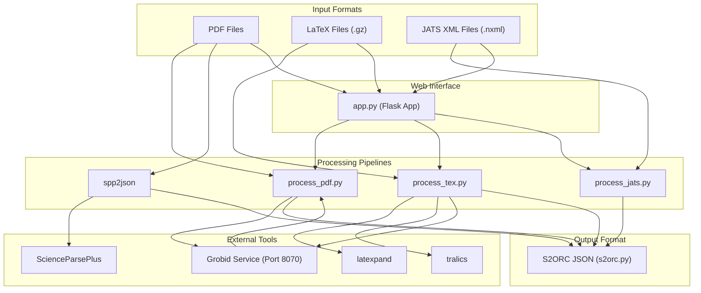
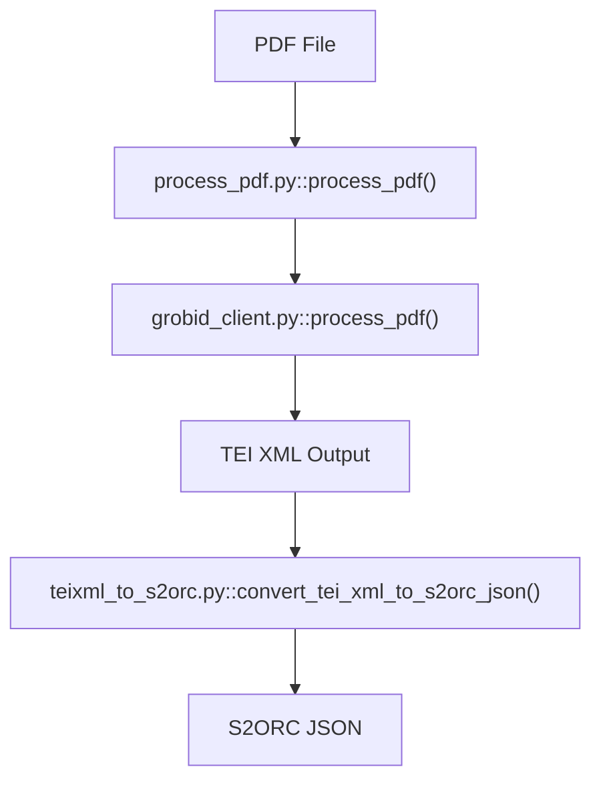
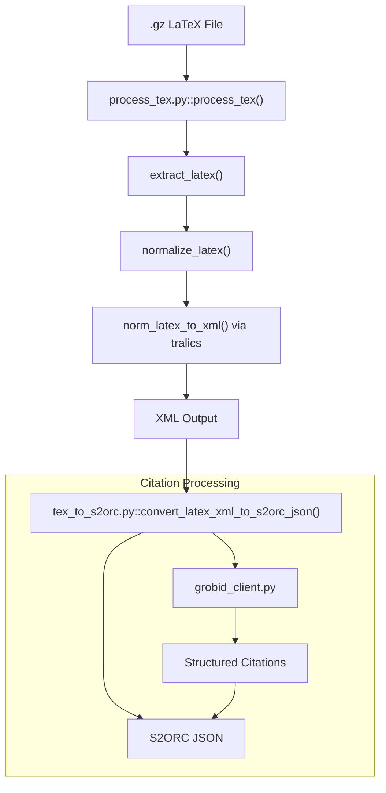
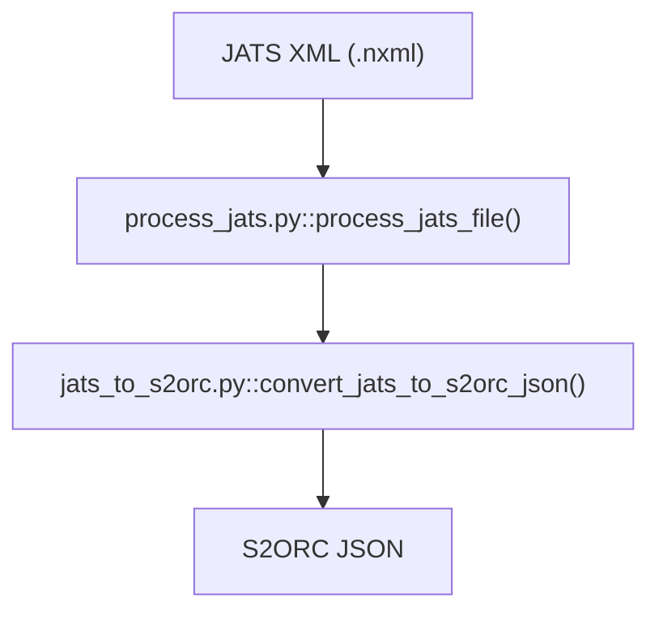
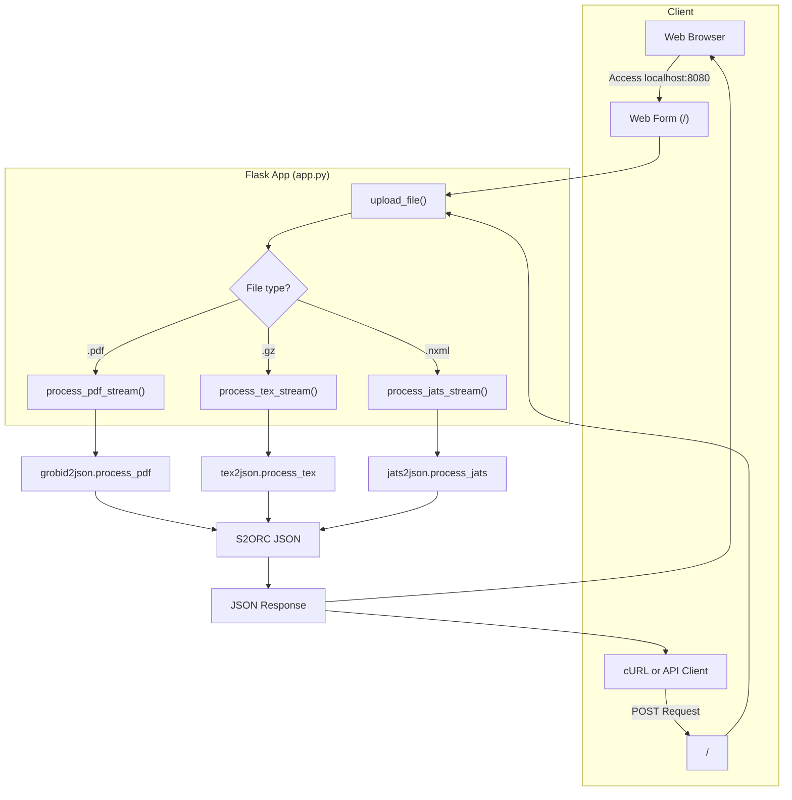
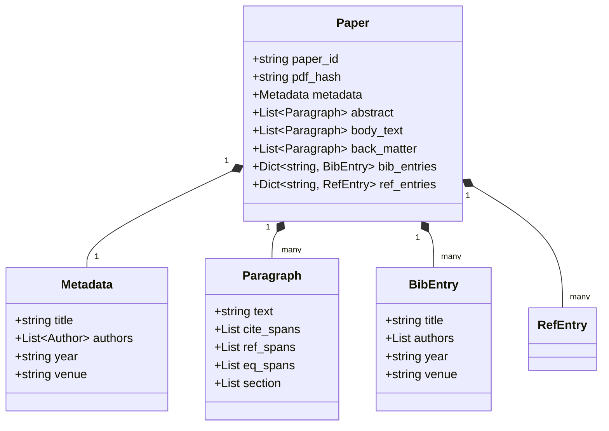

<!-- source: DeepWiki mcp.deepwiki.com · repo allenai/s2orc-doc2json · page 1 Overview · fetched 2026-10-26 -->

# Overview

Relevant source files

The following files were used as context for generating this wiki page:

- [README.md](README.md)
- [doc2json/grobid2json/__init__.py](doc2json/grobid2json/__init__.py)
- [doc2json/grobid2json/grobid/__init__.py](doc2json/grobid2json/grobid/__init__.py)
- [doc2json/spp2json/spp/__init__.py](doc2json/spp2json/spp/__init__.py)
- [doc2json/tex2json/__init__.py](doc2json/tex2json/__init__.py)

The s2orc-doc2json repository provides tools to convert scientific papers from various formats (PDF, LaTeX, JATS XML) into a standardized JSON format used by the Semantic Scholar Open Research Corpus (S2ORC). This document introduces the repository's purpose, main components, and high-level architecture.

For detailed information about repository structure, see [Repository Structure](#1.1). For installation instructions, see [Installation and Setup](#1.2). For information about the S2ORC data format, see [S2ORC Data Model](#2).

## Purpose and Scope

The s2orc-doc2json system serves as a document conversion framework for the S2ORC project, extracting structured information from scientific papers into a unified JSON schema. This schema is also used in the COVID-19 Open Research Dataset (CORD-19) project.

The repository supports multiple document formats through specialized conversion pipelines:
- **grobid2json**: Converts PDFs to JSON using Grobid
- **tex2json**: Processes LaTeX documents (primarily from arXiv)
- **jats2json**: Processes JATS XML files (primarily from PubMed Central)
- **spp2json**: Alternative PDF processing using ScienceParsePlus

A web interface (Flask application) is also provided for easy document conversion through a browser or API calls.

Sources: [README.md:1-9]()

## System Architecture Overview

Sources: [README.md:27-45](), [README.md:65-82](), [README.md:84-92](), [README.md:98-120]()

## Document Conversion Pipelines

### PDF Processing with Grobid

The primary PDF processing pipeline uses Grobid to extract structured information from PDFs:

Sources: [README.md:27-64]()

### LaTeX Processing

The LaTeX processing pipeline handles compressed LaTeX files, typically from arXiv:

Sources: [README.md:65-82]()

### JATS XML Processing

The JATS XML processing pipeline handles PubMed Central XML files:

Sources: [README.md:84-92]()

## Web Interface

The repository includes a Flask web application that provides an easy-to-use interface for document conversion:

Sources: [README.md:98-120]()

## S2ORC JSON Data Model

The repository converts scientific papers into a standardized JSON format defined in `s2orc.py`. This format captures:

- Paper metadata (title, authors, year, venue)
- Abstract paragraphs
- Body text paragraphs with citations, references, and equations
- Bibliography entries
- Reference entries for figures, tables, and equations

For detailed information on the S2ORC data model, see [S2ORC Data Model](#2).

Sources: [README.md:5-7](), [README.md:93-96]()

## Key Dependencies

The s2orc-doc2json system relies on several external tools and libraries:

| Pipeline | Input Format | External Dependencies | Purpose |
|----------|-------------|------------------------|---------|
| grobid2json | PDF | Grobid (Java) | Extract structured information from PDFs |
| tex2json | LaTeX (.gz) | latexpand, tralics, Grobid | Process LaTeX files and extract citations |
| jats2json | JATS XML (.nxml) | None | Process JATS XML from PubMed Central |
| spp2json | PDF | ScienceParsePlus | Alternative PDF processor |

Grobid (version 0.7.3) runs as a service on port 8070 and is a critical component for both PDF and LaTeX processing. For LaTeX processing, `latexpand` and `tralics` are required to expand and convert LaTeX to XML.

Sources: [README.md:31-51](), [README.md:65-71]()

## Summary

The s2orc-doc2json repository provides a comprehensive framework for converting scientific papers from different formats into a standardized JSON format. By supporting multiple input formats and providing both command-line tools and a web interface, the system enables efficient processing of scientific literature for large-scale corpus creation and analysis.

The standardized JSON format facilitates downstream tasks such as information extraction, citation network analysis, and knowledge discovery across the scientific literature, supporting the broader goals of the S2ORC project.

Sources: [README.md:1-9](), [README.md:123-137]()

---

