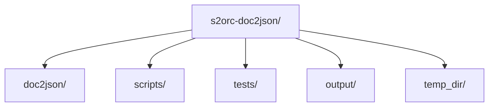
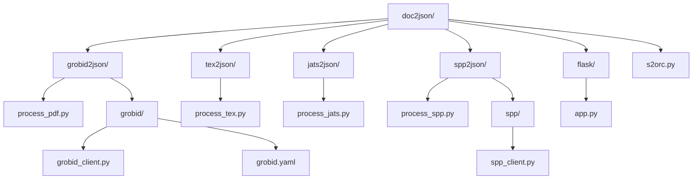
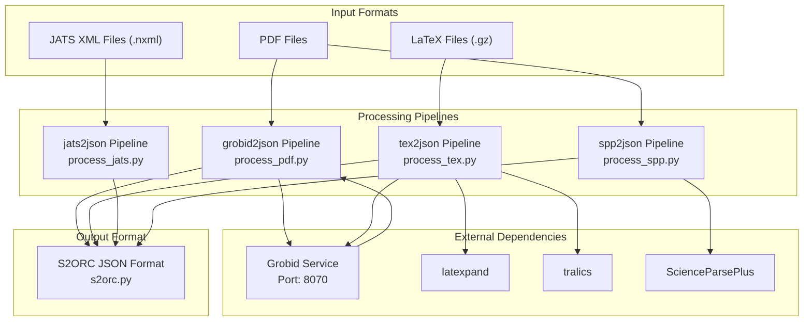
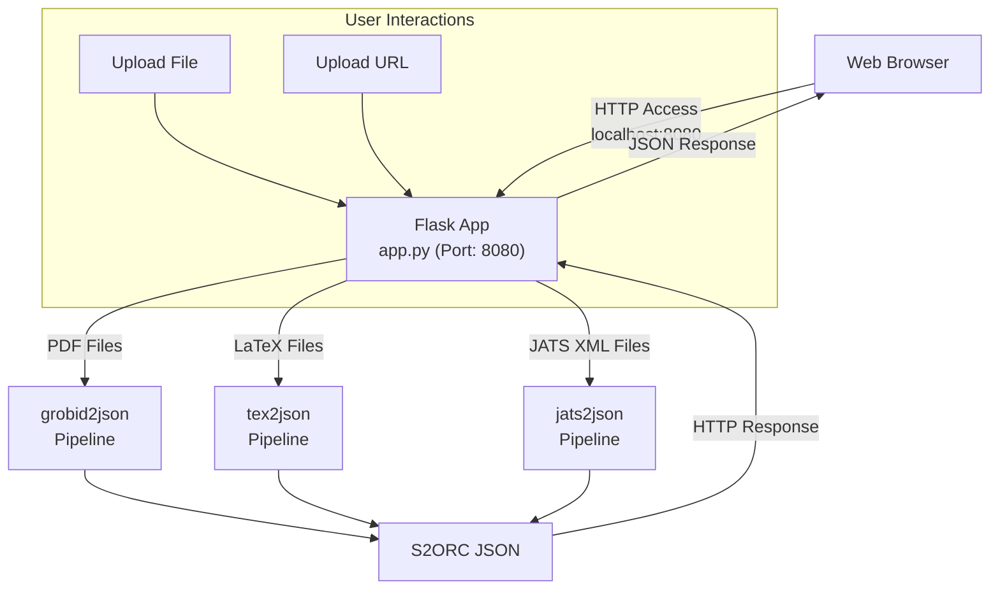
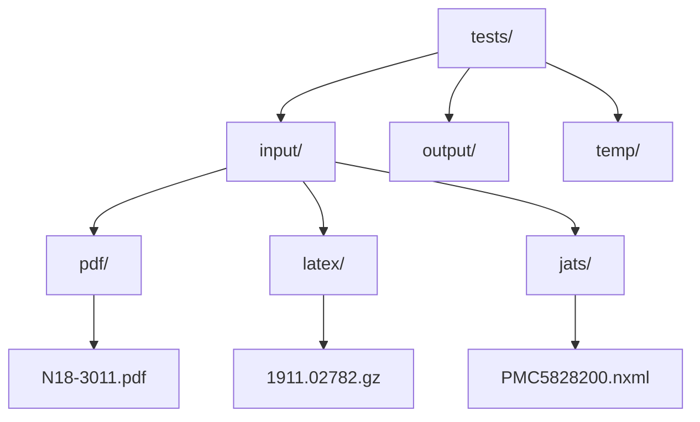

<!-- source: DeepWiki mcp.deepwiki.com · repo allenai/s2orc-doc2json · page 1.1 Repository Structure · fetched 2026-10-26 -->

# Repository Structure

Relevant source files

The following files were used as context for generating this wiki page:

- [.gitignore](.gitignore)
- [README.md](README.md)
- [doc2json/grobid2json/__init__.py](doc2json/grobid2json/__init__.py)
- [doc2json/grobid2json/grobid/__init__.py](doc2json/grobid2json/grobid/__init__.py)
- [doc2json/grobid2json/grobid/grobid.yaml](doc2json/grobid2json/grobid/grobid.yaml)
- [doc2json/spp2json/spp/__init__.py](doc2json/spp2json/spp/__init__.py)
- [doc2json/tex2json/__init__.py](doc2json/tex2json/__init__.py)

This document provides a detailed overview of the s2orc-doc2json repository structure, explaining the organization of the codebase and the purpose of each main component. For information about installation and setup, see [Installation and Setup](#1.2).

## Top-Level Directory Organization

The s2orc-doc2json repository is organized into several top-level directories, each serving a specific purpose in the document conversion workflow:

| Directory | Purpose |
|-----------|---------|
| `doc2json/` | Main Python package containing all conversion pipelines and core functionality |
| `scripts/` | Shell scripts for setting up and running external dependencies (e.g., Grobid) |
| `tests/` | Test data and expected outputs for validating the conversion pipelines |
| `output/` | Default directory for storing JSON output files |
| `temp_dir/` | Default directory for storing temporary files during processing |

Sources: [README.md:1-145](), [.gitignore:1-11]()

## Main Package Structure

The `doc2json` package is the core of the repository, containing several specialized modules, each responsible for a specific document conversion pipeline:

| Package/Module | Purpose | Entry Point |
|----------------|---------|-------------|
| `grobid2json/` | Converts PDF documents to JSON using Grobid | `process_pdf.py` |
| `tex2json/` | Converts LaTeX documents to JSON | `process_tex.py` |
| `jats2json/` | Converts JATS XML documents to JSON | `process_jats.py` |
| `spp2json/` | Alternative PDF-to-JSON conversion using ScienceParsePlus | `process_spp.py` |
| `flask/` | Web interface for document conversion | `app.py` |
| `s2orc.py` | Defines the S2ORC JSON schema and data model | - |

Sources: [README.md:3-7](), [doc2json/grobid2json/__init__.py:1](), [doc2json/tex2json/__init__.py:1](), [doc2json/spp2json/spp/__init__.py:1]()

## Conversion Pipeline Architecture

The repository implements four distinct conversion pipelines, each specialized for a particular input format, but all producing the standardized S2ORC JSON format:

| Pipeline | Input Format | External Dependencies | Output Format |
|----------|--------------|--------------|--------------|
| `grobid2json` | PDF (.pdf) | Grobid | S2ORC JSON |
| `tex2json` | LaTeX (.gz) | latexpand, tralics, Grobid | S2ORC JSON |
| `jats2json` | JATS XML (.nxml) | None | S2ORC JSON |
| `spp2json` | PDF (.pdf) | ScienceParsePlus | S2ORC JSON |

Sources: [README.md:27-92]()

## External Dependencies

The conversion pipelines integrate with several external tools:

1. **Grobid**: A machine learning library for extracting structured information from scholarly documents
   - Used by: `grobid2json` and `tex2json` pipelines
   - Configured by: `doc2json/grobid2json/grobid/grobid.yaml`
   - Default port: 8070
   - Version: 0.7.3

2. **latexpand**: A utility for expanding LaTeX files and resolving imports
   - Used by: `tex2json` pipeline
   - Required for processing LaTeX document structure

3. **tralics**: A LaTeX to XML converter
   - Used by: `tex2json` pipeline
   - Converts normalized LaTeX to an intermediate XML format

4. **ScienceParsePlus**: An alternative tool for PDF parsing
   - Used by: `spp2json` pipeline
   - Provides an alternative approach to extracting structured data from PDFs

Sources: [README.md:35-50](), [README.md:69-71](), [doc2json/grobid2json/grobid/grobid.yaml:1-273]()

## Web Interface Architecture

The repository includes a Flask web application that serves as a user-friendly interface for the document conversion pipelines:

The Flask application (`doc2json/flask/app.py`) provides two main endpoints:

- `/`: Main endpoint for uploading document files directly
- `/upload_url`: Endpoint for processing documents from URLs

Sources: [README.md:98-118]()

## Setup Scripts

The `scripts/` directory contains shell scripts for managing external dependencies:

- `setup_grobid.sh`: Downloads and configures Grobid 0.7.3
   - Sets up the Grobid service
   - Copies custom configuration from `doc2json/grobid2json/grobid/grobid.yaml`

- `run_grobid.sh`: Starts the Grobid service on port 8070
   - Required to be running before using `grobid2json` or `tex2json` pipelines

Sources: [README.md:38-46]()

## Test Directory Structure

The `tests/` directory is organized to facilitate testing of the conversion pipelines:

| Directory | Purpose |
|-----------|---------|
| `input/` | Sample input files for testing each conversion pipeline |
| `output/` | Expected and actual output JSON files from test runs |
| `temp/` | Temporary files generated during the testing process |

Sources: [README.md:57-60](), [.gitignore:3-5]()

## Ignored Directories

The `.gitignore` file specifies several directories that are excluded from version control:

- `.idea/`: IDE-specific directory (PyCharm)
- `*__pycache__/`: Python cache directories
- `*.egg-info/`: Python package metadata
- `tests/output/*`: Test output files
- `tests/temp/*`: Temporary test files
- `temp_dir/`: Temporary processing directory
- `output_dir/`: Output directory for converted files

Sources: [.gitignore:1-11]()

---

