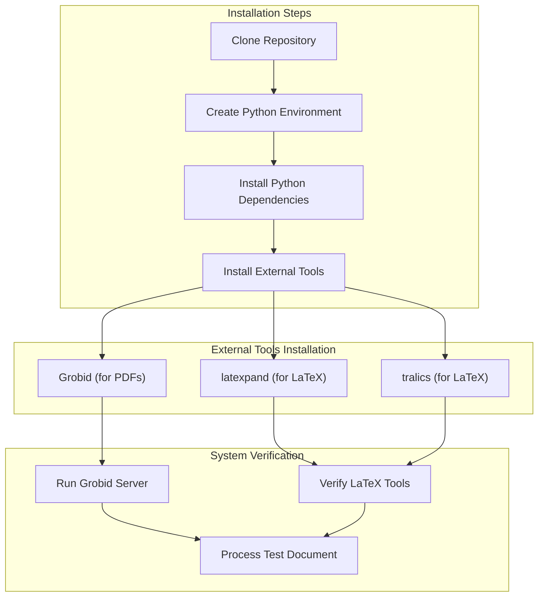
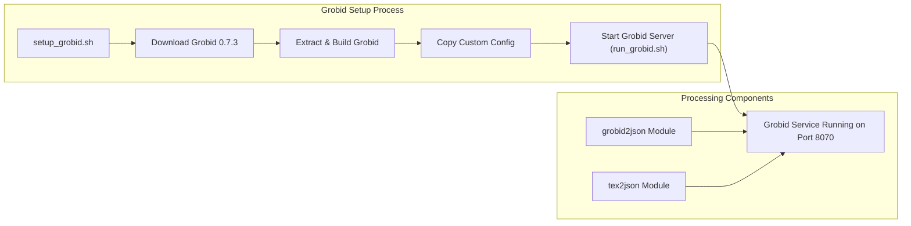
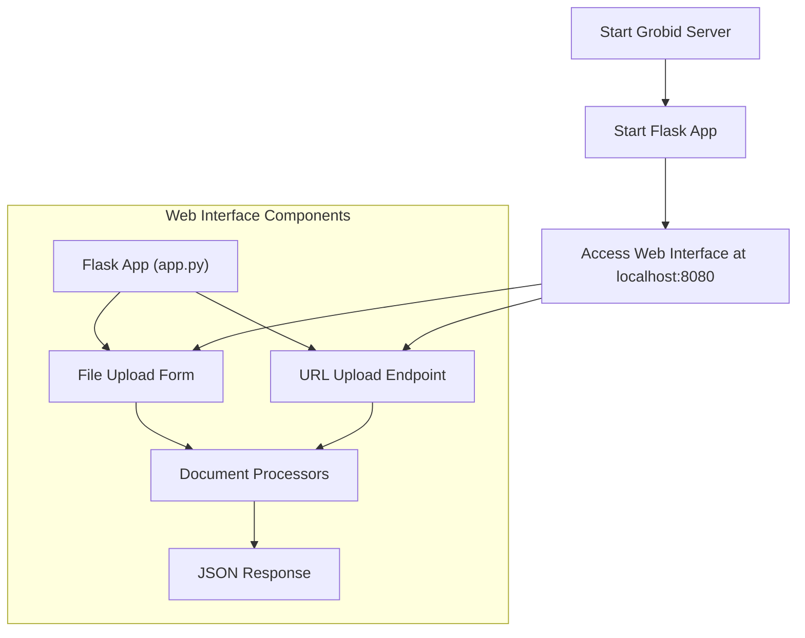
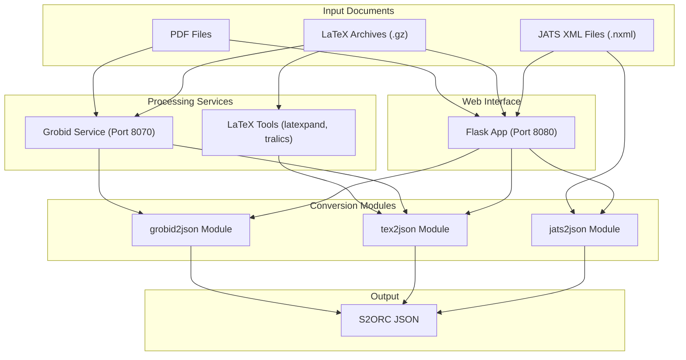

<!-- source: DeepWiki mcp.deepwiki.com · repo allenai/s2orc-doc2json · page 1.2 Installation and Setup · fetched 2026-10-26 -->

# Installation and Setup

<details>
<summary>Relevant source files</summary>

The following files were used as context for generating this wiki page:

- [README.md](README.md)
- [scripts/run_grobid.sh](scripts/run_grobid.sh)
- [scripts/setup_grobid.sh](scripts/setup_grobid.sh)

</details>


This page provides the detailed steps for installing and configuring the s2orc-doc2json system that converts scientific documents (PDF, LaTeX, JATS XML) into the S2ORC JSON format. For information about the overall system architecture, see [Overview](#1), and for details about the specific conversion pipelines, see [Conversion Pipelines](#3).

## Prerequisites

Before beginning installation, ensure your system has:

- Python 3.8 or later
- Java 11 (required for Grobid)
- pip and git
- bash shell environment

## Environment Setup Diagram



Sources: [README.md:12-25](), [README.md:31-52](), [README.md:67-71]()

## Basic Environment Setup

1. Clone the repository:
   ```bash
   git clone https://github.com/allenai/s2orc-doc2json.git
   cd s2orc-doc2json
   ```

2. Set up a Python environment using conda (or your preferred environment manager):
   ```bash
   conda create -n doc2json python=3.8 pytest
   conda activate doc2json
   pip install -r requirements.txt
   python setup.py develop
   ```

Sources: [README.md:12-25]()

## Installing and Configuring Components

The setup process varies depending on which document types you need to process.

### Grobid Installation (Required for PDF Processing)

Grobid is a machine learning library that extracts information from scholarly documents. It's required for processing PDFs and also for certain LaTeX processing steps.



You have two options for installing Grobid:

#### Option 1: Using the Provided Script

1. Edit the `setup_grobid.sh` script to set the correct `DOC2JSON_HOME` path:
   ```bash
   # Edit this line to point to your installation directory
   export DOC2JSON_HOME=/path/to/s2orc-doc2json
   ```

2. Run the setup script:
   ```bash
   bash scripts/setup_grobid.sh
   ```

3. After installation, start the Grobid server:
   ```bash
   bash scripts/run_grobid.sh
   ```

#### Option 2: Manual Installation

1. Download and extract Grobid 0.7.3:
   ```bash
   cd $HOME
   wget https://github.com/kermitt2/grobid/archive/0.7.3.zip
   unzip 0.7.3.zip
   rm 0.7.3.zip
   ```

2. Build and install Grobid:
   ```bash
   cd $HOME/grobid-0.7.3
   ./gradlew clean install
   ```

3. Copy the provided configuration (optional but recommended):
   ```bash
   cp /path/to/s2orc-doc2json/doc2json/grobid2json/grobid/grobid.yaml $HOME/grobid-0.7.3/grobid-home/config/grobid.yaml
   ```

4. Start the Grobid server:
   ```bash
   cd $HOME/grobid-0.7.3
   ./gradlew run
   ```

Grobid by default runs on port 8070. The server is ready when the console shows "87% EXECUTING" (this is normal behavior).

Sources: [README.md:31-52](), [scripts/setup_grobid.sh:1-22](), [scripts/run_grobid.sh:1-6]()

### LaTeX Processing Dependencies

If you plan to process LaTeX documents, you'll need to install additional tools:

1. Install latexpand:
   ```bash
   # On Ubuntu/Debian
   apt install texlive-extra-utils
   
   # On macOS with Homebrew
   brew install texlive
   ```

2. Install tralics:
   ```bash
   # On Ubuntu/Debian
   apt install tralics
   
   # On macOS with Homebrew
   brew install tralics
   ```

Sources: [README.md:67-71]()

## Component Dependencies Table

| Component | Purpose | Required For | Dependencies |
|-----------|---------|--------------|-------------|
| Python Environment | Core runtime | All conversions | Python 3.8+, pip |
| Grobid | Extracts structured data from PDFs | PDF processing, LaTeX processing | Java 11 |
| latexpand | Resolves LaTeX includes | LaTeX processing | TeX Live |
| tralics | Converts LaTeX to XML | LaTeX processing | - |

Sources: [README.md:12-82]()

## Testing Your Installation

After installing all components, you can verify the installation by processing test documents:

### Testing PDF Processing

1. Start the Grobid server if not already running:
   ```bash
   bash scripts/run_grobid.sh
   ```

2. Process a test PDF:
   ```bash
   python doc2json/grobid2json/process_pdf.py -i tests/pdf/N18-3011.pdf -t temp_dir/ -o output_dir/
   ```

### Testing LaTeX Processing

1. Ensure Grobid is running (required for citation and author processing):
   ```bash
   bash scripts/run_grobid.sh
   ```

2. Process a test LaTeX file:
   ```bash
   python doc2json/tex2json/process_tex.py -i tests/latex/1911.02782.gz -t temp_dir/ -o output_dir/
   ```

### Testing JATS XML Processing

```bash
python doc2json/jats2json/process_jats.py -i tests/jats/PMC5828200.nxml -o output_dir/
```

Sources: [README.md:54-92]()

## Running the Web Interface

The system includes a Flask web application that provides a user interface for document processing:



1. Start the Grobid server (required for PDF processing):
   ```bash
   bash scripts/run_grobid.sh
   ```

2. Start the Flask application:
   ```bash
   python doc2json/flask/app.py
   ```

3. Access the web interface by navigating to [http://localhost:8080](http://localhost:8080) in your browser.

4. You can also use the API directly, for example:
   ```bash
   curl localhost:8080/ -F file=@tests/pdf/N18-3011.pdf
   ```

Sources: [README.md:98-118]()

## Configuration Options

### Grobid Configuration

The Grobid configuration file (`grobid.yaml`) is located at `$HOME/grobid-0.7.3/grobid-home/config/grobid.yaml` after installation. Key configuration options include:

- Server port (default: 8070)
- Maximum connections
- Logging levels

If you modify the Grobid port, you must also update the port in `doc2json/grobid2json/grobid/grobid_client.py`.

Sources: [README.md:49-51](), [scripts/setup_grobid.sh:14-18]()

### Flask Application Configuration

The Flask application defaults to port 8080. To modify this, edit the `doc2json/flask/app.py` file.

Sources: [README.md:106]()

## Common Installation Issues

1. **Grobid fails to start**: Ensure Java 11 is installed and properly configured.
2. **LaTeX processing fails**: Verify that both latexpand and tralics are correctly installed and available in your PATH.
3. **Port conflicts**: If the default ports (8070 for Grobid, 8080 for Flask) are already in use, modify the configuration as described above.

## System Architecture Overview



Sources: [README.md:1-143]()

This completes the installation and setup process for the s2orc-doc2json system. For more details about using the different conversion pipelines, refer to [Conversion Pipelines](#3).

---

