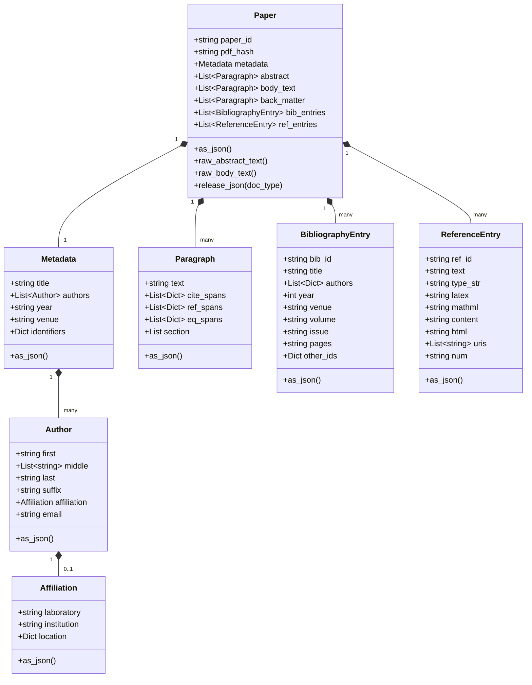
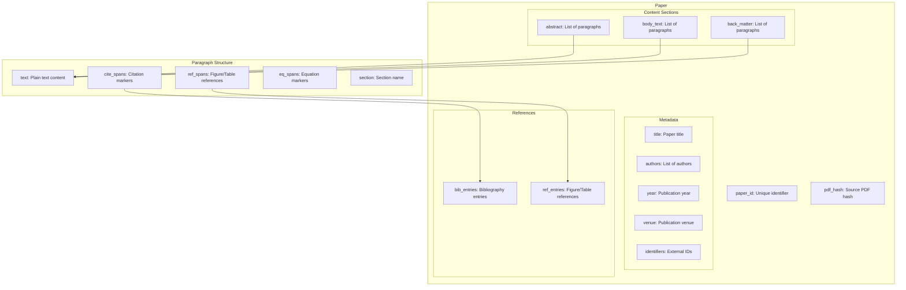
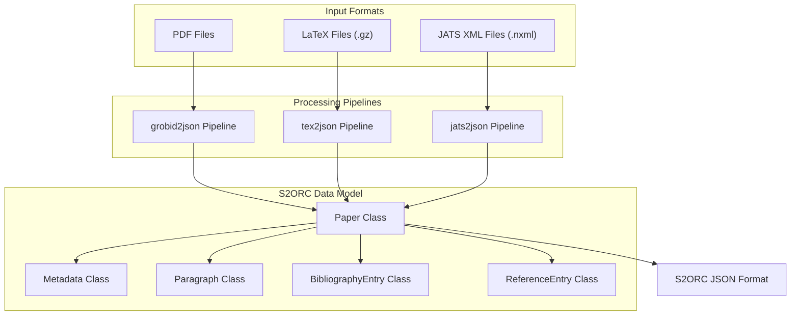

<!-- source: DeepWiki mcp.deepwiki.com · repo allenai/s2orc-doc2json · page 2 S2ORC Data Model · fetched 2026-10-26 -->

# S2ORC Data Model

<details>
<summary>Relevant source files</summary>

The following files were used as context for generating this wiki page:

- [README.md](README.md)
- [doc2json/s2orc.py](doc2json/s2orc.py)

</details>


The S2ORC (Semantic Scholar Open Research Corpus) Data Model provides a standardized format for representing scientific papers across different source formats (PDF, LaTeX, JATS XML). This document describes the core data structures and relationships in the S2ORC model, which is used by all conversion pipelines in the s2orc-doc2json repository to produce a consistent JSON output format.

The S2ORC data model is primarily defined in the [doc2json/s2orc.py]() file, which contains the Python classes that implement the data structures and provide serialization capabilities.

## Class Structure

The S2ORC Data Model consists of several interconnected classes that represent different aspects of a scientific paper.

### Class Hierarchy Diagram



Sources: [doc2json/s2orc.py:33-474]()

### Core Classes

#### Paper

The `Paper` class is the root container that represents a complete scientific paper. It aggregates all other components.

```python
Paper(
    paper_id: str,                  # Unique identifier for the paper
    pdf_hash: str,                  # Hash of the source PDF file
    metadata: Dict,                 # Paper metadata
    abstract: List[Dict],           # List of abstract paragraphs
    body_text: List[Dict],          # List of main text paragraphs
    back_matter: List[Dict],        # List of back matter paragraphs
    bib_entries: Dict,              # Bibliography entries
    ref_entries: Dict               # Reference entries like figures, tables
)
```

Sources: [doc2json/s2orc.py:387-474]()

#### Metadata

The `Metadata` class contains bibliographic information about the paper:

```python
Metadata(
    title: str,                     # Paper title
    authors: List[Dict],            # List of authors
    year: Optional[str] = None,     # Publication year
    venue: Optional[str] = None,    # Publication venue
    identifiers: Optional[Dict] = {}  # External IDs (DOI, arXiv, etc.)
)
```

Sources: [doc2json/s2orc.py:263-313]()

#### Paragraph

The `Paragraph` class represents a single paragraph of text, which could be in the abstract, body text, or back matter. It includes spans that mark citations, references to figures/tables, and equations.

```python
Paragraph(
    text: str,                      # Plain text of the paragraph
    cite_spans: List[Dict],         # Spans marking citations
    ref_spans: List[Dict],          # Spans marking references to figures/tables
    eq_spans: Optional[List[Dict]] = [],  # Spans marking equations
    section: Optional = None,       # Section this paragraph belongs to
    sec_num: Optional = None        # Section number
)
```

Sources: [doc2json/s2orc.py:315-385]()

#### BibliographyEntry

The `BibliographyEntry` class represents a citation/reference to another paper:

```python
BibliographyEntry(
    bib_id: str,                    # ID of this reference
    title: str,                     # Title of the cited paper
    authors: List[Dict],            # Authors of the cited paper
    ref_id: Optional[str] = None,   # Reference ID
    year: Optional[int] = None,     # Publication year
    venue: Optional[str] = None,    # Publication venue
    volume: Optional[str] = None,   # Journal volume
    issue: Optional[str] = None,    # Journal issue
    pages: Optional[str] = None,    # Page numbers
    other_ids: Dict[str, List] = None,  # External IDs
    # ... additional fields
)
```

Sources: [doc2json/s2orc.py:101-178]()

#### ReferenceEntry

The `ReferenceEntry` class represents non-citation references like figures, tables, and equations:

```python
ReferenceEntry(
    ref_id: str,                    # ID of this reference
    text: str,                      # Reference text (e.g., figure caption)
    type_str: str,                  # Type (figure, table, equation, etc.)
    latex: Optional[str] = None,    # LaTeX for equations
    mathml: Optional[str] = None,   # MathML for equations
    content: Optional[str] = None,  # Content (for tables)
    html: Optional[str] = None,     # HTML (for tables)
    uris: Optional[List[str]] = None,  # URIs for images
    num: Optional[str] = None,      # Reference number
    # ... additional fields
)
```

Sources: [doc2json/s2orc.py:33-99]()

## Paper Structure

The following diagram shows how the different components are organized within a paper:



Sources: [doc2json/s2orc.py:387-474](), [README.md:5-7]()

## JSON Schema

When serialized to JSON, the S2ORC paper structure follows this format:

```
{
  "paper_id": "<unique identifier>",
  "pdf_hash": "<hash of source PDF>",
  "metadata": {
    "title": "<paper title>",
    "authors": [
      {
        "first": "<first name>",
        "middle": ["<middle name>"],
        "last": "<last name>",
        "suffix": "<suffix>",
        "affiliation": {
          "laboratory": "<lab name>",
          "institution": "<institution name>",
          "location": {
            "postCode": "<postal code>",
            "settlement": "<city>",
            "country": "<country>"
          }
        },
        "email": "<email address>"
      }
    ],
    "year": "<publication year>",
    "venue": "<publication venue>",
    "identifiers": {
      "<id_type>": "<id_value>"
    }
  },
  "abstract": [
    {
      "text": "<paragraph text>",
      "cite_spans": [
        {
          "start": <start_position>,
          "end": <end_position>,
          "text": "<citation text>",
          "ref_id": "<reference to bib_entries>"
        }
      ],
      "ref_spans": [...],
      "eq_spans": [...],
      "section": "<section name>",
      "sec_num": "<section number>"
    }
  ],
  "body_text": [...],  // Same structure as abstract
  "back_matter": [...],  // Same structure as abstract
  "bib_entries": {
    "<bib_id>": {
      "ref_id": "<reference id>",
      "title": "<reference title>",
      "authors": [...],  // Same structure as paper authors
      "year": <publication year>,
      "venue": "<publication venue>",
      "volume": "<volume>",
      "issue": "<issue>",
      "pages": "<page range>",
      "other_ids": {
        "<id_type>": ["<id_value>"]
      }
    }
  },
  "ref_entries": {
    "<ref_id>": {
      "text": "<reference text>",
      "type_str": "<reference type>",
      // Additional fields depend on the reference type:
      // for equations:
      "latex": "<LaTeX code>",
      "mathml": "<MathML code>",
      // for tables:
      "content": "<table content>",
      "html": "<HTML representation>",
      // for figures:
      "uris": ["<image URI>"],
      "num": "<reference number>"
    }
  }
}
```

Sources: [doc2json/s2orc.py:421-431]()

## Reference Spans and Citation Spans

The S2ORC model uses a span-based approach to mark citations and references to figures, tables, and equations within the text:

### Citation Spans

Citation spans mark references to bibliography entries:

```
"cite_spans": [
  {
    "start": 54,
    "end": 57,
    "text": "[1]",
    "ref_id": "BIBREF0"  // Links to a bib_entries entry
  }
]
```

### Reference Spans

Reference spans mark references to figures, tables, etc.:

```
"ref_spans": [
  {
    "start": 76,
    "end": 82,
    "text": "Fig. 1",
    "ref_id": "FIGREF0"  // Links to a ref_entries entry
  }
]
```

### Equation Spans

Equation spans mark inline equations:

```
"eq_spans": [
  {
    "start": 53,
    "end": 61,
    "text": "α = 1",
    "latex": "\\alpha = 1",
    "ref_id": null  // May link to a ref_entries entry for a numbered equation
  }
]
```

Sources: [doc2json/s2orc.py:315-385]()

## Utility Methods

The S2ORC classes provide several utility methods:

1. **as_json()**: Each class has an `as_json()` method that converts the object to a JSON-serializable dictionary.

2. **raw_abstract_text()**: Returns the concatenated text of all abstract paragraphs.

3. **raw_body_text()**: Returns the concatenated text of all body text paragraphs.

4. **release_json(doc_type)**: Produces a special JSON format used for S2ORC releases, with additional header information.

5. **load_s2orc(paper_dict)**: Function to load a paper from a JSON dictionary, handling different S2ORC format versions.

Sources: [doc2json/s2orc.py:421-530]()

## Usage

The S2ORC data model is the output format for all document conversion pipelines in the repository:



Sources: [README.md:1-7](), [doc2json/s2orc.py:387-474]()

To load an existing S2ORC JSON file, use the `load_s2orc` function from `doc2json/s2orc.py`:

```python
from doc2json.s2orc import load_s2orc
import json

with open('paper.json', 'r') as f:
    paper_dict = json.load(f)

paper = load_s2orc(paper_dict)
```

Sources: [doc2json/s2orc.py:476-530](), [README.md:94-96]()

## Compatibility Notes

The S2ORC data model has evolved over time with different versions of the S2ORC corpus. The `load_s2orc` function attempts to handle these variations, supporting both:

- 2019 GORC parses with a "grobid_parse" key
- Current and 2020 S2ORC releases with "pdf_parse" and separate metadata

The S2ORC data model is also used by the CORD-19 project, which may be familiar to researchers who have worked with that dataset.

Sources: [README.md:5-7](), [doc2json/s2orc.py:476-530]()

---

