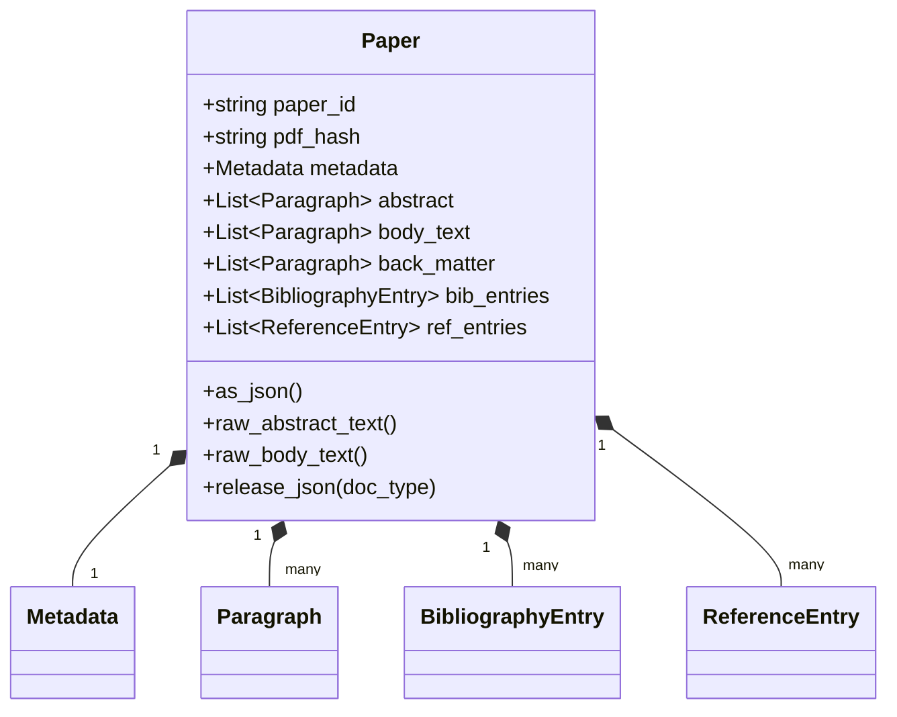
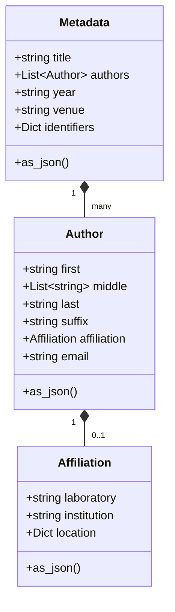
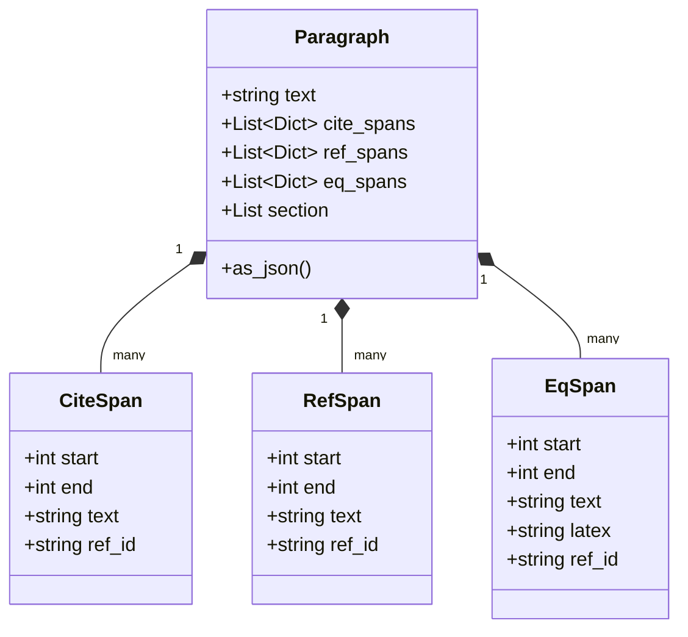
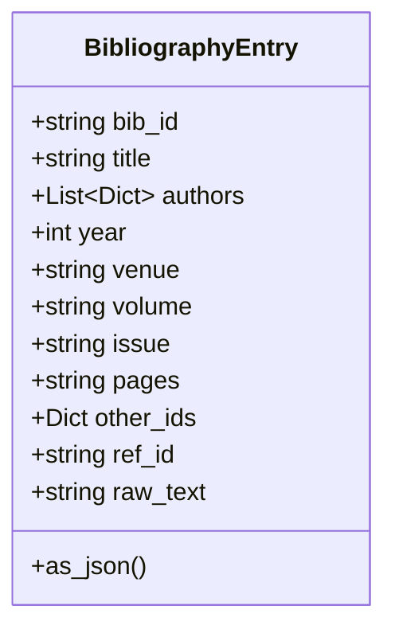
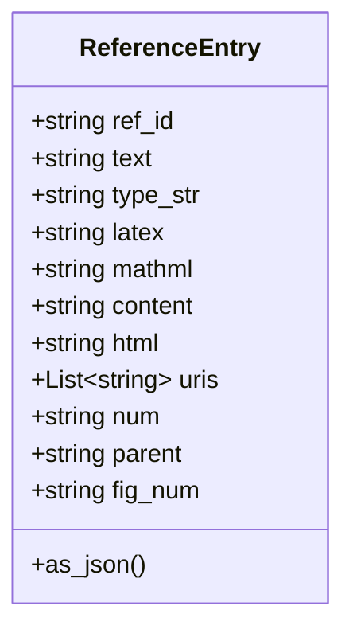
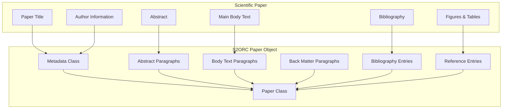
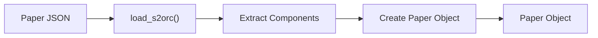

<!-- source: DeepWiki mcp.deepwiki.com · repo allenai/s2orc-doc2json · page 2.1 Paper Structure · fetched 2026-10-26 -->

# Paper Structure

<details>
<summary>Relevant source files</summary>

The following files were used as context for generating this wiki page:

- [doc2json/config.py](doc2json/config.py)
- [doc2json/s2orc.py](doc2json/s2orc.py)
- [tests/s2orc/20190928/10002293.json](tests/s2orc/20190928/10002293.json)

</details>


This document details the structure of the `Paper` class in the s2orc-doc2json system, which serves as the core data model for representing scientific papers. The `Paper` class encapsulates all the essential components of a scholarly document, including metadata, textual content, bibliographic references, and other scholarly elements. For information about the JSON schema used to serialize paper objects, see [JSON Format](#2.2).

## Paper Class Overview

The `Paper` class is the central data structure that represents a scientific document in the S2ORC format. It contains the complete representation of a paper, including its metadata, textual content broken down into sections, bibliographic entries, and various types of references (figures, tables, equations).



Sources: [doc2json/s2orc.py:387-474]()

The `Paper` class is initialized with the following parameters:

| Parameter | Type | Description |
|-----------|------|-------------|
| `paper_id` | string | Unique identifier for the paper |
| `pdf_hash` | string | Hash value of the PDF if available |
| `metadata` | dict | Dictionary containing paper metadata |
| `abstract` | list | List of paragraph dictionaries for the abstract |
| `body_text` | list | List of paragraph dictionaries for the main text |
| `back_matter` | list | List of paragraph dictionaries for the back matter |
| `bib_entries` | dict | Dictionary of bibliography entries |
| `ref_entries` | dict | Dictionary of references (figures, tables, etc.) |

Sources: [doc2json/s2orc.py:391-401]()

## Paper Components

### Metadata

The `Metadata` class encapsulates bibliographic information about the paper:



Sources: [doc2json/s2orc.py:213-313](), [doc2json/s2orc.py:181-211](), [doc2json/s2orc.py:263-313]()

The `Metadata` object contains the paper's title, authors (including their affiliations), publication year, venue, and various identifiers like DOI or arXiv ID.

### Paragraphs and Content Structure

The `Paper` class contains three lists of `Paragraph` objects:
- `abstract`: The paper's abstract split into paragraphs
- `body_text`: The main content of the paper
- `back_matter`: Additional content like appendices



Sources: [doc2json/s2orc.py:315-385]()

Each `Paragraph` contains:
- The paragraph text
- Citation spans (references to bibliography entries)
- Reference spans (references to figures, tables, etc.)
- Equation spans
- Section information

### Bibliography Entries

Bibliography entries represent the references cited in the paper:



Sources: [doc2json/s2orc.py:101-179]()

Each `BibliographyEntry` contains bibliographic information about a cited work, including title, authors, year, venue, and other identifiers.

### Reference Entries

Reference entries represent figures, tables, equations, and other non-textual elements:



Sources: [doc2json/s2orc.py:33-99]()

The `type_str` field indicates the type of reference, which can be:
- `figure`: Figures or images
- `table`: Data tables
- `equation`: Mathematical equations
- `section`: Section headings
- `footnote`: Footnotes

## Paper Structure Workflow

The following diagram illustrates how a scientific paper is structured in the s2orc-doc2json system:



Sources: [doc2json/s2orc.py:387-474]()

## Serialization and Deserialization

The `Paper` class includes methods for serializing to and deserializing from JSON:

### Serialization Methods

1. **`as_json()`**: Converts the `Paper` object and all its components to a JSON-serializable dictionary.
   
2. **`raw_abstract_text()`**: Returns the abstract text as a single string, joining all abstract paragraphs with newlines.
   
3. **`raw_body_text()`**: Returns the body text as a single string, joining all body text paragraphs with newlines.
   
4. **`release_json(doc_type)`**: Returns a JSON representation of the paper in a format suitable for release, including header information with the S2ORC version and generation date.

Sources: [doc2json/s2orc.py:421-473]()

### Deserialization

The `load_s2orc()` function outside the `Paper` class is used to load a paper from a JSON dictionary:



Sources: [doc2json/s2orc.py:476-530]()

The function handles different JSON formats, including the 2019 GORC format and the 2020 S2ORC format.

## Example Paper Structure

Here's an example of how a simple paper might be represented in the `Paper` class:

```
Paper:
├── paper_id: "10002293"
├── pdf_hash: "5f6e186429d76704a651eb1d0d7d37c0e906cc65"
├── metadata:
│   ├── title: "Antimicrobial Photodynamic Therapy against Endodontic Enterococcus faecalis and Candida albicans Mono and Mixed Biofilms..."
│   ├── authors: [...multiple authors...]
│   ├── year: "2017"
│   └── venue: "Frontiers in microbiology"
├── abstract:
│   └── [Paragraph with text about endodontic biofilms...]
├── body_text:
│   ├── [Paragraph about apical periodontitis...]
│   ├── [Paragraph about microbial biofilms...]
│   └── [...more paragraphs...]
├── back_matter:
│   └── [Concluding paragraphs...]
├── bib_entries:
│   ├── "b0": {title: "Photodynamic inactivation of multidrug-resistant bacteria...", authors: [...], year: 2014, ...}
│   ├── "b1": {title: "Antimicrobial photodynamic therapy: an effective alternative...", authors: [...], year: 2015, ...}
│   └── [...more bibliography entries...]
└── ref_entries:
    ├── "FIGREF0": {text: "Chemical structures of the photosensitizers tested", type_str: "figure", ...}
    ├── "TABREF0": {text: "Photosensitizers (PSs) effect in biofilm biomass", type_str: "table", ...}
    └── [...more reference entries...]
```

Sources: [tests/s2orc/20190928/10002293.json:1-10]()

This structure allows for comprehensive representation of a scientific paper, capturing not only the textual content but also the relationships between different elements like citations, figures, and equations.

---

