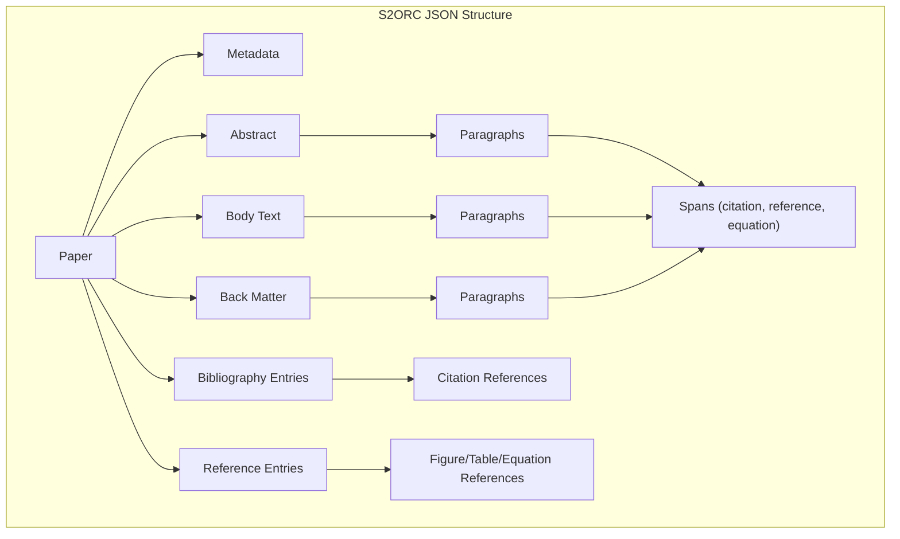
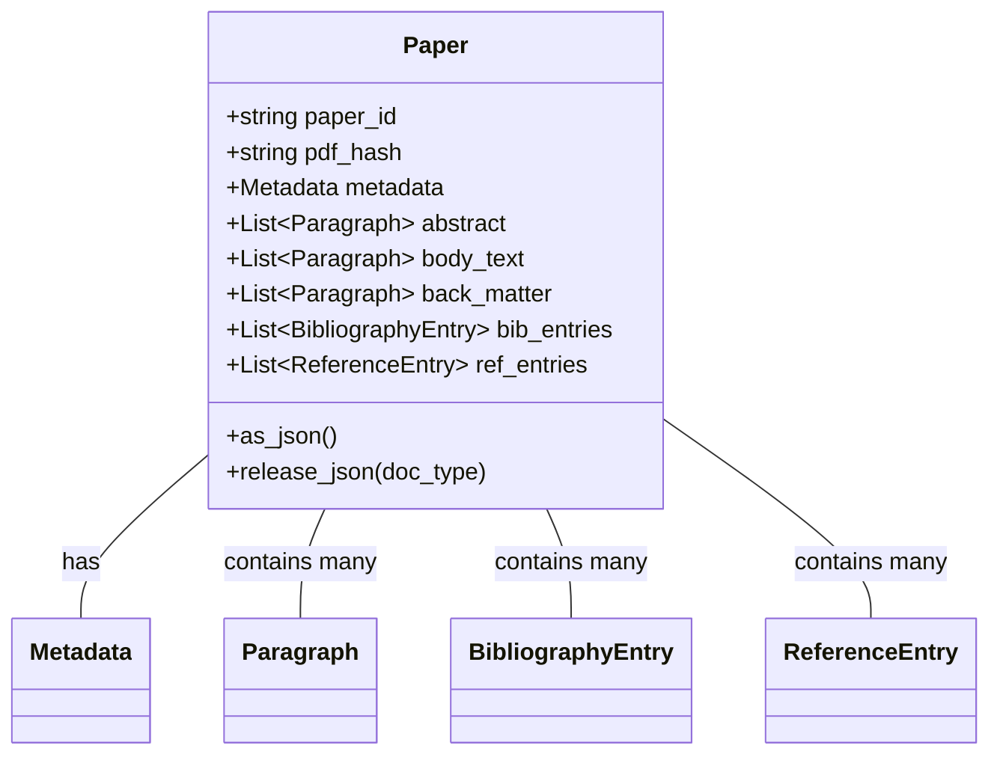
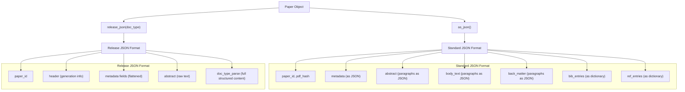
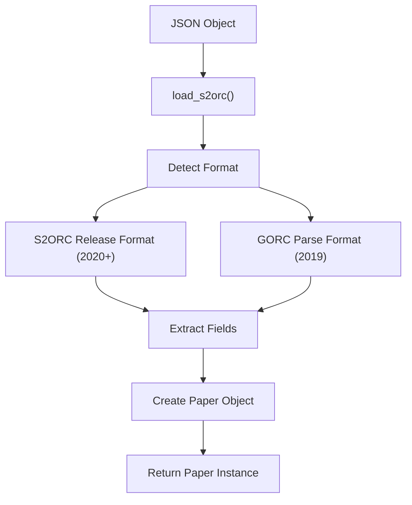

<!-- source: DeepWiki mcp.deepwiki.com · repo allenai/s2orc-doc2json · page 2.2 JSON Format · fetched 2026-10-26 -->

# JSON Format

<details>
<summary>Relevant source files</summary>

The following files were used as context for generating this wiki page:

- [doc2json/s2orc.py](doc2json/s2orc.py)
- [tests/pdf/2020.acl-main.207.json](tests/pdf/2020.acl-main.207.json)
- [tests/pdf/2020.acl-main.207.pdf](tests/pdf/2020.acl-main.207.pdf)
- [tests/pdf/2020.acl-main.207.tei.xml](tests/pdf/2020.acl-main.207.tei.xml)
- [tests/pdf/N18-3011.json](tests/pdf/N18-3011.json)
- [tests/pdf/N18-3011.pdf](tests/pdf/N18-3011.pdf)

</details>


This page documents the JSON format used by S2ORC-doc2json for representing scientific documents. The S2ORC JSON format provides a standardized structure for storing parsed scientific papers, including metadata, text content, citations, and various references. For information about the overall Paper structure, see [Paper Structure](#2.1).

## Overview of the S2ORC JSON Format

The S2ORC JSON format is designed to represent scholarly documents with their hierarchical structure and relationships intact. It captures both document metadata and content in a structured way that preserves citation spans, reference spans, and equation spans within the text.



Sources: [doc2json/s2orc.py:386-431](). [tests/pdf/2020.acl-main.207.json:74-472]().

## Core JSON Structure

The S2ORC JSON format consists of the following primary components:

| Field | Description | Type |
|-------|-------------|------|
| `paper_id` | Unique identifier for the paper | string |
| `pdf_hash` | Hash of the PDF file (if available) | string |
| `metadata` | Paper metadata (title, authors, etc.) | object |
| `abstract` | List of paragraphs in the abstract | array of objects |
| `body_text` | List of paragraphs in the main body | array of objects |
| `back_matter` | List of paragraphs in the back matter | array of objects |
| `bib_entries` | Bibliography entries referenced in the paper | dictionary |
| `ref_entries` | References to figures, tables, equations, etc. | dictionary |

Sources: [doc2json/s2orc.py:421-430]().

Let's examine how the Paper class in the codebase converts to this JSON structure:



Sources: [doc2json/s2orc.py:387-473]().

## Component JSON Structures

### Metadata JSON Format

The metadata section contains bibliographic information about the paper:

```json
{
  "title": "Paper title",
  "authors": [
    {
      "first": "First name",
      "middle": ["Middle names"],
      "last": "Last name",
      "suffix": "",
      "affiliation": {
        "laboratory": "Lab name",
        "institution": "Institution name",
        "location": {
          "postCode": "12345",
          "settlement": "City",
          "country": "Country"
        }
      },
      "email": "email@example.com"
    }
  ],
  "year": "2023",
  "venue": "Conference or journal name",
  "identifiers": {
    "doi": "10.xxxx/xxxxx",
    "arxiv": "xxxx.xxxxx"
  }
}
```

The `Metadata` class in the codebase handles this structure with the following fields:

- `title`: The title of the paper
- `authors`: List of author objects, each with first name, middle name, last name, suffix, affiliation, and email
- `year`: Publication year
- `venue`: Publication venue (conference or journal)
- `identifiers`: Dictionary of external identifiers (DOI, arXiv, etc.)

Sources: [doc2json/s2orc.py:263-312](). [tests/pdf/2020.acl-main.207.json:7-73]().

### Paragraph JSON Format

Paragraphs are the basic text units in the document and include spans for citations, references, and equations:

```json
{
  "text": "Paragraph text with citation CITATION_ID and reference REFERENCE_ID.",
  "cite_spans": [
    {
      "start": 28,
      "end": 40,
      "text": "CITATION_ID",
      "ref_id": "BIBREF0"
    }
  ],
  "ref_spans": [
    {
      "start": 45,
      "end": 58,
      "text": "REFERENCE_ID",
      "ref_id": "FIGREF0"
    }
  ],
  "eq_spans": [],
  "section": "Introduction",
  "sec_num": "1"
}
```

The `Paragraph` class maps to this structure with these fields:

- `text`: The plain text content of the paragraph
- `cite_spans`: Spans identifying citations in the text
- `ref_spans`: Spans identifying references to figures, tables, etc.
- `eq_spans`: Spans identifying mathematical equations
- `section`: Section name or hierarchy (e.g., "Introduction" or "Methods::Experiment 1")
- `sec_num`: Section number (if available)

Sources: [doc2json/s2orc.py:315-384](). [tests/pdf/2020.acl-main.207.json:78-85]().

### Bibliography Entry JSON Format

Bibliography entries represent cited papers:

```json
{
  "BIBREF0": {
    "ref_id": "b0",
    "title": "Cited paper title",
    "authors": [
      {
        "first": "First",
        "middle": ["M"],
        "last": "Last"
      }
    ],
    "year": 2023,
    "venue": "Journal name",
    "volume": "10",
    "issue": "2",
    "pages": "123-145",
    "other_ids": {
      "doi": ["10.xxxx/xxxxx"]
    }
  }
}
```

The `BibliographyEntry` class handles this structure with fields including:

- `bib_id`: Unique identifier for the citation
- `ref_id`: Reference ID (used for citation linking)
- `title`: Title of the cited paper
- `authors`: List of authors of the cited paper
- `year`: Publication year
- `venue`: Publication venue
- `volume`, `issue`, `pages`: Publication details
- `other_ids`: External identifiers (DOI, etc.)

Sources: [doc2json/s2orc.py:101-178](). [tests/pdf/2020.acl-main.207.json:91-103]().

### Reference Entry JSON Format

Reference entries represent figures, tables, equations, and other internal references:

```json
{
  "FIGREF0": {
    "text": "Figure 1: Example figure caption",
    "type_str": "figure",
    "uris": ["image.png"],
    "num": "1"
  },
  "TABREF0": {
    "text": "Table 1: Example table caption",
    "type_str": "table",
    "content": "Table content...",
    "html": "<table>...</table>",
    "num": "1"
  },
  "EQREF0": {
    "text": "E = mc^2",
    "type_str": "equation",
    "latex": "E = mc^2",
    "mathml": "<math>...</math>",
    "num": "1"
  }
}
```

The `ReferenceEntry` class manages these structures with fields including:

- `ref_id`: Unique identifier for the reference
- `text`: Display text or caption
- `type_str`: Type of reference (figure, table, equation, etc.)
- `latex`: LaTeX representation (for equations)
- `mathml`: MathML representation (for equations)
- `content`: Textual content (for tables)
- `html`: HTML representation (for tables)
- `uris`: URIs to related resources (for figures)
- `num`: Reference number

Sources: [doc2json/s2orc.py:33-98](). [tests/pdf/2020.acl-main.207.json:266-277]().

## JSON Conversion Process

The conversion between Paper objects and JSON is handled by the `as_json()` and `release_json()` methods:



Sources: [doc2json/s2orc.py:421-473]().

### Standard JSON Format

The `as_json()` method generates the standard representation described above, which includes all structured information about the paper.

### Release JSON Format

The `release_json(doc_type)` method generates a format used in S2ORC releases:

- It includes a header with generation information
- It flattens metadata fields to the top level
- It includes a raw text version of the abstract
- It nests the full structured content under a key based on the document type (e.g., `pdf_parse` or `tex_parse`)

This format is optimized for distribution and compatibility with external tools.

Sources: [doc2json/s2orc.py:449-473](). [tests/pdf/2020.acl-main.207.json:1-73]().

## Loading S2ORC JSON

The `load_s2orc()` function provides functionality to load a JSON representation back into a Paper object. It handles both the standard format and various S2ORC release formats:



The function detects the format of the input JSON and extracts the relevant fields to create a new Paper object.

Sources: [doc2json/s2orc.py:476-530]().

## JSON Output Keys and Constants

The S2ORC code defines several constants that control the output keys in the JSON:

- `CORRECT_KEYS`: Maps from internal field names to output JSON keys
- `SKIP_KEYS`: Fields that should be omitted from the JSON output
- `REFERENCE_OUTPUT_KEYS`: Specific keys to include for different reference types
- `METADATA_KEYS`: Keys used for extracting metadata from JSON

These constants help ensure consistent JSON output and handle special cases for different entity types.

Sources: [doc2json/s2orc.py:10-30]().

## Example JSON Document

Here's a simplified example of a complete S2ORC JSON document:

```json
{
  "paper_id": "2020",
  "pdf_hash": "abc123",
  "metadata": {
    "title": "SPECTER: Document-level Representation Learning using Citation-informed Transformers",
    "authors": [
      {
        "first": "Arman",
        "middle": [],
        "last": "Cohan",
        "suffix": "",
        "affiliation": {
          "laboratory": "",
          "institution": "University of Washington",
          "location": {}
        },
        "email": "armanc@allenai.org"
      }
    ],
    "year": "",
    "venue": "",
    "identifiers": {}
  },
  "abstract": [
    {
      "text": "Representation learning is a critical ingredient for natural language processing systems...",
      "cite_spans": [],
      "ref_spans": [],
      "eq_spans": [],
      "section": "Abstract",
      "sec_num": null
    }
  ],
  "body_text": [
    {
      "text": "As the pace of scientific publication continues to increase...",
      "cite_spans": [
        {
          "start": 322,
          "end": 344,
          "text": "(Radford et al.,
2018;",
          "ref_id": "BIBREF38"
        }
      ],
      "ref_spans": [],
      "eq_spans": [],
      "section": "Introduction",
      "sec_num": "1"
    }
  ],
  "back_matter": [],
  "bib_entries": {
    "BIBREF38": {
      "ref_id": "b38",
      "title": "Improving language understanding by generative pre-training",
      "authors": [
        {
          "first": "A",
          "middle": [],
          "last": "Radford",
          "suffix": ""
        }
      ],
      "year": 2018,
      "venue": "",
      "volume": "",
      "issue": "",
      "pages": "",
      "other_ids": {}
    }
  },
  "ref_entries": {
    "FIGREF0": {
      "text": "Figure 1: Overview of SPECTER.",
      "type_str": "figure",
      "latex": null,
      "mathml": null,
      "uris": [],
      "num": "1"
    }
  }
}
```

Sources: [tests/pdf/2020.acl-main.207.json:1-472](). [tests/pdf/N18-3011.json:1-194]().

---

