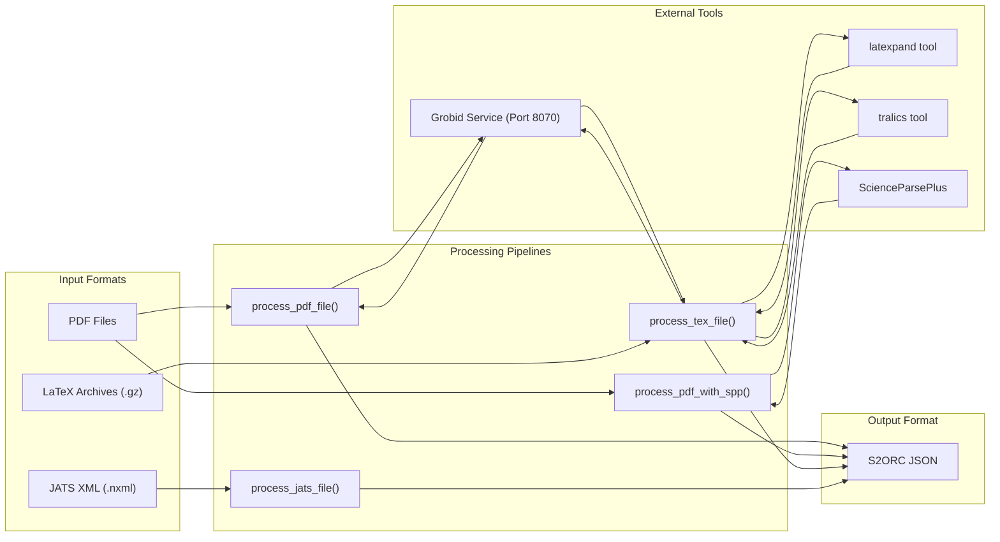
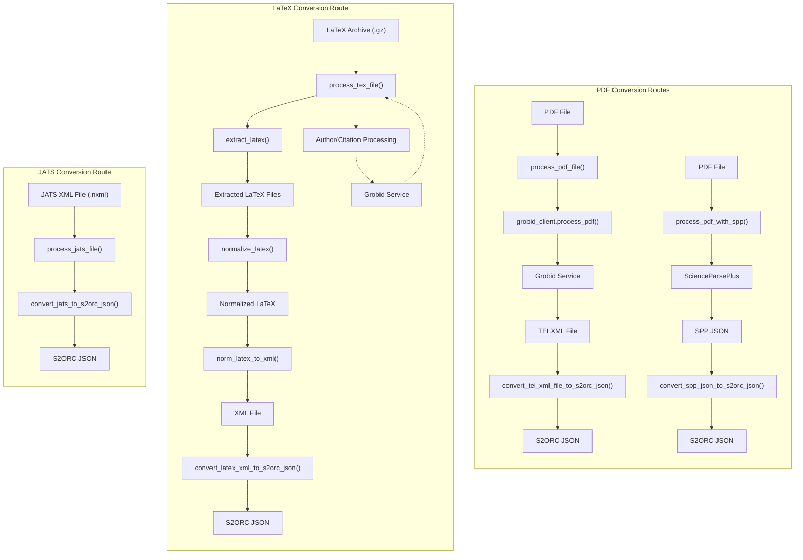
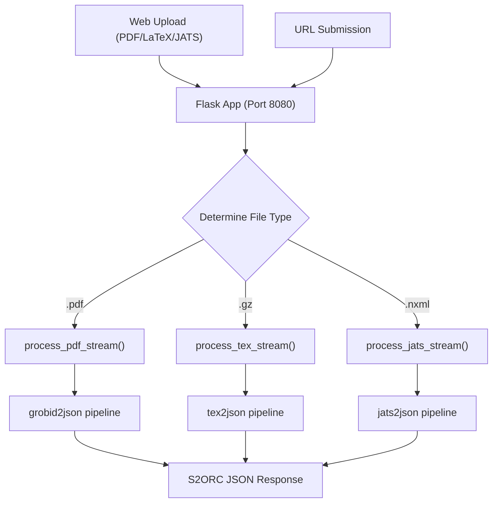

<!-- source: DeepWiki mcp.deepwiki.com · repo allenai/s2orc-doc2json · page 3 Conversion Pipelines · fetched 2026-10-26 -->

# Conversion Pipelines

<details>
<summary>Relevant source files</summary>

The following files were used as context for generating this wiki page:

- [README.md](README.md)
- [tests/test_end_to_end.py](tests/test_end_to_end.py)

</details>


## Purpose and Scope

This document covers the document conversion pipelines in the s2orc-doc2json system, which transform scientific documents from various formats (PDF, LaTeX, JATS XML) into the standardized S2ORC JSON format. These pipelines are core to the functionality of the S2ORC (Semantic Scholar Open Research Corpus) project, which aims to provide a structured corpus of scientific papers for research purposes.

For information about the data model that these pipelines output to, see [S2ORC Data Model](#2).
For details about specific pipelines, see their dedicated pages:
- [PDF to JSON (grobid2json)](#3.1)
- [PDF to JSON (spp2json)](#3.2)
- [LaTeX to JSON (tex2json)](#3.3)
- [JATS to JSON (jats2json)](#3.4)

Sources: [README.md:1-7]()

## Overview of Conversion Pipeline Architecture

### Pipeline Architecture Diagram



The system provides four main conversion pipelines, each specialized for a particular document format. Each pipeline transforms its input into the same standardized S2ORC JSON format, enabling unified processing and analysis of scientific literature regardless of the original format.

Sources: [README.md:27-92](), [tests/test_end_to_end.py:5-7]()

## Pipeline Processing Flow

### Detailed Processing Flow Diagram



Each conversion pipeline follows a specific processing flow to transform documents into the S2ORC JSON format. The following sections detail each pipeline's operation.

Sources: [tests/test_end_to_end.py:27-117]()

## PDF to JSON Conversion (grobid2json)

The `grobid2json` pipeline uses Grobid, a machine learning library for extracting structured information from scholarly documents, to convert PDFs to S2ORC JSON. The process involves:

1. Processing the PDF through Grobid to produce a TEI XML file with structured document information
2. Parsing the TEI XML to extract paper components (metadata, abstract, body text, references, etc.)
3. Creating a Paper object (defined in the S2ORC data model)
4. Serializing the Paper object to JSON format

The main function for this pipeline is `process_pdf_file()`, which takes input PDF path, temporary directory path, and output directory path as parameters.

```
process_pdf_file(pdf_path, temp_dir, output_dir)
├── Processes PDF through Grobid on port 8070
├── Saves TEI XML to temp_dir
├── Parses XML to extract paper components
└── Outputs S2ORC JSON to output_dir
```

Sources: [README.md:27-62](), [tests/test_end_to_end.py:27-56]()

## PDF to JSON Conversion (spp2json)

The `spp2json` pipeline offers an alternative approach to PDF conversion using ScienceParsePlus. This pipeline:

1. Processes the PDF through ScienceParsePlus to generate an intermediate JSON representation
2. Converts this intermediate JSON to the S2ORC JSON format
3. Serializes the result to a JSON file

This pipeline serves as an alternative to `grobid2json` and may provide better results for certain types of documents.

Sources: [README.md:9-11]()

## LaTeX to JSON Conversion (tex2json)

The `tex2json` pipeline converts LaTeX archives (typically `.gz` files from arXiv) to S2ORC JSON through a multi-stage process:

1. Extraction: Extracting LaTeX files from the archive to a temporary directory
2. Normalization: Using `latexpand` to resolve `\input` commands and creating a normalized LaTeX file
3. XML Conversion: Converting the normalized LaTeX to XML using `tralics`
4. Component Extraction: Parsing the XML to extract paper components
5. Processing Authors and Citations: Using Grobid for author name normalization and citation processing
6. JSON Creation: Creating a Paper object and serializing it to JSON

The main function for this pipeline is `process_tex_file()`, which takes input LaTeX archive path, temporary directory path, output directory path, and log directory path as parameters.

**Required External Tools:**
- `latexpand`: Resolves `\input` commands in LaTeX
- `tralics`: Converts LaTeX to XML
- Grobid: Processes author names and citations

Sources: [README.md:65-82](), [tests/test_end_to_end.py:58-93]()

## JATS to JSON Conversion (jats2json)

The `jats2json` pipeline converts JATS XML files (common in biomedical literature, typically with `.nxml` extension) to S2ORC JSON:

1. Parsing the JATS XML file to extract paper components
2. Creating a Paper object with these components
3. Serializing the Paper object to JSON

The main function for this pipeline is `process_jats_file()`, which takes input JATS XML path and output directory path as parameters.

This pipeline is simpler than the others as it doesn't require external tools or intermediate conversions.

Sources: [README.md:84-92](), [tests/test_end_to_end.py:95-117]()

## Pipeline Comparison

The following table compares key aspects of the four conversion pipelines:

| Feature | grobid2json | spp2json | tex2json | jats2json |
|---------|-------------|----------|----------|-----------|
| Input Format | PDF | PDF | LaTeX (.gz) | JATS XML (.nxml) |
| Main Function | `process_pdf_file()` | `process_pdf_with_spp()` | `process_tex_file()` | `process_jats_file()` |
| External Dependencies | Grobid | ScienceParsePlus | latexpand, tralics, Grobid | None |
| Intermediate Format | TEI XML | SPP JSON | XML | None |
| Complexity | Medium | Medium | High | Low |

All pipelines share a common goal of converting their respective input formats to the standardized S2ORC JSON format, which can then be used for downstream tasks like corpus analysis, information retrieval, and natural language processing.

Sources: [README.md:27-92](), [tests/test_end_to_end.py:5-117]()

## Integration with Web Interface

The conversion pipelines can be used programmatically or through a Flask web interface that allows users to upload documents or provide URLs for conversion.

### Web Interface Diagram



The web interface provides a convenient way to convert individual documents without needing to set up and execute the pipelines directly.

Sources: [README.md:98-118]()

## Common Features Across Pipelines

All conversion pipelines:

1. Use a common data model (`Paper` class from `doc2json.s2orc`) to represent scientific papers
2. Extract structured components (metadata, abstract, body text, references, etc.)
3. Identify and process citations and references in the text
4. Output to the same standardized S2ORC JSON format
5. Follow a similar processing pattern despite differing input formats and requirements

Sources: [README.md:3-7]()

---

