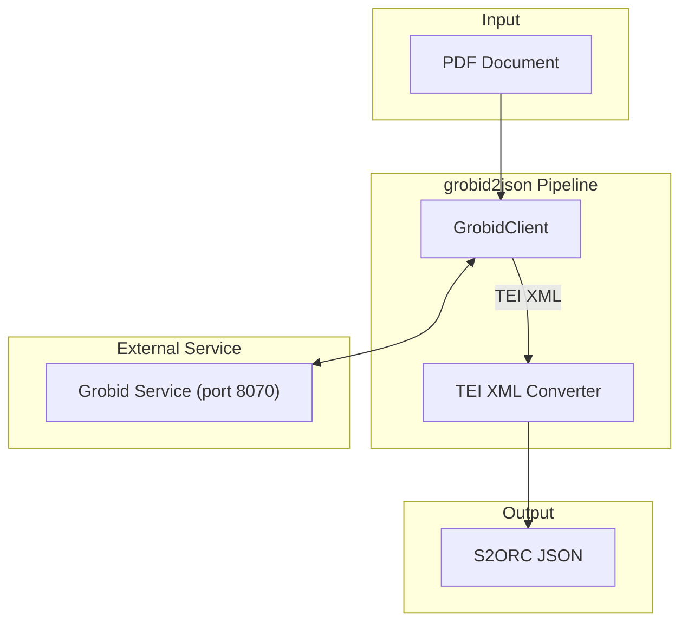
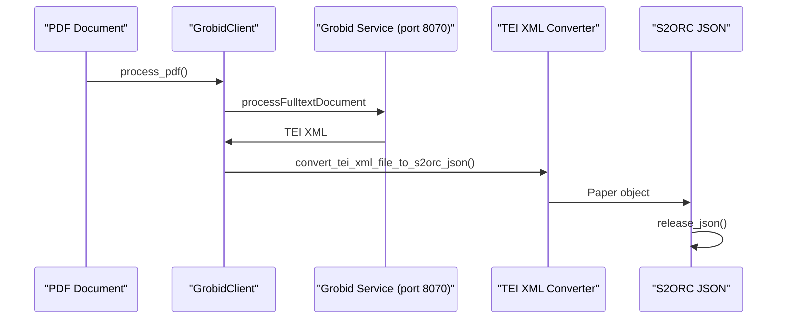
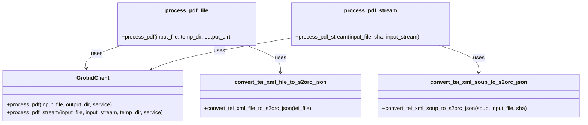

<!-- source: DeepWiki mcp.deepwiki.com · repo allenai/s2orc-doc2json · page 3.1 PDF to JSON (grobid2json) · fetched 2026-10-26 -->

# PDF to JSON (grobid2json)

<details>
<summary>Relevant source files</summary>

The following files were used as context for generating this wiki page:

- [README.md](README.md)
- [doc2json/grobid2json/process_pdf.py](doc2json/grobid2json/process_pdf.py)
- [doc2json/jats2json/pmc_utils/all_tag_utils.py](doc2json/jats2json/pmc_utils/all_tag_utils.py)

</details>


The PDF to JSON (`grobid2json`) module is a core component of the s2orc-doc2json system that converts scientific PDF documents into structured JSON format. It leverages the Grobid tool to extract text and metadata from PDFs, converting them first to TEI XML format and then to the S2ORC JSON schema. This module is specifically designed for processing scholarly PDFs, extracting structured information such as title, authors, abstract, body text, references, and citations.

For information about other document conversion pipelines, see:
- [PDF to JSON using ScienceParsePlus](#3.2)
- [LaTeX to JSON](#3.3)
- [JATS to JSON](#3.4)

## System Overview

The `grobid2json` pipeline is part of the larger s2orc-doc2json system, which provides multiple pathways for converting scientific documents into the S2ORC JSON format.

**Grobid2json Pipeline in Context**



Sources: [README.md:28-51](), [doc2json/grobid2json/process_pdf.py:14-78]()

## Workflow

The PDF to JSON conversion follows a two-step process: first converting PDF to TEI XML using Grobid, then converting the TEI XML to S2ORC JSON using custom parsers.

**Conversion Workflow**



Sources: [doc2json/grobid2json/process_pdf.py:37-78]()

## Key Components

### Grobid Integration

Grobid is an external tool that processes PDFs to extract structured information in TEI XML format. The `grobid2json` module communicates with a running Grobid service through the `GrobidClient` class.

**Component Relationships**



Sources: [doc2json/grobid2json/process_pdf.py:8-9](), [doc2json/grobid2json/process_pdf.py:16-34]()

### TEI XML to JSON Conversion

After obtaining TEI XML from Grobid, the module converts it to S2ORC JSON using either `convert_tei_xml_file_to_s2orc_json` (for file-based processing) or `convert_tei_xml_soup_to_s2orc_json` (for stream-based processing).

These functions parse the TEI XML structure, extracting information such as:
- Paper metadata (title, authors, venue, year)
- Abstract
- Body text with section structure
- Citations and references
- Equations and other special elements

The parsed data is then organized into a `Paper` object (defined in the S2ORC data model), which can be serialized to JSON.

Sources: [doc2json/grobid2json/process_pdf.py:9](), [doc2json/grobid2json/process_pdf.py:32](), [doc2json/grobid2json/process_pdf.py:72]()

## Usage

The module provides two main functions for processing PDFs:

1. `process_pdf_file`: Processes a PDF file on disk, outputting the S2ORC JSON to a specified directory.
2. `process_pdf_stream`: Processes a PDF provided as a byte stream, returning the S2ORC JSON directly.

### File-Based Processing

To process a PDF file and save the resulting JSON:

```python
from doc2json.grobid2json.process_pdf import process_pdf_file

# Process a PDF file
output_file = process_pdf_file(
    input_file="path/to/paper.pdf",
    temp_dir="temp_directory",
    output_dir="output_directory"
)
```

You can also use the command-line interface:

```bash
python doc2json/grobid2json/process_pdf.py -i tests/pdf/N18-3011.pdf -t temp_dir/ -o output_dir/
```

### Stream-Based Processing

For web applications or other scenarios where the PDF is already loaded in memory:

```python
from doc2json.grobid2json.process_pdf import process_pdf_stream

# Process a PDF stream
with open("path/to/paper.pdf", "rb") as f:
    pdf_stream = f.read()
    
json_data = process_pdf_stream(
    input_file="paper.pdf",  # Just the filename for identification
    sha="pdf_hash",          # Optional hash for tracking
    input_stream=pdf_stream
)
```

Sources: [README.md:53-64](), [doc2json/grobid2json/process_pdf.py:16-78]()

## Technical Implementation Details

The `process_pdf_file` function performs the following steps:

1. Creates the necessary output directories
2. Extracts the paper ID from the input file name
3. Calls the Grobid client to process the PDF
4. Converts the resulting TEI XML to S2ORC JSON
5. Writes the JSON to the output directory

The `process_pdf_stream` function is similar but works with in-memory data:

1. Processes the PDF stream directly through the Grobid client
2. Parses the TEI XML text using BeautifulSoup
3. Converts the parsed XML to S2ORC JSON
4. Returns the JSON directly

Both functions use the same underlying conversion process but operate on different input types to accommodate various usage scenarios.

Sources: [doc2json/grobid2json/process_pdf.py:16-78]()

## Integration with Web Service

The `grobid2json` module can be integrated with the Flask web service provided by the s2orc-doc2json system. This allows for PDF to JSON conversion through a web interface or API endpoints.

For more information on the web interface, see [Flask Application](#4.1).

Sources: [README.md:98-118]()

## Prerequisites

To use the `grobid2json` module, you need:

1. A running Grobid service (typically on port 8070)
2. The doc2json Python environment with required dependencies

The repository provides scripts to help set up Grobid:

```bash
bash scripts/setup_grobid.sh
bash scripts/run_grobid.sh
```

Sources: [README.md:31-51]()

---

