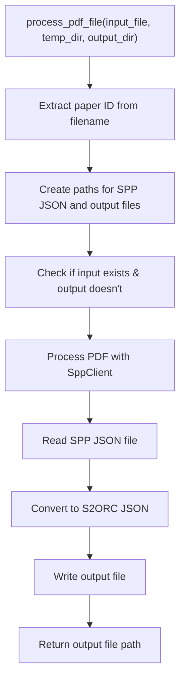
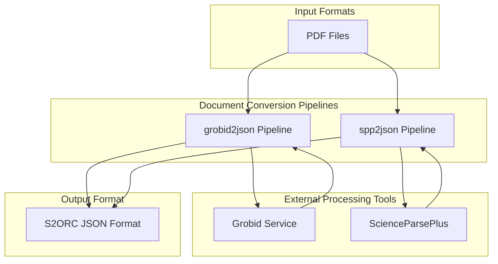

<!-- source: DeepWiki mcp.deepwiki.com · repo allenai/s2orc-doc2json · page 3.2 PDF to JSON (spp2json) · fetched 2026-10-26 -->

# PDF to JSON (spp2json)

<details>
<summary>Relevant source files</summary>

The following files were used as context for generating this wiki page:

- [README.md](README.md)
- [doc2json/spp2json/__init__.py](doc2json/spp2json/__init__.py)
- [doc2json/spp2json/process_pdf.py](doc2json/spp2json/process_pdf.py)
- [doc2json/spp2json/spp/spp_client.py](doc2json/spp2json/spp/spp_client.py)
- [doc2json/spp2json/spp/spp_json_to_s2orc_json.py](doc2json/spp2json/spp/spp_json_to_s2orc_json.py)

</details>


## Purpose and Scope

The spp2json module provides an alternative pipeline for converting scientific PDF documents to the S2ORC JSON format using ScienceParsePlus (SPP) as the PDF parsing engine. While the primary PDF conversion pipeline in the repository is grobid2json ([section 3.1](#3.1)), spp2json offers a different approach using the ScienceParsePlus tool instead of Grobid.

## Architecture Overview

The spp2json pipeline transforms PDF documents into structured S2ORC JSON through a series of processing steps:


Sources: [doc2json/spp2json/process_pdf.py:12-46]()

## Module Components

The spp2json module is structured with the following components:

### 1. SppClient

The `SppClient` class serves as the interface to the ScienceParsePlus tool. It's designed to handle the processing of PDF documents and produce SPP-formatted JSON output.

```python
class SppClient:
    def process(self, input: str, output: str):
        raise NotImplementedError
```

The `process` method takes:
- `input`: Path to the input PDF file
- `output`: Path to the output directory where SPP JSON will be saved

Sources: [doc2json/spp2json/spp/spp_client.py:11-13]()

### 2. SPP JSON to S2ORC JSON Converter

The `convert_spp_json_to_s2orc_json` function is responsible for transforming the SPP JSON format into the standardized S2ORC JSON format used throughout the repository.

```python
def convert_spp_json_to_s2orc_json(spp_json: Dict) -> Paper:
    raise NotImplementedError
```

The function takes an SPP JSON dictionary and returns a `Paper` object from the `doc2json.s2orc` module.

Sources: [doc2json/spp2json/spp/spp_json_to_s2orc_json.py:6-7]()

### 3. PDF Processing Coordinator

The `process_pdf_file` function coordinates the entire PDF processing pipeline:



The function handles:
1. Filename processing to extract paper identifiers
2. File path management for input, intermediate, and output files
3. Coordinating the conversion process through SppClient and the converter
4. Writing the final S2ORC JSON output

Sources: [doc2json/spp2json/process_pdf.py:12-46]()

## Command-Line Interface

The module provides a command-line interface for processing PDF files:

```bash
python doc2json/spp2json/process_pdf.py -i input.pdf -t temp_dir/ -o output_dir/
```

Command-line arguments:
- `-i, --input`: Path to the input PDF file (required)
- `-t, --temp`: Path to the temporary directory (default: 'temp/')
- `-o, --output`: Path to the output directory (default: 'output/')
- `-k, --keep`: Flag to keep temporary files (optional)

Sources: [doc2json/spp2json/process_pdf.py:49-72]()

## Integration with S2ORC

The spp2json module fits into the larger document conversion ecosystem as follows:



Both pipelines take PDF files as input and produce S2ORC JSON as output, but they use different external tools for PDF parsing.

Sources: [README.md:27-31](), [doc2json/spp2json/process_pdf.py:12-46]()

## Implementation Status

In the current implementation:

1. `SppClient.process` raises `NotImplementedError` - the interface to ScienceParsePlus is defined but not implemented.
2. `convert_spp_json_to_s2orc_json` raises `NotImplementedError` - the conversion from SPP JSON to S2ORC JSON is defined but not implemented.

These limitations prevent the pipeline from fully processing PDF documents in its current state.

Sources: [doc2json/spp2json/spp/spp_client.py:12](), [doc2json/spp2json/spp/spp_json_to_s2orc_json.py:6]()

## Comparison with grobid2json

| Feature | spp2json | grobid2json |
|---------|----------|-------------|
| PDF Parsing Tool | ScienceParsePlus | Grobid |
| Implementation Status | Interface defined but not implemented | Fully implemented |
| Intermediate Format | SPP JSON | TEI XML |
| Output Format | S2ORC JSON | S2ORC JSON |
| Command-Line Interface | Available through process_pdf.py | Available through process_pdf.py |

Sources: [README.md:27-31](), [doc2json/spp2json/process_pdf.py:12-46]()

---

