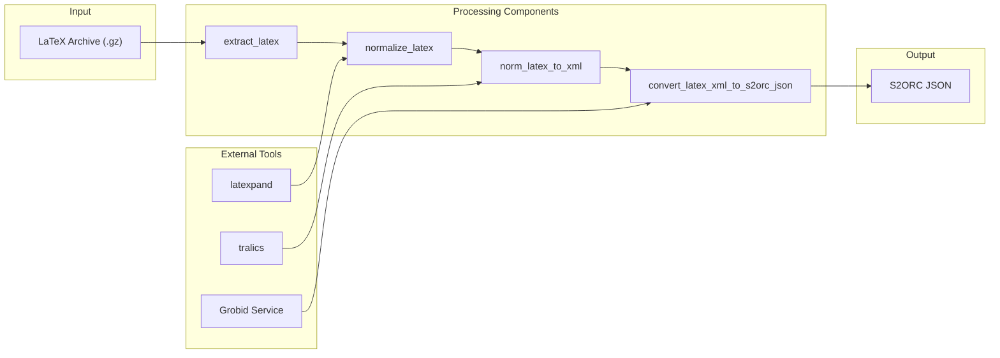
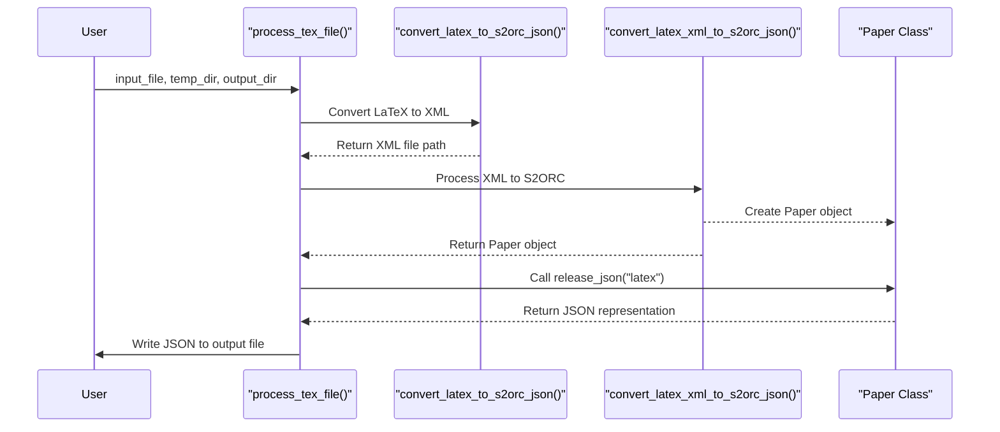
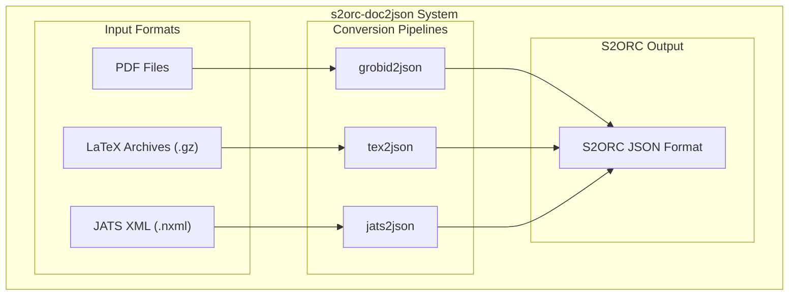

<!-- source: DeepWiki mcp.deepwiki.com · repo allenai/s2orc-doc2json · page 3.3 LaTeX to JSON (tex2json) · fetched 2026-10-26 -->

# LaTeX to JSON (tex2json)

<details>
<summary>Relevant source files</summary>

The following files were used as context for generating this wiki page:

- [README.md](README.md)
- [doc2json/tex2json/process_tex.py](doc2json/tex2json/process_tex.py)

</details>


## Purpose and Scope

The LaTeX to JSON (tex2json) pipeline is a component of the s2orc-doc2json system that converts scientific papers stored in LaTeX format into the standardized S2ORC JSON format. This document describes the architecture, workflow, and implementation details of the tex2json conversion pipeline. For information about other conversion pipelines like PDF to JSON, see [PDF to JSON (grobid2json)](#3.1) or [JATS to JSON (jats2json)](#3.4).

The tex2json pipeline is particularly valuable for processing arXiv papers, which are commonly available in LaTeX format.

Sources: [README.md:65-82](), [doc2json/tex2json/process_tex.py:1-9]()

## System Architecture

The tex2json system converts LaTeX documents into S2ORC JSON through a series of transformations, utilizing external tools and internal processing components.



Sources: [doc2json/tex2json/process_tex.py:53-99](), [README.md:65-82]()

## Workflow and Implementation

The tex2json pipeline processes LaTeX files through the following sequential steps:



Sources: [doc2json/tex2json/process_tex.py:53-99]()

### Key Processing Steps

1. **File Preparation**: The input LaTeX archive (.gz) is processed to extract the LaTeX source files.
2. **LaTeX to XML Conversion**: The LaTeX files are normalized and converted to XML using external tools.
3. **XML to JSON Transformation**: The XML representation is parsed and converted to the S2ORC JSON format.
4. **Metadata Extraction**: Paper metadata (title, authors, citations, etc.) is extracted.

For detailed information on the LaTeX to XML conversion process, see [LaTeX to XML Conversion](#3.3.1). For details on XML to JSON conversion, see [XML to JSON Conversion](#3.3.2).

Sources: [doc2json/tex2json/process_tex.py:53-99](), [README.md:65-82]()

## Main Functions

The tex2json pipeline is implemented through the following main functions:

| Function | Description | Input | Output |
|----------|-------------|-------|--------|
| `process_tex_file()` | Main entry point for processing LaTeX files | LaTeX archive path, directory paths | Path to output JSON file |
| `process_tex_stream()` | Process LaTeX from a byte stream | Filename, byte stream | JSON content |
| `convert_latex_to_s2orc_json()` | Convert LaTeX to XML | LaTeX file path, temp directory | XML file path |
| `convert_latex_xml_to_s2orc_json()` | Convert XML to S2ORC JSON | XML file path, log directory | Paper object |

Sources: [doc2json/tex2json/process_tex.py:16-50](), [doc2json/tex2json/process_tex.py:53-99]()

### process_tex_file Function

The `process_tex_file` function is the main entry point for processing LaTeX files. It:

1. Creates necessary directories for temporary files and output
2. Extracts the paper ID from the input filename
3. Calls `convert_latex_to_s2orc_json` to convert LaTeX to XML
4. Calls `convert_latex_xml_to_s2orc_json` to convert XML to a Paper object
5. Writes the Paper object to a JSON file

Sources: [doc2json/tex2json/process_tex.py:53-99]()

### process_tex_stream Function

The `process_tex_stream` function is similar to `process_tex_file` but accepts a byte stream instead of a file path. This is useful for web interfaces and API endpoints that receive file uploads. It:

1. Writes the byte stream to a temporary file
2. Calls `process_tex_file` to process the temporary file
3. Reads and returns the resulting JSON content

Sources: [doc2json/tex2json/process_tex.py:16-50]()

## Dependencies

The tex2json pipeline relies on several external tools:

| Dependency | Purpose | Installation |
|------------|---------|-------------|
| latexpand | Processes and expands LaTeX files | `apt install texlive-extra-utils` |
| tralics | Converts LaTeX to XML | `apt install tralics` |
| Grobid | Processes citations and authors | See [Grobid Setup](#5.1) |

Grobid is particularly important as it provides services for structuring citations and author information. The tex2json pipeline uses Grobid's APIs to convert raw citation strings into structured forms.

Sources: [README.md:65-82]()

## Usage Example

To process a LaTeX archive using the command line:

```
python doc2json/tex2json/process_tex.py -i test/latex/1911.02782.gz -t temp_dir/ -o output_dir/
```

Options:
- `-i, --input`: Path to input LaTeX archive (.gz)
- `-t, --temp`: Directory for temporary files
- `-o, --output`: Directory for output JSON files 
- `-l, --log`: Directory for log files
- `-k, --keep`: Flag to keep temporary files

Sources: [README.md:74-77](), [doc2json/tex2json/process_tex.py:102-126]()

## Integration with the S2ORC System

The tex2json pipeline produces JSON files that conform to the S2ORC data model. The final step in the pipeline calls `paper.release_json("latex")` to generate the JSON representation with the document type specified as "latex".



Sources: [README.md:3-7](), [doc2json/tex2json/process_tex.py:95-97]()

This standardized JSON format allows for consistent processing and analysis of scientific papers regardless of their original format, facilitating large-scale corpus analysis and information extraction.

---

