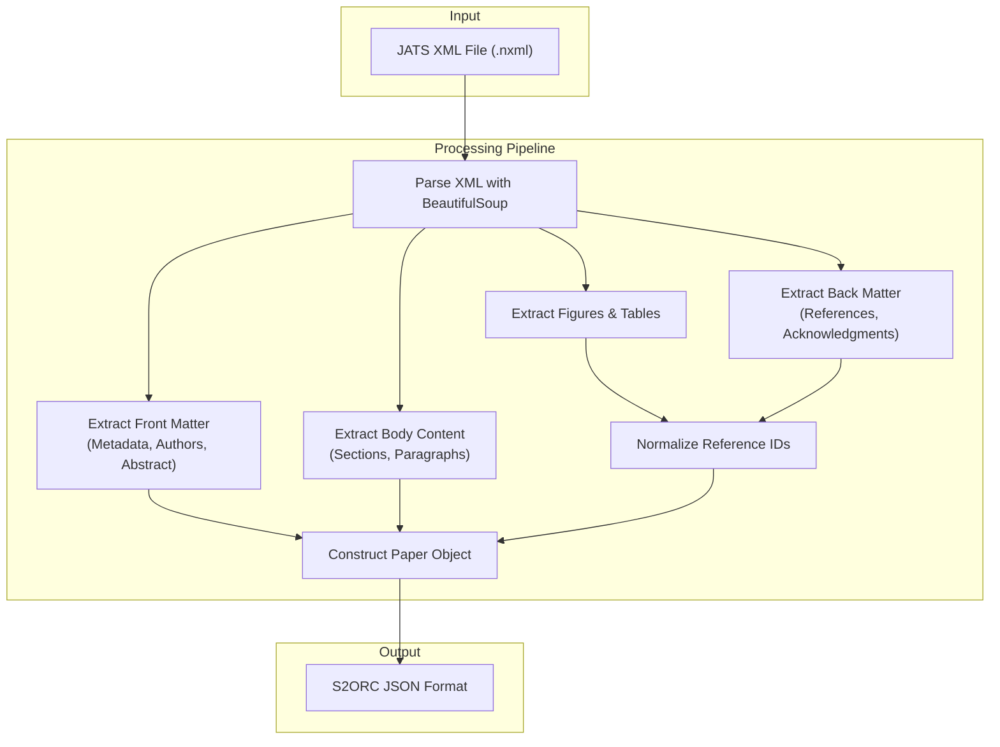
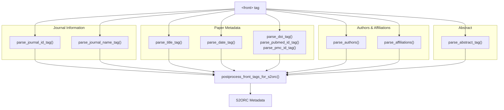
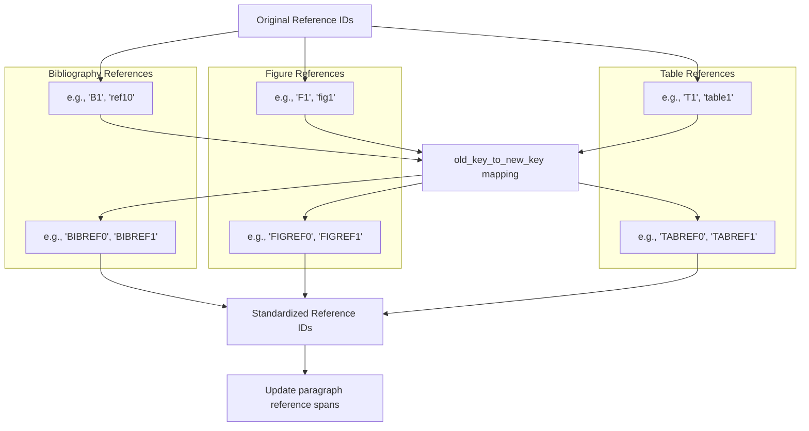
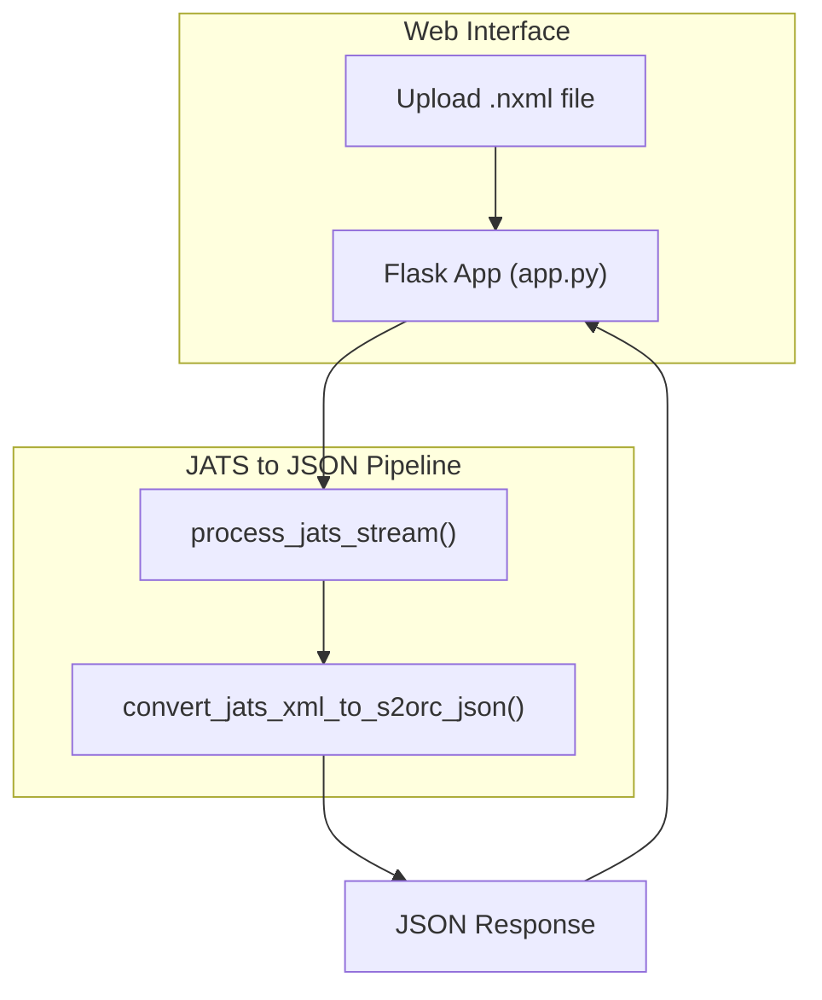

<!-- source: DeepWiki mcp.deepwiki.com · repo allenai/s2orc-doc2json · page 3.4 JATS to JSON (jats2json) · fetched 2026-10-26 -->

# JATS to JSON (jats2json)

<details>
<summary>Relevant source files</summary>

The following files were used as context for generating this wiki page:

- [README.md](README.md)
- [doc2json/__init__.py](doc2json/__init__.py)
- [doc2json/jats2json/__init__.py](doc2json/jats2json/__init__.py)
- [doc2json/jats2json/jats_to_json.py](doc2json/jats2json/jats_to_json.py)
- [doc2json/jats2json/pmc_utils/__init__.py](doc2json/jats2json/pmc_utils/__init__.py)
- [doc2json/jats2json/pmc_utils/back_tag_utils.py](doc2json/jats2json/pmc_utils/back_tag_utils.py)
- [doc2json/jats2json/pmc_utils/extract_utils.py](doc2json/jats2json/pmc_utils/extract_utils.py)
- [doc2json/jats2json/pmc_utils/front_tag_utils.py](doc2json/jats2json/pmc_utils/front_tag_utils.py)

</details>


The JATS to JSON (jats2json) module converts scientific papers in JATS XML format to the standardized S2ORC JSON format. JATS (Journal Article Tag Suite) is an XML standard used for journal articles, particularly those in PubMed Central (PMC). This module forms one of the three main conversion pipelines in the s2orc-doc2json system, alongside the PDF to JSON and LaTeX to JSON pathways.

## Purpose and Scope

This document explains how the jats2json module processes JATS XML files (typically with `.nxml` extension) and converts them into the structured S2ORC JSON format. It covers the conversion workflow, component functions, and data transformation processes. For information about other conversion pipelines, see [PDF to JSON (grobid2json)](#3.1) or [LaTeX to JSON (tex2json)](#3.3).

## Conversion Pipeline Overview

The jats2json conversion pipeline extracts and transforms content from three main sections of a JATS XML document: front matter (metadata), body (main content), and back matter (references, acknowledgments).



Sources: [doc2json/jats2json/jats_to_json.py:214-328]()

## Input Format: JATS XML

JATS XML documents typically have three main sections:

1. **Front Matter** (`<front>`) - Contains metadata about the paper, including:
   - Journal information (`<journal-meta>`)
   - Article information (`<article-meta>`)
   - Title, authors, affiliations
   - Abstract
   - Publication dates
   - Identifiers (DOI, PMID, PMC ID)

2. **Body** (`<body>`) - Contains the main text of the paper, organized into:
   - Sections (`<sec>`)
   - Paragraphs (`<p>`)
   - Figures (`<fig>`)
   - Tables (`<table-wrap>`)
   - References to bibliography (`<xref>`)

3. **Back Matter** (`<back>`) - Contains supplementary material, including:
   - Bibliography (`<ref-list>`)
   - Acknowledgments (`<ack>`)
   - Appendices

Sources: [doc2json/jats2json/jats_to_json.py:29-134]()

## JATS to S2ORC Conversion Components

The conversion process consists of several specialized components that handle different parts of the JATS document:

```mermaid
classDiagram
    class "convert_jats_xml_to_s2orc_json" {
        +Process JATS XML file
        +Return Paper object
    }
    
    class "process_front_tag" {
        +Extract metadata
        +Extract authors
        +Extract abstract
    }
    
    class "process_body_tag" {
        +Extract body text
        +Process sections
        +Handle references
    }
    
    class "process_back_tag" {
        +Extract bibliography
        +Extract acknowledgments
    }
    
    class "extract_fig_blobs" {
        +Extract figures
        +Process captions
    }
    
    class "extract_table_blobs" {
        +Extract tables
        +Process captions
    }
    
    class "Paper" {
        +paper_id
        +metadata
        +abstract
        +body_text
        +back_matter
        +bib_entries
        +ref_entries
    }
    
    "convert_jats_xml_to_s2orc_json" --> "process_front_tag"
    "convert_jats_xml_to_s2orc_json" --> "process_body_tag"
    "convert_jats_xml_to_s2orc_json" --> "process_back_tag"
    "convert_jats_xml_to_s2orc_json" --> "extract_fig_blobs"
    "convert_jats_xml_to_s2orc_json" --> "extract_table_blobs"
    "convert_jats_xml_to_s2orc_json" --> "Paper"
```

Sources: [doc2json/jats2json/jats_to_json.py:29-134](), [doc2json/jats2json/pmc_utils/extract_utils.py:10-107]()

## Processing Front Matter

The front matter processing extracts metadata about the paper, including:

1. **Journal Information**:
   - Journal ID and name

2. **Paper Metadata**:
   - Title
   - Publication dates
   - DOI, PMID, PMC ID

3. **Authors and Affiliations**:
   - Author names, email addresses, ORCID IDs
   - Institutional affiliations

4. **Abstract**:
   - Abstract paragraphs with section information

The extracted metadata is then standardized to match the S2ORC format.



Sources: [doc2json/jats2json/pmc_utils/front_tag_utils.py:25-390](), [doc2json/jats2json/jats_to_json.py:29-67](), [doc2json/jats2json/jats_to_json.py:137-172]()

## Processing Body Content

The body processing extracts the main text content:

1. **Preprocessing**:
   - Replace XML reference tags with placeholders
   - Replace superscript/subscript tags with placeholders

2. **Section Extraction**:
   - Process each section recursively
   - Extract paragraphs with their section hierarchy

3. **Special Element Handling**:
   - Handle inline citations
   - Process references to figures and tables

The extracted body content is then converted to the S2ORC paragraph format.

Sources: [doc2json/jats2json/jats_to_json.py:70-102]()

## Processing Back Matter

The back matter processing extracts:

1. **Bibliography**:
   - Extract bibliography entries
   - Normalize author information
   - Extract publication details (year, venue, etc.)

2. **Acknowledgments**:
   - Extract acknowledgment paragraphs
   - Process funding information

Sources: [doc2json/jats2json/jats_to_json.py:105-134](), [doc2json/jats2json/pmc_utils/back_tag_utils.py:1-56]()

## Reference Normalization

The system standardizes references to figures, tables, and bibliography entries:

1. **Reference ID Standardization**:
   - Generate new standardized IDs (e.g., "FIGREF0", "TABREF0", "BIBREF0")
   - Create mapping from original IDs to new IDs

2. **Reference Span Updates**:
   - Update references in paragraphs to use new IDs
   - Convert figure and table references to a standard format



Sources: [doc2json/jats2json/jats_to_json.py:175-212](), [doc2json/jats2json/jats_to_json.py:231-307]()

## Output Format: S2ORC JSON

The conversion process ultimately produces a `Paper` object with the following structure:

| Field | Description |
|-------|-------------|
| `paper_id` | Identifier for the paper (typically PMC ID) |
| `pdf_hash` | Empty for JATS XML conversions |
| `metadata` | Title, authors, year, venue, and identifiers |
| `abstract` | List of paragraphs in the abstract |
| `body_text` | List of paragraphs in the main content |
| `back_matter` | Acknowledgments section |
| `bib_entries` | Bibliography entries |
| `ref_entries` | References to figures, tables, etc. |

Sources: [doc2json/jats2json/jats_to_json.py:319-328]()

## Usage

To convert a JATS XML file to S2ORC JSON, use the provided command-line interface:

```
python doc2json/jats2json/process_jats.py -i test/jats/PMC5828200.nxml -o output_dir/
```

This will generate a JSON file with the same paper ID in the specified output directory.

Sources: [README.md:85-91]()

## Integration with Web Interface

The jats2json module is integrated into the system's Flask web application, allowing for conversion through a web interface.



Sources: [README.md:98-112]()

## Limitations and Edge Cases

The jats2json converter handles various edge cases:

1. **Missing Sections**: Some JATS XML files may lack certain sections (e.g., body, back matter).
2. **Varied Reference Formats**: Different journals may use different reference formats.
3. **Complex Tables and Figures**: The converter extracts captions but preserves the original XML for tables.
4. **Publication Dates**: Multiple date formats are handled (e.g., received, accepted, published).

Sources: [doc2json/jats2json/jats_to_json.py:231-307]()

---

