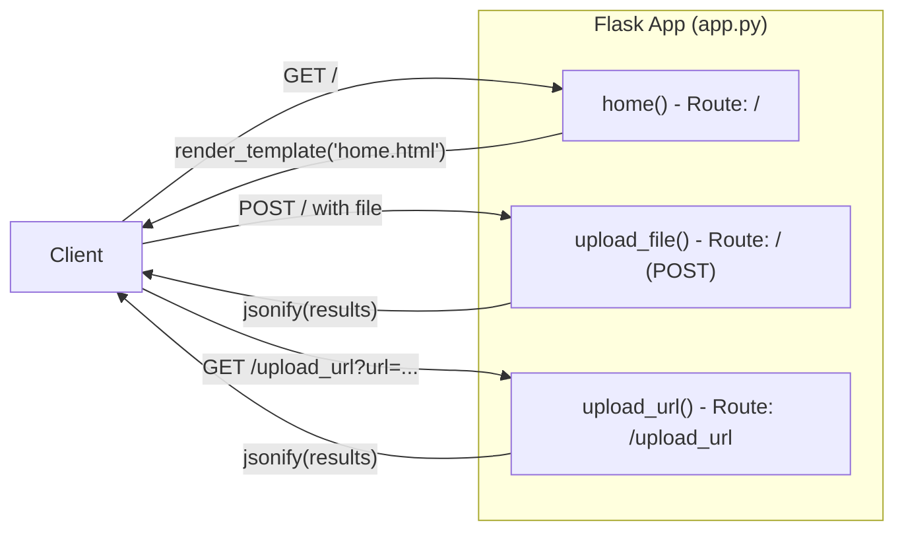
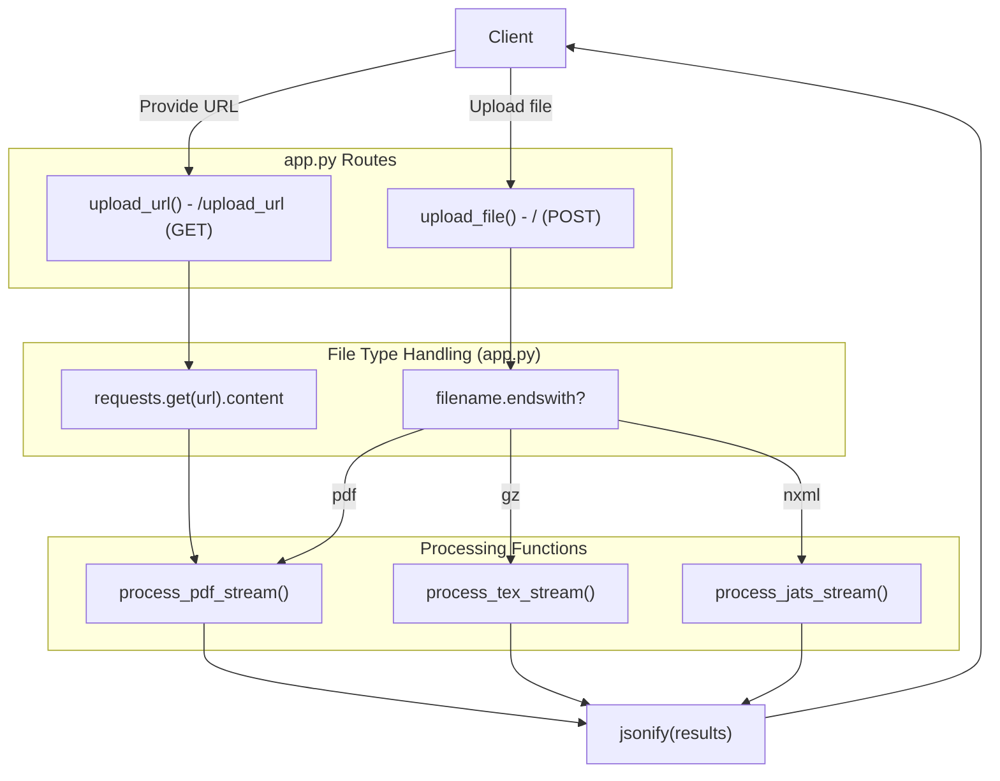
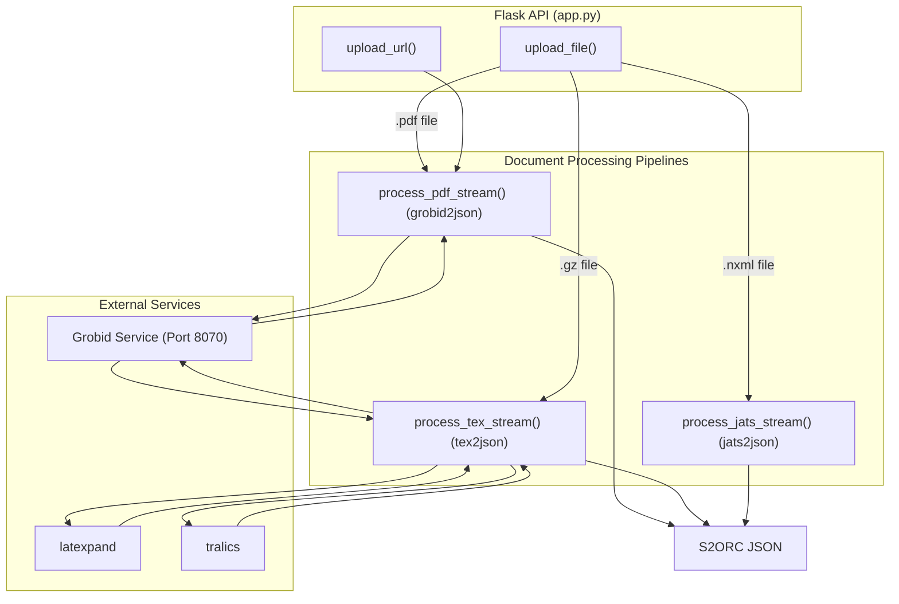

<!-- source: DeepWiki mcp.deepwiki.com · repo allenai/s2orc-doc2json · page 4.2 API Endpoints · fetched 2026-10-26 -->

# API Endpoints

<details>
<summary>Relevant source files</summary>

The following files were used as context for generating this wiki page:

- [README.md](README.md)
- [doc2json/flask/app.py](doc2json/flask/app.py)
- [requirements.txt](requirements.txt)

</details>


## Purpose and Scope

This document describes the REST API endpoints provided by the s2orc-doc2json system for converting scientific documents (PDF, LaTeX, JATS XML) to S2ORC JSON format. The API is implemented as a Flask web service that allows both web interface access and programmatic document conversion. For information about the Flask application structure itself, see [Flask Application](#4.1).

## API Endpoints Overview

The s2orc-doc2json system provides a RESTful API through a Flask web service running on port 8080 by default. The system offers the following endpoints:

| Endpoint | HTTP Method | Handler Function | Description |
|----------|-------------|------------------|-------------|
| `/` | GET | `home()` | Displays the home page with a file upload form |
| `/` | POST | `upload_file()` | Processes an uploaded file (PDF, LaTeX, or JATS XML) |
| `/upload_url` | GET | `upload_url()` | Processes a PDF file from a given URL |

### API Routes Diagram



Sources: [doc2json/flask/app.py:16-65]()

## Endpoint Details

### Home Page Endpoint

**Endpoint:** `/`  
**Method:** GET  
**Handler Function:** `home()`  
**Description:** Renders the home page template with a file upload form.  
**Response:** HTML page with a form for uploading files  
**Implementation:** [doc2json/flask/app.py:16-18]()  

### File Upload Endpoint

**Endpoint:** `/`  
**Method:** POST  
**Handler Function:** `upload_file()`  
**Description:** Processes an uploaded file and converts it to S2ORC JSON format.

**Request Parameters:**
- `file` (form-data): The file to be processed. Supported file types as defined in `ALLOWED_EXTENSIONS`:
  - PDF files (`.pdf`)
  - LaTeX files (`.gz`)
  - JATS XML files (`.nxml`)

**Response:**
- JSON object containing the processed document in S2ORC format
- Error response if file type is not supported: `{"Error": "Unknown file type!"}`

**Processing Logic:**
1. Extracts the file from the request
2. Determines the file type based on extension
3. Routes to the appropriate processing function:
   - PDF → `process_pdf_stream(filename, pdf_sha, pdf_content)`
   - LaTeX → `process_tex_stream(filename, zip_content)`
   - JATS XML → `process_jats_stream(filename, xml_content)`
4. Returns the processed result using Flask's `jsonify()` function

**Implementation:** [doc2json/flask/app.py:20-54]()

### URL Upload Endpoint

**Endpoint:** `/upload_url`  
**Method:** GET  
**Handler Function:** `upload_url()`  
**Description:** Downloads and processes a PDF file from a given URL.

**Request Parameters:**
- `url` (query string): URL of the PDF to be downloaded and processed

**Response:**
- JSON object containing the processed document in S2ORC format

**Processing Logic:**
1. Downloads the PDF from the specified URL using `requests.get(url).content`
2. Computes a SHA-1 hash of the PDF content using `hashlib.sha1(pdf_content).hexdigest()`
3. Processes the PDF using `process_pdf_stream(filename, pdf_sha, pdf_content)`
4. Returns the processed result using Flask's `jsonify()` function

**Implementation:** [doc2json/flask/app.py:56-65]()

## Document Processing Flow

The following diagram illustrates how documents are processed through the API endpoints:

### Document Processing Flow Diagram



Sources: [doc2json/flask/app.py:21-54](), [doc2json/flask/app.py:56-65]()

## Processing Pipeline Integration

The API endpoints integrate with the document processing pipelines as follows:

### Processing Integration Diagram



Sources: [doc2json/flask/app.py:7-9](), [README.md:32-47](), [README.md:67-71]()

## Usage Examples

### Example 1: Using curl to upload a PDF

To upload and process a PDF file using curl:

```
curl localhost:8080/ -F file=@tests/pdf/N18-3011.pdf
```

This sends a POST request to the root endpoint with the PDF file attached as form data.

### Example 2: Using curl to process a PDF from a URL

To process a PDF from a URL using curl:

```
curl "localhost:8080/upload_url?url=https://example.com/paper.pdf"
```

This sends a GET request to the `/upload_url` endpoint with the URL of the PDF as a query parameter.

Sources: [README.md:114-118]()

## Response Format

All processing endpoints return a JSON response in the S2ORC format as defined in the `Paper` class in `doc2json/s2orc.py`. The response includes:

| Field | Description |
|-------|-------------|
| `paper_id` | Unique identifier for the paper |
| `metadata` | Paper metadata (title, authors, year, venue, etc.) |
| `abstract` | List of paragraphs in the abstract |
| `body_text` | List of paragraphs in the main text |
| `back_matter` | List of paragraphs in the back matter |
| `bib_entries` | Dictionary of bibliography entries |
| `ref_entries` | Dictionary of reference entries (figures, tables, etc.) |

For more details about the S2ORC data model, see [S2ORC Data Model](#2).

Sources: [README.md:5]()

## Error Handling

The API provides basic error handling:

- If the file type is not supported (not PDF, LaTeX, or JATS XML), the response will be: `{"Error": "Unknown file type!"}`
- If there are errors during processing, they will be propagated from the respective processing functions

Sources: [doc2json/flask/app.py:49-52]()

## Server Configuration

The Flask server is configured to run on port 8080 and listen on all interfaces (`0.0.0.0`):

```
app.run(port=8080, host='0.0.0.0')
```

This configuration is defined at the bottom of the `app.py` file.

Sources: [doc2json/flask/app.py:67-68](), [README.md:106-110]()

## Dependencies

The Flask API depends on the following Python packages:

- Flask (v1.0.2)
- requests
- hashlib (standard library)
- itsdangerous (v2.0.1)

All dependencies are listed in the requirements.txt file.

Sources: [requirements.txt:4-5](), [requirements.txt:9]()

---

