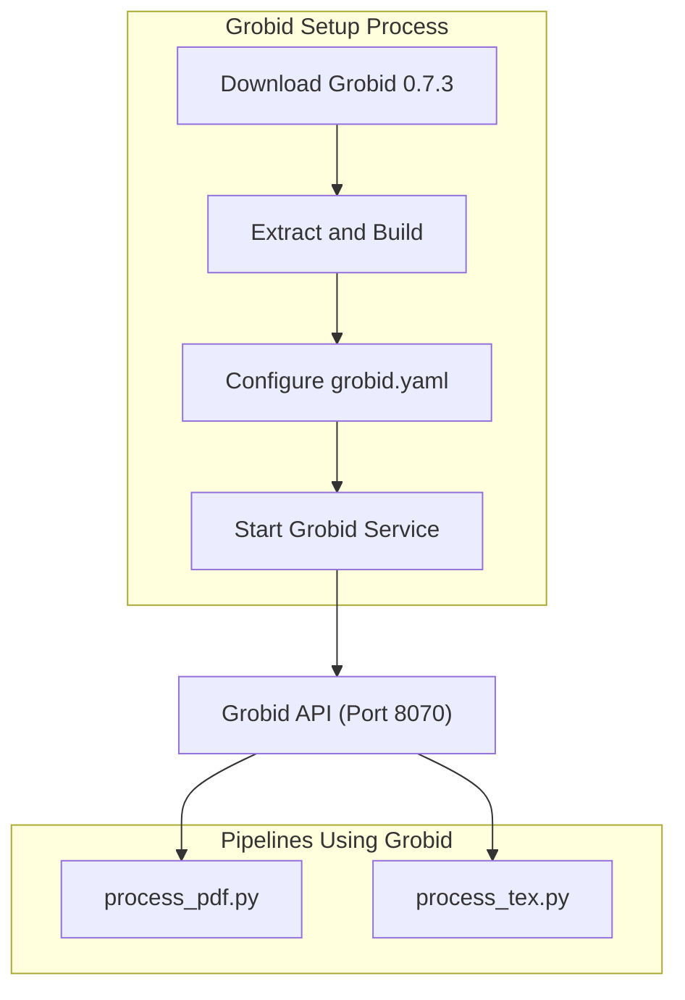
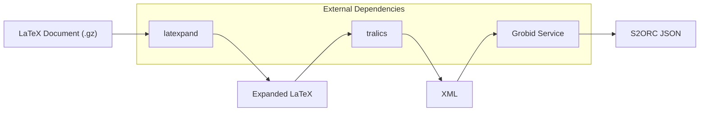
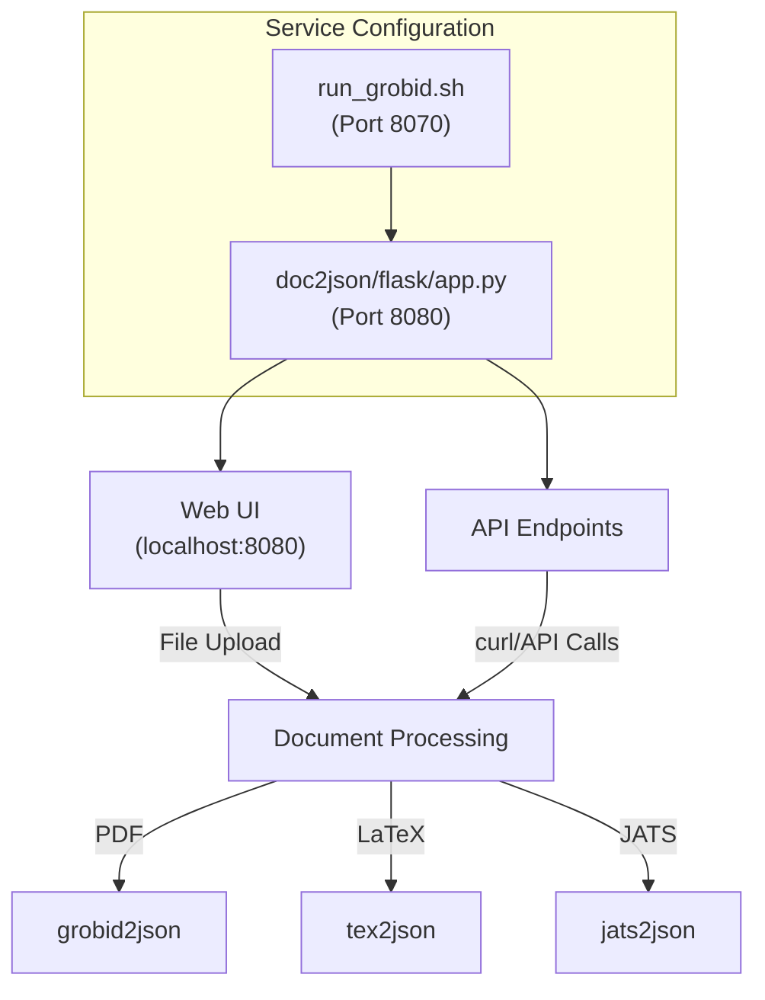
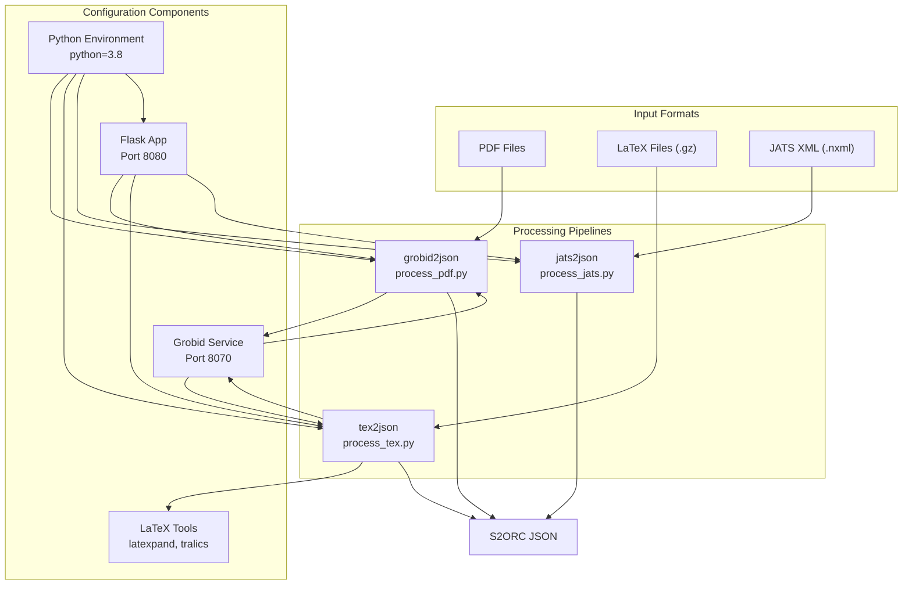
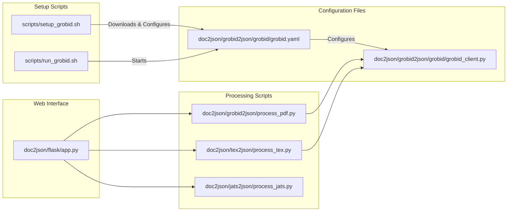

<!-- source: DeepWiki mcp.deepwiki.com · repo allenai/s2orc-doc2json · page 5 Setup and Configuration · fetched 2026-10-26 -->

# Setup and Configuration

<details>
<summary>Relevant source files</summary>

The following files were used as context for generating this wiki page:

- [README.md](README.md)
- [scripts/run_grobid.sh](scripts/run_grobid.sh)
- [scripts/setup_grobid.sh](scripts/setup_grobid.sh)

</details>


This page provides detailed instructions for setting up and configuring the s2orc-doc2json system. It covers environment preparation, dependency installation, and configuration of the various components necessary for converting scientific documents to the S2ORC JSON format.

For information about specific conversion pipelines, see [Conversion Pipelines](#3). For details about the web interface, see [Web Interface](#4).

## Environment Setup

### Python Environment

The s2orc-doc2json system requires Python 3.8 and several dependencies. While Conda is recommended, any Python environment manager should work.


**Step-by-step instructions:**

1. Install Miniconda from the official website
2. Create and activate a conda environment:
   ```
   conda create -n doc2json python=3.8 pytest
   conda activate doc2json
   ```
3. Install requirements:
   ```
   pip install -r requirements.txt
   ```
4. Set up for development:
   ```
   python setup.py develop
   ```

Sources: [README.md:12-25]()

### Core Dependencies

The following table lists the essential dependencies required for different components of the system:

| Component | Dependencies | Installation Command |
|-----------|--------------|----------------------|
| PDF Processing | Grobid 0.7.3, Java 11 | `bash scripts/setup_grobid.sh` |
| LaTeX Processing | latexpand, tralics, Grobid | `apt install texlive-extra-utils tralics` |
| JATS Processing | None beyond core requirements | N/A |
| Web Service | Flask | Included in requirements.txt |

Sources: [README.md:26-93]()

## Grobid Setup and Configuration

Grobid is a critical component used for processing PDFs and extracting structured information from scientific documents. It's also used by the LaTeX pipeline for citation and author parsing.



### Automatic Setup

The repository includes a script to automate Grobid installation:

1. Ensure Java 11 is installed on your system
2. Update the `DOC2JSON_HOME` variable in `scripts/setup_grobid.sh` to match your installation path
3. Run the setup script:
   ```
   bash scripts/setup_grobid.sh
   ```

This script:
1. Downloads Grobid 0.7.3
2. Extracts and builds it
3. Copies a custom configuration file
4. Starts the Grobid service

Sources: [scripts/setup_grobid.sh:1-22]()

### Manual Setup

If you prefer manual installation:

1. Download and extract Grobid 0.7.3:
   ```
   cd $HOME
   wget https://github.com/kermitt2/grobid/archive/0.7.3.zip
   unzip 0.7.3.zip
   rm 0.7.3.zip
   ```

2. Build Grobid:
   ```
   cd $HOME/grobid-0.7.3
   ./gradlew clean install
   ```

3. Copy the configuration file:
   ```
   cp $DOC2JSON_HOME/doc2json/grobid2json/grobid/grobid.yaml $HOME/grobid-0.7.3/grobid-home/config/grobid.yaml
   ```

Sources: [README.md:31-48](), [scripts/setup_grobid.sh:6-18]()

### Running Grobid

To start the Grobid service:

```
bash scripts/run_grobid.sh
```

Or manually:

```
cd $HOME/grobid-0.7.3
./gradlew run
```

The service runs on port 8070 by default. Note: The process may appear to "get stuck" at 87%, but this is normal and indicates that Grobid is ready to process documents.

Sources: [README.md:43-51](), [scripts/run_grobid.sh:1-6]()

### Grobid Configuration

The system provides a custom `grobid.yaml` configuration that optimizes Grobid for processing scientific papers:

- Increased maximum connections to handle multiple processes
- Reduced logging level
- Default port configuration (8070)

If you need to change the Grobid port, update it in both:
- The Grobid configuration file (`grobid.yaml`)
- The Grobid client in the codebase (`grobid/grobid_client.py`)

Sources: [README.md:48-51](), [scripts/setup_grobid.sh:14-18]()

## LaTeX Processing Dependencies

For processing LaTeX documents, additional tools are required beyond Grobid:



### Installation

Install the required LaTeX processing tools:

```
apt install texlive-extra-utils tralics
```

These tools serve specific functions in the LaTeX processing pipeline:
- `latexpand`: Expands all included files in the LaTeX source
- `tralics`: Converts LaTeX to XML as an intermediate step
- Grobid: Processes citations and authors

Sources: [README.md:65-82]()

## Web Interface Configuration

The system includes a Flask web application that provides both a user interface and API for document conversion.



### Starting the Web Service

1. First, start the Grobid service (if processing PDFs or LaTeX):
   ```
   bash scripts/run_grobid.sh
   ```

2. Then, start the Flask application:
   ```
   python doc2json/flask/app.py
   ```

The Flask app runs on port 8080 by default and provides a web interface at `localhost:8080`.

### API Usage

You can also use the API programmatically:

```
curl localhost:8080/ -F file=@tests/pdf/N18-3011.pdf
```

Sources: [README.md:98-118]()

## System Architecture and Configuration

The following diagram illustrates the complete architecture of the s2orc-doc2json system and how configuration affects the different components:



## Code Component Map

This diagram maps the key configuration files and scripts to their corresponding system functions:



Sources: [README.md:12-118](), [scripts/setup_grobid.sh:1-22](), [scripts/run_grobid.sh:1-6]()

---

