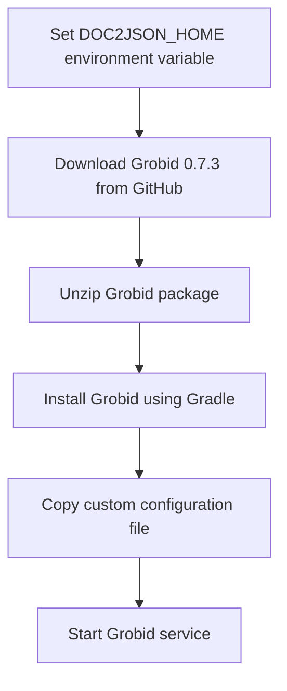
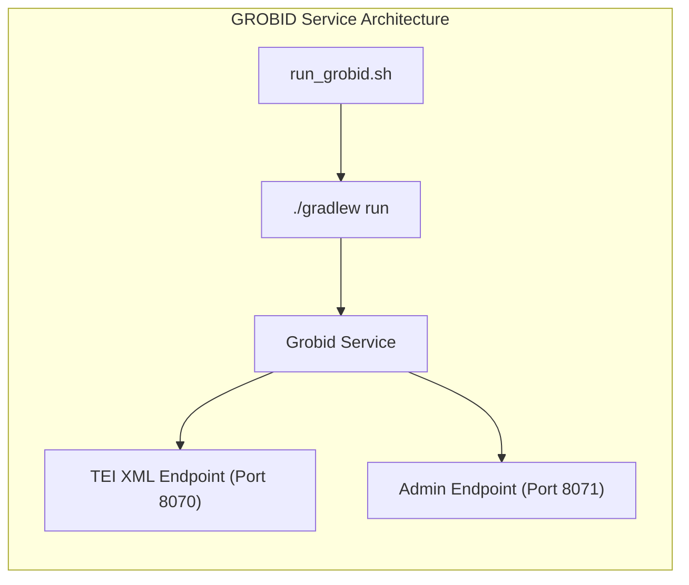

<!-- source: DeepWiki mcp.deepwiki.com · repo allenai/s2orc-doc2json · page 5.1 Grobid Setup · fetched 2026-10-26 -->

# Grobid Setup

<details>
<summary>Relevant source files</summary>

The following files were used as context for generating this wiki page:

- [.gitignore](.gitignore)
- [doc2json/grobid2json/grobid/grobid.yaml](doc2json/grobid2json/grobid/grobid.yaml)
- [scripts/run_grobid.sh](scripts/run_grobid.sh)
- [scripts/setup_grobid.sh](scripts/setup_grobid.sh)

</details>


This page documents the process of setting up GROBID (GeneRation Of BIbliographic Data), a machine learning library for extracting structured information from PDF documents. GROBID is a critical component in the PDF-to-JSON conversion pipeline within s2orc-doc2json. For information about the actual conversion process that uses GROBID, see [PDF to JSON (grobid2json)](#3.1).

## Overview of GROBID in s2orc-doc2json

GROBID serves as the primary PDF processing engine that extracts structured information from scientific papers. It parses PDF documents and converts them into TEI XML format, which is then transformed into the S2ORC JSON format by the grobid2json pipeline.


Sources: [scripts/setup_grobid.sh](), [doc2json/grobid2json/grobid/grobid.yaml:247-254]()

## Installation and Setup Process

GROBID setup is handled by the `setup_grobid.sh` script, which automates the download, installation, and configuration processes. This script performs the following actions:



Sources: [scripts/setup_grobid.sh:1-21]()

### Prerequisites

Before setting up GROBID, ensure your system meets the following requirements:

- Java JDK (recommended version 8 or above)
- Gradle
- Sufficient memory for PDF processing (at least 6GB RAM recommended)
- Storage space for GROBID models and processed files

### Setup Instructions

1. Clone the s2orc-doc2json repository if you haven't already.
2. Edit the `setup_grobid.sh` script to set the correct path for `DOC2JSON_HOME` variable.
3. Run the setup script:
   ```bash
   ./scripts/setup_grobid.sh
   ```
4. The script will:
   - Download Grobid 0.7.3 to your HOME directory
   - Unzip and install it using Gradle
   - Copy a custom configuration file from the repository
   - Start the Grobid service

Sources: [scripts/setup_grobid.sh:3-21]()

## GROBID Configuration

The s2orc-doc2json system uses a customized GROBID configuration file located at `doc2json/grobid2json/grobid/grobid.yaml`. This configuration is copied to the GROBID installation during setup.

### Key Configuration Parameters

The configuration file contains several important settings:

| Parameter | Value | Description |
|-----------|-------|-------------|
| `concurrency` | 72 | Maximum number of parallel requests GROBID can process |
| `modelPreload` | true | Preloads all models at startup for better performance |
| Server HTTP port | 8070 | Port on which the GROBID service runs |
| Admin HTTP port | 8071 | Port for GROBID administration |
| PDF memory limit | 6096 MB | Memory limit for PDF parsing |
| PDF timeout | 120 sec | Timeout for PDF parsing operations |

Sources: [doc2json/grobid2json/grobid/grobid.yaml:58-61](), [doc2json/grobid2json/grobid/grobid.yaml:247-254](), [doc2json/grobid2json/grobid/grobid.yaml:17-19]()

### Performance Optimization

The custom configuration includes optimizations for processing large numbers of scientific papers:

- Increased maximum connections to handle multiple parallel requests
- Reduced logging level for better performance
- Preloaded models to avoid loading delays during processing
- Adjusted memory limits for PDF parsing

Sources: [scripts/setup_grobid.sh:14-18](), [doc2json/grobid2json/grobid/grobid.yaml:245-246](), [doc2json/grobid2json/grobid/grobid.yaml:257-272]()

## Running GROBID

After installation, GROBID can be started using the `run_grobid.sh` script:

```bash
./scripts/run_grobid.sh
```

This script navigates to the GROBID installation directory and starts the service using Gradle.



Sources: [scripts/run_grobid.sh:1-6]()

### Verifying GROBID Operation

To verify that GROBID is running correctly:

1. Check that the service has started without errors
2. Access the GROBID console at http://localhost:8070
3. The service should display the GROBID homepage with available endpoints
4. If using the service programmatically, you can test with a sample PDF request

## Integration with s2orc-doc2json

GROBID is integrated with the s2orc-doc2json system primarily through the grobid2json module, which:

1. Sends PDF documents to the GROBID service
2. Receives TEI XML responses
3. Converts the TEI XML to S2ORC JSON format

The system assumes GROBID is running on port 8070, as specified in the configuration file. Any client connecting to GROBID should use this port for API requests.

Sources: [doc2json/grobid2json/grobid/grobid.yaml:247-254]()

## Troubleshooting

Common issues when setting up GROBID:

- **Service fails to start**: Check Java installation and version, ensure sufficient memory is available
- **Out of memory errors**: Increase the available memory for GROBID in the configuration file
- **Slow processing**: Consider increasing the concurrency parameter in the configuration file if your system has more CPU cores available
- **Connection errors**: Verify that ports 8070 and 8071 are not being used by other services

If GROBID is running but the s2orc-doc2json system cannot connect to it, verify that the service is running on the expected port (8070) and that there are no firewall or network issues preventing the connection.

---

