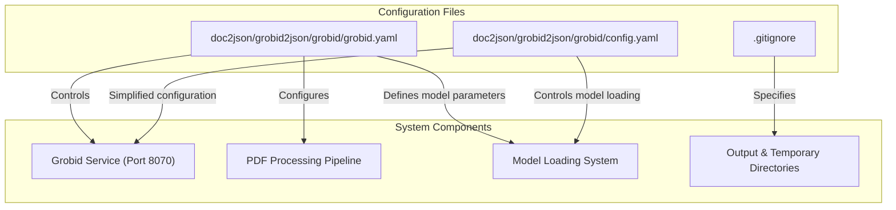
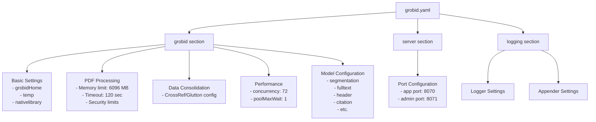
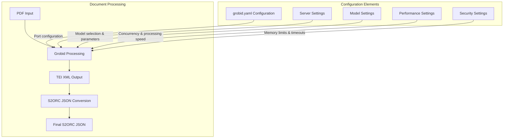

<!-- source: DeepWiki mcp.deepwiki.com · repo allenai/s2orc-doc2json · page 5.2 Configuration Files · fetched 2026-10-26 -->

# Configuration Files

Relevant source files

The following files were used as context for generating this wiki page:

- [.gitignore](.gitignore)
- [doc2json/grobid2json/grobid/config.yaml](doc2json/grobid2json/grobid/config.yaml)
- [doc2json/grobid2json/grobid/grobid.yaml](doc2json/grobid2json/grobid/grobid.yaml)

This page documents the configuration files used in the s2orc-doc2json system, their purpose, locations, and key settings. Configuration files are essential for customizing the behavior of various components, particularly the Grobid service used for PDF processing. For information about setting up Grobid specifically, see [Grobid Setup](#5.1).

## Configuration Files Overview

The s2orc-doc2json system uses several configuration files to control component behavior and processing parameters. The primary configuration files are for the Grobid service, which is a critical component in the PDF processing pipeline.

Sources: [doc2json/grobid2json/grobid/grobid.yaml](), [doc2json/grobid2json/grobid/config.yaml](), [.gitignore]()

## Grobid Configuration Files

Grobid is a machine learning library for extracting, parsing, and restructuring raw documents (particularly PDFs) into structured XML/TEI encoded documents. The s2orc-doc2json system uses Grobid in its PDF processing pipeline and provides two configuration files:

### grobid.yaml

This is the primary, comprehensive configuration file for the Grobid service, located at `doc2json/grobid2json/grobid/grobid.yaml`. It contains detailed settings for controlling Grobid's behavior.

Key settings in `grobid.yaml` include:

1. **PDF Processing Security**:
   - Memory limit: 6096 MB [doc2json/grobid2json/grobid/grobid.yaml:18]()
   - Timeout: 120 seconds [doc2json/grobid2json/grobid/grobid.yaml:19]()
   - Maximum blocks: 200,000 [doc2json/grobid2json/grobid/grobid.yaml:22]()
   - Maximum tokens: 1,000,000 [doc2json/grobid2json/grobid/grobid.yaml:23]()

2. **Performance Settings**:
   - Concurrency: 72 (maximum parallel requests) [doc2json/grobid2json/grobid/grobid.yaml:61]()
   - Pool maximum wait: 1 second [doc2json/grobid2json/grobid/grobid.yaml:64]()

3. **Server Configuration**:
   - Application port: 8070 [doc2json/grobid2json/grobid/grobid.yaml:251]()
   - Admin port: 8071 [doc2json/grobid2json/grobid/grobid.yaml:253]()

4. **Model Configuration**:
   - Detailed settings for each model (segmentation, header, citation, etc.)
   - Engine selection (wapiti or delft)
   - Training parameters for each model

5. **Model Preloading**:
   - `modelPreload: true` [doc2json/grobid2json/grobid/grobid.yaml:245]() - All models are loaded at server startup

Sources: [doc2json/grobid2json/grobid/grobid.yaml]()

### config.yaml

This is a simplified configuration file for Grobid, located at `doc2json/grobid2json/grobid/config.yaml`. It contains a subset of the settings found in `grobid.yaml`.

Key settings in `config.yaml` include:

1. **Basic Grobid Settings**:
   - `grobidHome: "grobid-home"` - Path to Grobid resources [doc2json/grobid2json/grobid/config.yaml:3]()
   - `modelPreload: true` - All models loaded at startup [doc2json/grobid2json/grobid/config.yaml:9]()

2. **Server Configuration**:
   - Application port: 8070 [doc2json/grobid2json/grobid/config.yaml:15]()
   - Admin port: 8071 [doc2json/grobid2json/grobid/config.yaml:17]()

3. **Logging Configuration**:
   - Logging level: WARN [doc2json/grobid2json/grobid/config.yaml:23]()
   - Console logging enabled [doc2json/grobid2json/grobid/config.yaml:27-29]()
   - File logging commented out [doc2json/grobid2json/grobid/config.yaml:30-36]()

Sources: [doc2json/grobid2json/grobid/config.yaml]()

## Directory Configuration

The `.gitignore` file indicates directories that are excluded from version control. These include output and temporary directories used by the system:

- `temp_dir/` - Temporary processing directory [.gitignore:9]()
- `output_dir/` - Output directory for processed files [.gitignore:10]()
- `tests/output/` and `tests/temp/` - Directories used for testing [.gitignore:4-5]()

Sources: [.gitignore]()

## Configuration Management Best Practices

When configuring the s2orc-doc2json system:

1. **Path Settings**: For production environments, change relative paths to absolute paths as noted in the comment [doc2json/grobid2json/grobid/config.yaml:2-3]()

2. **Performance Tuning**: Adjust the concurrency parameter in `grobid.yaml` based on your server's CPU/GPU capabilities. The default value (72) is recommended for a production server running only Grobid [doc2json/grobid2json/grobid/grobid.yaml:59-61]()

3. **Memory Management**: Be aware of the memory limit for PDF parsing (6096 MB by default). This may need adjustment for particularly large documents [doc2json/grobid2json/grobid/grobid.yaml:18]()

4. **Model Loading**: The `modelPreload` setting controls whether all models are loaded at startup (slower startup but faster first request) or on-demand (faster startup but slower first request) [doc2json/grobid2json/grobid/grobid.yaml:245]()

## Configuration Impact on Processing Pipeline

The configuration files directly affect how the document processing pipelines work, particularly the PDF processing through Grobid.

Sources: [doc2json/grobid2json/grobid/grobid.yaml](), [doc2json/grobid2json/grobid/config.yaml]()

---

