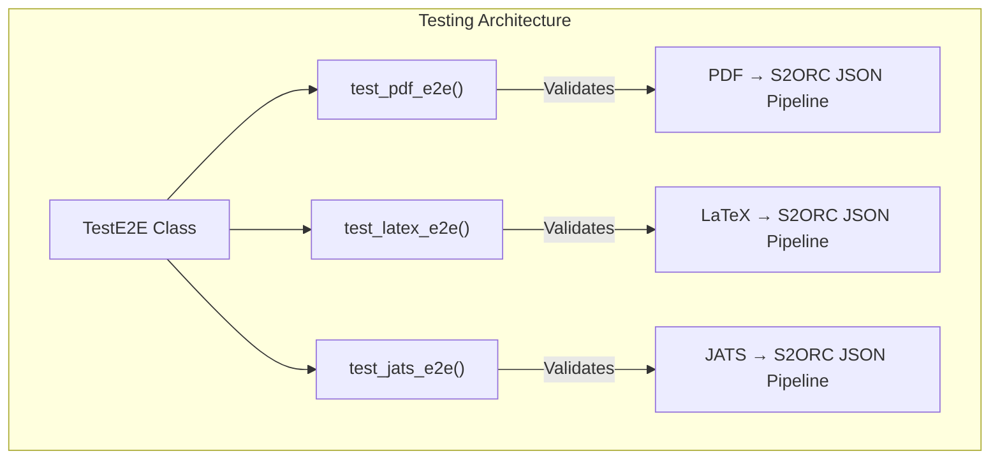
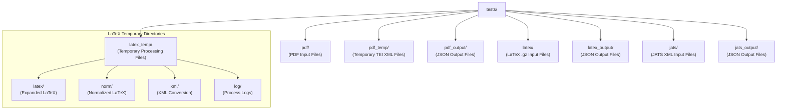
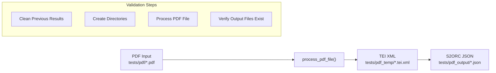
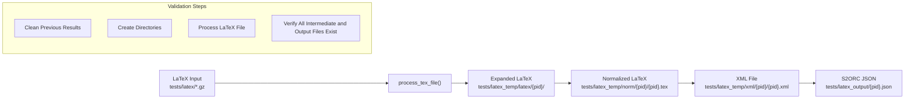
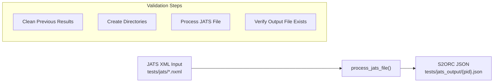
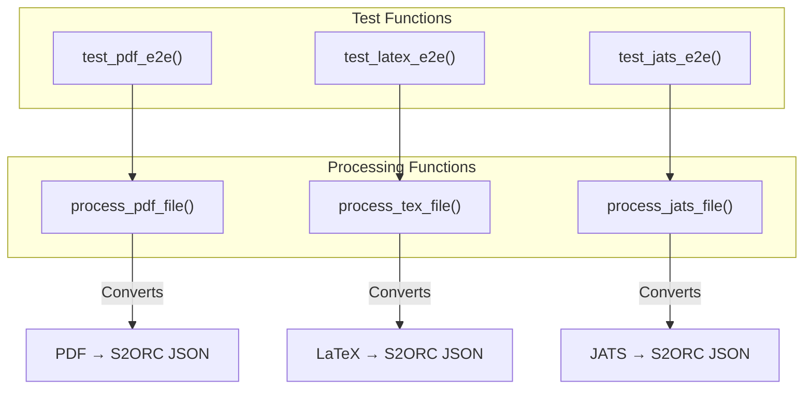

<!-- source: DeepWiki mcp.deepwiki.com · repo allenai/s2orc-doc2json · page 6 Testing · fetched 2026-10-26 -->

# Testing

<details>
<summary>Relevant source files</summary>

The following files were used as context for generating this wiki page:

- [README.md](README.md)
- [tests/test_end_to_end.py](tests/test_end_to_end.py)

</details>


This page provides an overview of the testing framework for the s2orc-doc2json repository. It covers the test organization, available end-to-end tests for each document conversion pipeline, and instructions for running tests to verify system functionality.

## Testing Framework Overview

The s2orc-doc2json system includes a testing framework based on Python's unittest module. The tests focus primarily on end-to-end validation of the conversion pipelines to ensure they correctly transform various input document formats (PDF, LaTeX, JATS XML) into the standardized S2ORC JSON format.



Sources: [tests/test_end_to_end.py:25-117]()

## Test Directory Structure

The testing framework uses a clearly defined directory structure to organize test inputs, intermediate files, and outputs:



Sources: [tests/test_end_to_end.py:9-22]()

## End-to-End Tests

End-to-end tests validate the full conversion process from source document to S2ORC JSON. The test suite contains a `TestE2E` class with methods for testing each conversion pipeline.

### PDF to JSON Tests

The `test_pdf_e2e` method tests the complete PDF-to-JSON conversion pipeline using Grobid.



The test performs the following actions for each PDF file:
1. Removes any existing output files from previous test runs
2. Creates necessary directories if they don't exist
3. Processes the PDF file using `process_pdf_file`
4. Verifies that both the temporary TEI XML file and the final JSON output exist

Sources: [tests/test_end_to_end.py:27-56]()

### LaTeX to JSON Tests

The `test_latex_e2e` method tests the complete LaTeX-to-JSON conversion pipeline.



The test performs the following actions for each LaTeX file:
1. Removes any existing temporary and output files from previous test runs
2. Creates necessary directories
3. Processes the LaTeX file using `process_tex_file`
4. Verifies that all expected files exist in each stage of the process:
   - Expanded LaTeX directory
   - Normalized LaTeX file
   - XML conversion file
   - Final JSON output

Sources: [tests/test_end_to_end.py:58-93]()

### JATS to JSON Tests

The `test_jats_e2e` method tests the complete JATS XML-to-JSON conversion pipeline.



The test performs the following actions for each JATS XML file:
1. Removes any existing output files from previous test runs
2. Creates necessary directories
3. Processes the JATS file using `process_jats_file`
4. Verifies that the JSON output file exists

Sources: [tests/test_end_to_end.py:95-117]()

## Running Tests

Tests can be run using the pytest framework, which is installed during the initial setup as specified in the README.

```
conda activate doc2json
pytest tests/test_end_to_end.py
```

To run a specific test method:

```
pytest tests/test_end_to_end.py::TestE2E::test_pdf_e2e
```

Before running tests, ensure that:
1. All required dependencies are installed
2. For PDF and LaTeX tests, Grobid is running on port 8070
3. For LaTeX tests, both latexpand and tralics are installed

Sources: [README.md:20-25](), [README.md:31-52]()

## Test Data

The repository includes test files for each document format:

| Directory | Content | Purpose |
|-----------|---------|---------|
| tests/pdf/ | Sample PDF files | Input for PDF-to-JSON tests |
| tests/latex/ | Sample LaTeX .gz files | Input for LaTeX-to-JSON tests |
| tests/jats/ | Sample JATS XML files | Input for JATS-to-JSON tests |

The test files serve as representative examples of different document formats that the system should be able to handle.

### Sample Test File Usage

The testing framework automatically processes all files with the appropriate extension in each input directory:
- PDF files with `.pdf` extension in `tests/pdf/`
- LaTeX archives with `.gz` extension in `tests/latex/`
- JATS XML files with `.nxml` extension in `tests/jats/`

For example, the N18-3011.pdf file mentioned in the README is used as a test input for the PDF-to-JSON pipeline.

Sources: [README.md:56-61](), [tests/test_end_to_end.py:32-34](), [tests/test_end_to_end.py:63-65](), [tests/test_end_to_end.py:99-101]()

## Integration with Processing Pipelines

The tests validate the entire processing pipeline for each document type by calling the high-level processing functions:



Each test function validates a specific document conversion pipeline by calling the corresponding processing function from the main codebase:
- `test_pdf_e2e` calls `process_pdf_file` from `doc2json.grobid2json.process_pdf`
- `test_latex_e2e` calls `process_tex_file` from `doc2json.tex2json.process_tex`
- `test_jats_e2e` calls `process_jats_file` from `doc2json.jats2json.process_jats`

Sources: [tests/test_end_to_end.py:1-8](), [tests/test_end_to_end.py:49-52](), [tests/test_end_to_end.py:82-88](), [tests/test_end_to_end.py:112-115]()

---

