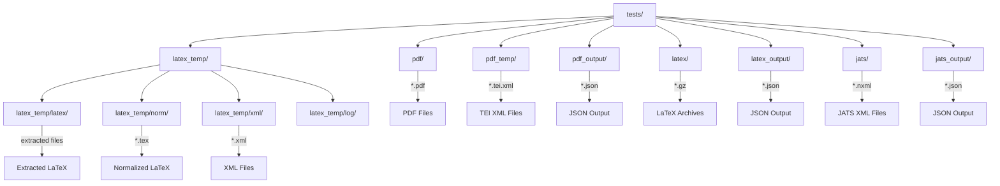
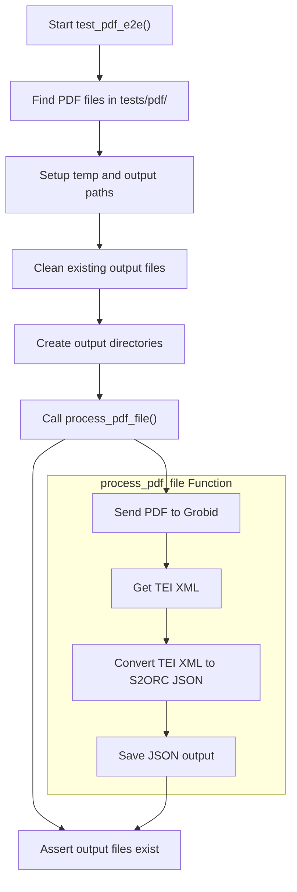
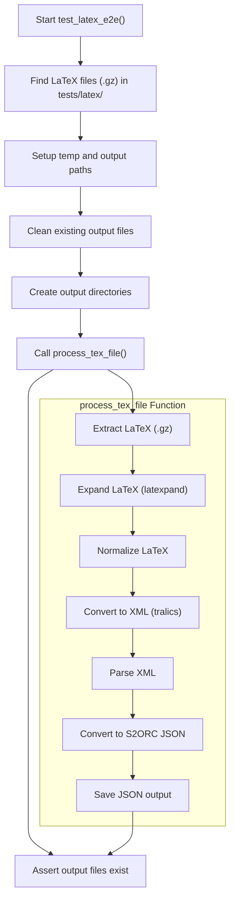
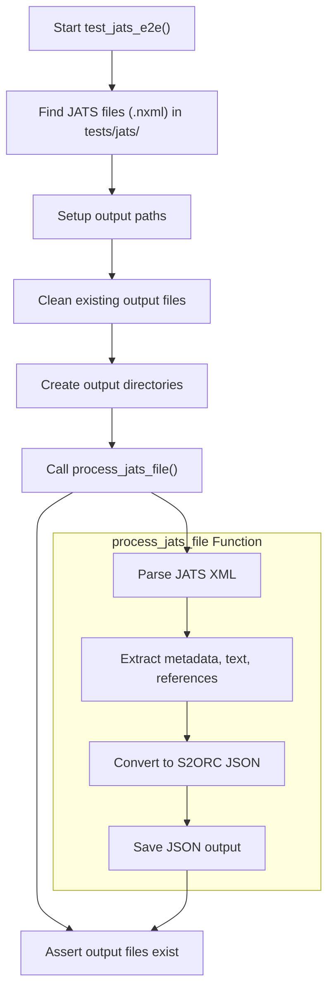
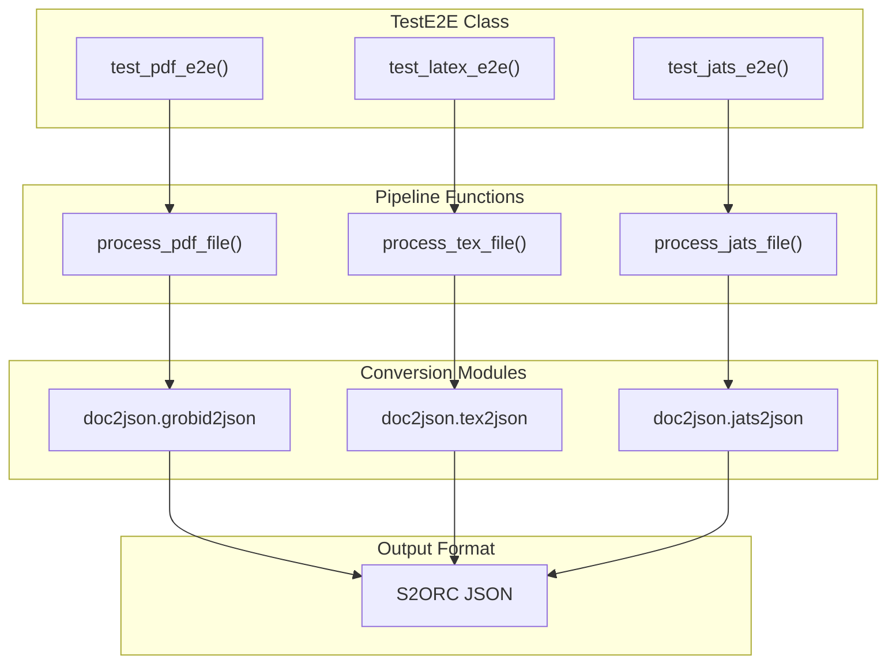

<!-- source: DeepWiki mcp.deepwiki.com · repo allenai/s2orc-doc2json · page 6.1 End-to-End Tests · fetched 2026-10-26 -->

# End-to-End Tests

<details>
<summary>Relevant source files</summary>

The following files were used as context for generating this wiki page:

- [tests/test_end_to_end.py](tests/test_end_to_end.py)

</details>


This document describes the end-to-end tests for the s2orc-doc2json system. These tests verify that the complete conversion pipelines function correctly by processing real document files through all stages of conversion and validating the expected outputs.

The tests cover all three main conversion pipelines:
- PDF to JSON (via Grobid)
- LaTeX to JSON
- JATS XML to JSON

For information about the specific test data used in these tests, see [Test Data](#6.2).

## Test Organization

The end-to-end tests are implemented in the `TestE2E` class within the test_end_to_end.py file. This class contains three test methods, one for each conversion pipeline:

```
TestE2E
├── test_pdf_e2e()     # Tests PDF → JSON pipeline
├── test_latex_e2e()   # Tests LaTeX → JSON pipeline
└── test_jats_e2e()    # Tests JATS XML → JSON pipeline
```

Sources: [tests/test_end_to_end.py:25-117]()

### Test Directory Structure

Each test pipeline uses its own set of directories for input data, temporary processing files, and output results.

Title: Test Directory Structure


Sources: [tests/test_end_to_end.py:9-22]()

## PDF Conversion Tests

The PDF conversion test (`test_pdf_e2e()`) verifies that PDF files can be successfully converted to the S2ORC JSON format.

Title: PDF Conversion Test Flow


Sources: [tests/test_end_to_end.py:27-56]()

### Implementation Details

The test performs the following steps for each PDF file:

1. Extracts the paper ID from the filename
2. Removes any existing temporary and output files
3. Creates necessary output directories
4. Calls `process_pdf_file()` from the `doc2json.grobid2json.process_pdf` module
5. Verifies that both the intermediate TEI XML file and the final JSON output file exist

Key assertions:
- The input directory exists
- The temporary TEI XML file exists after processing
- The final JSON output file exists after processing

## LaTeX Conversion Tests

The LaTeX conversion test (`test_latex_e2e()`) verifies that LaTeX files can be successfully converted to the S2ORC JSON format.

Title: LaTeX Conversion Test Flow


Sources: [tests/test_end_to_end.py:58-93]()

### Implementation Details

The test performs the following steps for each LaTeX archive:

1. Extracts the paper ID from the filename
2. Removes any existing temporary directory and output files
3. Creates necessary output directories
4. Calls `process_tex_file()` from the `doc2json.tex2json.process_tex` module
5. Verifies that all intermediate and final output files exist

Key assertions:
- The input directory exists
- The extracted LaTeX files exist
- The normalized LaTeX file exists
- The converted XML file exists
- The final JSON output file exists

The LaTeX pipeline is more complex than the others, with multiple intermediate stages that are all tested, including extraction, normalization, and XML conversion.

## JATS Conversion Tests

The JATS conversion test (`test_jats_e2e()`) verifies that JATS XML files can be successfully converted to the S2ORC JSON format.

Title: JATS Conversion Test Flow


Sources: [tests/test_end_to_end.py:95-117]()

### Implementation Details

The test performs the following steps for each JATS XML file:

1. Extracts the PMC ID from the filename
2. Removes any existing output files
3. Creates necessary output directories
4. Calls `process_jats_file()` from the `doc2json.jats2json.process_jats` module
5. Verifies that the final JSON output file exists

Key assertions:
- The input directory exists
- The final JSON output file exists

## Integration with Conversion Pipelines

The end-to-end tests integrate with the three main conversion modules of the s2orc-doc2json system, providing comprehensive validation of the entire system.

Title: E2E Tests Integration with Conversion Pipelines


Sources: [tests/test_end_to_end.py:5-7]()

## Running the Tests

The end-to-end tests can be run using Python's unittest framework:

```bash
python -m unittest tests.test_end_to_end
```

To run a specific test method:

```bash
python -m unittest tests.test_end_to_end.TestE2E.test_pdf_e2e
python -m unittest tests.test_end_to_end.TestE2E.test_latex_e2e
python -m unittest tests.test_end_to_end.TestE2E.test_jats_e2e
```

### Prerequisites

These tests require:
1. The Grobid service to be running for the PDF tests
2. External tools such as `latexpand` and `tralics` to be installed for the LaTeX tests
3. Appropriate test data in the test directories

## Summary

The end-to-end tests verify that each conversion pipeline can properly:
1. Read input files in their respective formats
2. Process them through all stages of conversion
3. Generate valid S2ORC JSON output

By testing the complete pipelines with real documents, these tests ensure that the system reliably converts scientific documents from various formats to the standardized S2ORC JSON format.

Sources: [tests/test_end_to_end.py]()

---

