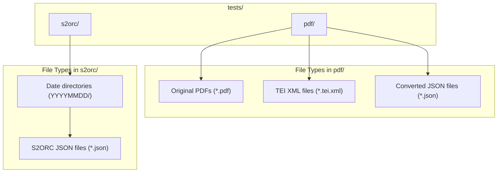
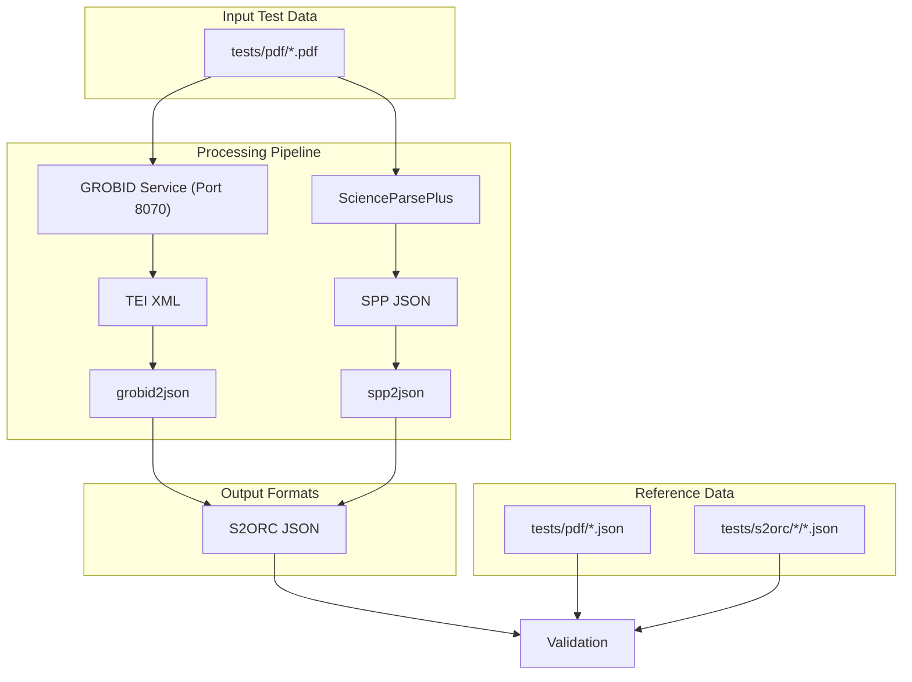
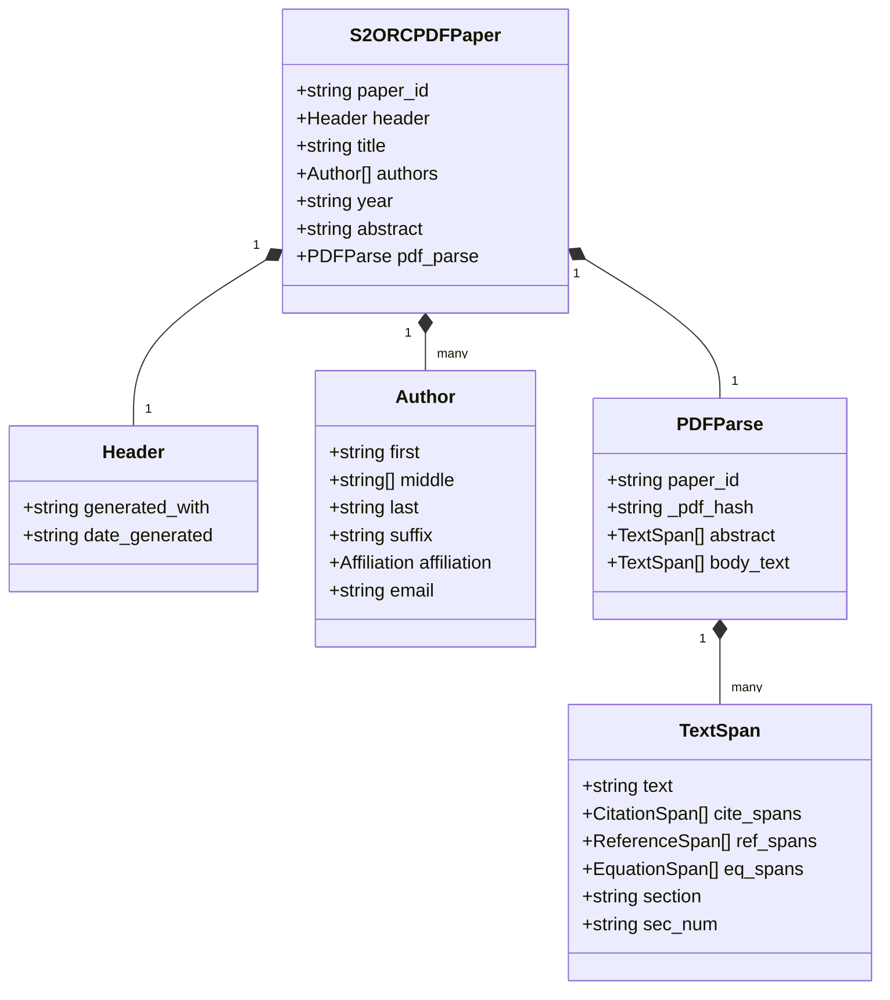
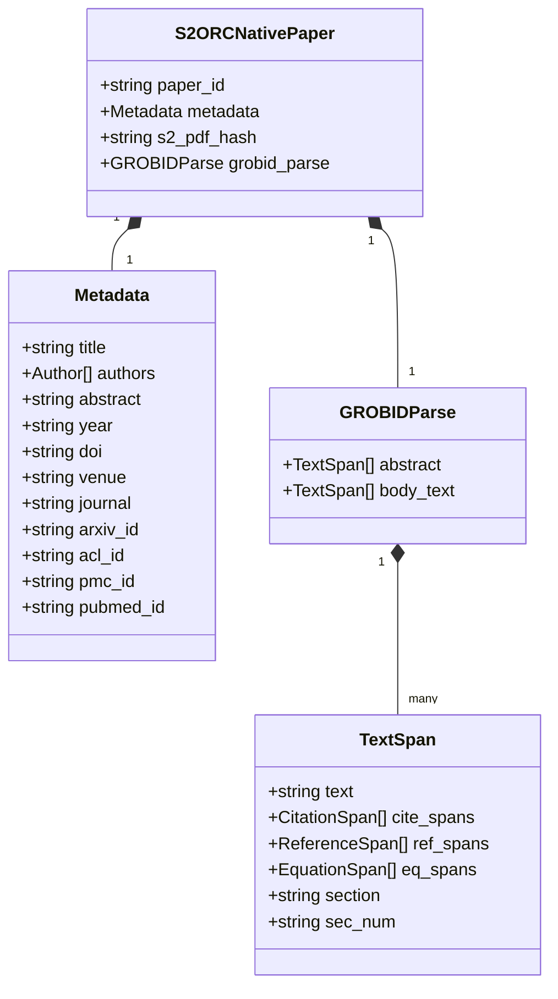

<!-- source: DeepWiki mcp.deepwiki.com · repo allenai/s2orc-doc2json · page 6.2 Test Data · fetched 2026-10-26 -->

# Test Data

Relevant source files

The following files were used as context for generating this wiki page:

- [doc2json/config.py](doc2json/config.py)
- [tests/pdf/2020.acl-main.207.json](tests/pdf/2020.acl-main.207.json)
- [tests/pdf/2020.acl-main.207.pdf](tests/pdf/2020.acl-main.207.pdf)
- [tests/pdf/2020.acl-main.207.tei.xml](tests/pdf/2020.acl-main.207.tei.xml)
- [tests/pdf/N18-3011.json](tests/pdf/N18-3011.json)
- [tests/pdf/N18-3011.pdf](tests/pdf/N18-3011.pdf)
- [tests/s2orc/20190928/10002293.json](tests/s2orc/20190928/10002293.json)

This page provides information about the test data available in the s2orc-doc2json repository, which is used to validate the various document conversion pipelines. It focuses on describing the structure, organization, and usage of test files for ensuring correct document parsing and conversion to the S2ORC JSON format.

## Test Data Organization

The test data in the repository is organized by input format in subdirectories within the `tests` directory:

Sources: `tests/pdf/2020.acl-main.207.json`, `tests/pdf/N18-3011.json`, `tests/pdf/N18-3011.pdf`, `tests/pdf/2020.acl-main.207.pdf`, `tests/pdf/2020.acl-main.207.tei.xml`, `tests/s2orc/20190928/10002293.json`

## Available Test Datasets

### PDF Test Files

The repository includes PDF test files along with their intermediate and final processed outputs:

1. **Original PDFs**: Scientific papers in PDF format
   - `tests/pdf/2020.acl-main.207.pdf` - "SPECTER: Document-level Representation Learning using Citation-informed Transformers"
   - `tests/pdf/N18-3011.pdf` - "Construction of the Literature Graph in Semantic Scholar"

2. **TEI XML Files**: Intermediate format generated by GROBID
   - `tests/pdf/2020.acl-main.207.tei.xml`

3. **JSON Files**: Final S2ORC JSON format after processing
   - `tests/pdf/2020.acl-main.207.json`
   - `tests/pdf/N18-3011.json`

### S2ORC Format Test Files

The repository also contains examples of papers already in the S2ORC format:

- `tests/s2orc/20190928/10002293.json` - "Antimicrobial Photodynamic Therapy against Endodontic Enterococcus faecalis and Candida albicans Mono and Mixed Biofilms in the Presence of Photosensitizers"

Sources: `tests/pdf/2020.acl-main.207.json`, `tests/pdf/N18-3011.json`, `tests/s2orc/20190928/10002293.json`

## Testing Pipeline Workflow

The test data is used to validate different conversion pipelines in the s2orc-doc2json system:

Sources: `tests/pdf/2020.acl-main.207.pdf`, `tests/pdf/2020.acl-main.207.tei.xml`, `tests/pdf/2020.acl-main.207.json`

## S2ORC JSON Format Structure

The test data illustrates two slightly different JSON formats:

### 1. PDF-derived S2ORC JSON Format

This format is generated by the PDF conversion pipelines (grobid2json, spp2json):

### 2. Native S2ORC JSON Format

This format is used in the S2ORC dataset:

The key differences between the formats are:
- PDF-derived format has `header` and `pdf_parse` fields
- Native S2ORC format has `metadata` and `grobid_parse` fields
- Native S2ORC format includes additional metadata fields like `doi`, `venue`, `arxiv_id`, etc.

Sources: `tests/pdf/2020.acl-main.207.json`, `tests/s2orc/20190928/10002293.json`, `doc2json/config.py`

## Using Test Data for Validation

The test data can be used to validate the conversion pipelines through the following process:

1. **Input Processing**: Process the input test files (e.g., PDFs) through the relevant pipeline
2. **Output Comparison**: Compare the generated output with the reference JSON files
3. **Validation Criteria**: Check for:
   - Correct metadata extraction (title, authors, abstract)
   - Proper section parsing and organization
   - Accurate citation and reference extraction
   - Proper handling of equations and other special elements

### Example Validation Workflow

For validating the grobid2json pipeline:

1. Process `tests/pdf/2020.acl-main.207.pdf` using the grobid2json pipeline
2. Compare the output with the reference file `tests/pdf/2020.acl-main.207.json`
3. Verify key elements are correctly extracted and formatted

For validating the spp2json pipeline:

1. Process `tests/pdf/N18-3011.pdf` using the spp2json pipeline
2. Compare the output with the reference file `tests/pdf/N18-3011.json`
3. Verify key elements are correctly extracted and formatted

### Version Information

The test data targets S2ORC version 1.0.0 as indicated in the `header.generated_with` field of the JSON files and confirmed in the configuration file [doc2json/config.py:1-2]().

Sources: `tests/pdf/2020.acl-main.207.json`, `tests/pdf/N18-3011.json`, `doc2json/config.py`

## Test Data Usage Table

| Test File Type | Location | Purpose | Used by Pipeline |
|----------------|----------|---------|------------------|
| Original PDFs | `tests/pdf/*.pdf` | Input test documents | grobid2json, spp2json |
| TEI XML | `tests/pdf/*.tei.xml` | Intermediate format | grobid2json |
| Output JSON | `tests/pdf/*.json` | Reference output for validation | - |
| S2ORC JSON | `tests/s2orc/*/*.json` | Reference S2ORC format | - |

Sources: `tests/pdf/2020.acl-main.207.pdf`, `tests/pdf/2020.acl-main.207.tei.xml`, `tests/pdf/2020.acl-main.207.json`, `tests/s2orc/20190928/10002293.json`