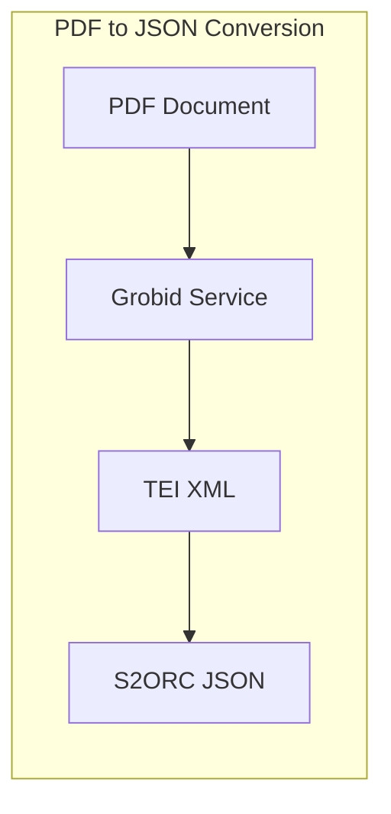
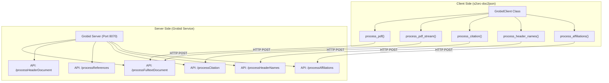
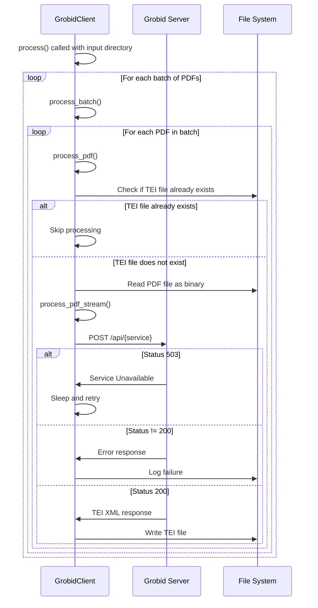
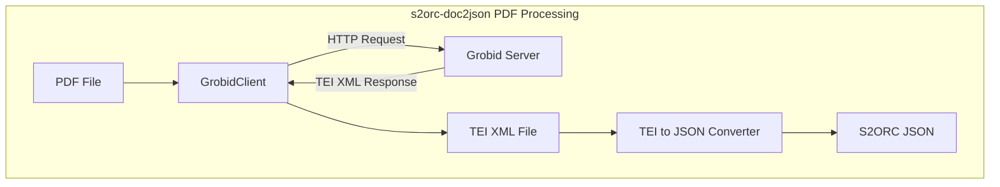

<!-- source: DeepWiki mcp.deepwiki.com · repo allenai/s2orc-doc2json · extra page Grobid Integration · fetched 2026-10-26 -->

# Grobid Integration

<details>
<summary>Relevant source files</summary>

The following files were used as context for generating this wiki page:

- [.gitignore](.gitignore)
- [doc2json/grobid2json/grobid/Readme.md](doc2json/grobid2json/grobid/Readme.md)
- [doc2json/grobid2json/grobid/grobid.yaml](doc2json/grobid2json/grobid/grobid.yaml)
- [doc2json/grobid2json/grobid/grobid_client.py](doc2json/grobid2json/grobid/grobid_client.py)
- [doc2json/grobid2json/pdf_to_tei.py](doc2json/grobid2json/pdf_to_tei.py)

</details>


This document details how s2orc-doc2json integrates with Grobid, an open-source machine learning library for extracting structured information from scholarly documents. Specifically, this page covers the implementation details of how the PDF-to-JSON pipeline connects to and utilizes Grobid services to process PDF documents. For information about the subsequent TEI XML to JSON conversion process, see [TEI XML to JSON Conversion](#3.1.2).

## What is Grobid?

Grobid (GeneRation Of BIbliographic Data) is a machine learning-based document engineering tool that extracts structured data from scholarly documents in PDF format. It converts PDFs into structured TEI XML format, which includes detailed metadata, references, sections, and other document components.

In the s2orc-doc2json system, Grobid serves as the first step in converting PDFs to S2ORC JSON format:



Sources: [doc2json/grobid2json/grobid/grobid_client.py](), [doc2json/grobid2json/grobid/Readme.md]()

## Architecture

The Grobid integration in s2orc-doc2json is implemented as a client-server architecture:



Sources: [doc2json/grobid2json/grobid/grobid_client.py:32-243]()

## GrobidClient Implementation

The `GrobidClient` class is the primary interface for interacting with the Grobid service. It extends the `ApiClient` class and provides methods for processing PDF documents and extracting specific components.

### Configuration

The client uses a configuration dictionary that specifies:

```python
DEFAULT_GROBID_CONFIG = {
    "grobid_server": "localhost",
    "grobid_port": "8070",
    "batch_size": 1000,
    "sleep_time": 5,
    "generateIDs": False,
    "consolidate_header": False,
    "consolidate_citations": False,
    "include_raw_citations": True,
    "include_raw_affiliations": False,
    "max_workers": 2,
}
```

Sources: [doc2json/grobid2json/grobid/grobid_client.py:20-31]()

### Key Methods

The `GrobidClient` provides several methods for different types of document processing:

| Method | Purpose | API Endpoint |
|--------|---------|--------------|
| `process_pdf()` | Process a PDF file and write the TEI XML output | /api/processFulltextDocument |
| `process_pdf_stream()` | Process a PDF from a byte stream | /api/processFulltextDocument |
| `process_citation()` | Process a citation string | /api/processCitation |
| `process_header_names()` | Process author names from header | /api/processHeaderNames |
| `process_affiliations()` | Process affiliation information | /api/processAffiliations |

Each method sends appropriate HTTP POST requests to the Grobid service and handles the response, including error retries for 503 Service Unavailable responses.

Sources: [doc2json/grobid2json/grobid/grobid_client.py:67-225]()

## Processing Flow

The following diagram illustrates the detailed flow of PDF processing through the Grobid integration:



Sources: [doc2json/grobid2json/grobid/grobid_client.py:47-142]()

## Grobid Server Configuration

The Grobid service is configured using a YAML file (`grobid.yaml`) that specifies various parameters including:

1. **Server settings**:
   - HTTP port (default: 8070)
   - Admin port (default: 8071)

2. **Processing parameters**:
   - Model preloading
   - Memory limits
   - Timeouts
   - Maximum document size

3. **Model configurations**:
   - Engine selection (Wapiti CRF or DeLFT deep learning)
   - Training parameters
   - Architecture selection

For production use, the server can be configured to handle multiple concurrent requests based on available CPU/GPU resources.

Sources: [doc2json/grobid2json/grobid/grobid.yaml:1-272]()

## Usage in the PDF-to-JSON Pipeline

In the overall PDF-to-JSON conversion process, the Grobid integration functions as follows:



The conversion process involves:

1. The `GrobidClient` sends the PDF to the Grobid server
2. Grobid processes the PDF and returns structured TEI XML
3. The TEI XML is saved to a file
4. A separate converter processes the TEI XML into the final S2ORC JSON format

Sources: [doc2json/grobid2json/grobid/grobid_client.py](), [doc2json/grobid2json/pdf_to_tei.py]()

## Error Handling and Resilience

The Grobid integration includes several features to handle errors and ensure robustness:

1. **Retry mechanism** for 503 Service Unavailable responses
2. **Logging of failures** to a separate log file
3. **Batch processing** to manage large document collections
4. **Concurrency control** to prevent overwhelming the Grobid server

These features make the integration suitable for processing large volumes of academic papers in production environments.

Sources: [doc2json/grobid2json/grobid/grobid_client.py:109-125]()

## Summary

The Grobid integration is a critical component of the s2orc-doc2json system's PDF processing pipeline. It provides a robust client-server architecture for extracting structured information from scholarly PDFs, which then serves as input for the subsequent JSON conversion process. The integration is designed to be configurable, resilient, and capable of processing large document collections efficiently.

---

