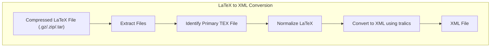
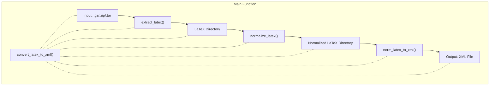
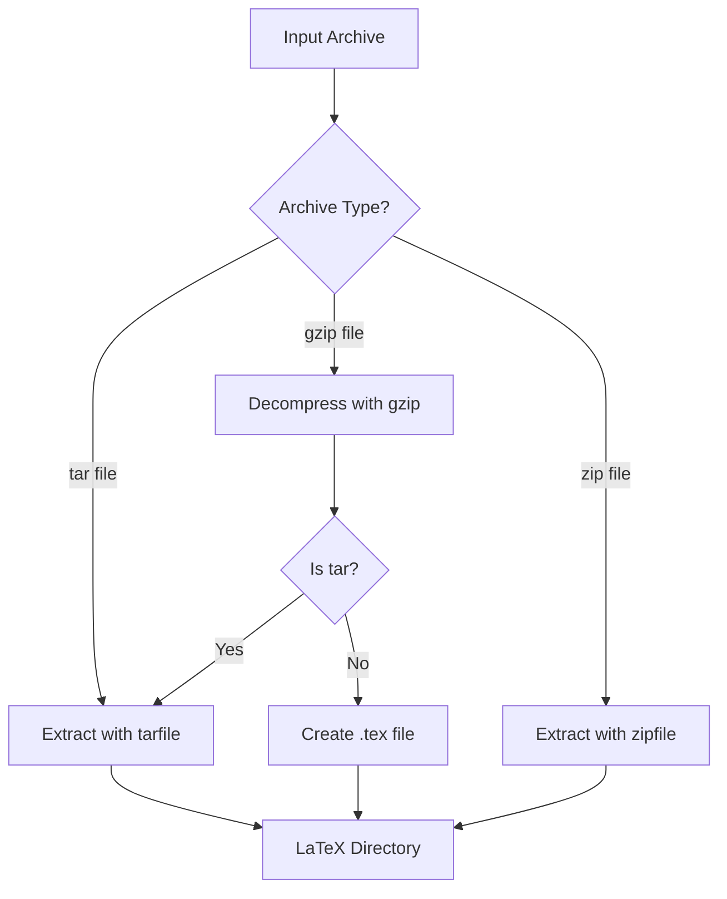
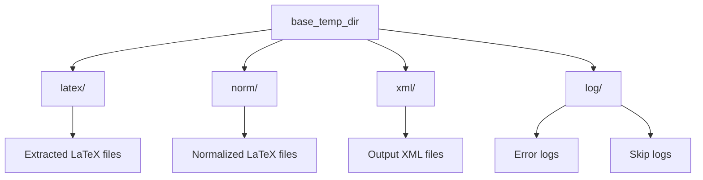
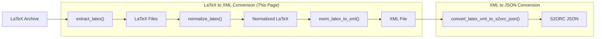

<!-- source: DeepWiki mcp.deepwiki.com · repo allenai/s2orc-doc2json · extra page LaTeX to XML Conversion · fetched 2026-10-26 -->

# LaTeX to XML Conversion

<details>
<summary>Relevant source files</summary>

The following files were used as context for generating this wiki page:

- [doc2json/tex2json/tex_to_xml.py](doc2json/tex2json/tex_to_xml.py)

</details>


## Purpose and Scope

This document details the LaTeX to XML conversion process within the tex2json pipeline of the s2orc-doc2json system. It focuses specifically on the intermediate step of converting LaTeX documents to XML, which serves as a bridge between raw LaTeX files and the final S2ORC JSON format. For information about how the resulting XML is converted to JSON, see [XML to JSON Conversion](#3.3.2).

## Overview

The LaTeX to XML conversion module transforms compressed LaTeX archives into structured XML documents using a series of processing steps. This conversion is a critical component of the tex2json pipeline, enabling the system to extract structured content from LaTeX documents for inclusion in the Semantic Scholar Open Research Corpus (S2ORC).



Sources: [doc2json/tex2json/tex_to_xml.py:1-11](). 

## Conversion Process

The LaTeX to XML conversion follows a multi-step process designed to handle the complexities of LaTeX documents while producing well-structured XML output.



Sources: [doc2json/tex2json/tex_to_xml.py:180-205]().

### 1. Extraction

The first step is to extract the LaTeX files from a compressed archive. The system supports multiple archive formats:
- `.gz` (gzip) files
- `.tar` files
- `.zip` files

The `extract_latex()` function handles the extraction process and creates a directory containing all the extracted files.



Sources: [doc2json/tex2json/tex_to_xml.py:28-117]().

### 2. Normalization

After extraction, the LaTeX files undergo normalization, which prepares them for XML conversion. This step is handled by the `normalize_latex()` function.

The normalization process:
1. Identifies the main LaTeX file
2. Expands included files (using latexpand)
3. Handles BibTeX content
4. Creates a single, self-contained LaTeX file

Sources: [doc2json/tex2json/tex_to_xml.py:119-145]().

### 3. XML Conversion

The normalized LaTeX is then converted to XML using the tralics tool. This process is handled by the `norm_latex_to_xml()` function.

Tralics is a LaTeX to XML converter that preserves the structure of the document, including:
- Sections and subsections
- Mathematical formulas
- Citations
- Tables and figures
- Special characters

The output is a well-formed XML document that maintains the semantic structure of the original LaTeX.

Sources: [doc2json/tex2json/tex_to_xml.py:148-178]().

## Directory Structure and File Management

The conversion process uses a structured directory system to manage files at different processing stages:



Each directory serves a specific purpose:
- `latex/`: Contains the extracted LaTeX files
- `norm/`: Contains the normalized LaTeX files
- `xml/`: Contains the output XML files
- `log/`: Contains error and skip logs

The system creates these directories if they don't exist and can optionally clean them up after processing.

Sources: [doc2json/tex2json/tex_to_xml.py:208-239]().

## Key Functions

### extract_latex

```python
def extract_latex(zip_file: str, latex_dir: str, cleanup=True)
```

Extracts LaTeX files from a compressed archive. Supports `.gz`, `.tar`, and `.zip` formats. Returns the path to the directory containing the extracted files.

Sources: [doc2json/tex2json/tex_to_xml.py:28-117]().

### normalize_latex

```python
def normalize_latex(latex_dir: str, norm_dir: str, norm_log_file: str, cleanup=True) -> Optional[str]
```

Normalizes LaTeX files by expanding includes and handling BibTeX. Returns the path to the directory containing the normalized files.

Sources: [doc2json/tex2json/tex_to_xml.py:119-145]().

### norm_latex_to_xml

```python
def norm_latex_to_xml(norm_dir: str, xml_dir: str, xml_err_file: str, xml_log_file: str, cleanup=True) -> Optional[str]
```

Converts normalized LaTeX to XML using tralics. Returns the path to the output XML file.

Sources: [doc2json/tex2json/tex_to_xml.py:148-178]().

### convert_latex_to_xml

```python
def convert_latex_to_xml(zip_file: str, latex_dir: str, norm_dir: str, xml_dir: str, log_dir: str, cleanup=True) -> Optional[str]
```

Runs the entire LaTeX to XML conversion pipeline. Returns the path to the output XML file.

Sources: [doc2json/tex2json/tex_to_xml.py:180-205]().

### convert_latex_to_s2orc_json

```python
def convert_latex_to_s2orc_json(latex_zip: str, base_temp_dir: str, cleanup_after: bool=True) -> str
```

Sets up the directory structure and invokes the conversion pipeline. Returns the path to the output XML file for further processing.

Sources: [doc2json/tex2json/tex_to_xml.py:208-239]().

## Integration with the tex2json Pipeline

The LaTeX to XML conversion is a key component of the larger tex2json pipeline, which converts LaTeX documents to S2ORC JSON. It serves as an intermediate step that transforms unstructured LaTeX into structured XML, which can then be converted to JSON.



Sources: [doc2json/tex2json/tex_to_xml.py:1-11](), [doc2json/tex2json/tex_to_xml.py:208-239]().

## Error Handling and Logging

The conversion process includes comprehensive error handling and logging:

| Log File | Purpose |
|----------|---------|
| norm_error.log | Records errors during LaTeX normalization |
| xml_error.log | Records errors during XML conversion |
| xml_skip.log | Records files that were skipped during XML conversion |

These logs help identify issues in the conversion process and can be useful for debugging and improving the system.

Sources: [doc2json/tex2json/tex_to_xml.py:197-202]().

## Dependencies

The LaTeX to XML conversion relies on several external tools and utilities:

1. **latexpand**: Used to expand LaTeX includes and create a single, self-contained LaTeX file
2. **tralics**: A LaTeX to XML converter that preserves the semantic structure of the document

These dependencies must be properly installed and configured for the conversion process to work correctly.

Sources: [doc2json/tex2json/tex_to_xml.py:20]().

## Conclusion

The LaTeX to XML conversion is a critical component of the tex2json pipeline, transforming unstructured LaTeX documents into structured XML that can be further processed into S2ORC JSON. The multi-step process handles the complexities of LaTeX while preserving the semantic structure of the document, enabling the extraction of valuable information from scientific papers in LaTeX format.

---

