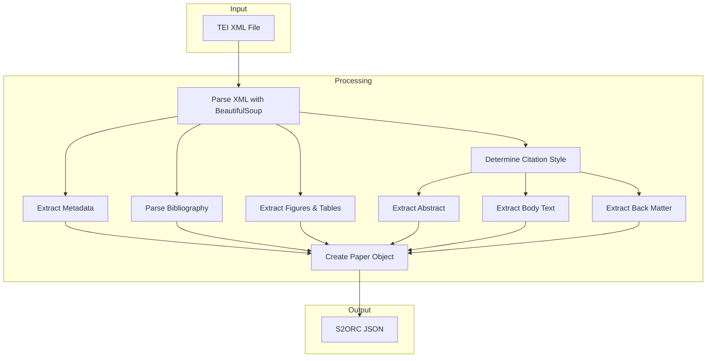
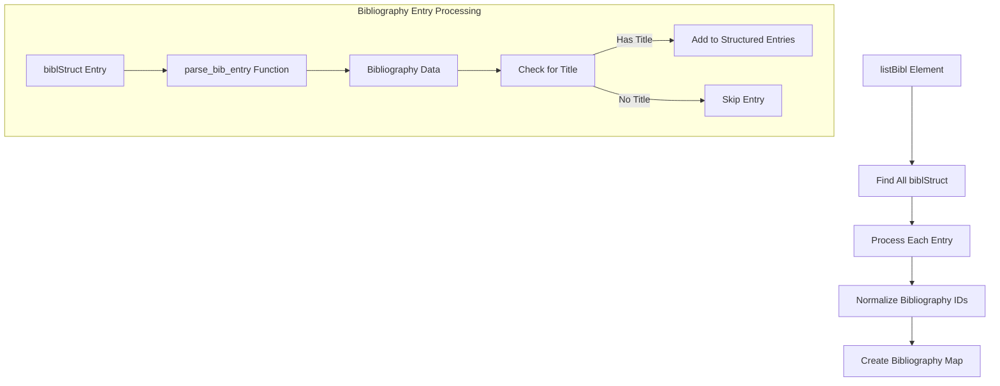
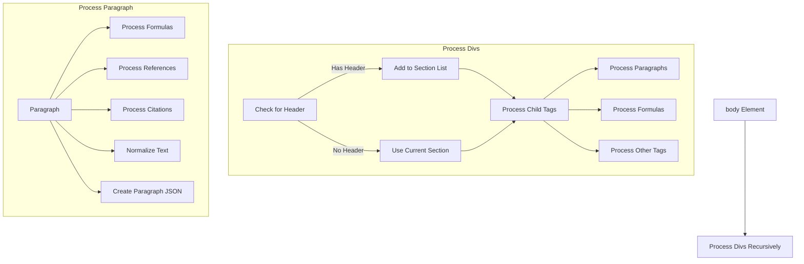
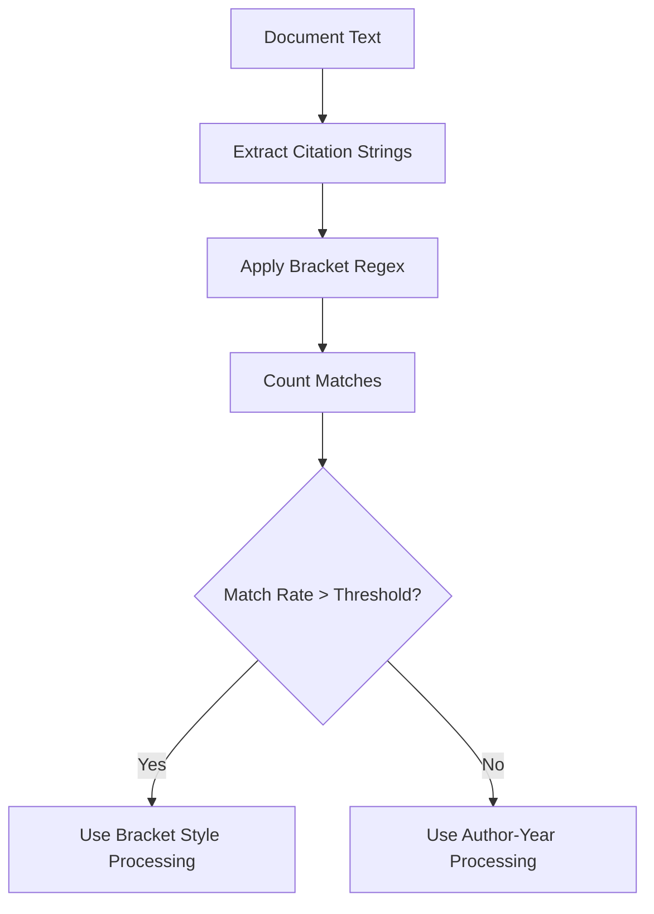

<!-- source: DeepWiki mcp.deepwiki.com · repo allenai/s2orc-doc2json · extra page TEI XML to JSON Conversion · fetched 2026-10-26 -->

# TEI XML to JSON Conversion

<details>
<summary>Relevant source files</summary>

The following files were used as context for generating this wiki page:

- [doc2json/grobid2json/tei_to_json.py](doc2json/grobid2json/tei_to_json.py)

</details>


This document explains the process of converting TEI XML documents (produced by GROBID) into the S2ORC JSON format. This conversion represents a critical intermediate step in the PDF to JSON pipeline, where the structured XML data is transformed into a standardized JSON format suitable for downstream analysis and applications.

For information about converting PDFs to TEI XML using GROBID, see [Grobid Integration](#3.1.1).

## Conversion Process Overview

The TEI XML to JSON conversion takes a TEI XML file produced by GROBID and parses it into a structured JSON representation that conforms to the S2ORC data model. The process involves extracting metadata, bibliography entries, figures, tables, and textual content from the XML document.



Sources: [doc2json/grobid2json/tei_to_json.py:691-756]()

## Main Functions and Components

The TEI XML to JSON conversion is implemented in the `tei_to_json.py` file, which provides two main entry points:

1. `convert_tei_xml_file_to_s2orc_json`: Processes a TEI XML file on disk
2. `convert_tei_xml_soup_to_s2orc_json`: Processes an already-parsed BeautifulSoup object

These functions coordinate the extraction of different document components and assemble them into a unified `Paper` object that follows the S2ORC data model.

```mermaid
classDiagram
    class "convert_tei_xml_file_to_s2orc_json" {
        +String tei_file
        +String pdf_hash
        -Read file
        -Parse XML
        -Call convert_tei_xml_soup_to_s2orc_json
        +Return Paper object
    }
    
    class "convert_tei_xml_soup_to_s2orc_json" {
        +BeautifulSoup soup
        +String paper_id
        +String pdf_hash
        -Extract metadata
        -Parse bibliography
        -Extract figures/tables
        -Determine citation style
        -Process abstract/body/back matter
        +Return Paper object
    }
    
    "convert_tei_xml_file_to_s2orc_json" --> "convert_tei_xml_soup_to_s2orc_json": Calls
```

Sources: [doc2json/grobid2json/tei_to_json.py:691-756]()

## Metadata Extraction

Metadata extraction processes the `fileDesc` element from the TEI XML to obtain bibliographic information about the paper, including:

- Title
- Authors (with affiliations when available)
- Year of publication
- Venue (journal or conference)
- Identifiers (DOI, arXiv ID, etc.)

The extracted metadata is cleaned to remove duplicate authors and empty entries.

Sources: [doc2json/grobid2json/tei_to_json.py:699-702](), [doc2json/utils/grobid_util.py]()

## Bibliography Extraction

The bibliography extraction process parses the `listBibl` element from the TEI XML to obtain references cited by the paper. Each bibliography entry is normalized and stored with the following information:

- Bibliography ID (normalized to the format "BIBREF#")
- Title
- Authors
- Year
- Venue
- Volume, issue, and page information
- Additional identifiers (DOI, etc.)

Empty bibliography entries without titles are filtered out during the process.



Sources: [doc2json/grobid2json/tei_to_json.py:68-87](), [doc2json/utils/grobid_util.py]()

## Figures and Tables Extraction

Figures and tables are extracted from the `figure` elements in the TEI XML. The system processes:

- Figures with captions
- Tables with content

Each figure and table is assigned a unique reference ID (normalized to "FIGREF#" or "TABREF#") and stored with associated metadata like captions, labels, and content.

For tables, the system performs additional conversion of table markup to HTML representation for better rendering.

Sources: [doc2json/grobid2json/tei_to_json.py:116-151]()

## Text Content Extraction

### Abstract Extraction

The abstract is extracted from the `abstract` element in the TEI XML. The system supports different abstract structures:

- Abstracts with multiple div elements
- Abstracts with paragraph (p) elements
- Plain text abstracts

Each paragraph in the abstract is processed to normalize text, extract citations, and identify references to figures, tables, or equations.

Sources: [doc2json/grobid2json/tei_to_json.py:501-546]()

### Body Text Extraction

Body text extraction processes the `body` element and all its nested div elements recursively. For each section:

1. Section headers are identified and structured hierarchically
2. Paragraphs are processed to normalize text
3. Citations are extracted and linked to bibliography entries
4. References to figures, tables, and equations are identified
5. Formulas are processed and labeled

The result is a structured representation of the paper's content with clear section demarcation.



Sources: [doc2json/grobid2json/tei_to_json.py:549-648]()

### Back Matter Extraction

Back matter extraction processes the `back` element, which typically contains acknowledgments, author contributions, competing interests, and other end-of-document content. The extraction follows a similar approach to body text extraction, with each section identified and processed.

Sources: [doc2json/grobid2json/tei_to_json.py:651-688]()

## Citation and Reference Processing

Citation and reference processing is a complex part of the conversion that handles:

1. Identifying citation and reference tags in the text
2. Determining citation style (bracket or non-bracket)
3. Normalizing reference IDs
4. Processing citation ranges (e.g., "[1-3]" expanded to "[1] [2] [3]")
5. Creating mappings between citation spans in the text and bibliography entries

The system uses regular expressions and context analysis to properly identify and normalize citations, even handling complex cases like citation ranges.

### Citation Style Detection

The system determines whether the document uses bracket-style citations (e.g., "[1]") or author-year style by analyzing the citation text patterns. This affects how citations are processed and expanded.



Sources: [doc2json/grobid2json/tei_to_json.py:154-177](), [doc2json/grobid2json/tei_to_json.py:246-404]()

## Output Structure

The final output of the conversion process is a `Paper` object containing:

- Metadata (title, authors, year, venue, identifiers)
- Abstract paragraphs (with citation and reference spans)
- Body text paragraphs (with citation and reference spans)
- Back matter paragraphs
- Bibliography entries
- Reference entries (figures, tables, equations)

This structured format preserves the semantic information from the original document while making it accessible for downstream processing.

### Example Structure

| Component | Description | Example Fields |
|-----------|-------------|----------------|
| Metadata  | Paper bibliographic information | title, authors, year, venue |
| Abstract  | List of paragraph objects | text, cite_spans, ref_spans, eq_spans |
| Body Text | List of paragraph objects with section info | text, cite_spans, ref_spans, eq_spans, section |
| Back Matter | List of paragraph objects | text, cite_spans, ref_spans, eq_spans, section |
| Bibliography | Dictionary of bibliography entries | key: BIBREF#, value: bib entry object |
| References | Dictionary of figure/table/equation references | key: FIGREF#/TABREF#/EQREF#, value: ref entry object |

Sources: [doc2json/grobid2json/tei_to_json.py:732-740](), [doc2json/s2orc.py]()

## Utility Functions

The conversion process uses several utility functions to handle specific tasks:

- `normalize_grobid_id`: Normalizes GROBID object identifiers to consistent formats (BIBREF#, FIGREF#, etc.)
- `UniqTokenGenerator`: Generates unique tokens for temporarily marking citations and references during processing
- `sub_spans_and_update_indices`: Updates text span indices after replacing tokens with their original text
- `process_formulas_in_paragraph`: Processes and labels equations within paragraphs
- `table_to_html`: Converts table markup to HTML format

Sources: [doc2json/grobid2json/tei_to_json.py:30-151](), [doc2json/utils/refspan_util.py]()

## Integration with the Conversion Pipeline

The TEI XML to JSON conversion is typically called after GROBID has processed a PDF document and produced TEI XML output. The resulting S2ORC JSON can then be used for various applications including:

- Academic search engines
- Citation graph analysis
- Content extraction and mining
- Knowledge base construction

For information about the overall PDF to JSON pipeline, see [PDF to JSON (grobid2json)](#3.1).

---

