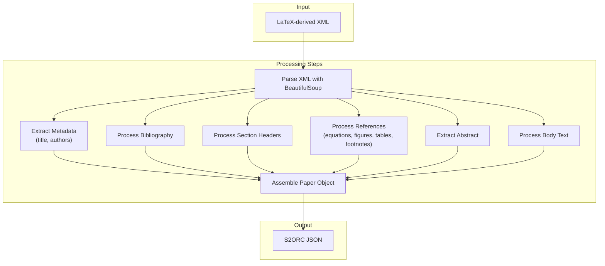
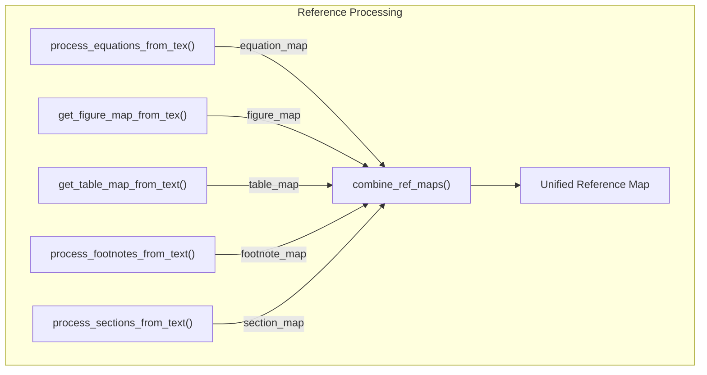
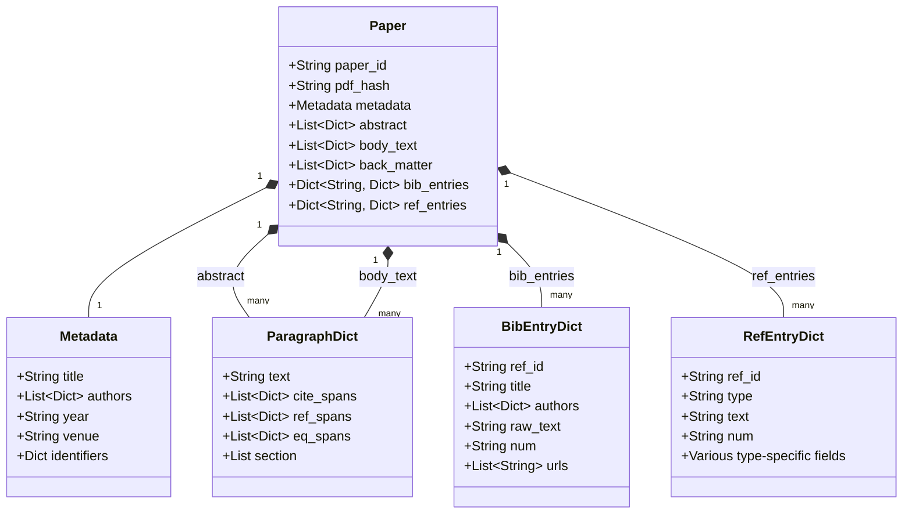

<!-- source: DeepWiki mcp.deepwiki.com · repo allenai/s2orc-doc2json · extra page XML to JSON Conversion · fetched 2026-10-26 -->

# XML to JSON Conversion

<details>
<summary>Relevant source files</summary>

The following files were used as context for generating this wiki page:

- [doc2json/tex2json/xml_to_json.py](doc2json/tex2json/xml_to_json.py)

</details>


This document explains the XML to JSON conversion process within the LaTeX to JSON pipeline (`tex2json`). Specifically, it details how XML files generated from LaTeX documents (covered in [LaTeX to XML Conversion](#3.3.1)) are parsed and converted into the standardized S2ORC JSON format that represents the structure and content of scientific papers.

## Conversion Process Overview

The XML to JSON conversion is the second major step in the LaTeX to JSON pipeline. It takes XML files (typically produced by tralics from LaTeX) and extracts structured information to create a standardized JSON representation that follows the S2ORC data model.



Sources: [doc2json/tex2json/xml_to_json.py:1360-1397]()

## Main Functions and Processing Flow

The XML to JSON conversion is primarily handled by two key functions:

```mermaid
classDiagram
    class "convert_latex_xml_to_s2orc_json" {
        +Takes XML file path
        +Initializes conversion process
        +Returns Paper object
    }
    
    class "convert_xml_to_s2orc" {
        +Takes BeautifulSoup object
        +Orchestrates conversion steps
        +Returns Paper object
    }
    
    class "Process Functions" {
        +process_metadata()
        +process_bibliography_from_tex()
        +process_sections_from_text()
        +process_equations_from_tex()
        +process_footnotes_from_text()
        +get_figure_map_from_tex()
        +process_figures_from_tex()
        +get_table_map_from_text()
        +process_tables_from_tex()
        +process_abstract_from_tex()
        +process_body_text_from_tex()
    }
    
    "convert_latex_xml_to_s2orc_json" --> "convert_xml_to_s2orc" : calls
    "convert_xml_to_s2orc" --> "Process Functions" : calls various
```

Sources: [doc2json/tex2json/xml_to_json.py:1269-1357](), [doc2json/tex2json/xml_to_json.py:1360-1397]()

### Entry Point

The entry point for conversion is the `convert_latex_xml_to_s2orc_json` function, which:

1. Takes an XML file path as input
2. Extracts basic file information (ID, year)
3. Reads and parses the XML using BeautifulSoup
4. Calls `convert_xml_to_s2orc` to perform the actual conversion
5. Returns a `Paper` object representing the document

Sources: [doc2json/tex2json/xml_to_json.py:1360-1397]()

### Core Conversion Process

The `convert_xml_to_s2orc` function performs the actual conversion through a series of steps:

1. Creates a Grobid client (used for processing citations and author names)
2. Processes document metadata (title, authors)
3. Processes bibliography entries
4. Processes section headers
5. Processes equations, footnotes, figures, and tables
6. Combines all reference information
7. Processes abstract and body text
8. Constructs and returns a `Paper` object

Sources: [doc2json/tex2json/xml_to_json.py:1269-1357]()

## Reference Processing

A key aspect of the conversion is handling various types of references (citations, figures, tables, equations, etc.). The system uses a standardized approach to normalize reference IDs and track their relationships.

### Reference Normalization

References from LaTeX are normalized to follow consistent patterns:

```
BID123 → BIBREF123  (bibliography references)
CID123 → SECREF123  (section references)
FORMULA123 → EQREF123 (equation references)
```

Sources: [doc2json/tex2json/xml_to_json.py:29-37]()

### Reference Types and Maps

The system processes and manages several types of references:

| Reference Type | Normalized Prefix | Purpose |
|----------------|-------------------|---------|
| Bibliography | BIBREF | Citations to other works |
| Section | SECREF/SECREFU | References to document sections |
| Equation | EQREF | Mathematical equations |
| Figure | FIGREF | Images and diagrams |
| Table | TABREF | Data tables |
| Footnote | FOOTREF | Footnotes |

Each reference type is processed separately and then combined into a unified reference map.

Sources: [doc2json/tex2json/xml_to_json.py:1082-1108]()



Sources: [doc2json/tex2json/xml_to_json.py:661-696](), [doc2json/tex2json/xml_to_json.py:737-765](), [doc2json/tex2json/xml_to_json.py:932-990](), [doc2json/tex2json/xml_to_json.py:699-734](), [doc2json/tex2json/xml_to_json.py:641-658](), [doc2json/tex2json/xml_to_json.py:1082-1108]()

## Text Content Processing

The system processes the document's textual content by:

1. Extracting and formatting the abstract
2. Processing body text, including paragraphs, lists, and inline formulas
3. Maintaining section structure throughout the document

### Paragraph Processing

Paragraphs are processed to:

1. Replace references with standardized tokens
2. Extract and format inline formulas
3. Generate citation spans, reference spans, and equation spans
4. Maintain section information

Sources: [doc2json/tex2json/xml_to_json.py:255-365]()

### Section Handling

The system builds a hierarchical section structure:

1. Extracts section headers and their numbers
2. Establishes parent-child relationships between sections
3. Associates paragraphs with their containing sections

Sources: [doc2json/tex2json/xml_to_json.py:547-638](), [doc2json/tex2json/xml_to_json.py:1152-1185]()

## Bibliography Processing

Bibliography entries are processed using Grobid:

1. Bibliographic text is extracted from the XML
2. Text is sent to Grobid for structured parsing
3. Parsed entries are normalized and added to the bibliography map

Sources: [doc2json/tex2json/xml_to_json.py:464-544](), [doc2json/tex2json/xml_to_json.py:69-90]()

## Output Structure

The final output is a `Paper` object with the following structure:



Sources: [doc2json/tex2json/xml_to_json.py:1348-1357]()

## Usage Example

The XML to JSON conversion is typically used as part of the LaTeX to JSON pipeline, but can also be called directly:

```python
from doc2json.tex2json.xml_to_json import convert_latex_xml_to_s2orc_json

# Convert an XML file to S2ORC JSON
paper = convert_latex_xml_to_s2orc_json(
    xml_fpath="path/to/latex_xml_file.xml", 
    log_dir="path/to/log_directory"
)

# Access the structured data
title = paper.metadata.title
authors = paper.metadata.authors
abstract_text = paper.raw_abstract_text()
body_text = paper.raw_body_text()

# Output as JSON
json_output = paper.release_json()
```

Sources: [doc2json/tex2json/xml_to_json.py:1360-1397]()

## Error Handling

The system includes error handling for:

1. Unicode decoding errors in the XML file
2. Missing or malformed bibliography entries
3. Missing body text
4. Attribute errors in XML parsing

These errors are logged to a specified log file for later analysis.

Sources: [doc2json/tex2json/xml_to_json.py:1394-1396](), [doc2json/tex2json/xml_to_json.py:1296-1298](), [doc2json/tex2json/xml_to_json.py:1334-1336]()

---

