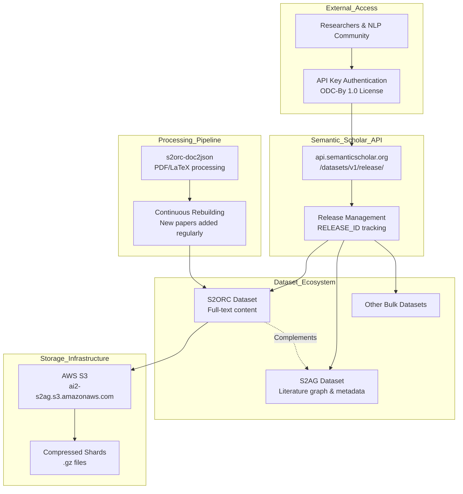
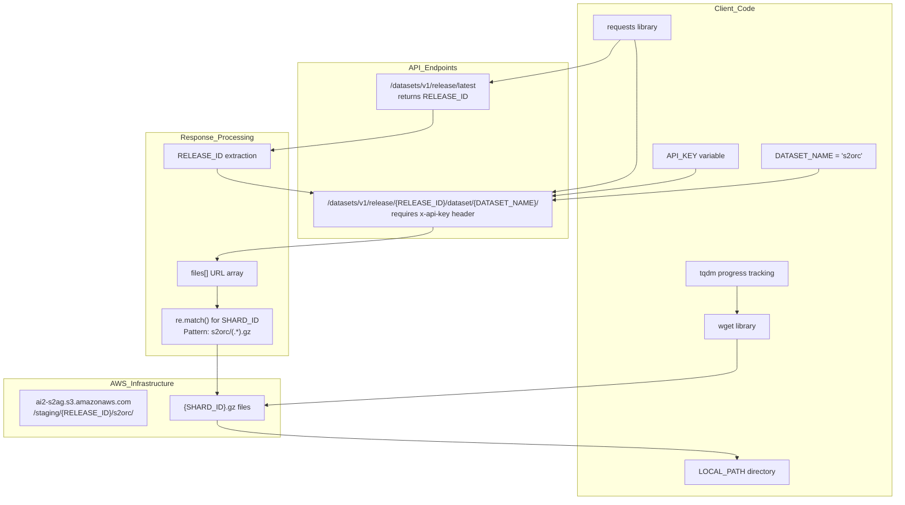

<!-- source: DeepWiki mcp.deepwiki.com · repo allenai/s2orc · page 1 S2ORC Overview · fetched 2026-10-26 -->

# S2ORC Overview

Relevant source files

The following files were used as context for generating this wiki page:

- [README.md](README.md)

## Purpose and Scope

This document provides a high-level introduction to S2ORC (The Semantic Scholar Open Research Corpus), its purpose as a scientific NLP dataset, and its role within the broader Semantic Scholar ecosystem. It covers the system's evolution from research project to production offering and explains how S2ORC complements other Semantic Scholar datasets.

For detailed technical information about S2ORC's internal architecture and processing pipeline, see [System Architecture](#1.1). For comprehensive documentation of data formats and schema specifications, see [Data Schema and Format](#1.2). For practical guidance on obtaining and using S2ORC data, see [Accessing S2ORC](#2).

## What is S2ORC

S2ORC is a general-purpose corpus designed for NLP and text mining research over scientific papers. Unlike traditional academic datasets that focus primarily on metadata, S2ORC provides machine-readable full-text content extracted from scientific papers through automated PDF and LaTeX parsing.

The system was originally developed as a research project by Kyle Lo and Lucy Lu Wang at the Allen Institute for AI, but has evolved into a production dataset offering maintained by the Semantic Scholar API team. This transition represents a significant architectural shift from standalone research tool to integrated component of Semantic Scholar's data infrastructure.

**Key Characteristics:**
- **Full-text focus**: Provides parsed content including abstracts, body text, citations, and references
- **Large scale**: Covers millions of scientific papers with continuous updates
- **Production quality**: Maintained with continuous rebuilding pipeline for new paper inclusion
- **Open access**: Available under ODC-By 1.0 license through public API

Sources: [README.md:1-153]()

## Position in Semantic Scholar Ecosystem

S2ORC operates as a specialized dataset within Semantic Scholar's broader data ecosystem, complementing other offerings like S2AG (Semantic Scholar Academic Graph).

**Ecosystem Integration:**
- **S2AG relationship**: S2AG handles paper metadata (title, authors, venue) while S2ORC provides full-text content
- **API integration**: Both datasets accessible through unified Semantic Scholar Public API
- **Shared infrastructure**: Common authentication, release management, and distribution systems
- **Complementary data**: Users often combine S2AG metadata with S2ORC full-text for comprehensive analysis

Sources: [README.md:110-117](), [README.md:55-91]()

## Technical Components and Data Flow

The current S2ORC system integrates several key technical components to deliver full-text scientific paper data at scale.

**Component Functions:**
- **`requests` library**: Handles HTTP communication with Semantic Scholar API endpoints
- **`wget` library**: Downloads large compressed shard files from AWS S3
- **`tqdm` library**: Provides progress tracking during multi-file download operations
- **Release management**: `RELEASE_ID` system enables versioned dataset access
- **Shard pattern**: Regular expression parsing extracts `SHARD_ID` from S3 URLs for local file naming

Sources: [README.md:60-88]()

## Evolution and Current Status

S2ORC has undergone significant evolution from its origins as a research project to its current status as a production dataset offering.

| Phase | Timeline | Key Characteristics | Access Model |
|-------|----------|-------------------|--------------|
| **Research Project** | 2019-2020 | Standalone releases, 81M→136M papers, manual distribution | Direct download, non-commercial license |
| **Tool Release** | 2021 | `s2orc-doc2json` parser release, community adoption | GitHub-based tools |
| **Production System** | 2023-Present | API team ownership, continuous rebuilding, ODC-By 1.0 license | Semantic Scholar Public API integration |

**Current Production Features:**
- **Continuous updates**: New papers automatically incorporated through rebuilding pipeline
- **API-first access**: Integrated with Semantic Scholar Public API infrastructure
- **Professional maintenance**: Transitioned from research team to dedicated product team
- **Licensing change**: Moved from non-commercial to ODC-By 1.0 open license
- **Deprecated legacy versions**: 2019 and 2020 standalone releases no longer supported

**Architectural Improvements:**
- **Schema separation** (2020): Split metadata from full-text content for incremental updates
- **Incremental releases**: Support for partial updates without full reprocessing
- **Bug fixes**: Resolved missing section names, broken citation links, and metadata typing issues

Sources: [README.md:17-53](), [README.md:119-127]()

## Support and Maintenance

S2ORC is currently maintained by the Semantic Scholar API product team, with support channels integrated into the broader Semantic Scholar ecosystem.

**Primary Support Channels:**
- **GitHub Issues**: [s2-folks repository](https://github.com/allenai/s2-folks/issues) for bug reports and feature requests
- **Email Contact**: Include `kylel`, `lucyw`, and `rodneyk` for dataset-specific inquiries
- **API Documentation**: Comprehensive guides available at [api.semanticscholar.org](https://api.semanticscholar.org/api-docs/datasets)

**Citation Requirement:**
Users must cite the original ACL 2020 paper when using S2ORC in research or applications, maintaining attribution to the original research contribution despite the system's evolution to production status.

Sources: [README.md:93-106](), [README.md:135-152]()

---

