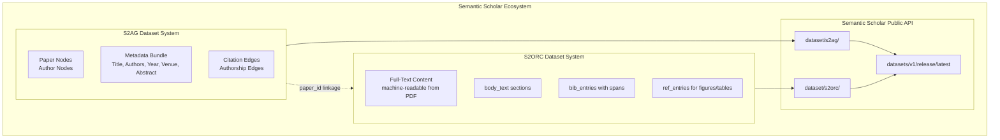
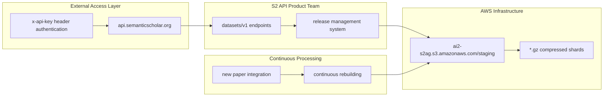
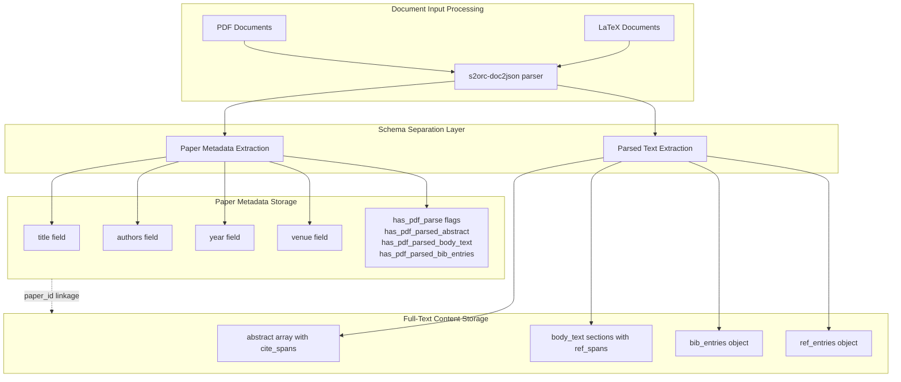
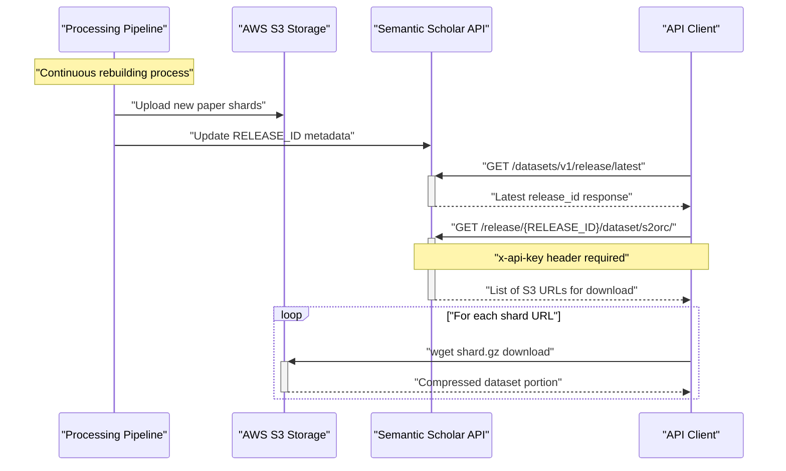
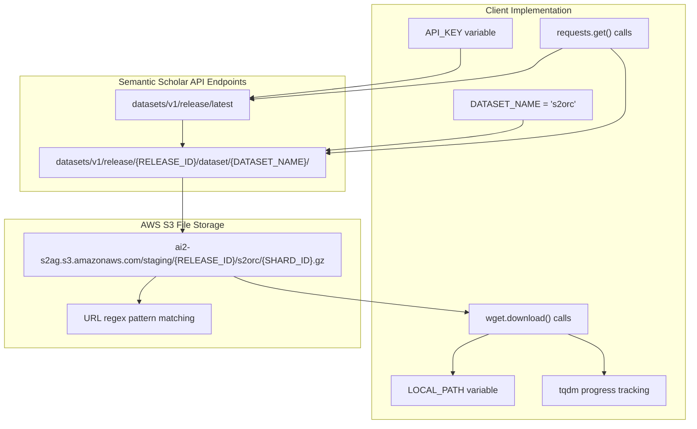
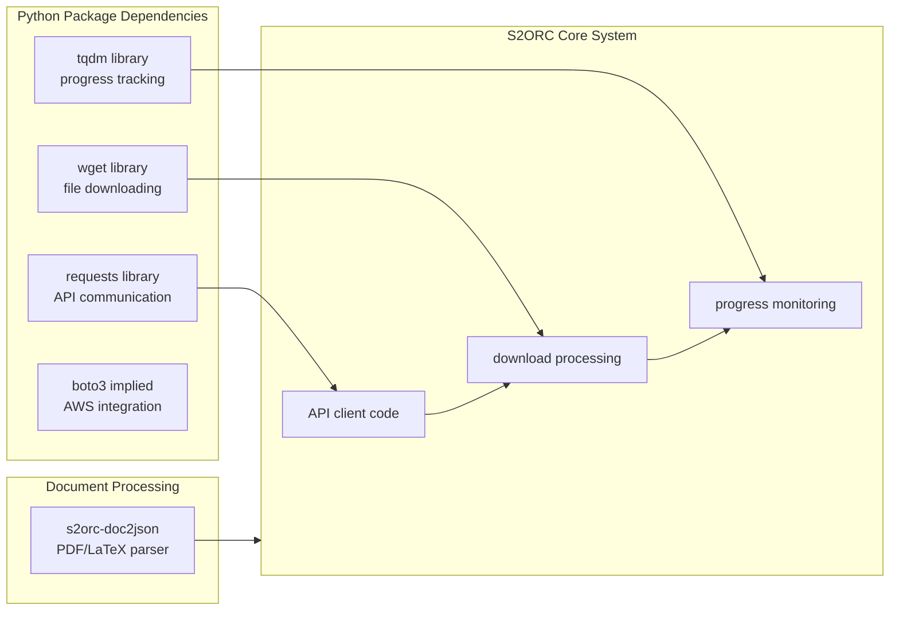

<!-- source: DeepWiki mcp.deepwiki.com · repo allenai/s2orc · page 1.1 System Architecture · fetched 2026-10-26 -->

# System Architecture

Relevant source files

The following files were used as context for generating this wiki page:

- [README.md](README.md)

## Purpose and Scope

This document describes the technical architecture of S2ORC (Semantic Scholar Open Research Corpus), focusing on its integration within the Semantic Scholar ecosystem, data processing pipeline, and distribution mechanisms. This covers the system-level design decisions, component relationships, and infrastructure dependencies that enable S2ORC to function as a continuously updated dataset offering.

For information about the specific data structures and JSON schema, see [Data Schema and Format](#1.2). For practical usage instructions, see [Accessing S2ORC](#2).

## Core Architecture Components

S2ORC operates as a specialized component within the broader Semantic Scholar infrastructure, designed specifically to complement the S2AG (Semantic Scholar Academic Graph) dataset through a clear architectural separation.

### S2ORC vs S2AG System Separation

The architecture maintains a clear separation where S2AG handles the literature graph structure (nodes, edges, metadata) while S2ORC provides the parsed full-text content derived from PDF processing models.

**Sources:** [README.md:110-117]()

### Production Infrastructure Integration

**Sources:** [README.md:19-23](), [README.md:121-123]()

## Data Processing Pipeline Architecture

The processing pipeline represents a significant architectural evolution from the original research implementation to a production system integrated within Semantic Scholar's infrastructure.

### Schema Separation Architecture (2020-07-05 Update)

This architectural change enables incremental releases and separates concerns between metadata management and full-text processing.

**Sources:** [README.md:30-36](), [README.md:25-27]()

### Continuous Rebuilding System

The continuous rebuilding ensures that new papers are regularly integrated without requiring full dataset regeneration.

**Sources:** [README.md:23](), [README.md:74-87]()

## API Distribution System Architecture

### Release Management and Shard Distribution

The distribution system uses a two-stage API pattern that separates release metadata from actual data download:

The system uses a specific URL pattern with regex matching to extract `RELEASE_ID` and `SHARD_ID` components for organized local storage.

**Sources:** [README.md:59-88]()

### Authentication and Access Control

| Component | Implementation | Purpose |
|-----------|----------------|---------|
| API Key | `x-api-key` header | Authentication for bulk dataset access |
| License | ODC-By 1.0 | Legal framework for dataset usage |
| Endpoint Protection | Header validation | Restricts access to authorized users |

**Sources:** [README.md:12](), [README.md:79](), [README.md:129-131]()

## Integration Points and Dependencies

### External Tool Integration

The system integrates with several external tools and libraries for functionality:

**Sources:** [README.md:61-66](), [README.md:27]()

### Support and Maintenance Infrastructure

The system has transitioned from research project maintenance to production support:

| Aspect | Original System | Current System |
|--------|----------------|----------------|
| Maintenance Team | Original researchers (Kyle Lo, Lucy Lu Wang) | S2 API Product Team |
| Support Channel | Direct email contact | GitHub issues in s2-folks repo |
| License | Non-commercial | ODC-By 1.0 |
| Implementation | Original research code | Production pipeline reimplementation |

**Sources:** [README.md:11](), [README.md:104-105](), [README.md:121-126]()

## Architectural Evolution

The system has undergone significant architectural changes from research prototype to production infrastructure:

1. **Research Phase (2019-2020)**: Standalone project with manual releases
2. **Schema Redesign (2020-07-05)**: Metadata/content separation for incremental updates  
3. **Production Integration (2023)**: Full integration into Semantic Scholar API ecosystem with continuous rebuilding

This evolution demonstrates a successful transition from research implementation to scalable production infrastructure while maintaining backward compatibility and data access patterns.

**Sources:** [README.md:17-52](), [README.md:119-127]()

---

