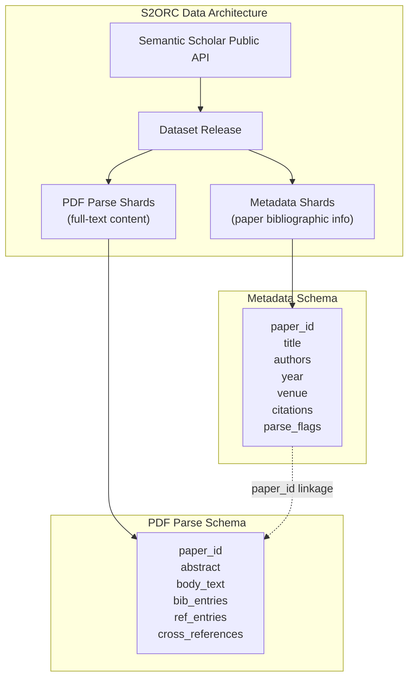
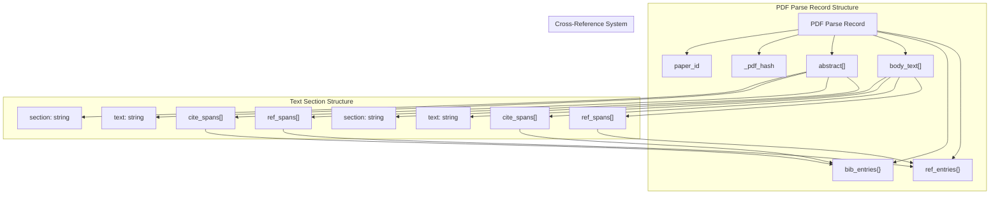
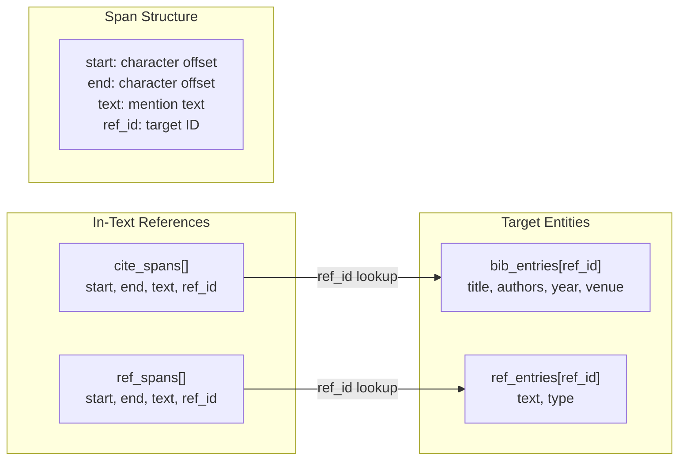

<!-- source: DeepWiki mcp.deepwiki.com · repo allenai/s2orc · page 1.2 Data Schema and Format · fetched 2026-10-26 -->

# Data Schema and Format

<details>
<summary>Relevant source files</summary>

The following files were used as context for generating this wiki page:

- [README.md](README.md)
- [data/metadata/sample.jsonl](data/metadata/sample.jsonl)
- [data/pdf_parses/sample.jsonl](data/pdf_parses/sample.jsonl)

</details>


This page documents the data structure, JSON schema, and field definitions for S2ORC dataset files. It covers both the metadata format (paper bibliographic information) and PDF parse format (full-text content extraction). For information about accessing and downloading S2ORC data, see [Data Download Process](#2.2).

## Schema Architecture

S2ORC employs a separated schema design implemented in the 2020-07-05 release that splits data into two distinct file types:



This separation enables independent updates and efficient incremental releases. Papers are linked across schemas using the `paper_id` field as the primary key.

**Sources:** [README.md:30-38](), [data/metadata/sample.jsonl:1-107](), [data/pdf_parses/sample.jsonl:1-4]()

## Metadata Schema

The metadata schema contains bibliographic information and citation graphs. Each record represents one paper with the following structure:

| Field | Type | Description |
|-------|------|-------------|
| `paper_id` | string | Unique identifier for the paper |
| `title` | string | Paper title |
| `authors` | array | Author objects with `first`, `middle`, `last`, `suffix` |
| `abstract` | string | Plain text abstract (may be null) |
| `year` | integer | Publication year |
| `venue` | string | Conference/journal venue |
| `journal` | string | Journal name |
| `doi` | string | Digital Object Identifier |
| `arxiv_id` | string | ArXiv identifier |
| `acl_id` | string | ACL Anthology identifier |
| `pmc_id` | string | PubMed Central identifier |
| `pubmed_id` | string | PubMed identifier |
| `mag_id` | string | Microsoft Academic Graph identifier |
| `mag_field_of_study` | array | Research field classifications |
| `outbound_citations` | array | List of cited paper IDs |
| `inbound_citations` | array | List of citing paper IDs |
| `has_outbound_citations` | boolean | Citation data availability flag |
| `has_inbound_citations` | boolean | Citation data availability flag |
| `has_pdf_parse` | boolean | Full-text parsing availability flag |
| `has_pdf_parsed_abstract` | boolean | Abstract parsing flag |
| `has_pdf_parsed_body_text` | boolean | Body text parsing flag |
| `has_pdf_parsed_bib_entries` | boolean | Bibliography parsing flag |
| `has_pdf_parsed_ref_entries` | boolean | Reference entries parsing flag |
| `s2_url` | string | Semantic Scholar corpus URL |

**Sources:** [data/metadata/sample.jsonl:1-107]()

## PDF Parse Schema

The PDF parse schema contains structured full-text content extracted from scientific papers. The core structure includes:



### Core Fields

| Field | Type | Description |
|-------|------|-------------|
| `paper_id` | string | Links to metadata schema |
| `_pdf_hash` | string | Hash of source PDF file |
| `abstract` | array | Structured abstract sections |
| `body_text` | array | Structured body text sections |
| `bib_entries` | object | Bibliography reference entries |
| `ref_entries` | object | Figure and table references |

### Text Section Objects

Both `abstract` and `body_text` arrays contain section objects with:

| Field | Type | Description |
|-------|------|-------------|
| `section` | string | Section heading/name |
| `text` | string | Section text content |
| `cite_spans` | array | In-text citation references |
| `ref_spans` | array | Figure/table references |

**Sources:** [data/pdf_parses/sample.jsonl:1-4]()

## Cross-Reference System

S2ORC implements a comprehensive cross-reference system linking in-text mentions to bibliography and reference entries:



### Span Objects

Citation spans (`cite_spans`) and reference spans (`ref_spans`) use this structure:

| Field | Type | Description |
|-------|------|-------------|
| `start` | integer | Starting character offset in text |
| `end` | integer | Ending character offset in text |
| `text` | string | Actual mention text |
| `ref_id` | string | Reference ID for lookup |

### Bibliography Entries

The `bib_entries` object maps reference IDs to bibliography information:

| Field | Type | Description |
|-------|------|-------------|
| `title` | string | Referenced work title |
| `authors` | array | Author objects |
| `year` | integer | Publication year |
| `venue` | string | Publication venue |
| `link` | string | External identifier/link |

### Reference Entries

The `ref_entries` object maps reference IDs to figures and tables:

| Field | Type | Description |
|-------|------|-------------|
| `text` | string | Caption or description text |
| `type` | string | Entry type (figure, table, etc.) |

**Sources:** [data/pdf_parses/sample.jsonl:1-4]()

## Schema Examples

### Metadata Record Example

```json
{
  "paper_id": "77499681",
  "title": "Effects of Teriparatide Administration on Fracture Healing after Intramedullary Nailing in Atypical Femoral Fractures",
  "authors": [
    {"first": "Chul Hyun", "middle": [], "last": "Park", "suffix": ""},
    {"first": "Oog Jin", "middle": [], "last": "Shon", "suffix": ""}
  ],
  "year": 2016,
  "venue": null,
  "journal": "The Journal of The Korean Orthopaedic Association",
  "has_pdf_parse": true,
  "has_pdf_parsed_abstract": true,
  "has_pdf_parsed_body_text": true,
  "has_pdf_parsed_bib_entries": true,
  "outbound_citations": ["71492442", "8323353", "3224020"],
  "inbound_citations": []
}
```

### PDF Parse Record Example

```json
{
  "paper_id": "77499681",
  "_pdf_hash": "11f281316fe4638843a83cf559ce4f60aade00f8",
  "abstract": [
    {
      "section": "Abstract",
      "text": "The purpose of this study is to evaluate the effects of teriparatide administration...",
      "cite_spans": [],
      "ref_spans": []
    }
  ],
  "body_text": [
    {
      "section": "",
      "text": "Values are presented as number only or median (range).",
      "cite_spans": [],
      "ref_spans": []
    }
  ],
  "bib_entries": {
    "BIBREF0": {
      "title": "Bone health and osteoporosis: a report of the surgeon general",
      "authors": [],
      "year": 2004,
      "venue": "",
      "link": null
    }
  },
  "ref_entries": {
    "FIGREF0": {
      "text": "Figure caption describing experimental results...",
      "type": "figure"
    }
  }
}
```

**Sources:** [data/metadata/sample.jsonl:102](), [data/pdf_parses/sample.jsonl:1]()

---

