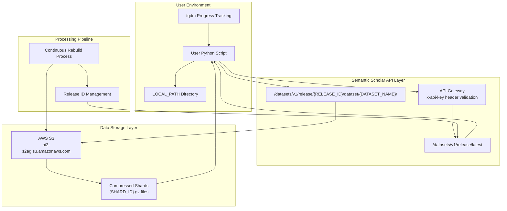
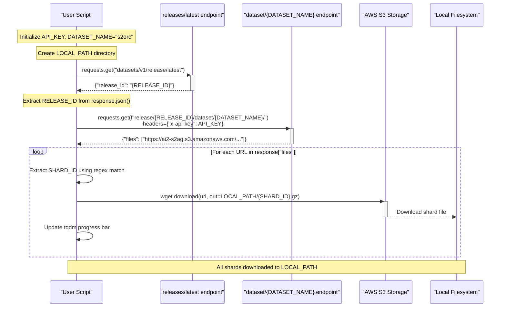

<!-- source: DeepWiki mcp.deepwiki.com · repo allenai/s2orc · page 2 Accessing S2ORC · fetched 2026-10-26 -->

# Accessing S2ORC

<details>
<summary>Relevant source files</summary>

The following files were used as context for generating this wiki page:

- [README.md](README.md)

</details>


This page provides a comprehensive guide to accessing and downloading S2ORC data through the Semantic Scholar Public API. It covers the overall access architecture, workflow, and technical requirements for obtaining the dataset.

For detailed step-by-step instructions on API key setup and authentication, see [API Authentication and Setup](#2.1). For specifics on the download process and data handling, see [Data Download Process](#2.2).

## Access Overview

S2ORC is distributed as a "Bulk Dataset" through the Semantic Scholar Public API infrastructure. The dataset is continuously rebuilt, ensuring users have access to newly processed papers. Access requires API authentication and follows a two-stage process: obtaining release metadata and downloading dataset shards from AWS S3 storage.

## API Access Architecture

The S2ORC access system integrates multiple components within the Semantic Scholar infrastructure to deliver large-scale dataset distribution:



**Sources:** [README.md:55-91]()

## Technical Access Workflow

The programmatic access follows a specific sequence using the `requests` library for API calls and `wget` for efficient large file downloads:



**Sources:** [README.md:61-88]()

## Code Implementation Details

The access implementation uses specific Python libraries and follows a structured pattern for handling API responses and file downloads:

| Component | Purpose | Implementation Details |
|-----------|---------|----------------------|
| `API_KEY` | Authentication | Passed via `x-api-key` header to dataset endpoints |
| `DATASET_NAME` | Resource identifier | Set to `"s2orc"` for full-text dataset access |
| `RELEASE_ID` | Version control | Retrieved from latest release endpoint, used in subsequent calls |
| `LOCAL_PATH` | Storage destination | User-defined directory for downloaded shards |
| `tqdm` | Progress tracking | Wraps download loop for visual progress indication |
| `wget` | File transfer | Handles large file downloads from S3 URLs |
| `re.match()` | URL parsing | Extracts `SHARD_ID` from S3 URL patterns |

**Sources:** [README.md:68-86]()

## Dataset Distribution Model

S2ORC uses a sharded distribution approach where the complete dataset is split across multiple compressed files. Each shard follows a predictable URL pattern and naming convention:

```mermaid
graph LR
    subgraph "S3 URL Structure"
        BaseURL["https://ai2-s2ag.s3.amazonaws.com"]
        StagingPath["/staging/{RELEASE_ID}"]
        DatasetPath["/s2orc/"]
        ShardFile["{SHARD_ID}.gz"]
    end
    
    subgraph "Regex Pattern Matching"
        URLPattern["r'https://ai2-s2ag.s3.amazonaws.com/staging/(.*)/s2orc/(.*).gz(.*)'""]
        Group1["match.group(1) == RELEASE_ID"]
        Group2["match.group(2) == SHARD_ID"]
    end
    
    subgraph "Local File Organization"
        LocalDir["LOCAL_PATH/"]
        LocalFile["{SHARD_ID}.gz"]
    end
    
    BaseURL --> StagingPath
    StagingPath --> DatasetPath
    DatasetPath --> ShardFile
    
    ShardFile --> URLPattern
    URLPattern --> Group1
    URLPattern --> Group2
    
    Group2 --> LocalFile
    LocalDir --> LocalFile
```

**Sources:** [README.md:82-86]()

## Integration Requirements

Access to S2ORC requires several key dependencies and setup considerations:

- **Python Dependencies**: `requests` for API calls, `wget` for downloads, `tqdm` for progress tracking, `json` and `os` for data handling
- **Network Requirements**: Reliable internet connection for large file downloads from AWS S3
- **Storage Requirements**: Sufficient local disk space for compressed dataset shards
- **Authentication**: Valid API key from Semantic Scholar Public API portal
- **License Compliance**: Agreement to ODC-By 1.0 license terms

**Sources:** [README.md:61-67](), [README.md:12](), [README.md:131]()

## Current System Status

S2ORC transitioned from a research project to a production system maintained by the Semantic Scholar API team. The current implementation offers several advantages over historical versions:

- **Continuous Updates**: Dataset is rebuilt regularly with new papers
- **Production Maintenance**: Supported by dedicated API infrastructure team
- **Improved Licensing**: ODC-By 1.0 replaces previous non-commercial restrictions
- **Integrated Access**: Unified distribution through Semantic Scholar APIs
- **Scalable Infrastructure**: AWS-based distribution handles large-scale access

Historical versions (2019-09-28, 2020-07-05) are no longer supported, and users are encouraged to migrate to the current API-based access method.

**Sources:** [README.md:19-24](), [README.md:119-127]()

---

