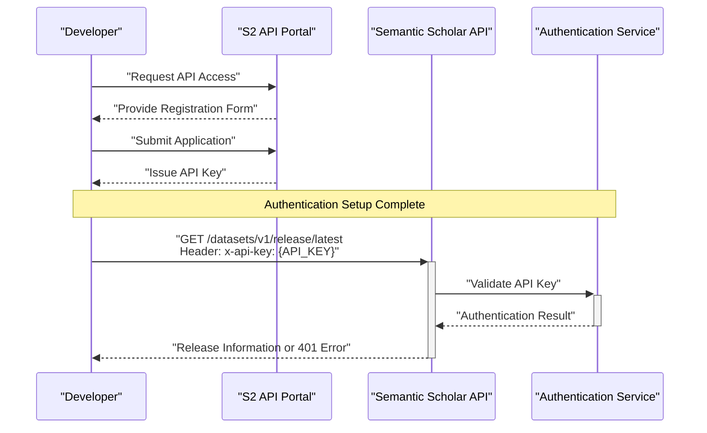
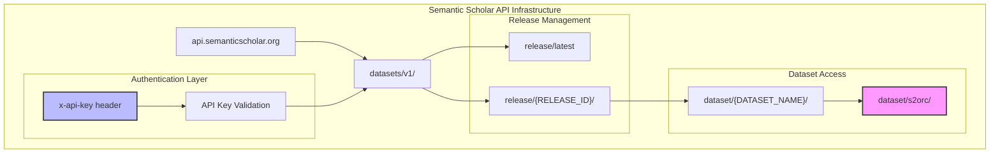

<!-- source: DeepWiki mcp.deepwiki.com · repo allenai/s2orc · page 2.1 API Authentication and Setup · fetched 2026-10-26 -->

# API Authentication and Setup

<details>
<summary>Relevant source files</summary>

The following files were used as context for generating this wiki page:

- [README.md](README.md)

</details>


This document covers the authentication requirements and initial setup needed to access S2ORC data through the Semantic Scholar Public API. It includes obtaining API keys, understanding license obligations, and configuring authentication headers for API requests.

For information about the actual data download workflow and shard processing, see [Data Download Process](#2.2). For details about S2ORC's overall architecture within the Semantic Scholar ecosystem, see [System Architecture](#1.1).

## License Requirements

S2ORC is distributed under the ODC-By 1.0 (Open Data Commons Attribution License). Users must agree to the license terms before accessing the data.

### Key License Points

| Aspect | Requirement |
|--------|------------|
| **License Type** | ODC-By 1.0 (Open Data Commons Attribution) |
| **Attribution** | Required when using S2ORC data |
| **Commercial Use** | Permitted under ODC-By 1.0 terms |
| **Distribution** | Must include license attribution |

The license represents a significant change from the original research project, which used a non-commercial license. Current S2ORC allows commercial applications under the ODC-By 1.0 terms.

**Sources:** [README.md:12](), [README.md:126-127](), [README.md:129-131]()

## Authentication Architecture



**Authentication Flow for S2ORC API Access**

The authentication system uses API key-based authentication through HTTP headers. All dataset API requests require the `x-api-key` header for authorization.

**Sources:** [README.md:59](), [README.md:69](), [README.md:79-81]()

## API Key Acquisition

### Obtaining Access Credentials

1. **Visit the Semantic Scholar Public API portal**: Navigate to the official API registration page
2. **Complete registration**: Provide required information for API access
3. **Accept license terms**: Agree to ODC-By 1.0 license requirements
4. **Receive API key**: Obtain your unique authentication token

### API Key Configuration

The API key must be included in all requests to the datasets endpoints using the `x-api-key` header:

```python
headers = {"x-api-key": API_KEY}
response = requests.get(endpoint_url, headers=headers)
```

**Sources:** [README.md:59](), [README.md:69](), [README.md:81]()

## API Endpoints Structure



**S2ORC API Endpoint Hierarchy and Authentication**

### Core Endpoints

| Endpoint | Purpose | Authentication |
|----------|---------|---------------|
| `GET /datasets/v1/release/latest` | Get current release ID | None required |
| `GET /datasets/v1/release/{RELEASE_ID}/dataset/s2orc/` | Get S2ORC download URLs | `x-api-key` required |

**Sources:** [README.md:75-76](), [README.md:81]()

## Authentication Setup Verification

### Basic Authentication Test

```python
import requests

# Test basic API access (no auth required)
response = requests.get("https://api.semanticscholar.org/datasets/v1/release/latest")
if response.status_code == 200:
    release_data = response.json()
    print(f"Latest release: {release_data['release_id']}")
else:
    print("Failed to access public endpoint")

# Test authenticated access
API_KEY = "your_api_key_here"
headers = {"x-api-key": API_KEY}
auth_response = requests.get(
    f"https://api.semanticscholar.org/datasets/v1/release/{release_data['release_id']}/dataset/s2orc/",
    headers=headers
)

if auth_response.status_code == 200:
    print("Authentication successful")
    dataset_info = auth_response.json()
    print(f"Available files: {len(dataset_info['files'])}")
elif auth_response.status_code == 401:
    print("Authentication failed - check API key")
else:
    print(f"Unexpected response: {auth_response.status_code}")
```

### Common Authentication Issues

| Issue | Symptom | Solution |
|-------|---------|----------|
| **Missing API Key** | 401 Unauthorized | Include `x-api-key` header |
| **Invalid API Key** | 401 Unauthorized | Verify key from API portal |
| **Malformed Header** | 400 Bad Request | Check header format |
| **Rate Limiting** | 429 Too Many Requests | Implement request throttling |

**Sources:** [README.md:75-81]()

## Implementation Dependencies

### Required Python Packages

The authentication and API access workflow requires specific Python packages:

```python
import requests  # HTTP client for API calls
import json      # JSON response parsing
import os        # Environment variable access
```

These dependencies support the core authentication workflow demonstrated in the S2ORC download example.

**Sources:** [README.md:61-64]()

## Migration from Legacy Versions

### Authentication Changes

Users migrating from older S2ORC versions should note significant changes:

| Legacy Version | Current API-Based Version |
|---------------|---------------------------|
| Direct file downloads | API-mediated access |
| No authentication | API key required |
| Non-commercial license | ODC-By 1.0 license |
| Static releases | Continuous rebuilding |

The current system provides better access control and enables continuous dataset updates through the Semantic Scholar infrastructure.

**Sources:** [README.md:19-23](), [README.md:38](), [README.md:46](), [README.md:119-127]()

---

