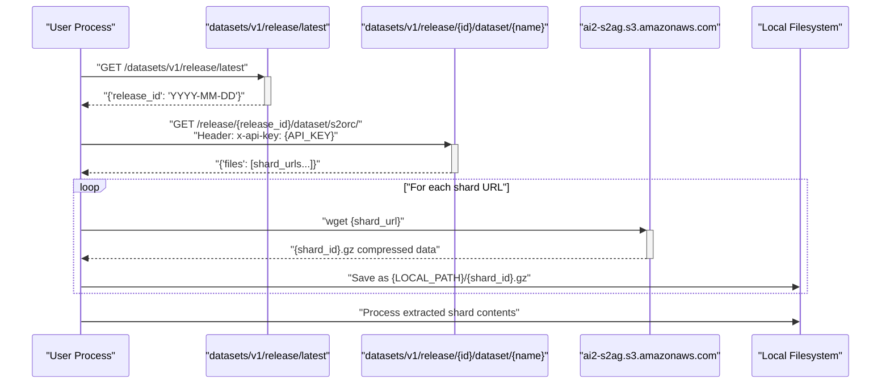
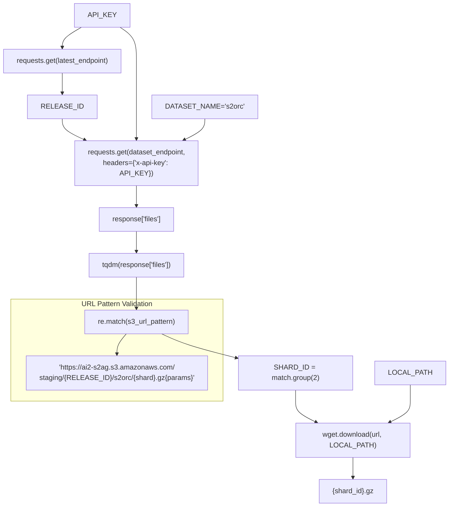

<!-- source: DeepWiki mcp.deepwiki.com · repo allenai/s2orc · page 2.2 Data Download Process · fetched 2026-10-26 -->

# Data Download Process

<details>
<summary>Relevant source files</summary>

The following files were used as context for generating this wiki page:

- [README.md](README.md)
- [requirements.txt](requirements.txt)

</details>


This document covers the technical workflow for downloading S2ORC dataset files through the Semantic Scholar Public API. It details the multi-step process of obtaining dataset shards, the underlying API architecture, and local file handling procedures.

For information about obtaining API credentials and license requirements, see [API Authentication and Setup](#2.1). For details about the data format and schema structure, see [Data Schema and Format](#1.2).

## Overview

The S2ORC download process follows a two-stage API pattern: first obtaining release metadata, then retrieving signed URLs for individual dataset shards. The system distributes data as compressed `.gz` files stored on AWS S3, with each shard containing a portion of the complete dataset.

Sources: [README.md:55-88]()

## Download Workflow Architecture



**Download Workflow Sequence**

This diagram shows the API interaction pattern where users first retrieve the current release identifier, then use that to obtain signed S3 URLs for dataset shards.

Sources: [README.md:74-87]()

## Core Download Implementation

The download process involves several key components and data flows:



**Download Process Data Flow**

This diagram illustrates the core variables and function calls involved in the download implementation, showing how API responses are processed into local files.

Sources: [README.md:68-87]()

## API Endpoints and Parameters

The download process interacts with two primary API endpoints:

| Endpoint | Method | Purpose | Authentication |
|----------|--------|---------|----------------|
| `/datasets/v1/release/latest` | GET | Retrieve current release ID | None |
| `/datasets/v1/release/{RELEASE_ID}/dataset/{DATASET_NAME}/` | GET | Get shard download URLs | `x-api-key` header |

### Request Parameters

- **RELEASE_ID**: Date-formatted identifier (e.g., "2024-01-15") returned by the latest endpoint
- **DATASET_NAME**: Fixed value "s2orc" for S2ORC dataset access
- **API_KEY**: User-specific authentication token obtained from Semantic Scholar

Sources: [README.md:75-81]()

## File Structure and Shard Management

### URL Pattern Analysis

The system validates downloaded URLs against a specific pattern to extract shard identifiers:

```
https://ai2-s2ag.s3.amazonaws.com/staging/{RELEASE_ID}/s2orc/{SHARD_ID}.gz{query_params}
```

The regex pattern extracts:
- **Group 1**: Release ID validation
- **Group 2**: Shard identifier for local filename
- **Group 3**: Query parameters (authentication tokens)

### Local File Organization

Downloaded files are organized as:
```
{LOCAL_PATH}/
├── {shard_id_001}.gz
├── {shard_id_002}.gz
└── {shard_id_nnn}.gz
```

Sources: [README.md:83-86]()

## Dependencies and Progress Tracking

The download implementation requires specific Python packages:

### Required Dependencies

| Package | Purpose | Usage Context |
|---------|---------|---------------|
| `requests` | HTTP API calls | Endpoint communication |
| `wget` | File downloading | S3 shard retrieval |
| `tqdm` | Progress visualization | Download iteration tracking |
| `re` | Pattern matching | URL validation and parsing |
| `json` | Response parsing | API data processing |
| `os` | Path management | Local directory creation |

### Progress Tracking Implementation

The `tqdm` library provides progress indication during the shard download loop:

```python
for url in tqdm(response["files"]):
    # Download processing for each shard
```

This creates a visual progress bar showing download completion across all shards.

Sources: [README.md:61-67](), [requirements.txt:1-2]()

## Error Handling and Validation

### URL Validation

The system performs assertion-based validation on S3 URLs:

```python
assert match.group(1) == RELEASE_ID
```

This ensures downloaded shards match the requested release version.

### Directory Management

Local path creation uses safe directory handling:

```python
os.makedirs(LOCAL_PATH, exist_ok=True)
```

The `exist_ok=True` parameter prevents errors if the target directory already exists.

Sources: [README.md:72-84]()

## Data Processing Considerations

### Compressed Format

All dataset shards are distributed in gzip-compressed format (`.gz` extension), requiring decompression before data processing.

### Shard-Based Distribution

The dataset is partitioned across multiple shards to enable:
- Parallel downloading
- Incremental processing
- Reduced memory requirements
- Network fault tolerance

### Storage Requirements

Users should ensure adequate local storage capacity before initiating downloads, as the complete S2ORC dataset represents a substantial data volume across all compressed shards.

Sources: [README.md:80-87]()

---

