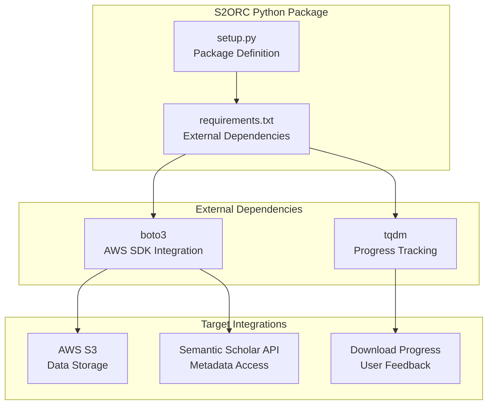
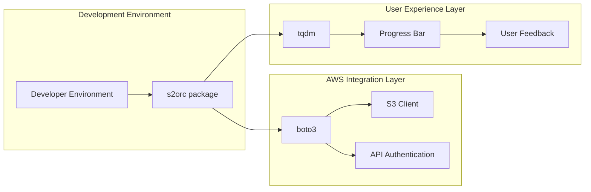
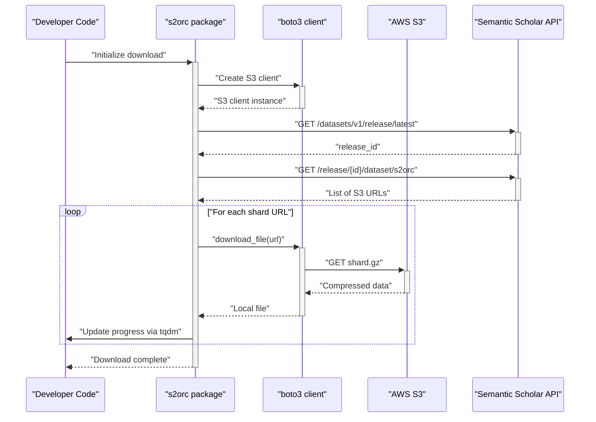
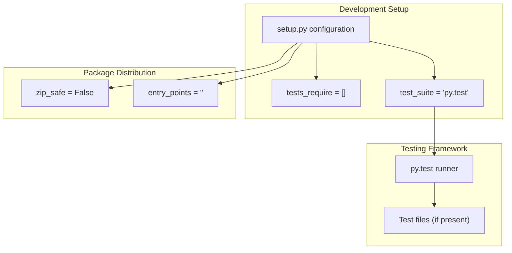

<!-- source: DeepWiki mcp.deepwiki.com · repo allenai/s2orc · page 3 Development and Integration · fetched 2026-10-26 -->

# Development and Integration

Relevant source files

The following files were used as context for generating this wiki page:

- [requirements.txt](requirements.txt)
- [setup.py](setup.py)

This document covers the technical aspects of working with S2ORC programmatically, including Python package setup, dependencies, and integration patterns. This focuses on the development infrastructure provided by this repository for accessing and processing S2ORC data.

For information about the data access API and download procedures, see [Accessing S2ORC](#2). For details about the underlying data schema and formats, see [Data Schema and Format](#1.2).

## Package Architecture

The S2ORC repository provides a minimal Python package infrastructure designed to support programmatic access to the dataset. The package follows standard Python packaging conventions with a lightweight configuration focused on external integrations.

The package configuration in `setup.py` defines a minimal structure with no internal dependencies, indicating that the primary functionality relies on external services rather than local processing code.

**Sources:** [setup.py:1-15](), [requirements.txt:1-2]()

## Development Dependencies

The S2ORC package declares two core external dependencies that enable integration with the Semantic Scholar ecosystem:

| Dependency | Purpose | Integration Point |
|------------|---------|------------------|
| `boto3` | AWS SDK for Python | S3 dataset download, API authentication |
| `tqdm` | Progress bar library | Download progress feedback |

The `boto3` dependency enables direct interaction with AWS services, particularly for downloading dataset shards from S3 storage. The `tqdm` library provides user-friendly progress tracking during potentially long-running download operations.

**Sources:** [requirements.txt:1-2]()

## Integration Patterns

The S2ORC development environment follows specific integration patterns that align with the broader Semantic Scholar infrastructure:

### AWS Service Integration

This pattern separates API discovery (getting download URLs) from data transfer (downloading files), enabling efficient bulk data access while maintaining authentication and progress tracking.

**Sources:** [requirements.txt:1-2]()

## Development Workflow

The package setup supports a standard Python development workflow optimized for dataset access applications:

### Package Installation and Setup

The `setup.py` configuration defines a lightweight package structure:

- **Package Name**: `s2orc` [setup.py:5]()
- **Version**: `0.1` (development version) [setup.py:6]()
- **Package Discovery**: Automatic via `setuptools.find_packages()` [setup.py:7]()
- **Dependencies**: Externally managed via requirements.txt [setup.py:8-9]()

### Testing Configuration

The testing configuration uses `py.test` as the test runner [setup.py:13](), with empty test requirements indicating minimal testing infrastructure. The `zip_safe = False` setting [setup.py:12]() ensures proper package installation in environments where files need to be extracted.

**Sources:** [setup.py:10-14]()

### Development Installation

For development work with S2ORC, the recommended installation pattern follows standard Python package development practices:

1. Clone the repository
2. Install in development mode: `pip install -e .`
3. Install dependencies: `pip install -r requirements.txt`
4. Verify installation by importing the package

The minimal package structure allows developers to focus on data access and processing logic rather than complex internal dependencies.

**Sources:** [setup.py:1-15](), [requirements.txt:1-2]()

---

