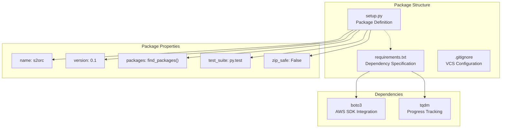
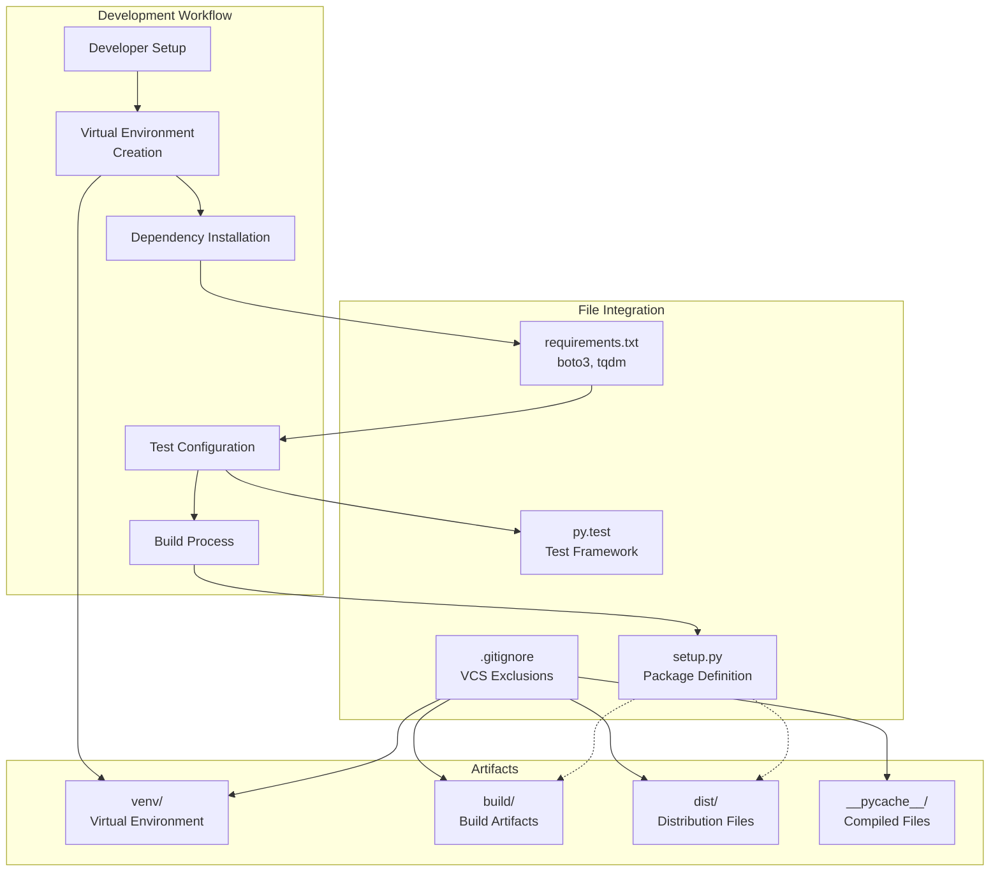
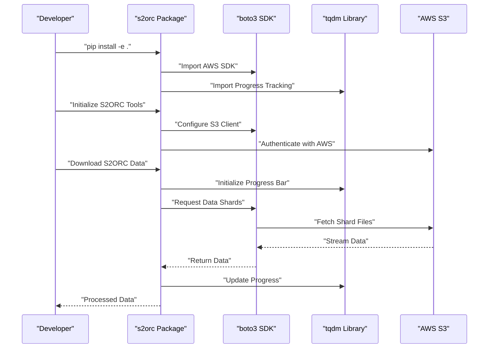

<!-- source: DeepWiki mcp.deepwiki.com · repo allenai/s2orc · page 3.1 Python Package Setup · fetched 2026-10-26 -->

# Python Package Setup

Relevant source files

The following files were used as context for generating this wiki page:

- [.gitignore](.gitignore)
- [requirements.txt](requirements.txt)
- [setup.py](setup.py)

This document covers the Python package configuration for the S2ORC project, including package definition, dependencies, installation procedures, and development environment setup. The S2ORC Python package provides essential utilities and dependencies for working with the S2ORC dataset programmatically.

For information about S2ORC data access and download workflows, see [Accessing S2ORC](#2). For details about specific dependencies and their integration roles, see [Dependencies and Tools](#3.2).

## Package Configuration Overview

The S2ORC project is configured as a minimal Python package primarily designed to manage dependencies and provide a foundation for data processing utilities. The package configuration is defined through standard Python packaging files.

### Package Definition

The core package is defined in [setup.py:4-15]() with the following characteristics:

| Property | Value | Purpose |
|----------|-------|---------|
| Package Name | `s2orc` | Identifies the package in Python environments |
| Version | `0.1` | Initial development version |
| Package Discovery | `setuptools.find_packages()` | Automatic package detection |
| Install Requirements | Empty list | Runtime dependencies managed separately |
| Test Suite | `py.test` | Testing framework configuration |
| Zip Safe | `False` | Ensures proper file system access |

**Package Configuration Architecture**

Sources: [setup.py:1-15](), [requirements.txt:1-2]()

### Installation Requirements

The package uses a split approach for dependency management. While [setup.py:8-9]() defines an empty `install_requires` list, actual runtime dependencies are specified in [requirements.txt:1-2]():

- `boto3`: AWS SDK for Python, enabling S3 data access
- `tqdm`: Progress bar library for download tracking

This separation allows for flexible dependency management during development while maintaining clean package distribution.

## Development Environment Setup

The development environment is configured to support Python package development with standard tooling and version control integration.

### Version Control Configuration

The [.gitignore:1-115]() file implements comprehensive exclusion patterns for Python development:

| Category | Examples | Purpose |
|----------|----------|---------|
| IDE Files | `.vscode`, `.idea/` | Editor-specific configurations |
| Python Artifacts | `__pycache__/`, `*.pyc`, `*.egg-info/` | Compiled and generated files |
| Build Outputs | `build/`, `dist/`, `wheels/` | Package distribution artifacts |
| Testing | `.pytest_cache/`, `coverage.xml` | Test execution artifacts |
| Virtual Environments | `.venv`, `env/`, `venv/` | Isolated Python environments |
| Project-Specific | `setup.sh`, `output/*` | Custom build scripts and outputs |

**Development Environment Workflow**

Sources: [.gitignore:1-115](), [setup.py:13-14]()

### Testing Configuration

The package is configured for testing through [setup.py:13-14]() with `test_suite='py.test'` and an empty `tests_require` list. This configuration integrates with the pytest framework while allowing test dependencies to be managed separately.

The [.gitignore:44-52]() includes comprehensive test artifact exclusion:
- `.pytest_cache/` for pytest execution cache
- `coverage.xml` and `.coverage.*` for coverage reports
- `htmlcov/` for HTML coverage reports
- `.tox/` for multi-environment testing

## Integration with S2ORC Ecosystem

The Python package serves as a foundation for integrating with the broader S2ORC data processing ecosystem, particularly through its dependency management for AWS integration and progress tracking.

**Package Integration Sequence**

Sources: [requirements.txt:1-2](), [setup.py:4-15]()

The minimal package structure reflects S2ORC's role as primarily a dataset distribution system rather than a complex software library. The package provides essential infrastructure for data access while the main value proposition lies in the dataset content itself, accessed through the Semantic Scholar Public API as documented in [API Authentication and Setup](#2.1) and [Data Download Process](#2.2).

---

