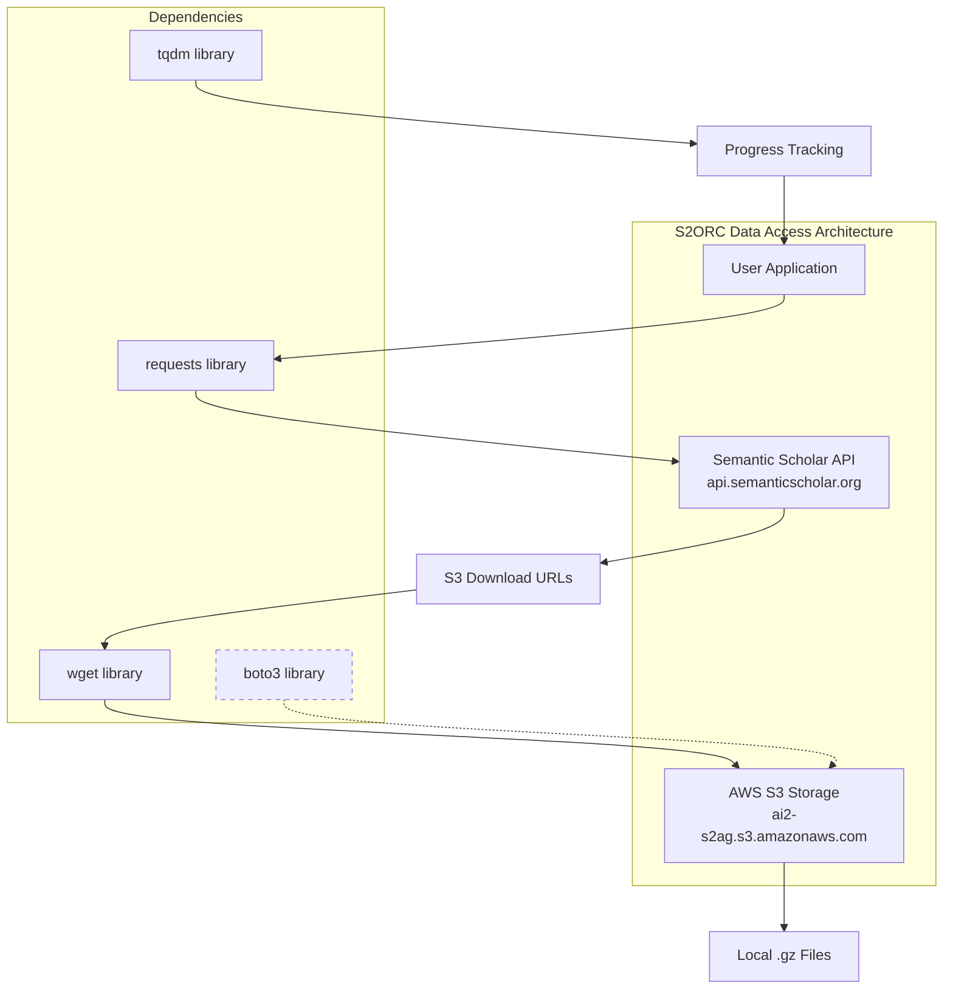
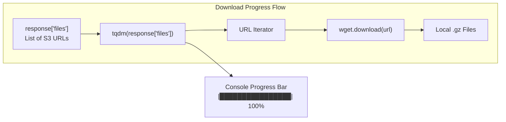
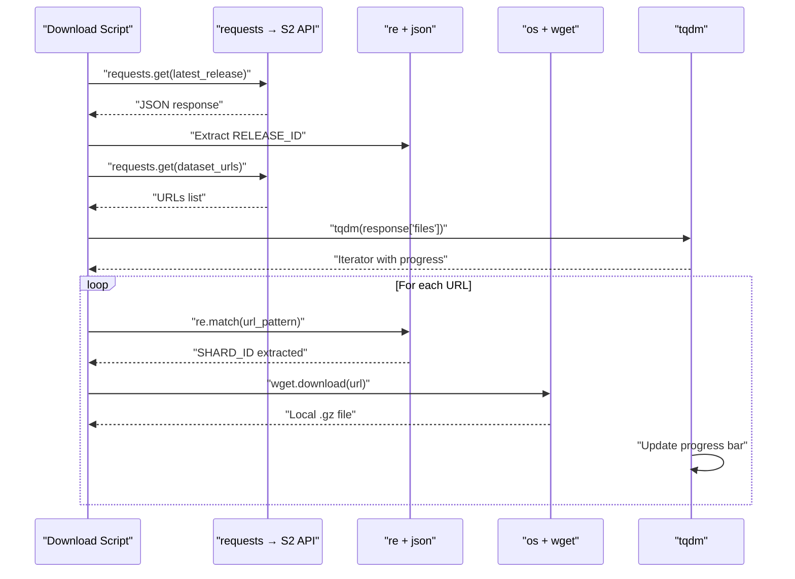
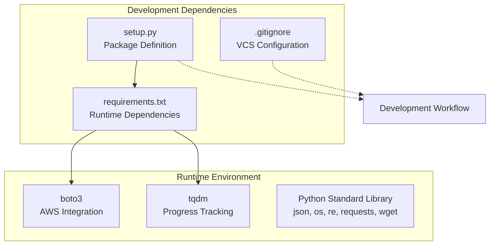

<!-- source: DeepWiki mcp.deepwiki.com · repo allenai/s2orc · page 3.2 Dependencies and Tools · fetched 2026-10-26 -->

# Dependencies and Tools

Relevant source files

The following files were used as context for generating this wiki page:

- [README.md](README.md)
- [requirements.txt](requirements.txt)

This page documents the external dependencies and tools required for S2ORC development and data access. It covers the core Python packages needed for AWS integration, progress tracking, and data retrieval workflows. For information about package installation and setup, see [Python Package Setup](#3.1). For details on the actual download workflow, see [Data Download Process](#2.2).

## Core Dependencies

S2ORC relies on two primary dependencies specified in the package requirements:

| Dependency | Purpose | Usage Context |
|------------|---------|---------------|
| `boto3` | AWS SDK for Python | S3 bucket access and AWS service integration |
| `tqdm` | Progress bar library | Download progress tracking and user feedback |

### AWS Integration with boto3

The `boto3` library serves as the foundation for AWS integration within the S2ORC ecosystem. While not explicitly shown in the download example, `boto3` enables programmatic access to AWS services that host S2ORC data.

**AWS Integration Dependencies**

Sources: [requirements.txt:1](), [README.md:61-88]()

### Progress Tracking with tqdm

The `tqdm` library provides progress visualization for long-running download operations. In the S2ORC download workflow, `tqdm` wraps iterative operations to show real-time progress.

**Progress Tracking Implementation**

Sources: [README.md:66](), [README.md:82](), [requirements.txt:2]()

## Additional Runtime Dependencies

Beyond the core package requirements, the S2ORC download example demonstrates several additional dependencies:

### HTTP and File Operations

| Library | Purpose | Code Usage |
|---------|---------|------------|
| `requests` | HTTP client for API calls | `requests.get()` for API endpoints |
| `wget` | File download utility | `wget.download()` for S3 file retrieval |
| `json` | JSON parsing | API response processing |
| `os` | Operating system interface | Directory creation with `os.makedirs()` |
| `re` | Regular expressions | URL parsing and shard ID extraction |

### API Integration Flow

**Dependency Interaction in Download Workflow**

Sources: [README.md:61-66](), [README.md:74-86]()

## Development Environment Dependencies

The S2ORC repository structure indicates additional tooling for development workflows:

### Package Management

The presence of `setup.py` suggests standard Python packaging dependencies, though specific development dependencies are not explicitly documented in the provided files.

**Development and Runtime Dependency Structure**

Sources: [requirements.txt:1-2](), [README.md:61-66]()

## Dependency Integration Patterns

The S2ORC download implementation demonstrates a layered dependency architecture where each tool serves a specific role in the data access pipeline:

1. **API Layer**: `requests` handles HTTP communication with Semantic Scholar APIs
2. **Data Processing**: `json` and `re` parse responses and extract metadata  
3. **AWS Integration**: `boto3` provides AWS SDK capabilities (future extensibility)
4. **File Operations**: `wget` and `os` manage local file system operations
5. **User Experience**: `tqdm` provides feedback during long-running operations

This architecture separates concerns while maintaining simplicity, allowing developers to integrate S2ORC data access into larger applications with minimal dependency overhead.

Sources: [README.md:55-88](), [requirements.txt:1-2]()

---

