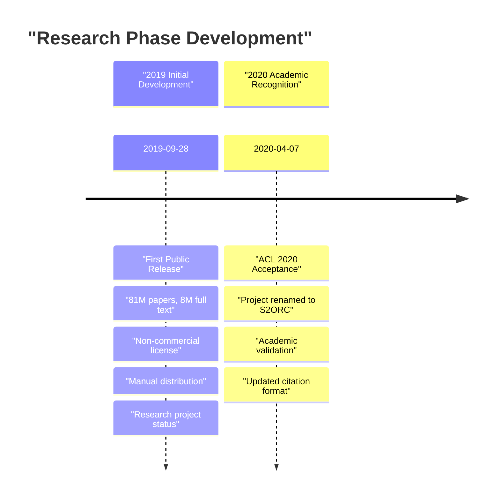
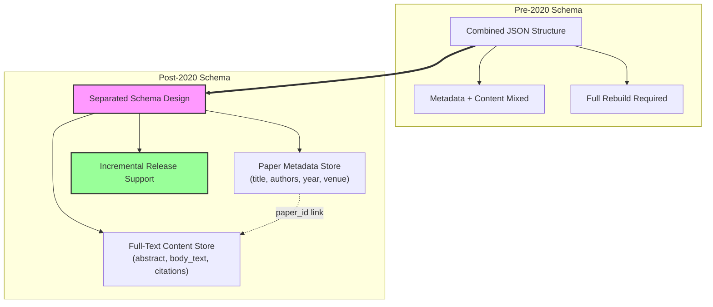
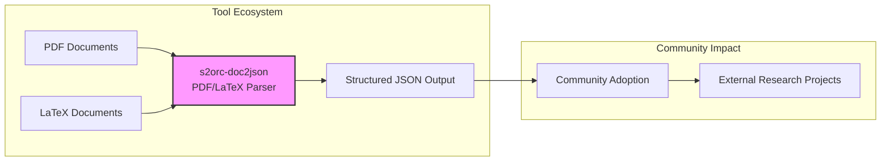
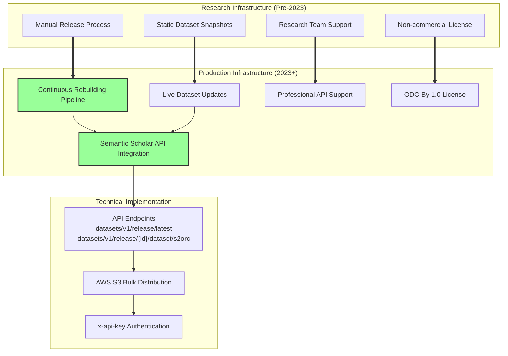
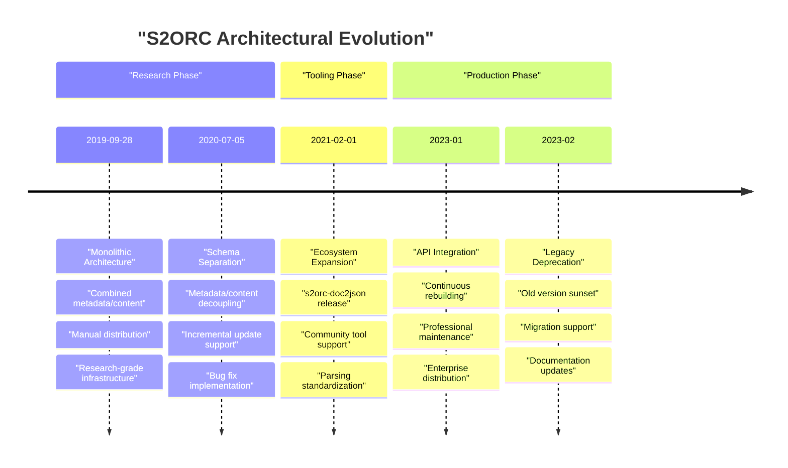
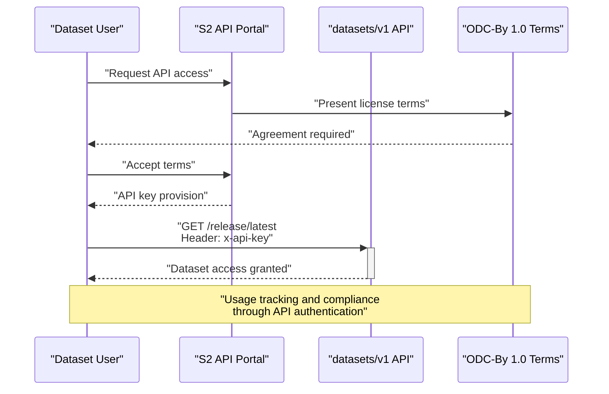
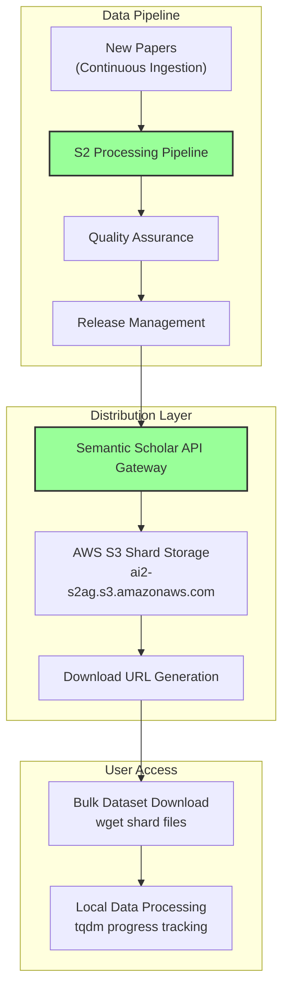

<!-- source: DeepWiki mcp.deepwiki.com · repo allenai/s2orc · page 4 Historical Evolution · fetched 2026-10-26 -->

# Historical Evolution

Relevant source files

The following files were used as context for generating this wiki page:

- [README.md](README.md)

This document traces the development of S2ORC from its inception as a research project in 2019 to its current status as a production dataset offering within the Semantic Scholar ecosystem. It covers major releases, architectural changes, schema evolution, and the transition from academic research to production infrastructure.

For information about the current system architecture and API access patterns, see [System Architecture](#1.1) and [Accessing S2ORC](#2). For details about the data schema that evolved through these releases, see [Data Schema and Format](#1.2).

## Research Project Origins (2019-2020)

S2ORC began as an academic research initiative led by Kyle Lo and Lucy Lu Wang at the Allen Institute for AI. The project aimed to create a comprehensive corpus for NLP and text mining research over scientific papers, addressing the need for large-scale full-text scientific document processing.

### Initial Release: September 28, 2019

The first public release established S2ORC as a significant research dataset with the following characteristics:

- **Scale**: 81M+ paper nodes with 73M+ gold abstracts and 8M+ full text papers
- **Purpose**: General-purpose corpus for NLP and text mining research
- **License**: Non-commercial research license
- **Distribution**: Standalone research project with manual release management

However, this initial version contained several implementation issues that would drive future architectural changes.

**Sources**: [README.md:49-53]()

### Major Schema Redesign: July 5, 2020

The second major release represented a fundamental architectural evolution, addressing the limitations discovered in the initial version:

#### Scale Expansion
- Paper count increased from 81M to 136M papers
- Full text coverage expanded from 8M to 12M papers
- More lenient filtering policies for papers with limited text content

#### Schema Separation Innovation
The most significant change was the separation of paper metadata from parsed content, enabling more flexible and efficient data management:

**Sources**: [README.md:30-37]()

#### Critical Bug Fixes
- **Missing section names**: Resolved structural parsing issues
- **Citation link resolution**: Fixed inline citation mentions that failed to resolve to bibliographies  
- **Metadata field consistency**: Standardized typing across metadata fields
- **LaTeX parse omission**: Strategic removal to enable incremental releases

This release established the architectural foundation that would support the eventual transition to production infrastructure.

**Sources**: [README.md:30-37]()

## Production Transition Phase (2021-2023)

### Tool Release: February 1, 2021

The release of the `s2orc-doc2json` parsing tool marked the beginning of S2ORC's evolution toward a more comprehensive ecosystem:

This tool release demonstrated the project's commitment to supporting the broader research community with reusable infrastructure components.

**Sources**: [README.md:25-27]()

### Production Integration: January 2023

The most significant transformation occurred when S2ORC transitioned from a research project to a core production offering within the Semantic Scholar infrastructure:

#### Ownership Transfer
- **Original Team**: Kyle Lo and Lucy Lu Wang (research project)
- **New Ownership**: Semantic Scholar API product team
- **Maintenance Model**: Professional product management and continuous support

#### Infrastructure Modernization
The transition brought enterprise-grade infrastructure capabilities:

**Sources**: [README.md:19-24](), [README.md:121-127]()

## Architectural Evolution Timeline

The following timeline captures the major architectural decisions and their implementation across S2ORC's development:

**Sources**: [README.md:17-53]()

## License and Governance Evolution

S2ORC's licensing model evolved significantly during its transition to production:

| Phase | License | Usage Rights | Distribution Model |
|-------|---------|-------------|-------------------|
| **Research (2019-2020)** | Non-commercial | Academic research only | Direct download |
| **Production (2023+)** | ODC-By 1.0 | Commercial permitted with attribution | API-mediated access |

### Implementation Details

The current licensing system is enforced through the API authentication mechanism:

**Sources**: [README.md:12](), [README.md:129-131]()

## Current State and Future Direction

### Legacy Version Management

As of February 2023, S2ORC implemented a clear deprecation strategy for older versions:

- **2019-09-28 Release**: No longer supported due to structural bugs
- **2020-07-05 Release**: Deprecated in favor of API access
- **Current Recommendation**: Exclusive use of Semantic Scholar Public API access

The legacy support model maintains minimal assistance through direct researcher contact for users with specific requirements.

### Continuous Integration Model

The production system implements several key improvements over the research model:

**Sources**: [README.md:55-89]()

### Technical Implementation Status

The current codebase reflects this evolutionary history through its structure:

- **Repository Focus**: Primarily documentation and distribution guidance rather than core processing code
- **Dependency Management**: Minimal dependencies (`boto3`, `tqdm`) focused on AWS integration and user experience
- **Code Distribution**: Actual processing logic migrated to Semantic Scholar production infrastructure

The transformation from research project to production system demonstrates a successful model for scaling academic research infrastructure to serve the broader scientific community.

**Sources**: [README.md:1-153]()

---

