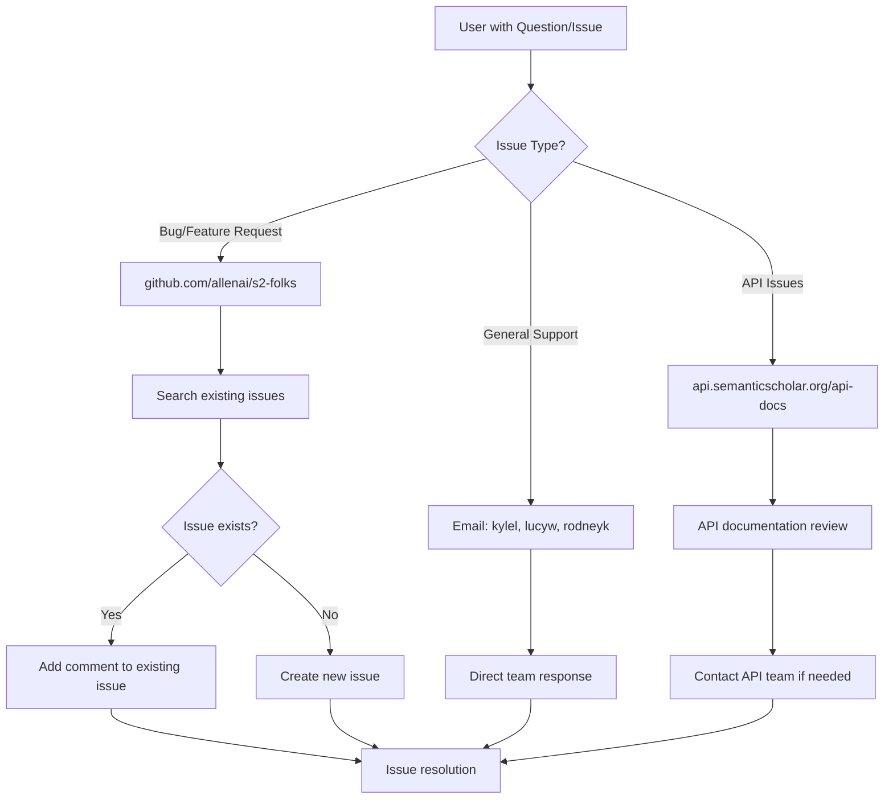
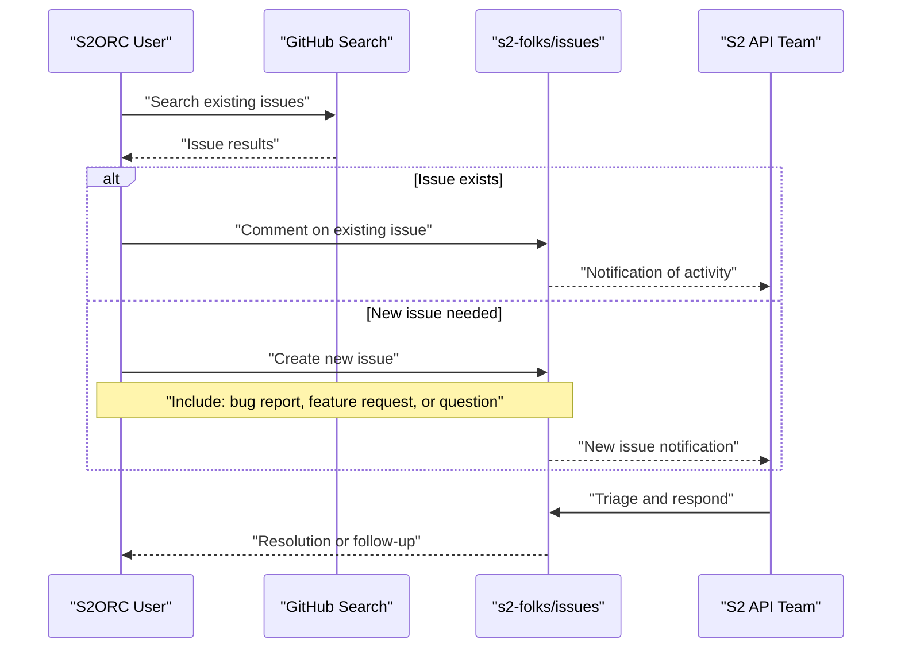
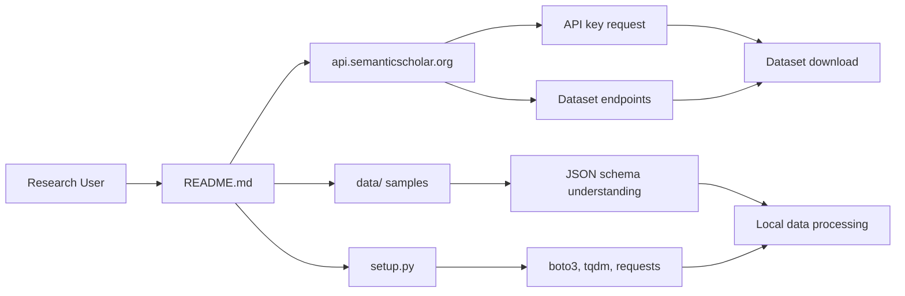
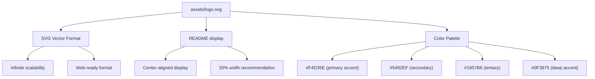
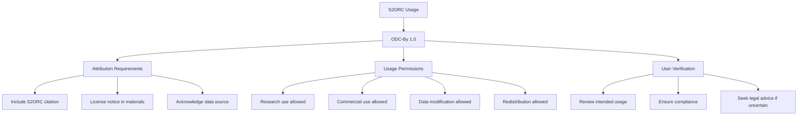
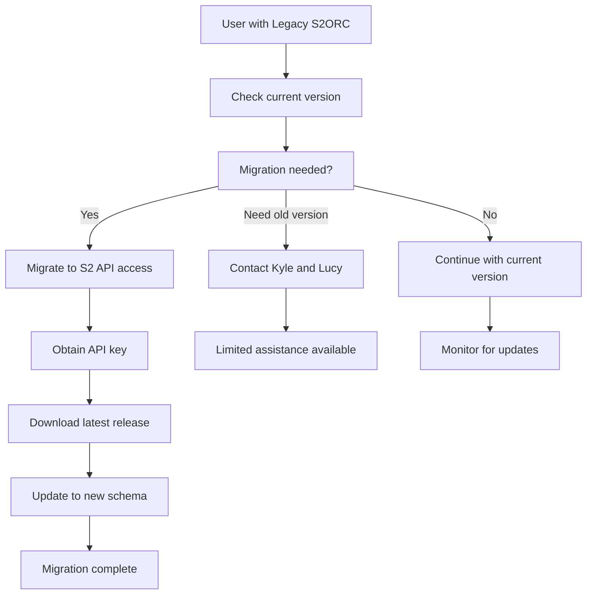

<!-- source: DeepWiki mcp.deepwiki.com · repo allenai/s2orc · page 5 Support and Resources · fetched 2026-10-26 -->

# Support and Resources

<details>
<summary>Relevant source files</summary>

The following files were used as context for generating this wiki page:

- [README.md](README.md)
- [assets/logo.svg](assets/logo.svg)

</details>


This document provides comprehensive support information, contact channels, community resources, and branding materials for S2ORC users. It covers issue reporting procedures, direct contact methods, licensing requirements, citation guidelines, and available documentation resources.

For technical implementation details, see [Development and Integration](#3). For data access procedures, see [Accessing S2ORC](#2).

## Contact and Support Channels

### Direct Contact Information

The S2ORC team maintains active communication channels for user support and feedback:

| Contact Method | Details | Purpose |
|---|---|---|
| **Primary Email** | Include `{kylel, lucyw, rodneyk}` on all correspondence | General support, dataset questions, technical issues |
| **Twitter** | [@kylelostat](https://twitter.com/kylelostat), [@lucyluwang](https://twitter.com/lucyluwang) | Project updates, community engagement |
| **Feedback** | Email or GitHub Issue | Dataset usage feedback, improvement suggestions |

The team actively responds to inquiries about dataset usage, technical implementation, and research applications. Users are encouraged to reach out regardless of experience level, as the team has assisted many researchers in getting started with the dataset.

**Support Workflow**



Sources: [README.md:93-106]()

### GitHub Issue Management

The project uses a centralized issue tracking system through the `s2-folks` repository:

**Issue Reporting Process**



**Repository Structure for Issues**
- **Base Repository**: `github.com/allenai/s2-folks`
- **Issue Categories**: Bug reports, feature requests, general questions
- **Search Required**: Users must search existing issues before creating new ones
- **Maintenance**: Issues are managed by the S2 API product team

Sources: [README.md:90-91](), [README.md:103-106]()

## Community Resources and Documentation

### API Documentation and Resources

The S2ORC ecosystem provides comprehensive documentation through multiple channels:

| Resource Type | Location | Content |
|---|---|---|
| **Primary Documentation** | `api.semanticscholar.org/api-docs/datasets` | Complete API documentation |
| **Download Instructions** | `README.md` section | Step-by-step access guide |
| **Schema Examples** | `data/` directory | JSON format samples |
| **Package Setup** | `setup.py`, `requirements.txt` | Python integration |

**Documentation Access Pattern**



Sources: [README.md:55-91]()

### Research Paper and Citation

The project maintains academic resources for proper attribution and understanding:

**Academic Citation Requirements**
```bibtex
@inproceedings{lo-wang-2020-s2orc,
    title = "{S}2{ORC}: The Semantic Scholar Open Research Corpus",
    author = "Lo, Kyle  and Wang, Lucy Lu  and Neumann, Mark  and Kinney, Rodney  and Weld, Daniel",
    booktitle = "Proceedings of the 58th Annual Meeting of the Association for Computational Linguistics",
    month = jul,
    year = "2020",
    address = "Online",
    publisher = "Association for Computational Linguistics",
    url = "https://www.aclweb.org/anthology/2020.acl-main.447",
    doi = "10.18653/v1/2020.acl-main.447",
    pages = "4969--4983"
}
```

**Additional Resources**
- **ACL 2020 Paper**: Primary research publication describing S2ORC methodology
- **12-minute ACL Talk**: Video presentation available on SlidesLive
- **ArXiv Preprint**: Early version with historical context

Sources: [README.md:13](), [README.md:137-152]()

## Branding and Visual Assets

### Official Logo and Branding

The S2ORC project provides official branding materials for use in presentations, papers, and applications:

**Logo Specifications**



**File Specifications**
- **File Path**: [assets/logo.svg:1-23]()
- **Format**: SVG (Scalable Vector Graphics)
- **Dimensions**: 60x60 viewBox
- **Generator**: Adobe Illustrator 26.0.2
- **Elements**: Multi-path design with gradient color scheme

**Usage Guidelines**
- The logo represents the "stork" pronunciation of S2ORC
- Recommended display width: 20% of container
- Center alignment for formal presentations
- SVG format ensures quality at all scales

Sources: [README.md:1-3](), [assets/logo.svg:1-23]()

## License and Legal Requirements

### ODC-By 1.0 License Compliance

S2ORC is released under the Open Data Commons Attribution License v1.0, which requires specific compliance measures:

**License Requirements**



**Key Compliance Points**
- **Attribution Required**: Users must cite the S2ORC paper and acknowledge the dataset
- **License Notice**: Include ODC-By 1.0 license notice in derivative works
- **Commercial Use**: Permitted under the license terms
- **User Responsibility**: Users must verify their specific use case compliance

**License Evolution**
- **Original License**: Non-commercial research license
- **Current License**: ODC-By 1.0 (more permissive)
- **Transition Date**: January 2023 with API integration
- **Verification**: Users should double-check compliance for their specific use cases

Sources: [README.md:12](), [README.md:126-127](), [README.md:129-131]()

## Version Support and Migration

### Historical Version Support

The S2ORC project has evolved through multiple versions with different support levels:

| Version | Status | Support Level | Access Method |
|---|---|---|---|
| **Current (API)** | Active | Full support | Semantic Scholar Public API |
| **2020-07-05** | Deprecated | Limited assistance | Contact original authors |
| **2019-09-28** | Deprecated | Limited assistance | Contact original authors |

**Migration Recommendations**



**Support Transition**
- **Maintenance Team**: S2 API product team (current), original researchers (legacy)
- **Implementation**: Current version is a reimplementation with potential differences
- **Recommendation**: All users should migrate to the API-based access method
- **Legacy Support**: Available on a limited basis through direct contact

Sources: [README.md:19-23](), [README.md:38](), [README.md:46](), [README.md:119-127]()