# Page: S2ORC Overview

# S2ORC Overview

<details>
<summary>Relevant source files</summary>

The following files were used as context for generating this wiki page:

- [README.md](README.md)

</details>


## Purpose and Scope

This document provides a high-level introduction to S2ORC (The Semantic Scholar Open Research Corpus), its purpose as a scientific NLP dataset, and its role within the broader Semantic Scholar ecosystem. It covers the system's evolution from research project to production offering and explains how S2ORC complements other Semantic Scholar datasets.

For detailed technical information about S2ORC's internal architecture and processing pipeline, see [System Architecture](#1.1). For comprehensive documentation of data formats and schema specifications, see [Data Schema and Format](#1.2). For practical guidance on obtaining and using S2ORC data, see [Accessing S2ORC](#2).

## What is S2ORC

S2ORC is a general-purpose corpus designed for NLP and text mining research over scientific papers. Unlike traditional academic datasets that focus primarily on metadata, S2ORC provides machine-readable full-text content extracted from scientific papers through automated PDF and LaTeX parsing.

The system was originally developed as a research project by Kyle Lo and Lucy Lu Wang at the Allen Institute for AI, but has evolved into a production dataset offering maintained by the Semantic Scholar API team. This transition represents a significant architectural shift from standalone research tool to integrated component of Semantic Scholar's data infrastructure.

**Key Characteristics:**
- **Full-text focus**: Provides parsed content including abstracts, body text, citations, and references
- **Large scale**: Covers millions of scientific papers with continuous updates
- **Production quality**: Maintained with continuous rebuilding pipeline for new paper inclusion
- **Open access**: Available under ODC-By 1.0 license through public API

Sources: [README.md:1-153]()

## Position in Semantic Scholar Ecosystem

S2ORC operates as a specialized dataset within Semantic Scholar's broader data ecosystem, complementing other offerings like S2AG (Semantic Scholar Academic Graph).

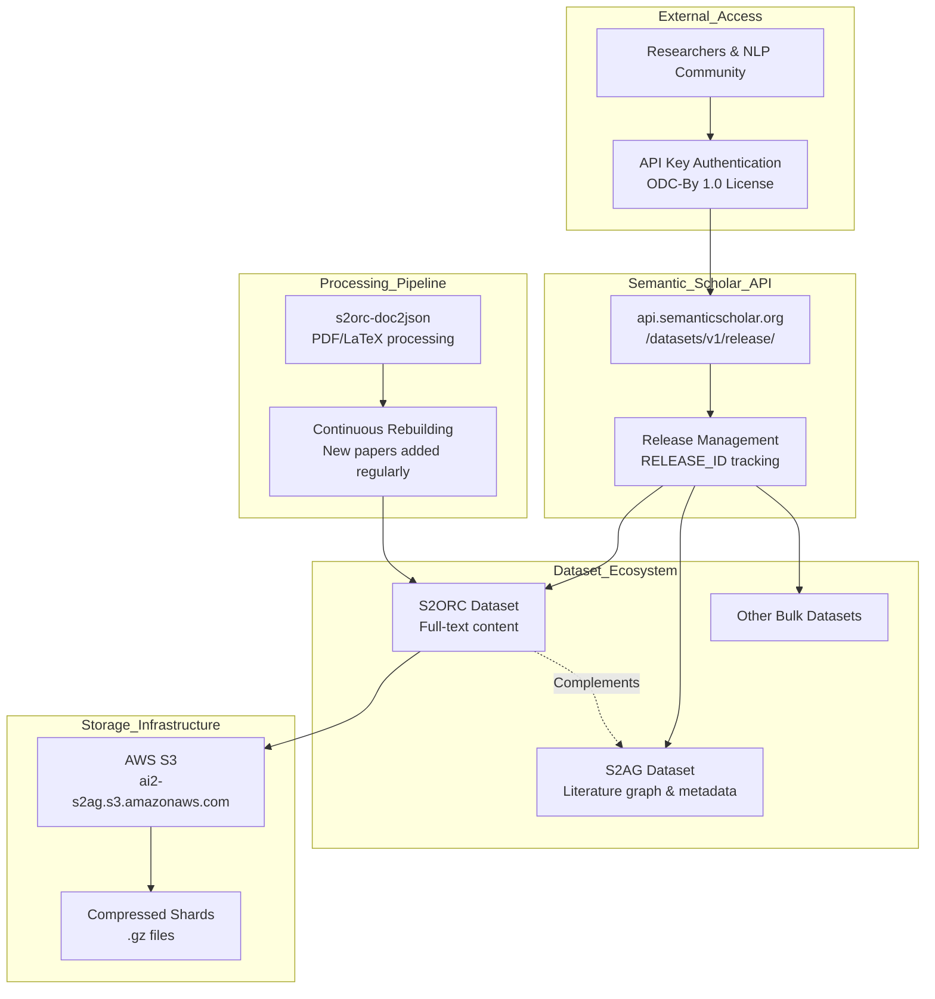

**Ecosystem Integration:**
- **S2AG relationship**: S2AG handles paper metadata (title, authors, venue) while S2ORC provides full-text content
- **API integration**: Both datasets accessible through unified Semantic Scholar Public API
- **Shared infrastructure**: Common authentication, release management, and distribution systems
- **Complementary data**: Users often combine S2AG metadata with S2ORC full-text for comprehensive analysis

Sources: [README.md:110-117](), [README.md:55-91]()

## Technical Components and Data Flow

The current S2ORC system integrates several key technical components to deliver full-text scientific paper data at scale.

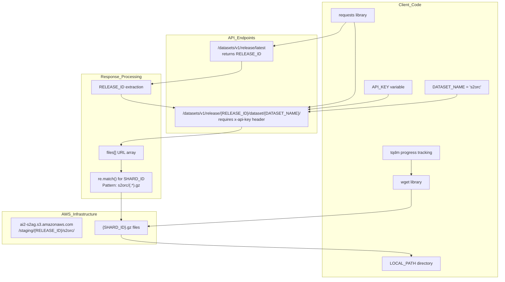

**Component Functions:**
- **`requests` library**: Handles HTTP communication with Semantic Scholar API endpoints
- **`wget` library**: Downloads large compressed shard files from AWS S3
- **`tqdm` library**: Provides progress tracking during multi-file download operations
- **Release management**: `RELEASE_ID` system enables versioned dataset access
- **Shard pattern**: Regular expression parsing extracts `SHARD_ID` from S3 URLs for local file naming

Sources: [README.md:60-88]()

## Evolution and Current Status

S2ORC has undergone significant evolution from its origins as a research project to its current status as a production dataset offering.

| Phase | Timeline | Key Characteristics | Access Model |
|-------|----------|-------------------|--------------|
| **Research Project** | 2019-2020 | Standalone releases, 81M→136M papers, manual distribution | Direct download, non-commercial license |
| **Tool Release** | 2021 | `s2orc-doc2json` parser release, community adoption | GitHub-based tools |
| **Production System** | 2023-Present | API team ownership, continuous rebuilding, ODC-By 1.0 license | Semantic Scholar Public API integration |

**Current Production Features:**
- **Continuous updates**: New papers automatically incorporated through rebuilding pipeline
- **API-first access**: Integrated with Semantic Scholar Public API infrastructure
- **Professional maintenance**: Transitioned from research team to dedicated product team
- **Licensing change**: Moved from non-commercial to ODC-By 1.0 open license
- **Deprecated legacy versions**: 2019 and 2020 standalone releases no longer supported

**Architectural Improvements:**
- **Schema separation** (2020): Split metadata from full-text content for incremental updates
- **Incremental releases**: Support for partial updates without full reprocessing
- **Bug fixes**: Resolved missing section names, broken citation links, and metadata typing issues

Sources: [README.md:17-53](), [README.md:119-127]()

## Support and Maintenance

S2ORC is currently maintained by the Semantic Scholar API product team, with support channels integrated into the broader Semantic Scholar ecosystem.

**Primary Support Channels:**
- **GitHub Issues**: [s2-folks repository](https://github.com/allenai/s2-folks/issues) for bug reports and feature requests
- **Email Contact**: Include `kylel`, `lucyw`, and `rodneyk` for dataset-specific inquiries
- **API Documentation**: Comprehensive guides available at [api.semanticscholar.org](https://api.semanticscholar.org/api-docs/datasets)

**Citation Requirement:**
Users must cite the original ACL 2020 paper when using S2ORC in research or applications, maintaining attribution to the original research contribution despite the system's evolution to production status.

Sources: [README.md:93-106](), [README.md:135-152]()

---

# Page: System Architecture

# System Architecture

<details>
<summary>Relevant source files</summary>

The following files were used as context for generating this wiki page:

- [README.md](README.md)

</details>


## Purpose and Scope

This document describes the technical architecture of S2ORC (Semantic Scholar Open Research Corpus), focusing on its integration within the Semantic Scholar ecosystem, data processing pipeline, and distribution mechanisms. This covers the system-level design decisions, component relationships, and infrastructure dependencies that enable S2ORC to function as a continuously updated dataset offering.

For information about the specific data structures and JSON schema, see [Data Schema and Format](#1.2). For practical usage instructions, see [Accessing S2ORC](#2).

## Core Architecture Components

S2ORC operates as a specialized component within the broader Semantic Scholar infrastructure, designed specifically to complement the S2AG (Semantic Scholar Academic Graph) dataset through a clear architectural separation.

### S2ORC vs S2AG System Separation

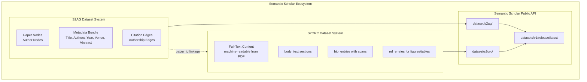

The architecture maintains a clear separation where S2AG handles the literature graph structure (nodes, edges, metadata) while S2ORC provides the parsed full-text content derived from PDF processing models.

**Sources:** [README.md:110-117]()

### Production Infrastructure Integration

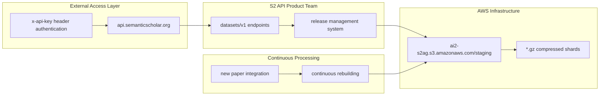

**Sources:** [README.md:19-23](), [README.md:121-123]()

## Data Processing Pipeline Architecture

The processing pipeline represents a significant architectural evolution from the original research implementation to a production system integrated within Semantic Scholar's infrastructure.

### Schema Separation Architecture (2020-07-05 Update)

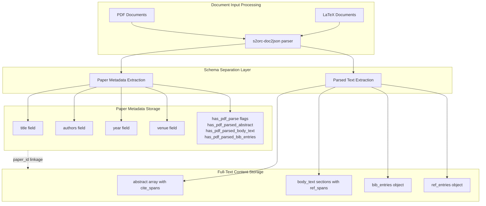

This architectural change enables incremental releases and separates concerns between metadata management and full-text processing.

**Sources:** [README.md:30-36](), [README.md:25-27]()

### Continuous Rebuilding System

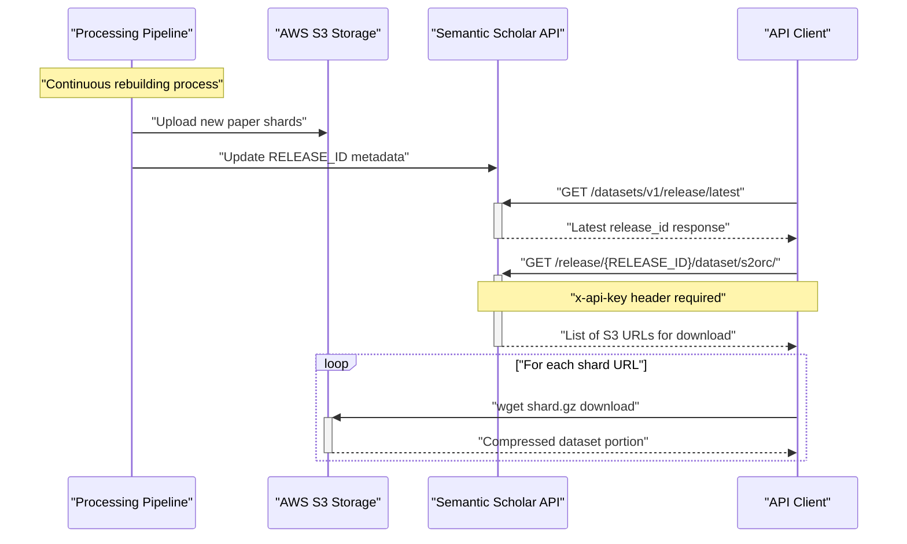

The continuous rebuilding ensures that new papers are regularly integrated without requiring full dataset regeneration.

**Sources:** [README.md:23](), [README.md:74-87]()

## API Distribution System Architecture

### Release Management and Shard Distribution

The distribution system uses a two-stage API pattern that separates release metadata from actual data download:

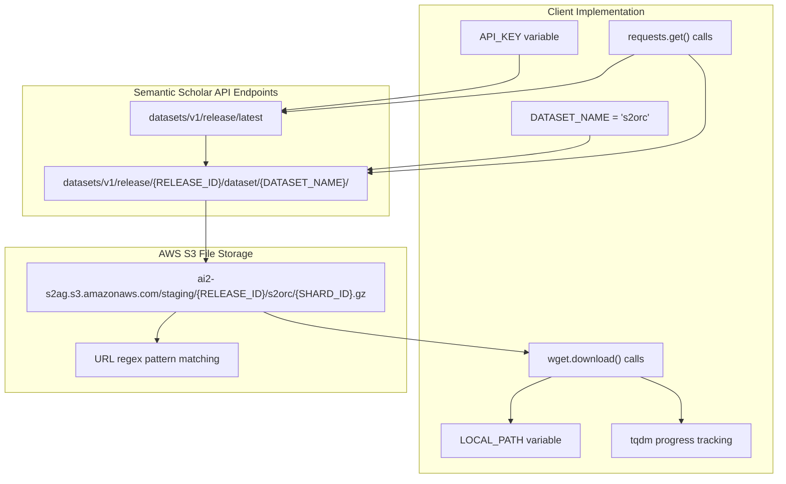

The system uses a specific URL pattern with regex matching to extract `RELEASE_ID` and `SHARD_ID` components for organized local storage.

**Sources:** [README.md:59-88]()

### Authentication and Access Control

| Component | Implementation | Purpose |
|-----------|----------------|---------|
| API Key | `x-api-key` header | Authentication for bulk dataset access |
| License | ODC-By 1.0 | Legal framework for dataset usage |
| Endpoint Protection | Header validation | Restricts access to authorized users |

**Sources:** [README.md:12](), [README.md:79](), [README.md:129-131]()

## Integration Points and Dependencies

### External Tool Integration

The system integrates with several external tools and libraries for functionality:

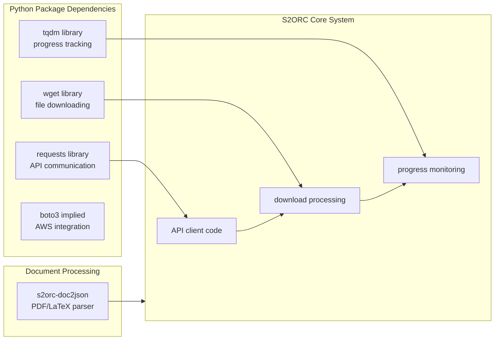

**Sources:** [README.md:61-66](), [README.md:27]()

### Support and Maintenance Infrastructure

The system has transitioned from research project maintenance to production support:

| Aspect | Original System | Current System |
|--------|----------------|----------------|
| Maintenance Team | Original researchers (Kyle Lo, Lucy Lu Wang) | S2 API Product Team |
| Support Channel | Direct email contact | GitHub issues in s2-folks repo |
| License | Non-commercial | ODC-By 1.0 |
| Implementation | Original research code | Production pipeline reimplementation |

**Sources:** [README.md:11](), [README.md:104-105](), [README.md:121-126]()

## Architectural Evolution

The system has undergone significant architectural changes from research prototype to production infrastructure:

1. **Research Phase (2019-2020)**: Standalone project with manual releases
2. **Schema Redesign (2020-07-05)**: Metadata/content separation for incremental updates  
3. **Production Integration (2023)**: Full integration into Semantic Scholar API ecosystem with continuous rebuilding

This evolution demonstrates a successful transition from research implementation to scalable production infrastructure while maintaining backward compatibility and data access patterns.

**Sources:** [README.md:17-52](), [README.md:119-127]()

---

# Page: Data Schema and Format

# Data Schema and Format

<details>
<summary>Relevant source files</summary>

The following files were used as context for generating this wiki page:

- [README.md](README.md)
- [data/metadata/sample.jsonl](data/metadata/sample.jsonl)
- [data/pdf_parses/sample.jsonl](data/pdf_parses/sample.jsonl)

</details>


This page documents the data structure, JSON schema, and field definitions for S2ORC dataset files. It covers both the metadata format (paper bibliographic information) and PDF parse format (full-text content extraction). For information about accessing and downloading S2ORC data, see [Data Download Process](#2.2).

## Schema Architecture

S2ORC employs a separated schema design implemented in the 2020-07-05 release that splits data into two distinct file types:

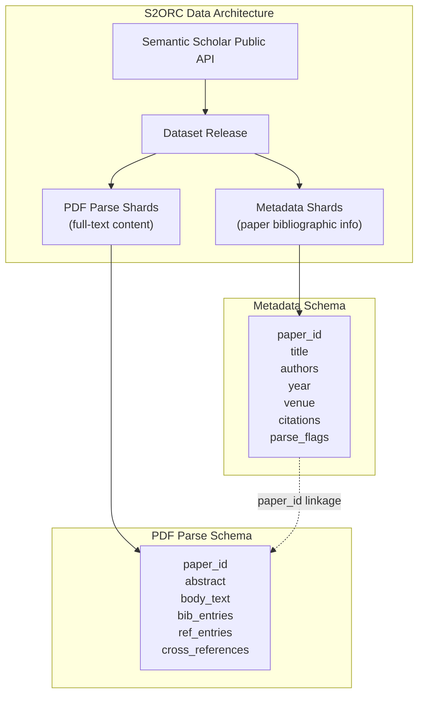

This separation enables independent updates and efficient incremental releases. Papers are linked across schemas using the `paper_id` field as the primary key.

**Sources:** [README.md:30-38](), [data/metadata/sample.jsonl:1-107](), [data/pdf_parses/sample.jsonl:1-4]()

## Metadata Schema

The metadata schema contains bibliographic information and citation graphs. Each record represents one paper with the following structure:

| Field | Type | Description |
|-------|------|-------------|
| `paper_id` | string | Unique identifier for the paper |
| `title` | string | Paper title |
| `authors` | array | Author objects with `first`, `middle`, `last`, `suffix` |
| `abstract` | string | Plain text abstract (may be null) |
| `year` | integer | Publication year |
| `venue` | string | Conference/journal venue |
| `journal` | string | Journal name |
| `doi` | string | Digital Object Identifier |
| `arxiv_id` | string | ArXiv identifier |
| `acl_id` | string | ACL Anthology identifier |
| `pmc_id` | string | PubMed Central identifier |
| `pubmed_id` | string | PubMed identifier |
| `mag_id` | string | Microsoft Academic Graph identifier |
| `mag_field_of_study` | array | Research field classifications |
| `outbound_citations` | array | List of cited paper IDs |
| `inbound_citations` | array | List of citing paper IDs |
| `has_outbound_citations` | boolean | Citation data availability flag |
| `has_inbound_citations` | boolean | Citation data availability flag |
| `has_pdf_parse` | boolean | Full-text parsing availability flag |
| `has_pdf_parsed_abstract` | boolean | Abstract parsing flag |
| `has_pdf_parsed_body_text` | boolean | Body text parsing flag |
| `has_pdf_parsed_bib_entries` | boolean | Bibliography parsing flag |
| `has_pdf_parsed_ref_entries` | boolean | Reference entries parsing flag |
| `s2_url` | string | Semantic Scholar corpus URL |

**Sources:** [data/metadata/sample.jsonl:1-107]()

## PDF Parse Schema

The PDF parse schema contains structured full-text content extracted from scientific papers. The core structure includes:

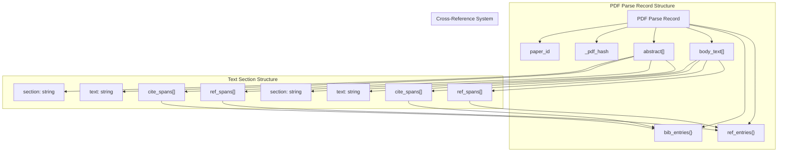

### Core Fields

| Field | Type | Description |
|-------|------|-------------|
| `paper_id` | string | Links to metadata schema |
| `_pdf_hash` | string | Hash of source PDF file |
| `abstract` | array | Structured abstract sections |
| `body_text` | array | Structured body text sections |
| `bib_entries` | object | Bibliography reference entries |
| `ref_entries` | object | Figure and table references |

### Text Section Objects

Both `abstract` and `body_text` arrays contain section objects with:

| Field | Type | Description |
|-------|------|-------------|
| `section` | string | Section heading/name |
| `text` | string | Section text content |
| `cite_spans` | array | In-text citation references |
| `ref_spans` | array | Figure/table references |

**Sources:** [data/pdf_parses/sample.jsonl:1-4]()

## Cross-Reference System

S2ORC implements a comprehensive cross-reference system linking in-text mentions to bibliography and reference entries:

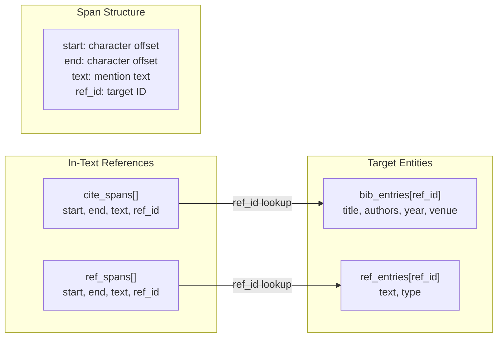

### Span Objects

Citation spans (`cite_spans`) and reference spans (`ref_spans`) use this structure:

| Field | Type | Description |
|-------|------|-------------|
| `start` | integer | Starting character offset in text |
| `end` | integer | Ending character offset in text |
| `text` | string | Actual mention text |
| `ref_id` | string | Reference ID for lookup |

### Bibliography Entries

The `bib_entries` object maps reference IDs to bibliography information:

| Field | Type | Description |
|-------|------|-------------|
| `title` | string | Referenced work title |
| `authors` | array | Author objects |
| `year` | integer | Publication year |
| `venue` | string | Publication venue |
| `link` | string | External identifier/link |

### Reference Entries

The `ref_entries` object maps reference IDs to figures and tables:

| Field | Type | Description |
|-------|------|-------------|
| `text` | string | Caption or description text |
| `type` | string | Entry type (figure, table, etc.) |

**Sources:** [data/pdf_parses/sample.jsonl:1-4]()

## Schema Examples

### Metadata Record Example

```json
{
  "paper_id": "77499681",
  "title": "Effects of Teriparatide Administration on Fracture Healing after Intramedullary Nailing in Atypical Femoral Fractures",
  "authors": [
    {"first": "Chul Hyun", "middle": [], "last": "Park", "suffix": ""},
    {"first": "Oog Jin", "middle": [], "last": "Shon", "suffix": ""}
  ],
  "year": 2016,
  "venue": null,
  "journal": "The Journal of The Korean Orthopaedic Association",
  "has_pdf_parse": true,
  "has_pdf_parsed_abstract": true,
  "has_pdf_parsed_body_text": true,
  "has_pdf_parsed_bib_entries": true,
  "outbound_citations": ["71492442", "8323353", "3224020"],
  "inbound_citations": []
}
```

### PDF Parse Record Example

```json
{
  "paper_id": "77499681",
  "_pdf_hash": "11f281316fe4638843a83cf559ce4f60aade00f8",
  "abstract": [
    {
      "section": "Abstract",
      "text": "The purpose of this study is to evaluate the effects of teriparatide administration...",
      "cite_spans": [],
      "ref_spans": []
    }
  ],
  "body_text": [
    {
      "section": "",
      "text": "Values are presented as number only or median (range).",
      "cite_spans": [],
      "ref_spans": []
    }
  ],
  "bib_entries": {
    "BIBREF0": {
      "title": "Bone health and osteoporosis: a report of the surgeon general",
      "authors": [],
      "year": 2004,
      "venue": "",
      "link": null
    }
  },
  "ref_entries": {
    "FIGREF0": {
      "text": "Figure caption describing experimental results...",
      "type": "figure"
    }
  }
}
```

**Sources:** [data/metadata/sample.jsonl:102](), [data/pdf_parses/sample.jsonl:1]()

---

# Page: Accessing S2ORC

# Accessing S2ORC

<details>
<summary>Relevant source files</summary>

The following files were used as context for generating this wiki page:

- [README.md](README.md)

</details>


This page provides a comprehensive guide to accessing and downloading S2ORC data through the Semantic Scholar Public API. It covers the overall access architecture, workflow, and technical requirements for obtaining the dataset.

For detailed step-by-step instructions on API key setup and authentication, see [API Authentication and Setup](#2.1). For specifics on the download process and data handling, see [Data Download Process](#2.2).

## Access Overview

S2ORC is distributed as a "Bulk Dataset" through the Semantic Scholar Public API infrastructure. The dataset is continuously rebuilt, ensuring users have access to newly processed papers. Access requires API authentication and follows a two-stage process: obtaining release metadata and downloading dataset shards from AWS S3 storage.

## API Access Architecture

The S2ORC access system integrates multiple components within the Semantic Scholar infrastructure to deliver large-scale dataset distribution:

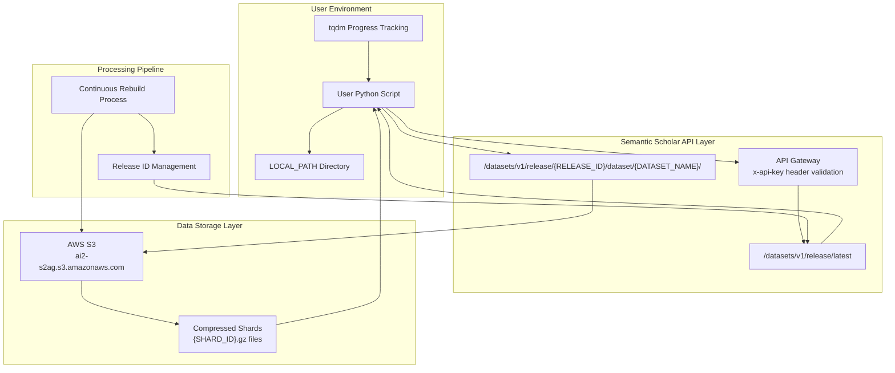

**Sources:** [README.md:55-91]()

## Technical Access Workflow

The programmatic access follows a specific sequence using the `requests` library for API calls and `wget` for efficient large file downloads:

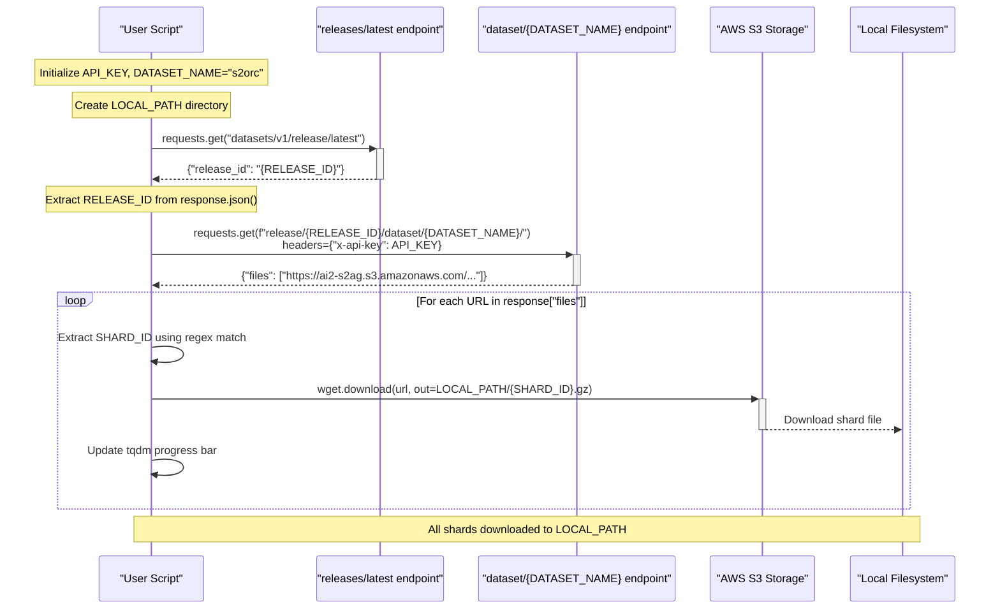

**Sources:** [README.md:61-88]()

## Code Implementation Details

The access implementation uses specific Python libraries and follows a structured pattern for handling API responses and file downloads:

| Component | Purpose | Implementation Details |
|-----------|---------|----------------------|
| `API_KEY` | Authentication | Passed via `x-api-key` header to dataset endpoints |
| `DATASET_NAME` | Resource identifier | Set to `"s2orc"` for full-text dataset access |
| `RELEASE_ID` | Version control | Retrieved from latest release endpoint, used in subsequent calls |
| `LOCAL_PATH` | Storage destination | User-defined directory for downloaded shards |
| `tqdm` | Progress tracking | Wraps download loop for visual progress indication |
| `wget` | File transfer | Handles large file downloads from S3 URLs |
| `re.match()` | URL parsing | Extracts `SHARD_ID` from S3 URL patterns |

**Sources:** [README.md:68-86]()

## Dataset Distribution Model

S2ORC uses a sharded distribution approach where the complete dataset is split across multiple compressed files. Each shard follows a predictable URL pattern and naming convention:

```mermaid
graph LR
    subgraph "S3 URL Structure"
        BaseURL["https://ai2-s2ag.s3.amazonaws.com"]
        StagingPath["/staging/{RELEASE_ID}"]
        DatasetPath["/s2orc/"]
        ShardFile["{SHARD_ID}.gz"]
    end
    
    subgraph "Regex Pattern Matching"
        URLPattern["r'https://ai2-s2ag.s3.amazonaws.com/staging/(.*)/s2orc/(.*).gz(.*)'""]
        Group1["match.group(1) == RELEASE_ID"]
        Group2["match.group(2) == SHARD_ID"]
    end
    
    subgraph "Local File Organization"
        LocalDir["LOCAL_PATH/"]
        LocalFile["{SHARD_ID}.gz"]
    end
    
    BaseURL --> StagingPath
    StagingPath --> DatasetPath
    DatasetPath --> ShardFile
    
    ShardFile --> URLPattern
    URLPattern --> Group1
    URLPattern --> Group2
    
    Group2 --> LocalFile
    LocalDir --> LocalFile
```

**Sources:** [README.md:82-86]()

## Integration Requirements

Access to S2ORC requires several key dependencies and setup considerations:

- **Python Dependencies**: `requests` for API calls, `wget` for downloads, `tqdm` for progress tracking, `json` and `os` for data handling
- **Network Requirements**: Reliable internet connection for large file downloads from AWS S3
- **Storage Requirements**: Sufficient local disk space for compressed dataset shards
- **Authentication**: Valid API key from Semantic Scholar Public API portal
- **License Compliance**: Agreement to ODC-By 1.0 license terms

**Sources:** [README.md:61-67](), [README.md:12](), [README.md:131]()

## Current System Status

S2ORC transitioned from a research project to a production system maintained by the Semantic Scholar API team. The current implementation offers several advantages over historical versions:

- **Continuous Updates**: Dataset is rebuilt regularly with new papers
- **Production Maintenance**: Supported by dedicated API infrastructure team
- **Improved Licensing**: ODC-By 1.0 replaces previous non-commercial restrictions
- **Integrated Access**: Unified distribution through Semantic Scholar APIs
- **Scalable Infrastructure**: AWS-based distribution handles large-scale access

Historical versions (2019-09-28, 2020-07-05) are no longer supported, and users are encouraged to migrate to the current API-based access method.

**Sources:** [README.md:19-24](), [README.md:119-127]()

---

# Page: API Authentication and Setup

# API Authentication and Setup

<details>
<summary>Relevant source files</summary>

The following files were used as context for generating this wiki page:

- [README.md](README.md)

</details>


This document covers the authentication requirements and initial setup needed to access S2ORC data through the Semantic Scholar Public API. It includes obtaining API keys, understanding license obligations, and configuring authentication headers for API requests.

For information about the actual data download workflow and shard processing, see [Data Download Process](#2.2). For details about S2ORC's overall architecture within the Semantic Scholar ecosystem, see [System Architecture](#1.1).

## License Requirements

S2ORC is distributed under the ODC-By 1.0 (Open Data Commons Attribution License). Users must agree to the license terms before accessing the data.

### Key License Points

| Aspect | Requirement |
|--------|------------|
| **License Type** | ODC-By 1.0 (Open Data Commons Attribution) |
| **Attribution** | Required when using S2ORC data |
| **Commercial Use** | Permitted under ODC-By 1.0 terms |
| **Distribution** | Must include license attribution |

The license represents a significant change from the original research project, which used a non-commercial license. Current S2ORC allows commercial applications under the ODC-By 1.0 terms.

**Sources:** [README.md:12](), [README.md:126-127](), [README.md:129-131]()

## Authentication Architecture

```mermaid
sequenceDiagram
    participant User as "Developer"
    participant Portal as "S2 API Portal"
    participant API as "Semantic Scholar API"
    participant Auth as "Authentication Service"
    
    User->>Portal: "Request API Access"
    Portal-->>User: "Provide Registration Form"
    User->>Portal: "Submit Application"
    Portal-->>User: "Issue API Key"
    
    Note over User,Auth: Authentication Setup Complete
    
    User->>+API: "GET /datasets/v1/release/latest<br/>Header: x-api-key: {API_KEY}"
    API->>+Auth: "Validate API Key"
    Auth-->>-API: "Authentication Result"
    API-->>-User: "Release Information or 401 Error"
```

**Authentication Flow for S2ORC API Access**

The authentication system uses API key-based authentication through HTTP headers. All dataset API requests require the `x-api-key` header for authorization.

**Sources:** [README.md:59](), [README.md:69](), [README.md:79-81]()

## API Key Acquisition

### Obtaining Access Credentials

1. **Visit the Semantic Scholar Public API portal**: Navigate to the official API registration page
2. **Complete registration**: Provide required information for API access
3. **Accept license terms**: Agree to ODC-By 1.0 license requirements
4. **Receive API key**: Obtain your unique authentication token

### API Key Configuration

The API key must be included in all requests to the datasets endpoints using the `x-api-key` header:

```python
headers = {"x-api-key": API_KEY}
response = requests.get(endpoint_url, headers=headers)
```

**Sources:** [README.md:59](), [README.md:69](), [README.md:81]()

## API Endpoints Structure

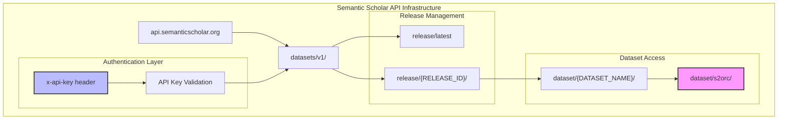

**S2ORC API Endpoint Hierarchy and Authentication**

### Core Endpoints

| Endpoint | Purpose | Authentication |
|----------|---------|---------------|
| `GET /datasets/v1/release/latest` | Get current release ID | None required |
| `GET /datasets/v1/release/{RELEASE_ID}/dataset/s2orc/` | Get S2ORC download URLs | `x-api-key` required |

**Sources:** [README.md:75-76](), [README.md:81]()

## Authentication Setup Verification

### Basic Authentication Test

```python
import requests

# Test basic API access (no auth required)
response = requests.get("https://api.semanticscholar.org/datasets/v1/release/latest")
if response.status_code == 200:
    release_data = response.json()
    print(f"Latest release: {release_data['release_id']}")
else:
    print("Failed to access public endpoint")

# Test authenticated access
API_KEY = "your_api_key_here"
headers = {"x-api-key": API_KEY}
auth_response = requests.get(
    f"https://api.semanticscholar.org/datasets/v1/release/{release_data['release_id']}/dataset/s2orc/",
    headers=headers
)

if auth_response.status_code == 200:
    print("Authentication successful")
    dataset_info = auth_response.json()
    print(f"Available files: {len(dataset_info['files'])}")
elif auth_response.status_code == 401:
    print("Authentication failed - check API key")
else:
    print(f"Unexpected response: {auth_response.status_code}")
```

### Common Authentication Issues

| Issue | Symptom | Solution |
|-------|---------|----------|
| **Missing API Key** | 401 Unauthorized | Include `x-api-key` header |
| **Invalid API Key** | 401 Unauthorized | Verify key from API portal |
| **Malformed Header** | 400 Bad Request | Check header format |
| **Rate Limiting** | 429 Too Many Requests | Implement request throttling |

**Sources:** [README.md:75-81]()

## Implementation Dependencies

### Required Python Packages

The authentication and API access workflow requires specific Python packages:

```python
import requests  # HTTP client for API calls
import json      # JSON response parsing
import os        # Environment variable access
```

These dependencies support the core authentication workflow demonstrated in the S2ORC download example.

**Sources:** [README.md:61-64]()

## Migration from Legacy Versions

### Authentication Changes

Users migrating from older S2ORC versions should note significant changes:

| Legacy Version | Current API-Based Version |
|---------------|---------------------------|
| Direct file downloads | API-mediated access |
| No authentication | API key required |
| Non-commercial license | ODC-By 1.0 license |
| Static releases | Continuous rebuilding |

The current system provides better access control and enables continuous dataset updates through the Semantic Scholar infrastructure.

**Sources:** [README.md:19-23](), [README.md:38](), [README.md:46](), [README.md:119-127]()

---

# Page: Data Download Process

# Data Download Process

<details>
<summary>Relevant source files</summary>

The following files were used as context for generating this wiki page:

- [README.md](README.md)
- [requirements.txt](requirements.txt)

</details>


This document covers the technical workflow for downloading S2ORC dataset files through the Semantic Scholar Public API. It details the multi-step process of obtaining dataset shards, the underlying API architecture, and local file handling procedures.

For information about obtaining API credentials and license requirements, see [API Authentication and Setup](#2.1). For details about the data format and schema structure, see [Data Schema and Format](#1.2).

## Overview

The S2ORC download process follows a two-stage API pattern: first obtaining release metadata, then retrieving signed URLs for individual dataset shards. The system distributes data as compressed `.gz` files stored on AWS S3, with each shard containing a portion of the complete dataset.

Sources: [README.md:55-88]()

## Download Workflow Architecture

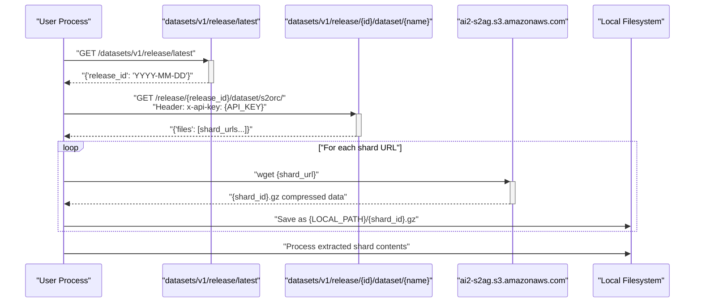

**Download Workflow Sequence**

This diagram shows the API interaction pattern where users first retrieve the current release identifier, then use that to obtain signed S3 URLs for dataset shards.

Sources: [README.md:74-87]()

## Core Download Implementation

The download process involves several key components and data flows:

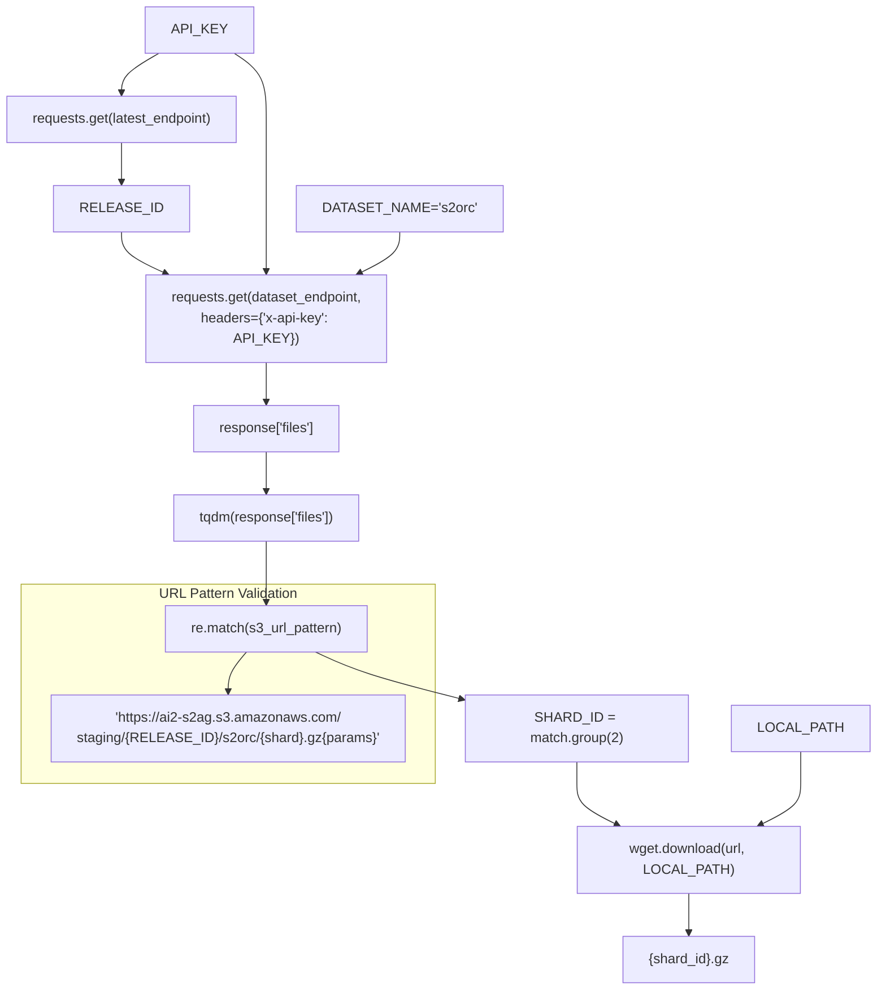

**Download Process Data Flow**

This diagram illustrates the core variables and function calls involved in the download implementation, showing how API responses are processed into local files.

Sources: [README.md:68-87]()

## API Endpoints and Parameters

The download process interacts with two primary API endpoints:

| Endpoint | Method | Purpose | Authentication |
|----------|--------|---------|----------------|
| `/datasets/v1/release/latest` | GET | Retrieve current release ID | None |
| `/datasets/v1/release/{RELEASE_ID}/dataset/{DATASET_NAME}/` | GET | Get shard download URLs | `x-api-key` header |

### Request Parameters

- **RELEASE_ID**: Date-formatted identifier (e.g., "2024-01-15") returned by the latest endpoint
- **DATASET_NAME**: Fixed value "s2orc" for S2ORC dataset access
- **API_KEY**: User-specific authentication token obtained from Semantic Scholar

Sources: [README.md:75-81]()

## File Structure and Shard Management

### URL Pattern Analysis

The system validates downloaded URLs against a specific pattern to extract shard identifiers:

```
https://ai2-s2ag.s3.amazonaws.com/staging/{RELEASE_ID}/s2orc/{SHARD_ID}.gz{query_params}
```

The regex pattern extracts:
- **Group 1**: Release ID validation
- **Group 2**: Shard identifier for local filename
- **Group 3**: Query parameters (authentication tokens)

### Local File Organization

Downloaded files are organized as:
```
{LOCAL_PATH}/
├── {shard_id_001}.gz
├── {shard_id_002}.gz
└── {shard_id_nnn}.gz
```

Sources: [README.md:83-86]()

## Dependencies and Progress Tracking

The download implementation requires specific Python packages:

### Required Dependencies

| Package | Purpose | Usage Context |
|---------|---------|---------------|
| `requests` | HTTP API calls | Endpoint communication |
| `wget` | File downloading | S3 shard retrieval |
| `tqdm` | Progress visualization | Download iteration tracking |
| `re` | Pattern matching | URL validation and parsing |
| `json` | Response parsing | API data processing |
| `os` | Path management | Local directory creation |

### Progress Tracking Implementation

The `tqdm` library provides progress indication during the shard download loop:

```python
for url in tqdm(response["files"]):
    # Download processing for each shard
```

This creates a visual progress bar showing download completion across all shards.

Sources: [README.md:61-67](), [requirements.txt:1-2]()

## Error Handling and Validation

### URL Validation

The system performs assertion-based validation on S3 URLs:

```python
assert match.group(1) == RELEASE_ID
```

This ensures downloaded shards match the requested release version.

### Directory Management

Local path creation uses safe directory handling:

```python
os.makedirs(LOCAL_PATH, exist_ok=True)
```

The `exist_ok=True` parameter prevents errors if the target directory already exists.

Sources: [README.md:72-84]()

## Data Processing Considerations

### Compressed Format

All dataset shards are distributed in gzip-compressed format (`.gz` extension), requiring decompression before data processing.

### Shard-Based Distribution

The dataset is partitioned across multiple shards to enable:
- Parallel downloading
- Incremental processing
- Reduced memory requirements
- Network fault tolerance

### Storage Requirements

Users should ensure adequate local storage capacity before initiating downloads, as the complete S2ORC dataset represents a substantial data volume across all compressed shards.

Sources: [README.md:80-87]()

---

# Page: Development and Integration

# Development and Integration

<details>
<summary>Relevant source files</summary>

The following files were used as context for generating this wiki page:

- [requirements.txt](requirements.txt)
- [setup.py](setup.py)

</details>


This document covers the technical aspects of working with S2ORC programmatically, including Python package setup, dependencies, and integration patterns. This focuses on the development infrastructure provided by this repository for accessing and processing S2ORC data.

For information about the data access API and download procedures, see [Accessing S2ORC](#2). For details about the underlying data schema and formats, see [Data Schema and Format](#1.2).

## Package Architecture

The S2ORC repository provides a minimal Python package infrastructure designed to support programmatic access to the dataset. The package follows standard Python packaging conventions with a lightweight configuration focused on external integrations.

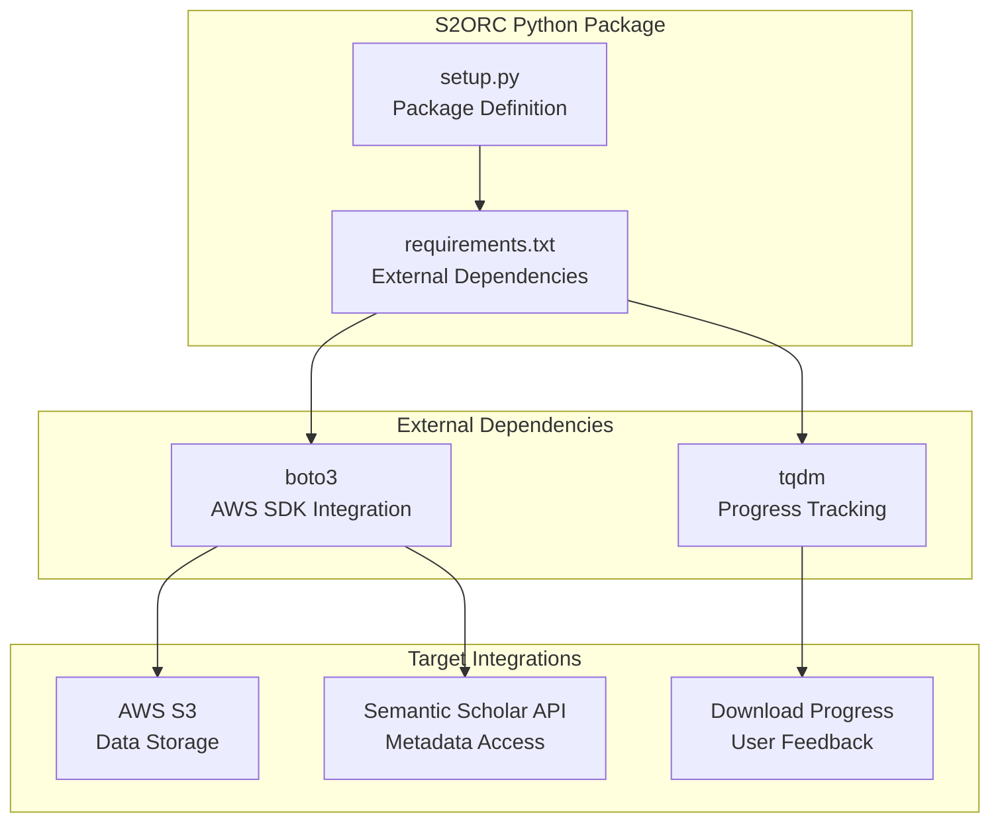

The package configuration in `setup.py` defines a minimal structure with no internal dependencies, indicating that the primary functionality relies on external services rather than local processing code.

**Sources:** [setup.py:1-15](), [requirements.txt:1-2]()

## Development Dependencies

The S2ORC package declares two core external dependencies that enable integration with the Semantic Scholar ecosystem:

| Dependency | Purpose | Integration Point |
|------------|---------|------------------|
| `boto3` | AWS SDK for Python | S3 dataset download, API authentication |
| `tqdm` | Progress bar library | Download progress feedback |

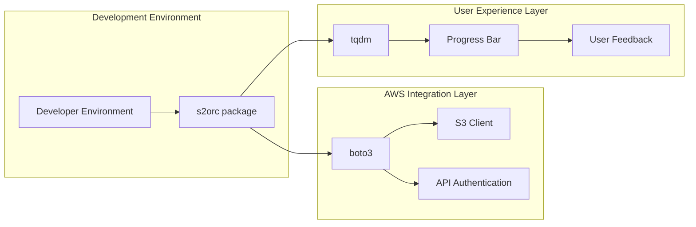

The `boto3` dependency enables direct interaction with AWS services, particularly for downloading dataset shards from S3 storage. The `tqdm` library provides user-friendly progress tracking during potentially long-running download operations.

**Sources:** [requirements.txt:1-2]()

## Integration Patterns

The S2ORC development environment follows specific integration patterns that align with the broader Semantic Scholar infrastructure:

### AWS Service Integration

```mermaid
sequenceDiagram
    participant dev as "Developer Code"
    participant s2orc as "s2orc package"
    participant boto3 as "boto3 client"
    participant s3 as "AWS S3"
    participant api as "Semantic Scholar API"
    
    dev->>+s2orc: "Initialize download"
    s2orc->>+boto3: "Create S3 client"
    boto3-->>-s2orc: "S3 client instance"
    
    s2orc->>+api: "GET /datasets/v1/release/latest"
    api-->>-s2orc: "release_id"
    
    s2orc->>+api: "GET /release/{id}/dataset/s2orc"
    api-->>-s2orc: "List of S3 URLs"
    
    loop "For each shard URL"
        s2orc->>+boto3: "download_file(url)"
        boto3->>+s3: "GET shard.gz"
        s3-->>-boto3: "Compressed data"
        boto3-->>-s2orc: "Local file"
        s2orc->>dev: "Update progress via tqdm"
    end
    
    s2orc-->>-dev: "Download complete"
```

This pattern separates API discovery (getting download URLs) from data transfer (downloading files), enabling efficient bulk data access while maintaining authentication and progress tracking.

**Sources:** [requirements.txt:1-2]()

## Development Workflow

The package setup supports a standard Python development workflow optimized for dataset access applications:

### Package Installation and Setup

The `setup.py` configuration defines a lightweight package structure:

- **Package Name**: `s2orc` [setup.py:5]()
- **Version**: `0.1` (development version) [setup.py:6]()
- **Package Discovery**: Automatic via `setuptools.find_packages()` [setup.py:7]()
- **Dependencies**: Externally managed via requirements.txt [setup.py:8-9]()

### Testing Configuration

```mermaid
graph TD
    subgraph "Development Setup"
        setup["setup.py configuration"]
        tests["tests_require = []"]
        suite["test_suite = 'py.test'"]
    end
    
    subgraph "Testing Framework"
        pytest["py.test runner"]
        testfiles["Test files (if present)"]
    end
    
    subgraph "Package Distribution"
        zipconfig["zip_safe = False"]
        entrypoints["entry_points = ''"]
    end
    
    setup --> tests
    setup --> suite
    setup --> zipconfig
    setup --> entrypoints
    suite --> pytest
    pytest --> testfiles
```

The testing configuration uses `py.test` as the test runner [setup.py:13](), with empty test requirements indicating minimal testing infrastructure. The `zip_safe = False` setting [setup.py:12]() ensures proper package installation in environments where files need to be extracted.

**Sources:** [setup.py:10-14]()

### Development Installation

For development work with S2ORC, the recommended installation pattern follows standard Python package development practices:

1. Clone the repository
2. Install in development mode: `pip install -e .`
3. Install dependencies: `pip install -r requirements.txt`
4. Verify installation by importing the package

The minimal package structure allows developers to focus on data access and processing logic rather than complex internal dependencies.

**Sources:** [setup.py:1-15](), [requirements.txt:1-2]()

---

# Page: Python Package Setup

# Python Package Setup

<details>
<summary>Relevant source files</summary>

The following files were used as context for generating this wiki page:

- [.gitignore](.gitignore)
- [requirements.txt](requirements.txt)
- [setup.py](setup.py)

</details>


This document covers the Python package configuration for the S2ORC project, including package definition, dependencies, installation procedures, and development environment setup. The S2ORC Python package provides essential utilities and dependencies for working with the S2ORC dataset programmatically.

For information about S2ORC data access and download workflows, see [Accessing S2ORC](#2). For details about specific dependencies and their integration roles, see [Dependencies and Tools](#3.2).

## Package Configuration Overview

The S2ORC project is configured as a minimal Python package primarily designed to manage dependencies and provide a foundation for data processing utilities. The package configuration is defined through standard Python packaging files.

### Package Definition

The core package is defined in [setup.py:4-15]() with the following characteristics:

| Property | Value | Purpose |
|----------|-------|---------|
| Package Name | `s2orc` | Identifies the package in Python environments |
| Version | `0.1` | Initial development version |
| Package Discovery | `setuptools.find_packages()` | Automatic package detection |
| Install Requirements | Empty list | Runtime dependencies managed separately |
| Test Suite | `py.test` | Testing framework configuration |
| Zip Safe | `False` | Ensures proper file system access |

```mermaid
graph TD
    subgraph "Package Structure"
        setup_py["setup.py<br/>Package Definition"]
        requirements_txt["requirements.txt<br/>Dependency Specification"]
        gitignore[".gitignore<br/>VCS Configuration"]
    end
    
    subgraph "Package Properties"
        name["name: s2orc"]
        version["version: 0.1"]
        packages["packages: find_packages()"]
        test_suite["test_suite: py.test"]
        zip_safe["zip_safe: False"]
    end
    
    subgraph "Dependencies"
        boto3["boto3<br/>AWS SDK Integration"]
        tqdm["tqdm<br/>Progress Tracking"]
    end
    
    setup_py --> name
    setup_py --> version
    setup_py --> packages
    setup_py --> test_suite
    setup_py --> zip_safe
    
    requirements_txt --> boto3
    requirements_txt --> tqdm
    
    setup_py -.-> requirements_txt
```

**Package Configuration Architecture**

Sources: [setup.py:1-15](), [requirements.txt:1-2]()

### Installation Requirements

The package uses a split approach for dependency management. While [setup.py:8-9]() defines an empty `install_requires` list, actual runtime dependencies are specified in [requirements.txt:1-2]():

- `boto3`: AWS SDK for Python, enabling S3 data access
- `tqdm`: Progress bar library for download tracking

This separation allows for flexible dependency management during development while maintaining clean package distribution.

## Development Environment Setup

The development environment is configured to support Python package development with standard tooling and version control integration.

### Version Control Configuration

The [.gitignore:1-115]() file implements comprehensive exclusion patterns for Python development:

| Category | Examples | Purpose |
|----------|----------|---------|
| IDE Files | `.vscode`, `.idea/` | Editor-specific configurations |
| Python Artifacts | `__pycache__/`, `*.pyc`, `*.egg-info/` | Compiled and generated files |
| Build Outputs | `build/`, `dist/`, `wheels/` | Package distribution artifacts |
| Testing | `.pytest_cache/`, `coverage.xml` | Test execution artifacts |
| Virtual Environments | `.venv`, `env/`, `venv/` | Isolated Python environments |
| Project-Specific | `setup.sh`, `output/*` | Custom build scripts and outputs |

```mermaid
flowchart TD
    subgraph "Development Workflow"
        dev_setup["Developer Setup"]
        venv_create["Virtual Environment<br/>Creation"]
        deps_install["Dependency Installation"]
        test_config["Test Configuration"]
        build_process["Build Process"]
    end
    
    subgraph "File Integration"
        setup_py_flow["setup.py<br/>Package Definition"]
        requirements_flow["requirements.txt<br/>boto3, tqdm"]
        gitignore_flow[".gitignore<br/>VCS Exclusions"]
        pytest_config["py.test<br/>Test Framework"]
    end
    
    subgraph "Artifacts"
        venv_dir["venv/<br/>Virtual Environment"]
        build_dir["build/<br/>Build Artifacts"]
        dist_dir["dist/<br/>Distribution Files"]
        cache_dir["__pycache__/<br/>Compiled Files"]
    end
    
    dev_setup --> venv_create
    venv_create --> venv_dir
    venv_create --> deps_install
    deps_install --> requirements_flow
    requirements_flow --> test_config
    test_config --> pytest_config
    test_config --> build_process
    build_process --> setup_py_flow
    
    gitignore_flow --> venv_dir
    gitignore_flow --> build_dir
    gitignore_flow --> dist_dir
    gitignore_flow --> cache_dir
    
    setup_py_flow -.-> build_dir
    setup_py_flow -.-> dist_dir
```

**Development Environment Workflow**

Sources: [.gitignore:1-115](), [setup.py:13-14]()

### Testing Configuration

The package is configured for testing through [setup.py:13-14]() with `test_suite='py.test'` and an empty `tests_require` list. This configuration integrates with the pytest framework while allowing test dependencies to be managed separately.

The [.gitignore:44-52]() includes comprehensive test artifact exclusion:
- `.pytest_cache/` for pytest execution cache
- `coverage.xml` and `.coverage.*` for coverage reports
- `htmlcov/` for HTML coverage reports
- `.tox/` for multi-environment testing

## Integration with S2ORC Ecosystem

The Python package serves as a foundation for integrating with the broader S2ORC data processing ecosystem, particularly through its dependency management for AWS integration and progress tracking.

```mermaid
sequenceDiagram
    participant Dev as "Developer"
    participant Package as "s2orc Package"
    participant Boto3 as "boto3 SDK"
    participant Tqdm as "tqdm Library"
    participant S3 as "AWS S3"
    
    Dev->>Package: "pip install -e ."
    Package->>Boto3: "Import AWS SDK"
    Package->>Tqdm: "Import Progress Tracking"
    
    Dev->>Package: "Initialize S2ORC Tools"
    Package->>Boto3: "Configure S3 Client"
    Package->>S3: "Authenticate with AWS"
    
    Dev->>Package: "Download S2ORC Data"
    Package->>Tqdm: "Initialize Progress Bar"
    Package->>Boto3: "Request Data Shards"
    Boto3->>S3: "Fetch Shard Files"
    S3-->>Boto3: "Stream Data"
    Boto3-->>Package: "Return Data"
    Package->>Tqdm: "Update Progress"
    Package-->>Dev: "Processed Data"
```

**Package Integration Sequence**

Sources: [requirements.txt:1-2](), [setup.py:4-15]()

The minimal package structure reflects S2ORC's role as primarily a dataset distribution system rather than a complex software library. The package provides essential infrastructure for data access while the main value proposition lies in the dataset content itself, accessed through the Semantic Scholar Public API as documented in [API Authentication and Setup](#2.1) and [Data Download Process](#2.2).

---

# Page: Dependencies and Tools

# Dependencies and Tools

<details>
<summary>Relevant source files</summary>

The following files were used as context for generating this wiki page:

- [README.md](README.md)
- [requirements.txt](requirements.txt)

</details>


This page documents the external dependencies and tools required for S2ORC development and data access. It covers the core Python packages needed for AWS integration, progress tracking, and data retrieval workflows. For information about package installation and setup, see [Python Package Setup](#3.1). For details on the actual download workflow, see [Data Download Process](#2.2).

## Core Dependencies

S2ORC relies on two primary dependencies specified in the package requirements:

| Dependency | Purpose | Usage Context |
|------------|---------|---------------|
| `boto3` | AWS SDK for Python | S3 bucket access and AWS service integration |
| `tqdm` | Progress bar library | Download progress tracking and user feedback |

### AWS Integration with boto3

The `boto3` library serves as the foundation for AWS integration within the S2ORC ecosystem. While not explicitly shown in the download example, `boto3` enables programmatic access to AWS services that host S2ORC data.

```mermaid
graph TD
    subgraph "S2ORC Data Access Architecture"
        User["User Application"]
        API["Semantic Scholar API<br/>api.semanticscholar.org"]
        S3["AWS S3 Storage<br/>ai2-s2ag.s3.amazonaws.com"]
    end
    
    subgraph "Dependencies"
        requests["requests library"]
        wget["wget library"] 
        boto3["boto3 library"]
        tqdm["tqdm library"]
    end
    
    User --> requests
    requests --> API
    API --> S3URLs["S3 Download URLs"]
    S3URLs --> wget
    wget --> S3
    S3 --> LocalFiles["Local .gz Files"]
    
    boto3 -.-> S3
    tqdm --> ProgressBars["Progress Tracking"]
    ProgressBars --> User
    
    style boto3 stroke-dasharray: 5 5
```
**AWS Integration Dependencies**

Sources: [requirements.txt:1](), [README.md:61-88]()

### Progress Tracking with tqdm

The `tqdm` library provides progress visualization for long-running download operations. In the S2ORC download workflow, `tqdm` wraps iterative operations to show real-time progress.

```mermaid
graph LR
    subgraph "Download Progress Flow"
        URLList["response['files']<br/>List of S3 URLs"]
        TQDMWrapper["tqdm(response['files'])"]
        Iterator["URL Iterator"]
        DownloadLoop["wget.download(url)"]
        LocalStorage["Local .gz Files"]
    end
    
    URLList --> TQDMWrapper
    TQDMWrapper --> Iterator
    Iterator --> DownloadLoop
    DownloadLoop --> LocalStorage
    
    TQDMWrapper --> ProgressBar["Console Progress Bar<br/>|████████████████| 100%"]
```
**Progress Tracking Implementation**

Sources: [README.md:66](), [README.md:82](), [requirements.txt:2]()

## Additional Runtime Dependencies

Beyond the core package requirements, the S2ORC download example demonstrates several additional dependencies:

### HTTP and File Operations

| Library | Purpose | Code Usage |
|---------|---------|------------|
| `requests` | HTTP client for API calls | `requests.get()` for API endpoints |
| `wget` | File download utility | `wget.download()` for S3 file retrieval |
| `json` | JSON parsing | API response processing |
| `os` | Operating system interface | Directory creation with `os.makedirs()` |
| `re` | Regular expressions | URL parsing and shard ID extraction |

### API Integration Flow

```mermaid
sequenceDiagram
    participant Script as "Download Script"
    participant API as "requests → S2 API"
    participant Parser as "re + json"
    participant FileSystem as "os + wget"
    participant Progress as "tqdm"
    
    Script->>API: "requests.get(latest_release)"
    API-->>Script: "JSON response"
    Script->>Parser: "Extract RELEASE_ID"
    
    Script->>API: "requests.get(dataset_urls)"
    API-->>Script: "URLs list"
    
    Script->>Progress: "tqdm(response['files'])"
    Progress-->>Script: "Iterator with progress"
    
    loop For each URL
        Script->>Parser: "re.match(url_pattern)"
        Parser-->>Script: "SHARD_ID extracted"
        Script->>FileSystem: "wget.download(url)"
        FileSystem-->>Script: "Local .gz file"
        Progress->>Progress: "Update progress bar"
    end
```
**Dependency Interaction in Download Workflow**

Sources: [README.md:61-66](), [README.md:74-86]()

## Development Environment Dependencies

The S2ORC repository structure indicates additional tooling for development workflows:

### Package Management

The presence of `setup.py` suggests standard Python packaging dependencies, though specific development dependencies are not explicitly documented in the provided files.

```mermaid
graph TB
    subgraph "Development Dependencies"
        setup["setup.py<br/>Package Definition"]
        requirements["requirements.txt<br/>Runtime Dependencies"]
        gitignore[".gitignore<br/>VCS Configuration"]
    end
    
    subgraph "Runtime Environment"
        boto3["boto3<br/>AWS Integration"]
        tqdm["tqdm<br/>Progress Tracking"]
        stdlib["Python Standard Library<br/>json, os, re, requests, wget"]
    end
    
    setup --> requirements
    requirements --> boto3
    requirements --> tqdm
    
    gitignore -.-> DevWorkflow["Development Workflow"]
    setup -.-> DevWorkflow
```
**Development and Runtime Dependency Structure**

Sources: [requirements.txt:1-2](), [README.md:61-66]()

## Dependency Integration Patterns

The S2ORC download implementation demonstrates a layered dependency architecture where each tool serves a specific role in the data access pipeline:

1. **API Layer**: `requests` handles HTTP communication with Semantic Scholar APIs
2. **Data Processing**: `json` and `re` parse responses and extract metadata  
3. **AWS Integration**: `boto3` provides AWS SDK capabilities (future extensibility)
4. **File Operations**: `wget` and `os` manage local file system operations
5. **User Experience**: `tqdm` provides feedback during long-running operations

This architecture separates concerns while maintaining simplicity, allowing developers to integrate S2ORC data access into larger applications with minimal dependency overhead.

Sources: [README.md:55-88](), [requirements.txt:1-2]()

---

# Page: Historical Evolution

# Historical Evolution

<details>
<summary>Relevant source files</summary>

The following files were used as context for generating this wiki page:

- [README.md](README.md)

</details>


This document traces the development of S2ORC from its inception as a research project in 2019 to its current status as a production dataset offering within the Semantic Scholar ecosystem. It covers major releases, architectural changes, schema evolution, and the transition from academic research to production infrastructure.

For information about the current system architecture and API access patterns, see [System Architecture](#1.1) and [Accessing S2ORC](#2). For details about the data schema that evolved through these releases, see [Data Schema and Format](#1.2).

## Research Project Origins (2019-2020)

S2ORC began as an academic research initiative led by Kyle Lo and Lucy Lu Wang at the Allen Institute for AI. The project aimed to create a comprehensive corpus for NLP and text mining research over scientific papers, addressing the need for large-scale full-text scientific document processing.

### Initial Release: September 28, 2019

The first public release established S2ORC as a significant research dataset with the following characteristics:

- **Scale**: 81M+ paper nodes with 73M+ gold abstracts and 8M+ full text papers
- **Purpose**: General-purpose corpus for NLP and text mining research
- **License**: Non-commercial research license
- **Distribution**: Standalone research project with manual release management

However, this initial version contained several implementation issues that would drive future architectural changes.

```mermaid
timeline
    title "Research Phase Development"
    
    section "2019 Initial Development"
    2019-09-28 : "First Public Release"
               : "81M papers, 8M full text"
               : "Non-commercial license"
               : "Manual distribution"
               : "Research project status"
    
    section "2020 Academic Recognition"  
    2020-04-07 : "ACL 2020 Acceptance"
               : "Project renamed to S2ORC"
               : "Academic validation"
               : "Updated citation format"
```

**Sources**: [README.md:49-53]()

### Major Schema Redesign: July 5, 2020

The second major release represented a fundamental architectural evolution, addressing the limitations discovered in the initial version:

#### Scale Expansion
- Paper count increased from 81M to 136M papers
- Full text coverage expanded from 8M to 12M papers
- More lenient filtering policies for papers with limited text content

#### Schema Separation Innovation
The most significant change was the separation of paper metadata from parsed content, enabling more flexible and efficient data management:

```mermaid
graph TB
    subgraph "Pre-2020 Schema"
        OldFormat["Combined JSON Structure"]
        OldFormat --> OldMeta["Metadata + Content Mixed"]
        OldFormat --> OldUpdate["Full Rebuild Required"]
    end
    
    subgraph "Post-2020 Schema"
        NewFormat["Separated Schema Design"]
        NewFormat --> MetaStore["Paper Metadata Store<br/>(title, authors, year, venue)"]
        NewFormat --> ContentStore["Full-Text Content Store<br/>(abstract, body_text, citations)"]
        MetaStore -.->|"paper_id link"| ContentStore
        NewFormat --> IncrementalUpdates["Incremental Release Support"]
    end
    
    OldFormat ==> NewFormat
    
    style NewFormat fill:#f9f,stroke:#333,stroke-width:2px
    style IncrementalUpdates fill:#9f9,stroke:#333,stroke-width:2px
```

**Sources**: [README.md:30-37]()

#### Critical Bug Fixes
- **Missing section names**: Resolved structural parsing issues
- **Citation link resolution**: Fixed inline citation mentions that failed to resolve to bibliographies  
- **Metadata field consistency**: Standardized typing across metadata fields
- **LaTeX parse omission**: Strategic removal to enable incremental releases

This release established the architectural foundation that would support the eventual transition to production infrastructure.

**Sources**: [README.md:30-37]()

## Production Transition Phase (2021-2023)

### Tool Release: February 1, 2021

The release of the `s2orc-doc2json` parsing tool marked the beginning of S2ORC's evolution toward a more comprehensive ecosystem:

```mermaid
graph LR
    subgraph "Tool Ecosystem"
        DocTool["s2orc-doc2json<br/>PDF/LaTeX Parser"]
        PDFInput["PDF Documents"] --> DocTool
        LaTeXInput["LaTeX Documents"] --> DocTool
        DocTool --> JSONOutput["Structured JSON Output"]
    end
    
    subgraph "Community Impact"
        JSONOutput --> CommunityAdoption["Community Adoption"]
        CommunityAdoption --> ExternalProjects["External Research Projects"]
    end
    
    style DocTool fill:#f9f,stroke:#333,stroke-width:2px
```

This tool release demonstrated the project's commitment to supporting the broader research community with reusable infrastructure components.

**Sources**: [README.md:25-27]()

### Production Integration: January 2023

The most significant transformation occurred when S2ORC transitioned from a research project to a core production offering within the Semantic Scholar infrastructure:

#### Ownership Transfer
- **Original Team**: Kyle Lo and Lucy Lu Wang (research project)
- **New Ownership**: Semantic Scholar API product team
- **Maintenance Model**: Professional product management and continuous support

#### Infrastructure Modernization
The transition brought enterprise-grade infrastructure capabilities:

```mermaid
graph TB
    subgraph "Research Infrastructure (Pre-2023)"
        ManualReleases["Manual Release Process"]
        StaticDataset["Static Dataset Snapshots"]  
        ResearchSupport["Research Team Support"]
        NonCommercial["Non-commercial License"]
    end
    
    subgraph "Production Infrastructure (2023+)"
        ContinuousPipeline["Continuous Rebuilding Pipeline"]
        LiveDataset["Live Dataset Updates"]
        ProductSupport["Professional API Support"] 
        CommercialLicense["ODC-By 1.0 License"]
        APIIntegration["Semantic Scholar API Integration"]
    end
    
    subgraph "Technical Implementation"
        APIEndpoints["API Endpoints<br/>datasets/v1/release/latest<br/>datasets/v1/release/{id}/dataset/s2orc"]
        S3Distribution["AWS S3 Bulk Distribution"]
        AuthHeaders["x-api-key Authentication"]
    end
    
    ManualReleases ==> ContinuousPipeline
    StaticDataset ==> LiveDataset  
    ResearchSupport ==> ProductSupport
    NonCommercial ==> CommercialLicense
    
    ContinuousPipeline --> APIIntegration
    LiveDataset --> APIIntegration
    APIIntegration --> APIEndpoints
    APIEndpoints --> S3Distribution
    S3Distribution --> AuthHeaders
    
    style ContinuousPipeline fill:#9f9,stroke:#333,stroke-width:2px
    style APIIntegration fill:#9f9,stroke:#333,stroke-width:2px
```

**Sources**: [README.md:19-24](), [README.md:121-127]()

## Architectural Evolution Timeline

The following timeline captures the major architectural decisions and their implementation across S2ORC's development:

```mermaid
timeline
    title "S2ORC Architectural Evolution"
    
    section "Research Phase"
    2019-09-28 : "Monolithic Architecture"
               : "Combined metadata/content"
               : "Manual distribution"
               : "Research-grade infrastructure"
    
    2020-07-05 : "Schema Separation"
               : "Metadata/content decoupling"  
               : "Incremental update support"
               : "Bug fix implementation"
    
    section "Tooling Phase"
    2021-02-01 : "Ecosystem Expansion"
               : "s2orc-doc2json release"
               : "Community tool support"
               : "Parsing standardization"
    
    section "Production Phase"
    2023-01    : "API Integration"
               : "Continuous rebuilding"
               : "Professional maintenance"
               : "Enterprise distribution"
               
    2023-02    : "Legacy Deprecation"
               : "Old version sunset"
               : "Migration support"
               : "Documentation updates"
```

**Sources**: [README.md:17-53]()

## License and Governance Evolution

S2ORC's licensing model evolved significantly during its transition to production:

| Phase | License | Usage Rights | Distribution Model |
|-------|---------|-------------|-------------------|
| **Research (2019-2020)** | Non-commercial | Academic research only | Direct download |
| **Production (2023+)** | ODC-By 1.0 | Commercial permitted with attribution | API-mediated access |

### Implementation Details

The current licensing system is enforced through the API authentication mechanism:

```mermaid
sequenceDiagram
    participant User as "Dataset User" 
    participant Portal as "S2 API Portal"
    participant API as "datasets/v1 API"
    participant Legal as "ODC-By 1.0 Terms"
    
    User->>Portal: "Request API access"
    Portal->>Legal: "Present license terms"
    Legal-->>User: "Agreement required"
    User->>Portal: "Accept terms"
    Portal-->>User: "API key provision"
    
    User->>+API: "GET /release/latest<br/>Header: x-api-key"
    API-->>-User: "Dataset access granted"
    
    Note over User,Legal: "Usage tracking and compliance<br/>through API authentication"
```

**Sources**: [README.md:12](), [README.md:129-131]()

## Current State and Future Direction

### Legacy Version Management

As of February 2023, S2ORC implemented a clear deprecation strategy for older versions:

- **2019-09-28 Release**: No longer supported due to structural bugs
- **2020-07-05 Release**: Deprecated in favor of API access
- **Current Recommendation**: Exclusive use of Semantic Scholar Public API access

The legacy support model maintains minimal assistance through direct researcher contact for users with specific requirements.

### Continuous Integration Model

The production system implements several key improvements over the research model:

```mermaid
graph TB
    subgraph "Data Pipeline"
        SourcePapers["New Papers<br/>(Continuous Ingestion)"]
        ProcessingPipeline["S2 Processing Pipeline"]  
        QualityControl["Quality Assurance"]
        ReleaseManager["Release Management"]
    end
    
    subgraph "Distribution Layer"
        APIGateway["Semantic Scholar API Gateway"]
        S3Shards["AWS S3 Shard Storage<br/>ai2-s2ag.s3.amazonaws.com"]
        DownloadEndpoint["Download URL Generation"]
    end
    
    subgraph "User Access"
        BulkDownload["Bulk Dataset Download<br/>wget shard files"]
        LocalProcessing["Local Data Processing<br/>tqdm progress tracking"]
    end
    
    SourcePapers --> ProcessingPipeline
    ProcessingPipeline --> QualityControl
    QualityControl --> ReleaseManager
    ReleaseManager --> APIGateway
    APIGateway --> S3Shards
    S3Shards --> DownloadEndpoint
    DownloadEndpoint --> BulkDownload
    BulkDownload --> LocalProcessing
    
    style ProcessingPipeline fill:#9f9,stroke:#333,stroke-width:2px
    style APIGateway fill:#9f9,stroke:#333,stroke-width:2px
```

**Sources**: [README.md:55-89]()

### Technical Implementation Status

The current codebase reflects this evolutionary history through its structure:

- **Repository Focus**: Primarily documentation and distribution guidance rather than core processing code
- **Dependency Management**: Minimal dependencies (`boto3`, `tqdm`) focused on AWS integration and user experience
- **Code Distribution**: Actual processing logic migrated to Semantic Scholar production infrastructure

The transformation from research project to production system demonstrates a successful model for scaling academic research infrastructure to serve the broader scientific community.

**Sources**: [README.md:1-153]()

---

# Page: Support and Resources

# Support and Resources

<details>
<summary>Relevant source files</summary>

The following files were used as context for generating this wiki page:

- [README.md](README.md)
- [assets/logo.svg](assets/logo.svg)

</details>


This document provides comprehensive support information, contact channels, community resources, and branding materials for S2ORC users. It covers issue reporting procedures, direct contact methods, licensing requirements, citation guidelines, and available documentation resources.

For technical implementation details, see [Development and Integration](#3). For data access procedures, see [Accessing S2ORC](#2).

## Contact and Support Channels

### Direct Contact Information

The S2ORC team maintains active communication channels for user support and feedback:

| Contact Method | Details | Purpose |
|---|---|---|
| **Primary Email** | Include `{kylel, lucyw, rodneyk}` on all correspondence | General support, dataset questions, technical issues |
| **Twitter** | [@kylelostat](https://twitter.com/kylelostat), [@lucyluwang](https://twitter.com/lucyluwang) | Project updates, community engagement |
| **Feedback** | Email or GitHub Issue | Dataset usage feedback, improvement suggestions |

The team actively responds to inquiries about dataset usage, technical implementation, and research applications. Users are encouraged to reach out regardless of experience level, as the team has assisted many researchers in getting started with the dataset.

**Support Workflow**

```mermaid
flowchart TD
    User["User with Question/Issue"] --> Decision{"Issue Type?"}
    
    Decision -->|"Bug/Feature Request"| GitHub["github.com/allenai/s2-folks"]
    Decision -->|"General Support"| Email["Email: kylel, lucyw, rodneyk"]
    Decision -->|"API Issues"| API["api.semanticscholar.org/api-docs"]
    
    GitHub --> Search["Search existing issues"]
    Search --> Exists{"Issue exists?"}
    Exists -->|"Yes"| Comment["Add comment to existing issue"]
    Exists -->|"No"| New["Create new issue"]
    
    Email --> Response["Direct team response"]
    API --> Docs["API documentation review"]
    
    Comment --> Resolution["Issue resolution"]
    New --> Resolution
    Response --> Resolution
    Docs --> Contact["Contact API team if needed"]
    Contact --> Resolution
```

Sources: [README.md:93-106]()

### GitHub Issue Management

The project uses a centralized issue tracking system through the `s2-folks` repository:

**Issue Reporting Process**

```mermaid
sequenceDiagram
    participant User as "S2ORC User"
    participant Search as "GitHub Search"
    participant Issues as "s2-folks/issues"
    participant Team as "S2 API Team"
    
    User->>Search: "Search existing issues"
    Search-->>User: "Issue results"
    
    alt Issue exists
        User->>Issues: "Comment on existing issue"
        Issues-->>Team: "Notification of activity"
    else New issue needed
        User->>Issues: "Create new issue"
        Note over User,Issues: "Include: bug report, feature request, or question"
        Issues-->>Team: "New issue notification"
    end
    
    Team->>Issues: "Triage and respond"
    Issues-->>User: "Resolution or follow-up"
```

**Repository Structure for Issues**
- **Base Repository**: `github.com/allenai/s2-folks`
- **Issue Categories**: Bug reports, feature requests, general questions
- **Search Required**: Users must search existing issues before creating new ones
- **Maintenance**: Issues are managed by the S2 API product team

Sources: [README.md:90-91](), [README.md:103-106]()

## Community Resources and Documentation

### API Documentation and Resources

The S2ORC ecosystem provides comprehensive documentation through multiple channels:

| Resource Type | Location | Content |
|---|---|---|
| **Primary Documentation** | `api.semanticscholar.org/api-docs/datasets` | Complete API documentation |
| **Download Instructions** | `README.md` section | Step-by-step access guide |
| **Schema Examples** | `data/` directory | JSON format samples |
| **Package Setup** | `setup.py`, `requirements.txt` | Python integration |

**Documentation Access Pattern**

```mermaid
graph LR
    User["Research User"] --> Entry["README.md"]
    Entry --> API["api.semanticscholar.org"]
    Entry --> Examples["data/ samples"]
    Entry --> Package["setup.py"]
    
    API --> Auth["API key request"]
    API --> Endpoints["Dataset endpoints"]
    Examples --> Schema["JSON schema understanding"]
    Package --> Dependencies["boto3, tqdm, requests"]
    
    Auth --> Download["Dataset download"]
    Endpoints --> Download
    Schema --> Processing["Local data processing"]
    Dependencies --> Processing
```

Sources: [README.md:55-91]()

### Research Paper and Citation

The project maintains academic resources for proper attribution and understanding:

**Academic Citation Requirements**
```bibtex
@inproceedings{lo-wang-2020-s2orc,
    title = "{S}2{ORC}: The Semantic Scholar Open Research Corpus",
    author = "Lo, Kyle  and Wang, Lucy Lu  and Neumann, Mark  and Kinney, Rodney  and Weld, Daniel",
    booktitle = "Proceedings of the 58th Annual Meeting of the Association for Computational Linguistics",
    month = jul,
    year = "2020",
    address = "Online",
    publisher = "Association for Computational Linguistics",
    url = "https://www.aclweb.org/anthology/2020.acl-main.447",
    doi = "10.18653/v1/2020.acl-main.447",
    pages = "4969--4983"
}
```

**Additional Resources**
- **ACL 2020 Paper**: Primary research publication describing S2ORC methodology
- **12-minute ACL Talk**: Video presentation available on SlidesLive
- **ArXiv Preprint**: Early version with historical context

Sources: [README.md:13](), [README.md:137-152]()

## Branding and Visual Assets

### Official Logo and Branding

The S2ORC project provides official branding materials for use in presentations, papers, and applications:

**Logo Specifications**

```mermaid
graph TD
    Logo["assets/logo.svg"] --> Format["SVG Vector Format"]
    Logo --> Usage["README display"]
    Logo --> Colors["Color Palette"]
    
    Format --> Scalable["Infinite scalability"]
    Format --> Web["Web-ready format"]
    
    Colors --> Yellow["#F4D35E (primary accent)"]
    Colors --> Blue1["#5492EF (secondary)"]
    Colors --> Blue2["#1857B6 (tertiary)"]
    Colors --> DarkBlue["#0F3875 (deep accent)"]
    
    Usage --> Center["Center-aligned display"]
    Usage --> Width["20% width recommendation"]
```

**File Specifications**
- **File Path**: [assets/logo.svg:1-23]()
- **Format**: SVG (Scalable Vector Graphics)
- **Dimensions**: 60x60 viewBox
- **Generator**: Adobe Illustrator 26.0.2
- **Elements**: Multi-path design with gradient color scheme

**Usage Guidelines**
- The logo represents the "stork" pronunciation of S2ORC
- Recommended display width: 20% of container
- Center alignment for formal presentations
- SVG format ensures quality at all scales

Sources: [README.md:1-3](), [assets/logo.svg:1-23]()

## License and Legal Requirements

### ODC-By 1.0 License Compliance

S2ORC is released under the Open Data Commons Attribution License v1.0, which requires specific compliance measures:

**License Requirements**

```mermaid
flowchart TD
    Usage["S2ORC Usage"] --> License["ODC-By 1.0"]
    License --> Requirements["Attribution Requirements"]
    License --> Permissions["Usage Permissions"]
    License --> Verification["User Verification"]
    
    Requirements --> Citation["Include S2ORC citation"]
    Requirements --> Notice["License notice in materials"]
    Requirements --> Source["Acknowledge data source"]
    
    Permissions --> Research["Research use allowed"]
    Permissions --> Commercial["Commercial use allowed"]
    Permissions --> Modification["Data modification allowed"]
    Permissions --> Distribution["Redistribution allowed"]
    
    Verification --> Review["Review intended usage"]
    Verification --> Compliance["Ensure compliance"]
    Verification --> Legal["Seek legal advice if uncertain"]
```

**Key Compliance Points**
- **Attribution Required**: Users must cite the S2ORC paper and acknowledge the dataset
- **License Notice**: Include ODC-By 1.0 license notice in derivative works
- **Commercial Use**: Permitted under the license terms
- **User Responsibility**: Users must verify their specific use case compliance

**License Evolution**
- **Original License**: Non-commercial research license
- **Current License**: ODC-By 1.0 (more permissive)
- **Transition Date**: January 2023 with API integration
- **Verification**: Users should double-check compliance for their specific use cases

Sources: [README.md:12](), [README.md:126-127](), [README.md:129-131]()

## Version Support and Migration

### Historical Version Support

The S2ORC project has evolved through multiple versions with different support levels:

| Version | Status | Support Level | Access Method |
|---|---|---|---|
| **Current (API)** | Active | Full support | Semantic Scholar Public API |
| **2020-07-05** | Deprecated | Limited assistance | Contact original authors |
| **2019-09-28** | Deprecated | Limited assistance | Contact original authors |

**Migration Recommendations**

```mermaid
graph TD
    OldUser["User with Legacy S2ORC"] --> Check["Check current version"]
    Check --> Migration["Migration needed?"]
    
    Migration -->|"Yes"| API["Migrate to S2 API access"]
    Migration -->|"No"| Current["Continue with current version"]
    
    API --> Key["Obtain API key"]
    Key --> Download["Download latest release"]
    Download --> Schema["Update to new schema"]
    
    Migration -->|"Need old version"| Contact["Contact Kyle and Lucy"]
    Contact --> Limited["Limited assistance available"]
    
    Current --> Monitor["Monitor for updates"]
    Schema --> Complete["Migration complete"]
```

**Support Transition**
- **Maintenance Team**: S2 API product team (current), original researchers (legacy)
- **Implementation**: Current version is a reimplementation with potential differences
- **Recommendation**: All users should migrate to the API-based access method
- **Legacy Support**: Available on a limited basis through direct contact

Sources: [README.md:19-23](), [README.md:38](), [README.md:46](), [README.md:119-127]()