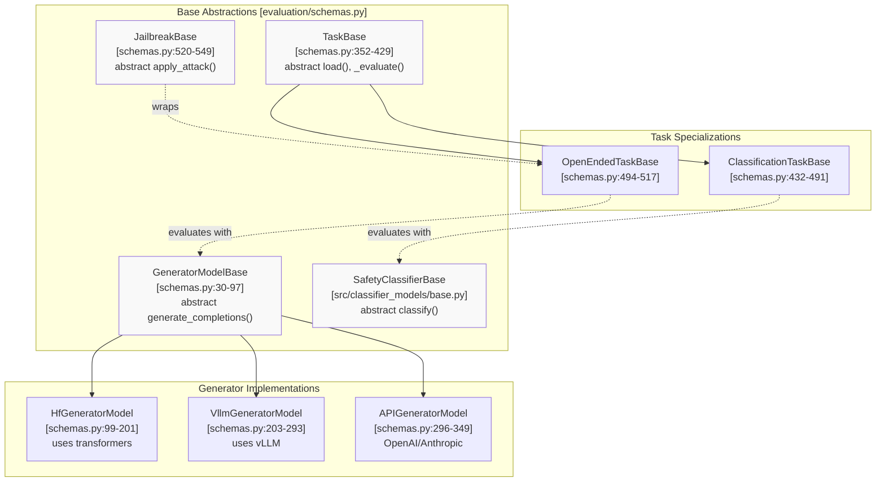
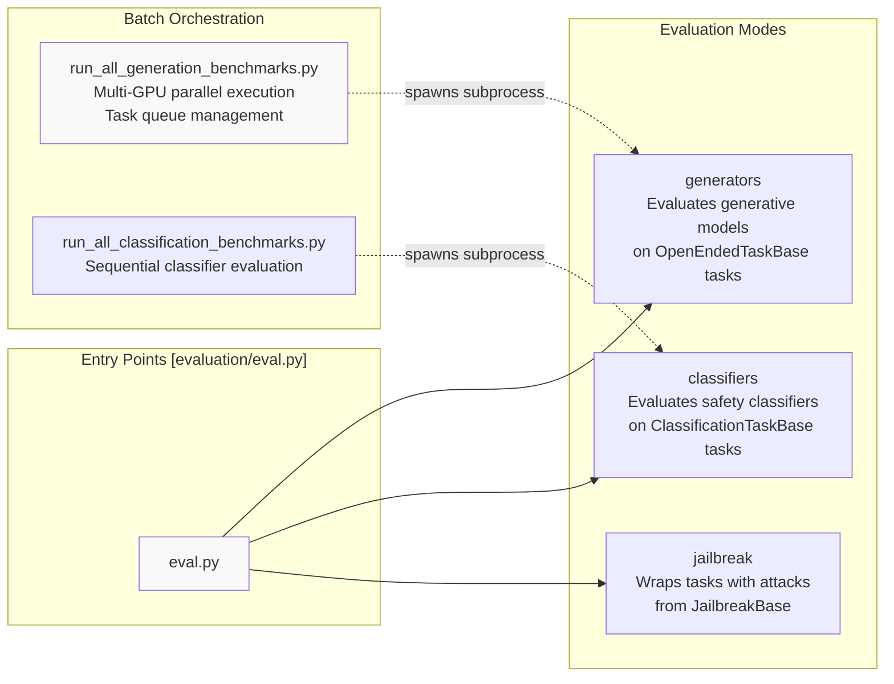
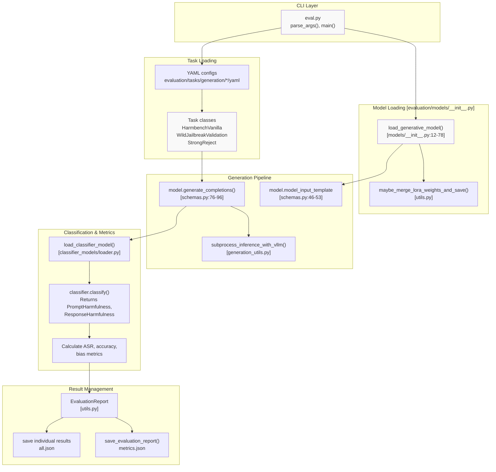
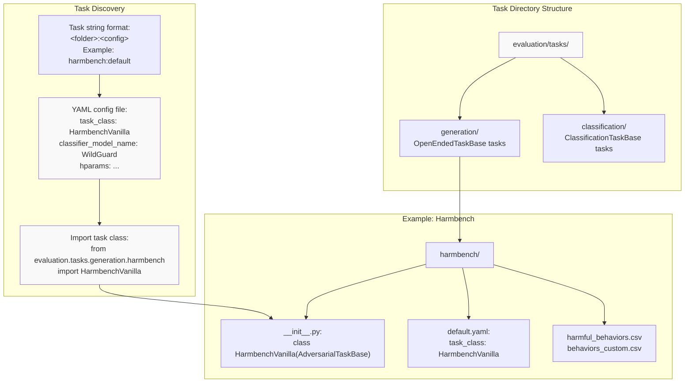
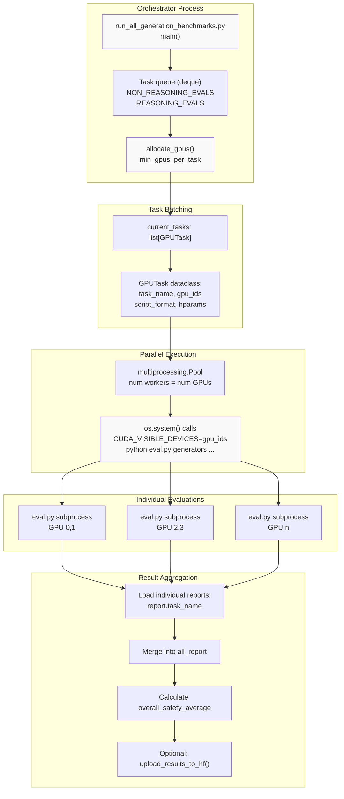
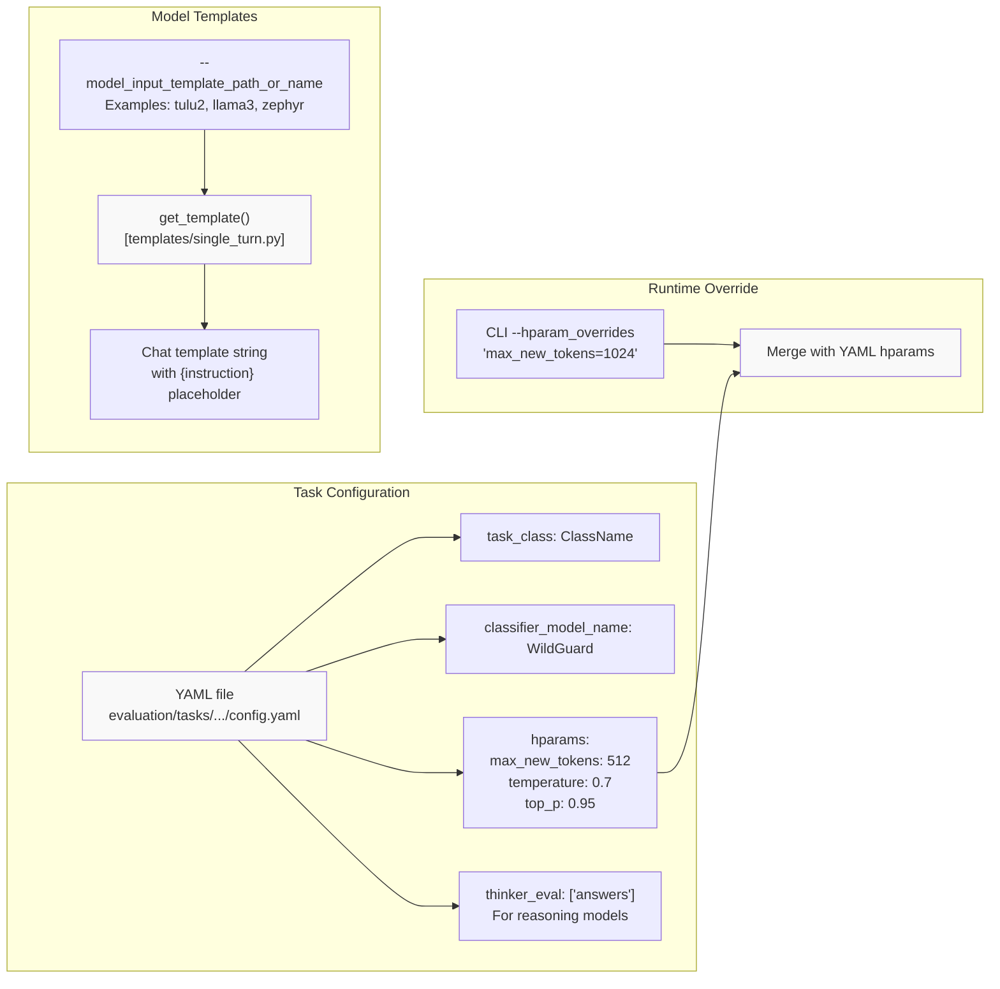

<!-- source: DeepWiki mcp.deepwiki.com · repo allenai/safety-eval · page 1 Overview · fetched 2026-10-26 -->

# Overview

<details>
<summary>Relevant source files</summary>

The following files were used as context for generating this wiki page:

- [README.md](README.md)
- [evaluation/models/__init__.py](evaluation/models/__init__.py)
- [evaluation/schemas.py](evaluation/schemas.py)
- [evaluation/tasks/generation/codex_eval/__init__.py](evaluation/tasks/generation/codex_eval/__init__.py)
- [evaluation/tasks/generation/do_anything_now/__init__.py](evaluation/tasks/generation/do_anything_now/__init__.py)
- [evaluation/tasks/generation/trustllm_jailbreaktrigger/__init__.py](evaluation/tasks/generation/trustllm_jailbreaktrigger/__init__.py)
- [evaluation/tasks/generation/trustllm_jailbreaktrigger/gpt4.yaml](evaluation/tasks/generation/trustllm_jailbreaktrigger/gpt4.yaml)
- [evaluation/tasks/generation/wildjailbreak/__init__.py](evaluation/tasks/generation/wildjailbreak/__init__.py)
- [evaluation/tasks/generation/xstest/exaggerated_safety.json](evaluation/tasks/generation/xstest/exaggerated_safety.json)

</details>


## Purpose and Scope

This document provides an introduction to the AI2 Safety Evaluation Framework, a comprehensive system for evaluating the safety and capabilities of generative language models and safety classifiers. This overview covers the framework's architecture, core abstractions, evaluation modes, and how different components interact.

For detailed information about specific subsystems, see:
- Installation and basic usage: [Getting Started](#2)
- Detailed architectural patterns: [Architecture](#3)
- Individual evaluation tasks: [Evaluation Tasks](#4)
- Model implementations: [Models](#5)
- Practical execution guides: [Running Evaluations](#7)

**Sources:** [README.md:1-28]()

## Framework Purpose

The AI2 Safety Evaluation Framework enables systematic evaluation of language models across three primary dimensions:

1. **Generative Model Safety**: Testing how well language models resist harmful requests, jailbreak attacks, and adversarial inputs across 14+ benchmarks (WildJailbreak, Harmbench, XSTest, ToxiGen, etc.)
2. **Safety Classifier Performance**: Evaluating safety moderation tools for detecting prompt harmfulness, response harmfulness, and response refusals across 10+ benchmarks
3. **General Capabilities**: Monitoring model performance on reasoning, coding, and knowledge tasks (MT-Bench, AlpacaEval, GSM8K, BBH, MMLU, CodexEval)

The framework is designed to be extensible, allowing easy addition of new benchmarks, models, and evaluation methodologies. It supports multiple inference backends (HuggingFace Transformers, vLLM, API-based models) and includes sophisticated GPU orchestration for parallel multi-benchmark evaluation.

**Sources:** [README.md:23-27](), [README.md:38-89]()

## Core Architectural Abstractions

The framework is built around four primary abstract base classes that define its evaluation architecture:



**Key Abstractions:**

| Abstraction | Purpose | Key Methods | Location |
|------------|---------|-------------|----------|
| `GeneratorModelBase` | Abstract interface for text generation models | `generate_completions()`, `load_model()` | [evaluation/schemas.py:30-97]() |
| `TaskBase` | Abstract evaluation task defining data loading and evaluation logic | `load()`, `_evaluate()`, `required_input_fields()` | [evaluation/schemas.py:352-429]() |
| `OpenEndedTaskBase` | Specialization for generation tasks | `validate_if_model_is_compatible()` | [evaluation/schemas.py:494-517]() |
| `ClassificationTaskBase` | Specialization for classifier evaluation | `required_output_fields()`, `label_field` | [evaluation/schemas.py:432-491]() |
| `JailbreakBase` | Wrapper for adversarial attacks on tasks | `apply_attack()` | [evaluation/schemas.py:520-549]() |

The abstractions enforce consistent interfaces while allowing polymorphic behavior. For example, `GeneratorModelBase.generate_completions()` [schemas.py:76-96]() accepts standardized inputs and hyperparameters regardless of whether the underlying implementation uses HuggingFace, vLLM, or an API.

**Sources:** [evaluation/schemas.py:30-549]()

## Evaluation Modes

The framework provides three primary evaluation entry points, each supporting different evaluation scenarios:



**Mode Details:**

1. **generators mode**: Evaluates generative language models on safety and capability benchmarks. Loads tasks via `evaluation/tasks/generation/` directory, where each subdirectory represents a benchmark (e.g., `harmbench/`, `wildguardtest/`, `xstest/`). Tasks extend `OpenEndedTaskBase` and use a classifier (default: WildGuard) to judge safety.

2. **classifiers mode**: Evaluates safety classifiers on their ability to detect harmful prompts, harmful responses, or refusals. Tasks extend `ClassificationTaskBase` and compare classifier predictions against ground truth labels.

3. **jailbreak mode**: Wraps generation tasks with adversarial attacks (PAIR, WildJailbreak, etc.) by applying `JailbreakBase` wrappers. Evaluates attack success rate (ASR) by measuring whether the attacked prompts elicit harmful responses.

**Sources:** [README.md:91-134](), [README.md:160-183]()

## System Architecture: Code-Level View

The following diagram shows how code entities interact during a typical evaluation workflow:



**Key Code Paths:**

1. **Model Loading**: `load_generative_model()` [models/__init__.py:12-78]() determines model type based on `model_name_or_path` format. Local paths or HuggingFace identifiers load `HfGeneratorModel` [schemas.py:99-201]() or `VllmGeneratorModel` [schemas.py:203-293](). API models (format `provider:identifier`) load `APIGeneratorModel` [schemas.py:296-349]().

2. **Template Application**: Each model loads a chat template via `get_template()` [schemas.py:50-53]() that formats task inputs. Templates contain placeholders like `{instruction}` that match `TaskBase.required_input_fields()` [schemas.py:376-383]().

3. **Generation**: `generate_completions()` accepts hyperparameters (`max_new_tokens`, `temperature`, `top_p`) and returns completions. vLLM models use subprocess isolation via `subprocess_inference_with_vllm()` [schemas.py:237-250]().

4. **Safety Classification**: After generation, `load_classifier_model()` instantiates a safety classifier that classifies each prompt/response pair. Results include `PromptHarmfulness` and `ResponseHarmfulness` enums [classifier_models/base.py]().

5. **Metrics & Reports**: Task-specific metrics are calculated and stored in `EvaluationReport` objects [utils.py](), which are serialized to `metrics.json` and `all.json`.

**Sources:** [evaluation/models/__init__.py:12-78](), [evaluation/schemas.py:30-350](), [evaluation/utils.py]()

## Task Hierarchy and Discovery

Tasks are organized by evaluation mode and discovered via filesystem convention:



**Task String Format**: Tasks are specified as `<folder>:<config>`, where:
- `<folder>` is a subdirectory under `evaluation/tasks/generation/` or `evaluation/tasks/classification/`
- `<config>` is a YAML filename (without `.yaml` extension) in that directory

For example, `wildguardtest:default` loads `evaluation/tasks/generation/wildguardtest/default.yaml`, which specifies:
```yaml
task_class: WildguardTest
classifier_model_name: WildGuard
hparams:
  max_new_tokens: 512
  temperature: 0.7
  top_p: 0.95
```

The `task_class` is dynamically imported from the task's `__init__.py`, instantiated, and evaluated with the specified hyperparameters.

**Sources:** [README.md:94-95](), [README.md:163-164](), [evaluation/tasks/generation/trustllm_jailbreaktrigger/gpt4.yaml:1-6]()

## Data Flow Through Evaluation Pipeline

The following diagram shows how data transforms through a complete evaluation:

```mermaid
graph LR
    subgraph "Input Data"
        raw_data["Raw task data<br/>.jsonl, .csv, HF datasets"]
        task_load["task.load()<br/>[schemas.py:386-393]<br/>Returns list[dict]"]
    end
    
    subgraph "Data Processing"
        put_id["task.put_id_on_data()<br/>[schemas.py:361-373]<br/>Adds id field"]
        sample_filter["Sampling & filtering<br/>MATCHES lists<br/>sample parameter"]
        format_input["Format with template<br/>model_input_template.format(**d)<br/>[schemas.py:118]"]
    end
    
    subgraph "Generation"
        gen_call["generate_completions()<br/>max_new_tokens, temperature, top_p"]
        outputs["List of completion strings"]
    end
    
    subgraph "Post-Processing"
        extract["Answer extraction<br/>extract_mc_answer()<br/>extract_think_answer()"]
        remove_rep["remove_repetitive()<br/>Truncation handling"]
    end
    
    subgraph "Evaluation"
        cls_input["Prepare classifier inputs:<br/>{prompt, response}"]
        cls_call["classifier.classify()"]
        cls_output["ClassifierOutput:<br/>prompt_harmfulness,<br/>response_harmfulness,<br/>response_refusal"]
    end
    
    subgraph "Metrics"
        calc_asr["Calculate ASR:<br/>(harmful responses / total)"]
        calc_accuracy["Calculate accuracy:<br/>correct predictions"]
        per_category["Per-category metrics"]
    end
    
    subgraph "Output"
        individual_results["individual_results list:<br/>[{id, prompt, response, ...}]"]
        metrics_report["metrics dict:<br/>{asr, accuracy, ...}"]
        save_json["Save to JSON files"]
    end
    
    raw_data --> task_load
    task_load --> put_id
    put_id --> sample_filter
    sample_filter --> format_input
    
    format_input --> gen_call
    gen_call --> outputs
    
    outputs --> extract
    outputs --> remove_rep
    
    extract --> cls_input
    remove_rep --> cls_input
    cls_input --> cls_call
    cls_call --> cls_output
    
    cls_output --> calc_asr
    cls_output --> calc_accuracy
    cls_output --> per_category
    
    calc_asr --> metrics_report
    calc_accuracy --> metrics_report
    per_category --> metrics_report
    
    outputs --> individual_results
    cls_output --> individual_results
    
    individual_results --> save_json
    metrics_report --> save_json

    style task_load fill:#f9f9f9
    style gen_call fill:#f9f9f9
    style cls_call fill:#f9f9f9
    style metrics_report fill:#f9f9f9
```



**Pipeline Stages:**

1. **Data Loading**: Each task's `load()` method [schemas.py:386-393]() reads data from files in the task directory. For example, `WildJailbreakValidation.load()` [evaluation/tasks/generation/wildjailbreak/__init__.py:8-16]() loads `harmful.jsonl` using `load_standard_data()`.

2. **ID Assignment**: `put_id_on_data()` [schemas.py:361-373]() adds unique IDs in format `{ClassName}/{index}` to each example.

3. **Input Formatting**: The model's chat template is applied via `model_input_template.format(**d)` [schemas.py:118](), where `d` is a data dictionary containing fields like `instruction`.

4. **Generation**: Batched generation occurs through backend-specific implementations, producing completion strings.

5. **Classification**: Completions are paired with prompts and classified by a safety classifier. The classifier returns structured outputs with enums for harmfulness and refusal.

6. **Metrics Calculation**: Task-specific metrics are computed. For adversarial tasks, Attack Success Rate (ASR) measures the proportion of harmful responses. For capability tasks, accuracy or pass@k metrics are calculated.

7. **Result Serialization**: Both individual predictions and aggregate metrics are saved to JSON files.

**Sources:** [evaluation/schemas.py:352-429](), [evaluation/tasks/generation/wildjailbreak/__init__.py:1-31](), [evaluation/tasks/generation/codex_eval/__init__.py:70-115]()

## Multi-GPU Orchestration Architecture

For comprehensive evaluations across many benchmarks, the framework provides parallel execution with automatic GPU allocation:



**Orchestration Details:**

The `run_all_generation_benchmarks.py` script manages parallel evaluation via:

1. **Task Queue**: Tasks are organized into predefined lists like `NON_REASONING_EVALS` (WildGuardTest, Harmbench, etc.) or `REASONING_EVALS` (BBH, GSM8K variants for reasoning models).

2. **GPU Allocation**: The `allocate_gpus()` function assigns GPU IDs to tasks based on `min_gpus_per_task` parameter. Tasks can request specific GPU counts.

3. **Subprocess Execution**: Each task runs in isolation via `os.system()` with `CUDA_VISIBLE_DEVICES` set to allocated GPUs. The subprocess calls `eval.py generators --tasks <task> --model_name_or_path <model>`.

4. **Result Aggregation**: After all tasks complete, individual reports are loaded and merged. An `overall_safety_average` metric aggregates across all safety benchmarks.

5. **Optional Upload**: If `--upload_to_hf` is specified, results are uploaded to HuggingFace Hub for each task.

This architecture enables efficient utilization of multi-GPU systems while maintaining process isolation for stability.

**Sources:** [README.md:97-105]()

## Configuration System

Tasks and models are configured through YAML files that specify class names, hyperparameters, and classifier choices:



**Configuration Example** (`trustllm_jailbreaktrigger/gpt4.yaml`):
```yaml
task_class: TrustLLMJailbreakTriggerSubset
classifier_model_name: OpenInstructGPTJailbreakTriggerClassifier
hparams:
  max_new_tokens: 512
  temperature: 0.7
  top_p: 0.95
```

This configuration:
- Specifies `TrustLLMJailbreakTriggerSubset` class to load [evaluation/tasks/generation/trustllm_jailbreaktrigger/__init__.py:7-16]()
- Uses `OpenInstructGPTJailbreakTriggerClassifier` for safety classification
- Sets generation hyperparameters that can be overridden via CLI

**Reasoning Model Support**: Setting `thinker_eval: ["answers"]` or `["reasonings"]` splits reasoning model outputs (which use `` tags) and evaluates specified sections separately.

**Sources:** [README.md:72-74](), [evaluation/tasks/generation/trustllm_jailbreaktrigger/gpt4.yaml:1-6]()

## Key Features Summary

| Feature | Implementation | Location |
|---------|---------------|----------|
| Multiple inference backends | `HfGeneratorModel`, `VllmGeneratorModel`, `APIGeneratorModel` | [evaluation/schemas.py:99-349]() |
| Extensible task system | `TaskBase` inheritance hierarchy | [evaluation/schemas.py:352-517]() |
| Jailbreak attack wrappers | `JailbreakBase` wraps `OpenEndedTaskBase` | [evaluation/schemas.py:520-549]() |
| Safety classifier abstraction | `SafetyClassifierBase` with 30+ implementations | [src/classifier_models/]() |
| Multi-GPU orchestration | `run_all_generation_benchmarks.py` subprocess management | [evaluation/run_all_generation_benchmarks.py]() |
| LoRA adapter support | `maybe_merge_lora_weights_and_save()` automatic detection | [evaluation/utils.py]() |
| Optional input filtering | `filter_classifier_name` parameter for pre/post-generation filtering | [evaluation/schemas.py:37-38]() |
| HuggingFace Hub upload | `upload_results_to_hf()` for result sharing | [evaluation/utils.py]() |
| Reasoning model support | `thinker_eval` configuration splits `<think>` outputs | [README.md:72-74]() |

**Sources:** [evaluation/schemas.py:1-550](), [README.md:23-28]()

## Getting Started

To begin using the framework:

1. **Installation**: See [Getting Started](#2) for dependency setup
2. **Single Task Evaluation**: See [Single Task Evaluation](#7.1) for running individual benchmarks
3. **Batch Evaluation**: See [Batch Evaluation with GPU Orchestration](#7.2) for multi-GPU parallel execution
4. **Custom Tasks**: See [Extending the Framework](#10.3) for adding new evaluation tasks

**Sources:** [README.md:29-36]()

---

