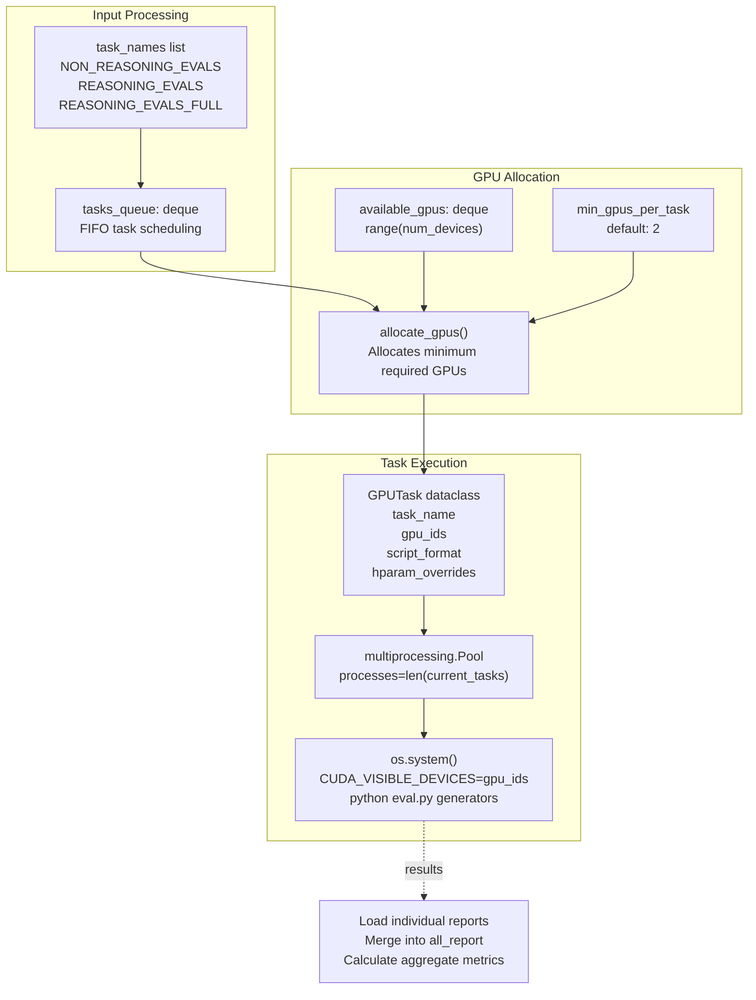
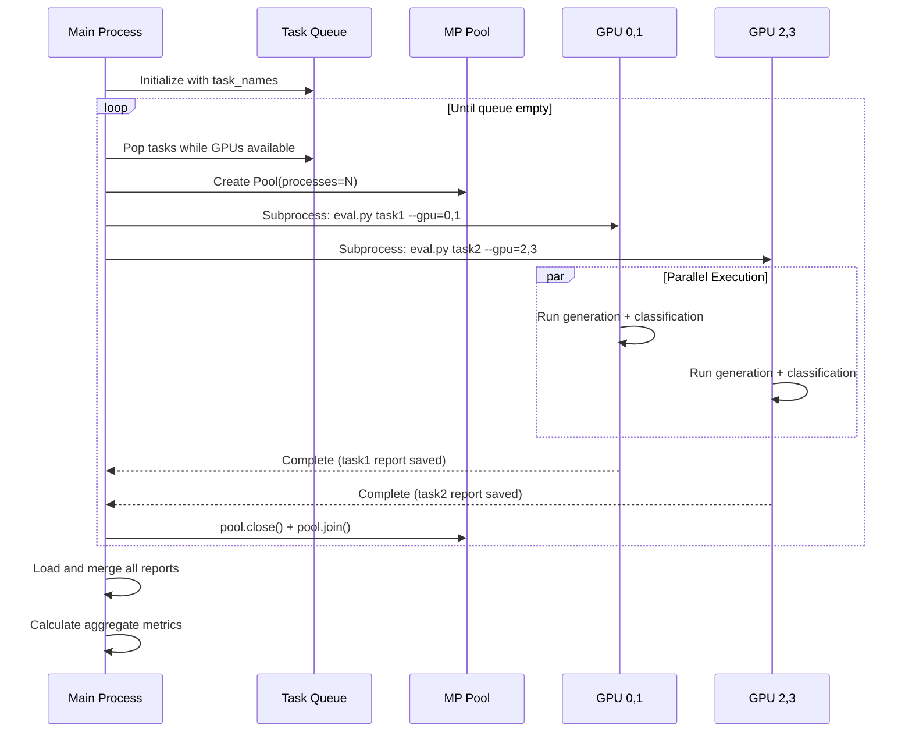
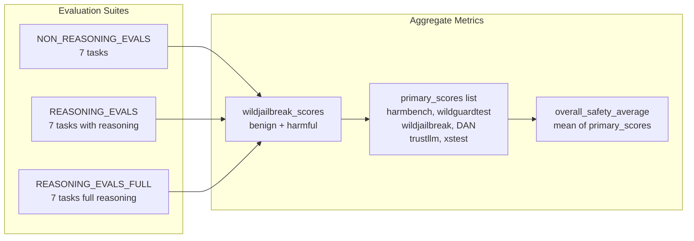
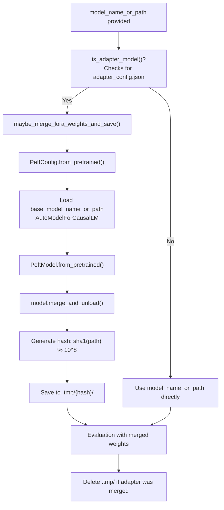
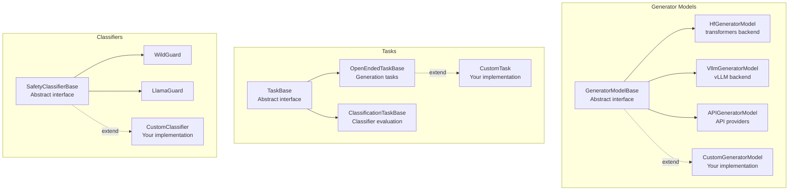
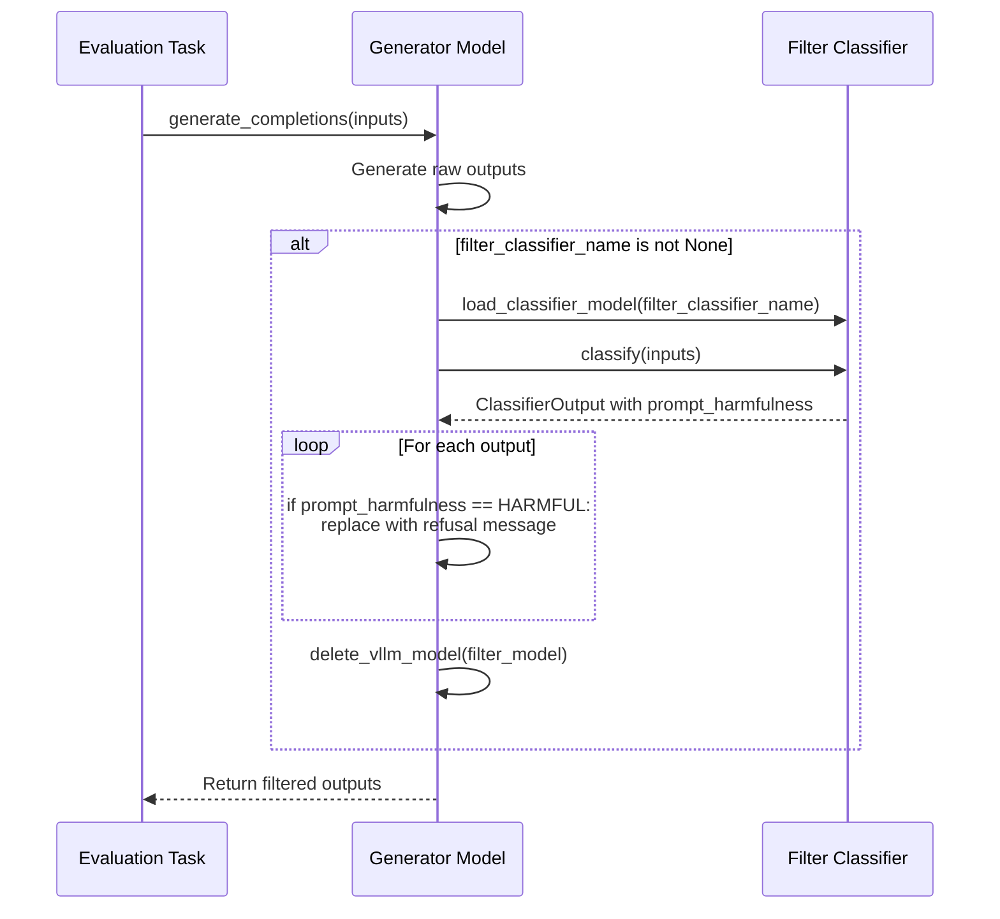

<!-- source: DeepWiki mcp.deepwiki.com · repo allenai/safety-eval · page 10 Advanced Topics · fetched 2026-10-26 -->

# Advanced Topics

<details>
<summary>Relevant source files</summary>

The following files were used as context for generating this wiki page:

- [evaluation/run_all_generation_benchmarks.py](evaluation/run_all_generation_benchmarks.py)
- [evaluation/schemas.py](evaluation/schemas.py)
- [evaluation/tasks/generation/codex_eval/__init__.py](evaluation/tasks/generation/codex_eval/__init__.py)
- [evaluation/utils.py](evaluation/utils.py)

</details>


## Purpose and Scope

This page covers advanced usage patterns, implementation details, and extension mechanisms in the AI2 Safety Evaluation Framework. Topics include multi-GPU task orchestration, LoRA adapter handling, framework extension patterns, and advanced generation features.

For basic evaluation execution, see [Running Evaluations](#7). For standard configuration options, see [Configuration System](#8). For architectural overview, see [Architecture](#3).

---

## Multi-GPU Task Orchestration

The framework provides sophisticated multi-GPU orchestration through `run_all_generation_benchmarks.py`, which allocates GPU resources dynamically and executes multiple evaluation tasks in parallel.

### Task Queue Architecture



**Figure 1: Multi-GPU Task Orchestration Flow**

Sources: [evaluation/run_all_generation_benchmarks.py:53-76](), [evaluation/run_all_generation_benchmarks.py:154-198]()

### GPU Allocation Algorithm

The `allocate_gpus()` function implements a simple but effective allocation strategy:

| Parameter | Type | Description |
|-----------|------|-------------|
| `available_gpus` | `deque[int]` | FIFO queue of available GPU indices |
| `min_gpus_per_task` | `int` | Minimum GPUs required per task (default: 2) |
| **Returns** | `list[int]` | List of allocated GPU IDs, or empty list if insufficient |

The orchestrator maintains a task queue and repeatedly allocates GPUs until either:
- No tasks remain in the queue
- Insufficient GPUs are available for the minimum requirement

Sources: [evaluation/run_all_generation_benchmarks.py:67-75]()

### GPUTask Dataclass

```python
@dataclass
class GPUTask:
    task_name: str                # e.g., "wildjailbreak:harmful"
    gpu_ids: list[int]            # e.g., [0, 1]
    script_format: str            # Command template with placeholders
    hparam_overrides: str         # JSON-encoded hyperparameter overrides
```

Each `GPUTask` encapsulates all information needed to execute a task on specific GPUs. The `run()` function at [evaluation/run_all_generation_benchmarks.py:60-64]() formats the command and executes it via `os.system()`.

Sources: [evaluation/run_all_generation_benchmarks.py:53-64]()

### Parallel Execution Pattern



**Figure 2: Parallel Task Execution Timeline**

Sources: [evaluation/run_all_generation_benchmarks.py:159-198]()

### Command Format String

The script format template at [evaluation/run_all_generation_benchmarks.py:138-152]() constructs subprocess commands:

```bash
CUDA_VISIBLE_DEVICES={gpu_id}
python eval.py generators
  --model_name_or_path {model_name_or_path}
  --model_input_template_path_or_name {template}
  --tasks {task_name}
  --report_output_path {report_path}.{task_name}
  --save_individual_results_path {save_path}.{task_name}
  --use_vllm
  --filter_classifier_name {filter_classifier_name}
  --hparam_overrides {hparam_overrides}
```

This enables each subprocess to run independently with isolated GPU visibility.

Sources: [evaluation/run_all_generation_benchmarks.py:138-152]()

### Result Aggregation and Metric Calculation

After all tasks complete, the orchestrator:

1. **Loads individual reports** from `{report_output_path}.{task_name}` files
2. **Merges into unified report** dictionary
3. **Calculates aggregate safety metrics** based on predefined evaluation suites



**Figure 3: Aggregate Metric Calculation Flow**

Sources: [evaluation/run_all_generation_benchmarks.py:200-278]()

---

## LoRA Adapter Support

The framework automatically detects and handles LoRA (Low-Rank Adaptation) adapter models, merging them with base weights before evaluation.

### Adapter Detection and Merging Workflow



**Figure 4: LoRA Adapter Detection and Merging Process**

Sources: [evaluation/utils.py:64-94](), [evaluation/run_all_generation_benchmarks.py:127-129]()

### Implementation Details

The `maybe_merge_lora_weights_and_save()` function at [evaluation/utils.py:64-94]() implements the merging logic:

```python
def maybe_merge_lora_weights_and_save(model_name_or_path: str) -> str | None:
    if is_adapter_model(model_name_or_path):
        # 1. Load PEFT configuration
        peft_config = PeftConfig.from_pretrained(model_name_or_path)
        
        # 2. Load base model
        base_model = AutoModelForCausalLM.from_pretrained(
            peft_config.base_model_name_or_path
        )
        
        # 3. Load and merge adapter weights
        model = PeftModel.from_pretrained(base_model, model_name_or_path)
        model = model.merge_and_unload()
        
        # 4. Save to temporary directory
        hash_name = int(hashlib.sha1(model_name_or_path.encode("utf-8")).hexdigest(), 16) % (10 ** 8)
        temp_dir = os.path.join(os.path.abspath(os.path.dirname(__file__)), ".tmp", str(hash_name))
        model.save_pretrained(temp_dir)
        
        return temp_dir
    return None
```

### Temporary Directory Management

| Stage | Action | Location |
|-------|--------|----------|
| Detection | Check for `adapter_config.json` | `src/generation_utils.py` |
| Merge | Merge adapter + base weights | `evaluation/utils.py:64-94` |
| Save | Write to `.tmp/{hash}/` | Relative to `evaluation/` directory |
| Evaluation | Use merged weights path | Throughout evaluation pipeline |
| Cleanup | Delete `.tmp/{hash}/` | [evaluation/run_all_generation_benchmarks.py:295-297]() |

The hash-based naming prevents collisions when multiple adapter models are evaluated concurrently.

Sources: [evaluation/utils.py:64-94](), [evaluation/run_all_generation_benchmarks.py:295-297]()

---

## Extending the Framework

The framework's modular architecture enables extension through well-defined abstract base classes.

### Extension Points Overview



**Figure 5: Framework Extension Points**

Sources: [evaluation/schemas.py:30-350]()

### Adding a Custom Generation Task

To add a new generation task, extend `OpenEndedTaskBase`:

**Required Methods:**

| Method | Return Type | Purpose |
|--------|-------------|---------|
| `required_input_fields()` | `list[str]` | Fields needed in model input template (e.g., `["instruction"]`) |
| `load()` | `list[dict]` | Load dataset, must include all required input fields |
| `_evaluate(model)` | `tuple[dict, list[dict]]` | Generate completions, classify, compute metrics |

**Example Structure (CodexEval):**

```python
class CodexEval(OpenEndedTaskBase):
    def __init__(self):
        self.max_new_tokens, self.temperature, self.top_p = self.prepare_hparams()
        super().__init__()  # Calls load() and validates data
    
    def required_input_fields(self) -> list[str]:
        return ["instruction"]  # Must exist in model.model_input_template
    
    def load(self) -> list[dict]:
        # Load data, return list of dicts with "instruction" field
        # Framework automatically adds "id" field via put_id_on_data()
        return loaded_data
    
    def _evaluate(self, model: GeneratorModelBase) -> tuple[dict, list[dict]]:
        # 1. Generate completions
        completions = model.generate_completions(
            self.data,
            max_new_tokens=self.max_new_tokens,
            temperature=self.temperature,
            top_p=self.top_p
        )
        
        # 2. Compute metrics (task-specific)
        metrics = {...}
        
        # 3. Format individual results (must include "id" field)
        individual_results = [{"id": d["id"], ...} for d in self.data]
        
        return metrics, individual_results
```

Sources: [evaluation/tasks/generation/codex_eval/__init__.py:20-115](), [evaluation/schemas.py:494-517]()

### Adding a Custom Generator Model

Extend `GeneratorModelBase` at [evaluation/schemas.py:30-97]():

**Required Methods:**

| Method | Signature | Purpose |
|--------|-----------|---------|
| `load_model()` | `(str) -> tuple[object, object]` | Load and return model, tokenizer |
| `generate_completions()` | `(list[dict], int, float, float, ...) -> list[str]` | Generate text completions |

**Key Implementation Considerations:**

1. **Input Formatting**: Apply `self.model_input_template.format(**d)` to each input dict
2. **Optional Filtering**: Support `self.filter_classifier_name` for safety filtering
3. **Memory Management**: Clean up GPU memory after generation (see [evaluation/schemas.py:141-143]())
4. **Stop Sequences**: Handle optional `stop` parameter for early termination

```python
class CustomGeneratorModel(GeneratorModelBase):
    def load_model(self, model_name_or_path: str):
        # Load your model backend
        model = load_custom_model(model_name_or_path)
        tokenizer = load_custom_tokenizer(model_name_or_path)
        return model, tokenizer
    
    def generate_completions(
        self,
        inputs: list[dict[str, str]],
        max_new_tokens: int,
        temperature: float,
        top_p: float,
        **kwargs
    ) -> list[str]:
        formatted_inputs = [self.model_input_template.format(**d) for d in inputs]
        
        # Generate with your backend
        outputs = custom_generate(formatted_inputs, ...)
        
        # Optional: Apply safety filtering
        if self.filter_classifier_name is not None:
            outputs = self._apply_filtering(inputs, outputs)
        
        return outputs
```

Sources: [evaluation/schemas.py:99-201](), [evaluation/schemas.py:203-294]()

### Adding a Custom Classifier

Extend `SafetyClassifierBase` (defined in `src/classifier_models/base.py`):

**Required Methods:**

| Method | Return Type | Purpose |
|--------|-------------|---------|
| `classify()` | `list[ClassifierOutput]` | Classify inputs, return structured outputs |
| `get_output_fields()` | `list[str]` | List output field names (e.g., `["prompt_harmfulness"]`) |
| `get_possible_input_fields()` | `list[str]` | List accepted input field names |

**ClassifierOutput Fields:**

The `ClassifierOutput` dataclass (from `src/classifier_models/base.py`) includes:
- `prompt_harmfulness: PromptHarmfulness` (HARMFUL/UNHARMFUL)
- `response_harmfulness: ResponseHarmfulness` (HARMFUL/UNHARMFUL)  
- `response_refusal: ResponseRefusal` (REFUSAL/COMPLIANCE)
- Additional task-specific fields

**Registration:**

Add your classifier to `load_classifier_model()` in `src/classifier_models/loader.py`:

```python
def load_classifier_model(classifier_name: str, local_model_path: str | None = None):
    if classifier_name == "custom_classifier":
        return CustomClassifier(local_model_path)
    # ... existing classifiers
```

Sources: [evaluation/schemas.py:432-491]()

---

## Advanced Generation Features

### Think-Answer Extraction

The framework supports reasoning models that output structured `<answer>...</answer>` patterns. The `extract_think_answer()` function at [evaluation/utils.py:128-174]() handles extraction:

**Extraction Algorithm:**

```mermaid
graph TB
    Input["Input: list of completions"]
    CheckThink{"Contains ''"]
    ExtractReason["reasoning = parts[:-1]<br/>Strip '<think>' prefix"]
    ExtractAnswer["answer = parts[-1]<br/>Strip '<answer>' tags"]
    NoThink["reasoning = '' or full text<br/>answer = '' or full text"]
    
    Input --> CheckThink
    CheckThink -->|Yes| Split
    CheckThink -->|No| NoThink
    Split --> ExtractReason
    Split --> ExtractAnswer
    
    ExtractReason --> Output["reasonings, answers, errors"]
    ExtractAnswer --> Output
    NoThink --> Output
```

**Figure 6: Think-Answer Extraction Logic**

**Flex Mode**: When `flex=True`, the extractor tolerates missing think tags and places all content in the answer field.

Sources: [evaluation/utils.py:128-174]()

### Output Filtering with Safety Classifiers

All generator models support optional output filtering via the `filter_classifier_name` parameter:



**Figure 7: Output Filtering Workflow**

The filtering logic at [evaluation/schemas.py:145-163]() replaces harmful outputs with `"I'm sorry, I can't help with that."`

Sources: [evaluation/schemas.py:145-163](), [evaluation/schemas.py:255-285]()

### Repetition Removal and Truncation

The `remove_repetitive()` function at [evaluation/utils.py:176-228]() prevents evaluation errors from excessively long outputs:

**Processing Steps:**

1. **Tokenize** output using `LlamaTokenizer` from WildGuard model
2. **Check length** against `limit` parameter (default: 30,000 tokens)
3. **Truncate** if necessary, decoding first `limit` tokens
4. **Track errors** in returned error list for reporting

**For Reasoning Models:**

The function first extracts think/answer components, then truncates each independently, tracking whether truncation occurred in "reasonings", "answers", or "both".

Sources: [evaluation/utils.py:176-228]()

### Template Customization for Specific Tasks

Tasks can modify the model input template dynamically. For example, CodexEval prepends code generation instructions:

```python
def _evaluate(self, model: VllmGeneratorModel) -> tuple[dict, list[dict]]:
    # Save original template
    current_model_input_template = model.model_input_template
    
    # Modify template for code generation
    answer = "Here is the function:\n\n```python\n"
    model.model_input_template = current_model_input_template + " " + answer + "{prompt}"
    
    # Generate with modified template
    completions = model.generate_completions(...)
    
    # Restore original template
    model.model_input_template = current_model_input_template
```

This pattern allows task-specific prompt engineering without modifying the model class.

Sources: [evaluation/tasks/generation/codex_eval/__init__.py:75-91]()

---

## Performance Optimization Patterns

### VLLM Subprocess Isolation

`VllmGeneratorModel` uses subprocess-based inference to prevent GPU memory leaks:

```python
def generate_completions(self, inputs, ...):
    outputs = subprocess_inference_with_vllm(
        prompts=formatted_inputs,
        model_name_or_path=self.model_name_or_path,
        ...
    )
```

The subprocess pattern ensures complete GPU memory cleanup after each inference batch.

Sources: [evaluation/schemas.py:225-287]()

### Multiprocessing Pool Configuration

The orchestrator uses `mp.set_start_method("spawn", force=True)` at [evaluation/run_all_generation_benchmarks.py:122]() to ensure clean subprocess initialization, preventing CUDA context conflicts.

Sources: [evaluation/run_all_generation_benchmarks.py:122]()

### Incremental Report Updates

The `save_evaluation_report()` function at [evaluation/utils.py:40-61]() merges new results with existing reports, enabling incremental evaluation:

```python
def save_evaluation_report(report_output_path: str, evaluation_report: dict):
    if os.path.exists(report_output_path):
        existing_report = maybe_load_evaluation_report(report_output_path)
        for k, v in existing_report.items():
            if k not in evaluation_report:
                evaluation_report[k] = v  # Preserve existing results
```

This allows interrupted evaluations to resume without re-running completed tasks.

Sources: [evaluation/utils.py:40-61]()

---

