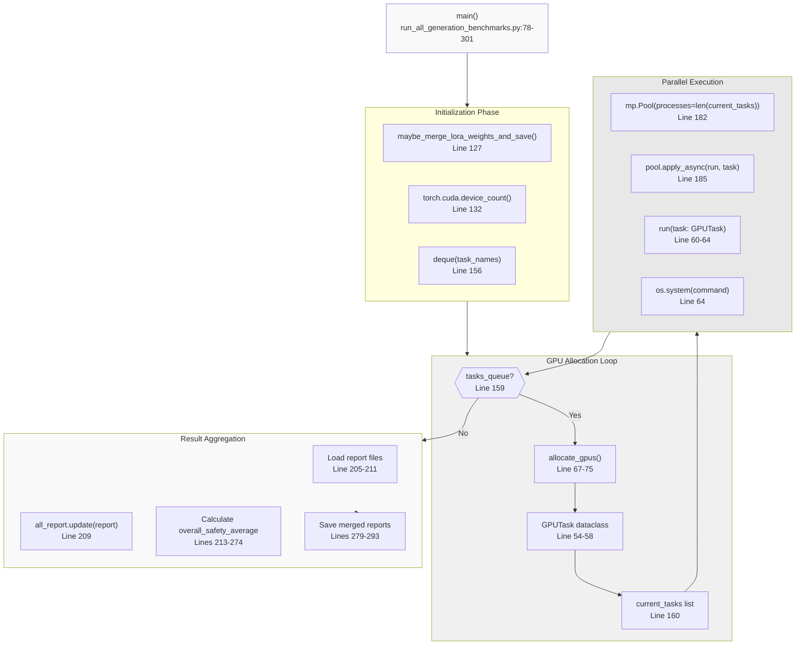
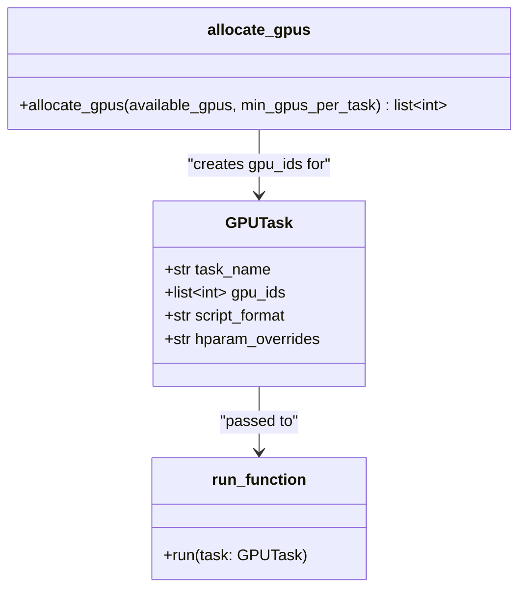
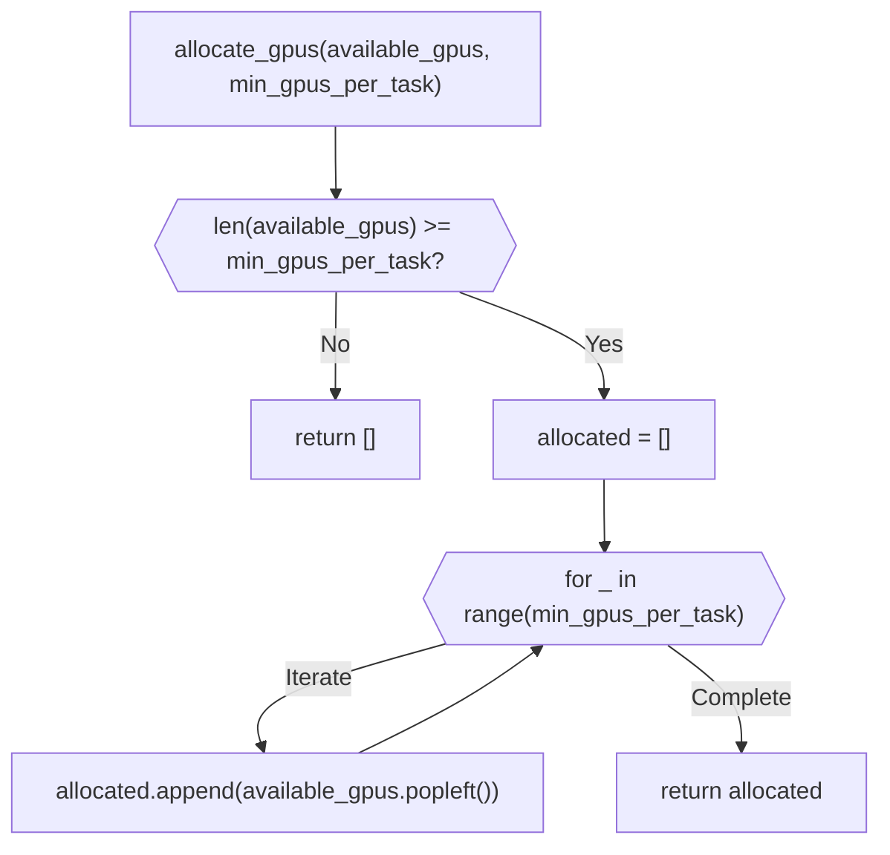
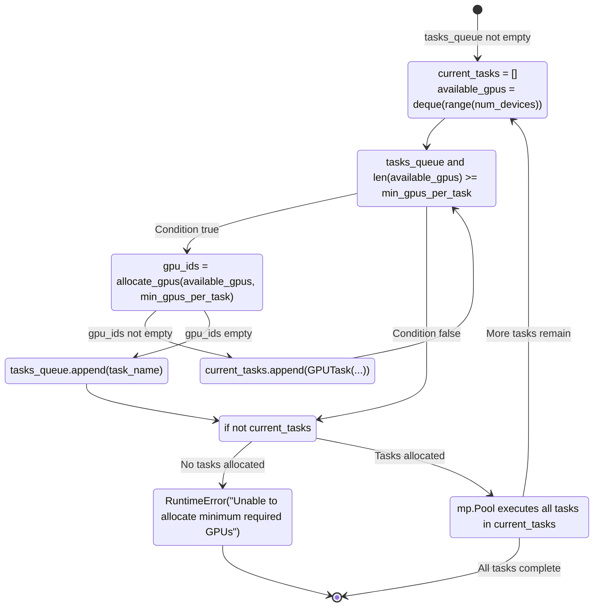
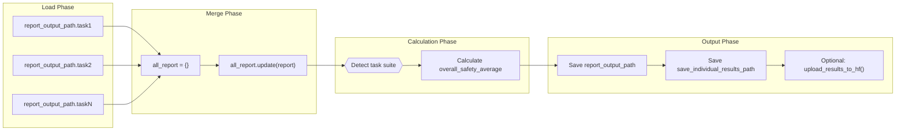

<!-- source: DeepWiki mcp.deepwiki.com · repo allenai/safety-eval · page 10.1 GPU Task Orchestration · fetched 2026-10-26 -->

# GPU Task Orchestration

<details>
<summary>Relevant source files</summary>

The following files were used as context for generating this wiki page:

- [evaluation/run_all_generation_benchmarks.py](evaluation/run_all_generation_benchmarks.py)

</details>


## Purpose and Scope

This document provides a detailed explanation of the multi-GPU task orchestration system implemented in `evaluation/run_all_generation_benchmarks.py`. The orchestration system manages parallel execution of multiple evaluation tasks across available GPU resources, dynamically allocating GPUs to tasks and managing task queues for efficient resource utilization.

For information about running single evaluation tasks without orchestration, see [Single Task Evaluation](#7.1). For general parallel execution concepts, see [Orchestration and Execution](#3.3).

## System Overview

The GPU task orchestration system is implemented as a standalone script that wraps calls to `eval.py` with automatic GPU allocation. The system maintains a task queue, dynamically allocates minimum required GPUs to each task, executes tasks in parallel batches, and aggregates results after completion.



**Diagram: GPU Task Orchestration Flow**

Sources: [evaluation/run_all_generation_benchmarks.py:1-301]()

## Core Components

### GPUTask Dataclass

The `GPUTask` dataclass encapsulates all information needed to execute a single evaluation task on allocated GPUs.

| Field | Type | Description |
|-------|------|-------------|
| `task_name` | `str` | Task identifier (e.g., "harmbench:default") |
| `gpu_ids` | `list[int]` | List of GPU device IDs allocated to this task |
| `script_format` | `str` | Command template string with placeholders |
| `hparam_overrides` | `str` | JSON string of hyperparameter overrides |



**Diagram: GPUTask Data Structure and Related Functions**

Sources: [evaluation/run_all_generation_benchmarks.py:53-64]()

### Task Execution Function

The `run` function at [evaluation/run_all_generation_benchmarks.py:60-64]() executes a single task by:

1. Converting GPU IDs to comma-separated string format
2. Formatting the command template with task-specific parameters
3. Executing the command via `os.system()`

```python
# Pseudocode representation
def run(task: GPUTask):
    gpu_ids_str = ",".join(map(str, task.gpu_ids))
    command = task.script_format.format(
        gpu_id=gpu_ids_str,
        task_name=task.task_name,
        hparam_overrides=task.hparam_overrides
    )
    os.system(command)
```

The command sets `CUDA_VISIBLE_DEVICES` to restrict each subprocess to its allocated GPUs, then calls `eval.py generators` with task-specific arguments.

Sources: [evaluation/run_all_generation_benchmarks.py:60-64]()

## GPU Allocation Strategy

### Allocation Algorithm

The `allocate_gpus` function at [evaluation/run_all_generation_benchmarks.py:67-75]() implements a simple FIFO allocation strategy:



**Diagram: GPU Allocation Logic**

The function uses a `deque` for `available_gpus` to efficiently pop GPUs from the front. If insufficient GPUs are available, it returns an empty list, signaling that no allocation is possible.

Sources: [evaluation/run_all_generation_benchmarks.py:67-75]()

### Dynamic Allocation in Main Loop

The main loop at [evaluation/run_all_generation_benchmarks.py:159-198]() implements dynamic GPU allocation across task batches:



**Diagram: Main Loop State Machine**

Key behaviors:
- **Greedy allocation**: The loop allocates as many tasks as possible to current GPU batch
- **Requeue mechanism**: Tasks that cannot be allocated are pushed back to queue
- **Error handling**: Raises `RuntimeError` if no tasks can be allocated (lines 178-179)
- **Batch execution**: All allocated tasks execute concurrently via multiprocessing pool

Sources: [evaluation/run_all_generation_benchmarks.py:159-198]()

## Parallel Execution Model

### Multiprocessing Pool Configuration

The system uses Python's `multiprocessing` module with spawn method [evaluation/run_all_generation_benchmarks.py:122]():

```python
mp.set_start_method("spawn", force=True)
```

For each batch of allocated tasks, a new pool is created [evaluation/run_all_generation_benchmarks.py:182]():

```python
with mp.Pool(processes=len(current_tasks)) as pool:
    res = []
    for task in current_tasks:
        res.append(pool.apply_async(run, (task,)))
```

The pool size equals the number of tasks in the current batch, with each process executing one task.

Sources: [evaluation/run_all_generation_benchmarks.py:122, 182-185]()

### Task Isolation via CUDA_VISIBLE_DEVICES

Each subprocess is isolated to its allocated GPUs through the `CUDA_VISIBLE_DEVICES` environment variable set in the command format [evaluation/run_all_generation_benchmarks.py:138-152]():

```python
script_format = (
    "CUDA_VISIBLE_DEVICES={gpu_id} \\\n"
    f"python {entrypoint_script_path} generators \\\n"
    # ... additional arguments
)
```

This ensures that:
- Each task only sees its allocated GPUs (numbered 0, 1, ... within the subprocess)
- No GPU contention occurs between concurrent tasks
- PyTorch and vLLM automatically use all visible GPUs

Sources: [evaluation/run_all_generation_benchmarks.py:138-152]()

### Subprocess Command Structure

The formatted command for each task includes:

| Parameter | Purpose |
|-----------|---------|
| `CUDA_VISIBLE_DEVICES` | GPU isolation |
| `model_name_or_path` | Model to evaluate |
| `model_input_template_path_or_name` | Chat template |
| `tasks` | Task identifier (e.g., "harmbench:default") |
| `report_output_path.{task_name}` | Task-specific report file |
| `save_individual_results_path.{task_name}` | Task-specific results file |
| `--use_vllm` | Enable vLLM backend |
| `filter_classifier_name` | Optional safety filter |
| `hparam_overrides` | JSON-encoded hyperparameter overrides |

Each task writes to distinct output files by appending `.{task_name}` to the base paths, preventing file conflicts.

Sources: [evaluation/run_all_generation_benchmarks.py:138-152]()

## Pre-defined Task Suites

The system defines three standard evaluation suites as constants:

### NON_REASONING_EVALS

```python
NON_REASONING_EVALS = [
    "wildjailbreak:harmful",
    "wildguardtest:default",
    "harmbench:default",
    "xstest:default",
    "wildjailbreak:benign",
    "do_anything_now:default",
    "trustllm_jailbreaktrigger:default"
]
```

Tasks that evaluate model safety without reasoning-based classifiers. Uses standard safety classifiers for metric calculation.

Sources: [evaluation/run_all_generation_benchmarks.py:13-21]()

### REASONING_EVALS

```python
REASONING_EVALS = [
    "wildjailbreak:harmful_wildguard_reasoning_answer",
    "wildguardtest:wildguard_reasoning_answer",
    "harmbench:wildguard_reasoning_answer",
    "xstest:wildguard_reasoning_answer",
    "wildjailbreak:benign_wildguard_reasoning_answer",
    "do_anything_now:wildguard_reasoning_answer",
    "trustllm_jailbreaktrigger:wildguard_reasoning_answer"
]
```

Tasks using WildGuard reasoning-based classification with answer extraction. Evaluates only the final answer from reasoning chains.

Sources: [evaluation/run_all_generation_benchmarks.py:22-30]()

### REASONING_EVALS_FULL

```python
REASONING_EVALS_FULL = [
    "wildjailbreak:harmful_wildguard_reasoning",
    "wildguardtest:wildguard_reasoning",
    "harmbench:wildguard_reasoning",
    "xstest:wildguard_reasoning",
    "wildjailbreak:benign_wildguard_reasoning",
    "do_anything_now:wildguard_reasoning",
    "trustllm_jailbreaktrigger:wildguard_reasoning",
]
```

Tasks using full WildGuard reasoning-based classification. Evaluates both reasoning chains and extracted answers separately.

Sources: [evaluation/run_all_generation_benchmarks.py:31-39]()

## Result Aggregation

### Report Merging Process

After all tasks complete, the system aggregates results in three stages:



**Diagram: Result Aggregation Pipeline**

Sources: [evaluation/run_all_generation_benchmarks.py:200-298]()

### Suite-Specific Aggregation

The aggregation logic differs based on which task suite was executed:

#### NON_REASONING_EVALS Aggregation

[evaluation/run_all_generation_benchmarks.py:213-232]()

Calculates `overall_safety_average` as the mean of:
- `harmbench:default["inverted_micro_asr_lower"]`
- `wildguardtest:default["inverted_micro_harm_lower"]`
- Average of WildJailbreak benign/harmful scores
- `do_anything_now:default["inverted_macro_asr"]`
- `trustllm_jailbreaktrigger:default["inverted_macro_asr"]`
- `xstest:default["overall_accuracy"]`

#### REASONING_EVALS Aggregation

[evaluation/run_all_generation_benchmarks.py:234-253]()

Uses identical metric keys but with `_wildguard_reasoning_answer` suffix on task names.

#### REASONING_EVALS_FULL Aggregation

[evaluation/run_all_generation_benchmarks.py:255-274]()

Accesses nested metrics under `["answers"]` key for each task, e.g.:
```python
all_report["harmbench:wildguard_reasoning"]["answers"]["inverted_micro_asr_lower"]
```

Sources: [evaluation/run_all_generation_benchmarks.py:213-274]()

### Individual Results Merging

Individual results files are merged by concatenating all task-specific result lists [evaluation/run_all_generation_benchmarks.py:282-293]():

```python
all_save = []
for save_file in save_files:
    with open(save_file, "r") as f:
        save = json.load(f)
        all_save.extend(save)  # Concatenate lists

with open(save_individual_results_path, "w") as f:
    json.dump(all_save, f)
```

Each task's individual results are stored as a JSON array. The merged output contains all results across all tasks in a single array.

Sources: [evaluation/run_all_generation_benchmarks.py:282-293]()

## Configuration Parameters

The `main` function accepts the following parameters:

| Parameter | Type | Default | Description |
|-----------|------|---------|-------------|
| `model_name_or_path` | `str` | Required | Model path or HuggingFace identifier |
| `model_input_template_path_or_name` | `str` | Required | Chat template name or path |
| `report_output_path` | `str` | Required | Base path for report files |
| `save_individual_results_path` | `str` | Required | Base path for results files |
| `min_gpus_per_task` | `int` | `2` | Minimum GPUs to allocate per task |
| `hf_revision` | `str` | `"main"` | HuggingFace model revision |
| `hf_upload_name` | `str \| None` | `None` | Name for HuggingFace upload |
| `upload_to_hf` | `str \| None` | `None` | HuggingFace repository for upload |
| `filter_classifier_name` | `str \| None` | `None` | Safety filter classifier name |
| `filter_model_override_path` | `str \| None` | `None` | Override path for filter model |
| `task_names` | `list[str]` | See default | List of task identifiers |
| `limit` | `str \| None` | `None` | Limit evaluation samples |
| `flex` | `str \| None` | `None` | Flexible evaluation mode |
| `hparam_overrides` | `str \| None` | `None` | JSON hyperparameter overrides |

Sources: [evaluation/run_all_generation_benchmarks.py:78-108]()

### Hyperparameter Override Handling

Hyperparameter overrides are processed at [evaluation/run_all_generation_benchmarks.py:116-117]():

```python
if hparam_overrides is not None:
    hparam_overrides = shlex.quote(json.dumps(hparam_overrides))
```

The system:
1. JSON-encodes the override dictionary
2. Shell-quotes the JSON string using `shlex.quote`
3. Passes the quoted string to each subprocess command

This allows complex nested configurations to be safely passed through the shell to `eval.py`.

Sources: [evaluation/run_all_generation_benchmarks.py:116-117]()

## LoRA Adapter Handling

Before task execution, the system checks for LoRA adapters and merges them if detected [evaluation/run_all_generation_benchmarks.py:127-129]():

```python
temp_dir_for_merged_weights = maybe_merge_lora_weights_and_save(model_name_or_path)
if temp_dir_for_merged_weights is not None:
    model_name_or_path = temp_dir_for_merged_weights
```

After all tasks complete, temporary merged weights are cleaned up [evaluation/run_all_generation_benchmarks.py:295-297]():

```python
if temp_dir_for_merged_weights is not None:
    print(f"Removing temporary directory: {temp_dir_for_merged_weights}")
    os.system(f"rm -rf {temp_dir_for_merged_weights}")
```

This ensures LoRA models are properly merged before vLLM evaluation and temporary files are removed afterward. For details on LoRA weight merging, see [LoRA Adapter Support](#10.2).

Sources: [evaluation/run_all_generation_benchmarks.py:127-129, 295-297]()

## Error Handling and Validation

### GPU Availability Validation

The system validates that sufficient GPUs are available [evaluation/run_all_generation_benchmarks.py:132-136]():

```python
num_devices = torch.cuda.device_count()
print(f"Number of devices: {num_devices}")

if min_gpus_per_task > num_devices:
    raise ValueError(f"min_gpus_per_task ({min_gpus_per_task}) cannot be greater than available GPUs ({num_devices})")
```

### Allocation Failure Detection

If no tasks can be allocated in a batch cycle, the system raises an error [evaluation/run_all_generation_benchmarks.py:178-179]():

```python
if not current_tasks:
    raise RuntimeError("Unable to allocate minimum required GPUs for any task")
```

This prevents infinite loops when `min_gpus_per_task` is misconfigured.

### Task Execution Error Handling

Individual task failures are caught and logged [evaluation/run_all_generation_benchmarks.py:188-195]():

```python
for task, r in zip(current_tasks, res):
    try:
        r.get()
        results[task.task_name] = True
    except Exception as e:
        print(f"Error in {task.task_name}.")
        print(e)
        results[task.task_name] = False
```

Failed tasks do not block other tasks or prevent result aggregation. The system continues and merges whatever results are available.

Sources: [evaluation/run_all_generation_benchmarks.py:132-136, 178-179, 188-195]()

## HuggingFace Upload Integration

When a recognized task suite is completed, results can be automatically uploaded to HuggingFace Hub [evaluation/run_all_generation_benchmarks.py:229-232]():

```python
if upload_to_hf is not None:
    _upload_results_to_hf(
        "overall_oe_safety_average", 
        "overall_safety_average", 
        all_report, 
        upload_to_hf, 
        hf_upload_name
    )
```

The `_upload_results_to_hf` helper function [evaluation/run_all_generation_benchmarks.py:41-51]() extracts the primary score and calls `upload_results_to_hf` from utilities with timestamp prepending enabled.

Upload is only supported for complete task suites (NON_REASONING_EVALS, REASONING_EVALS, or REASONING_EVALS_FULL), not arbitrary task lists [evaluation/run_all_generation_benchmarks.py:276-277]().

Sources: [evaluation/run_all_generation_benchmarks.py:41-51, 229-232, 276-277]()

---

