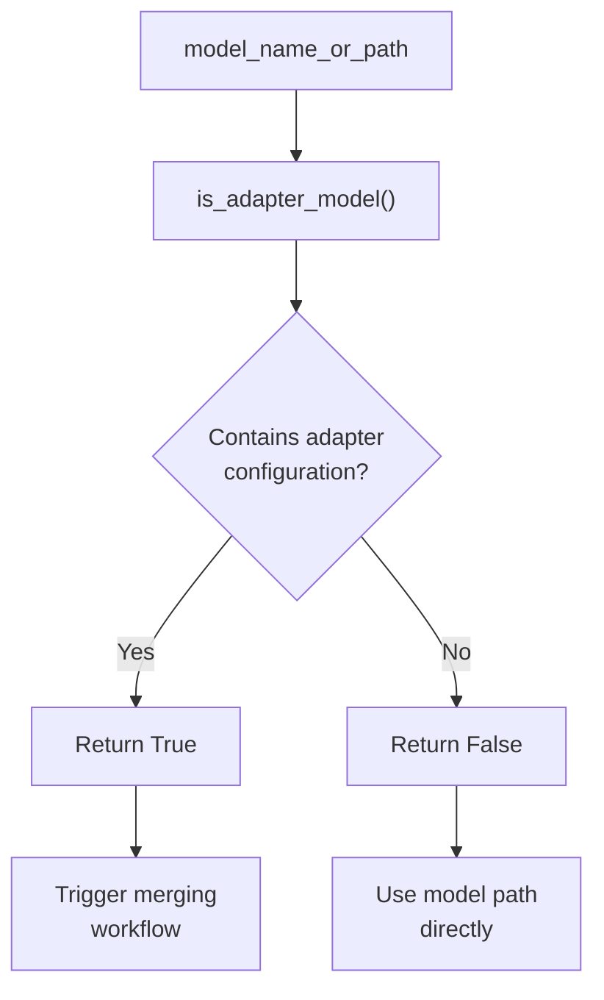
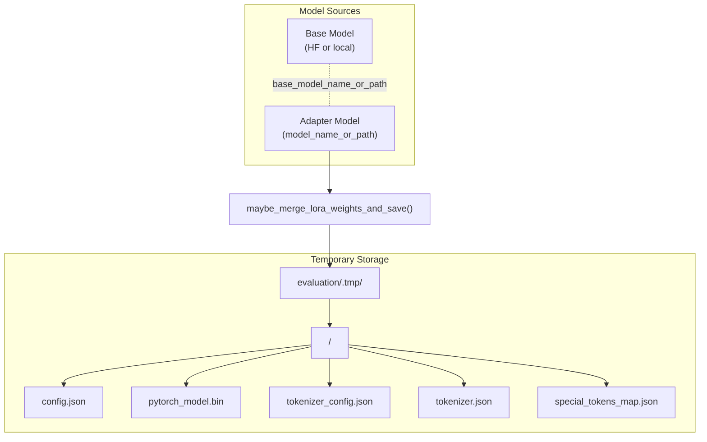
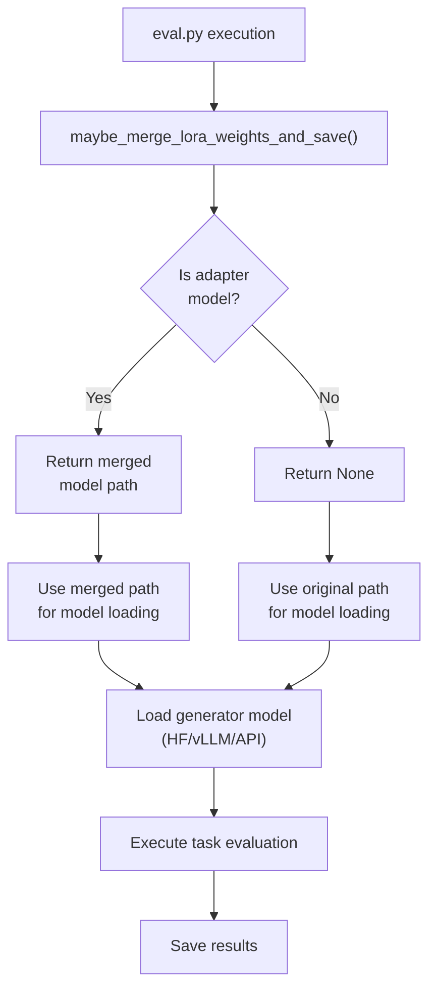
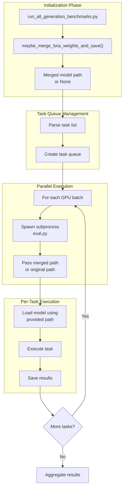
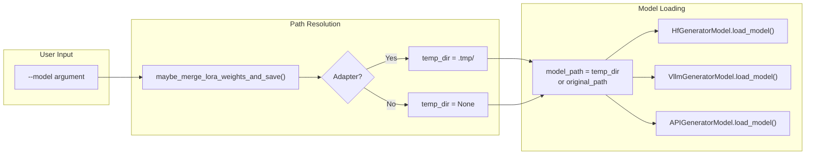
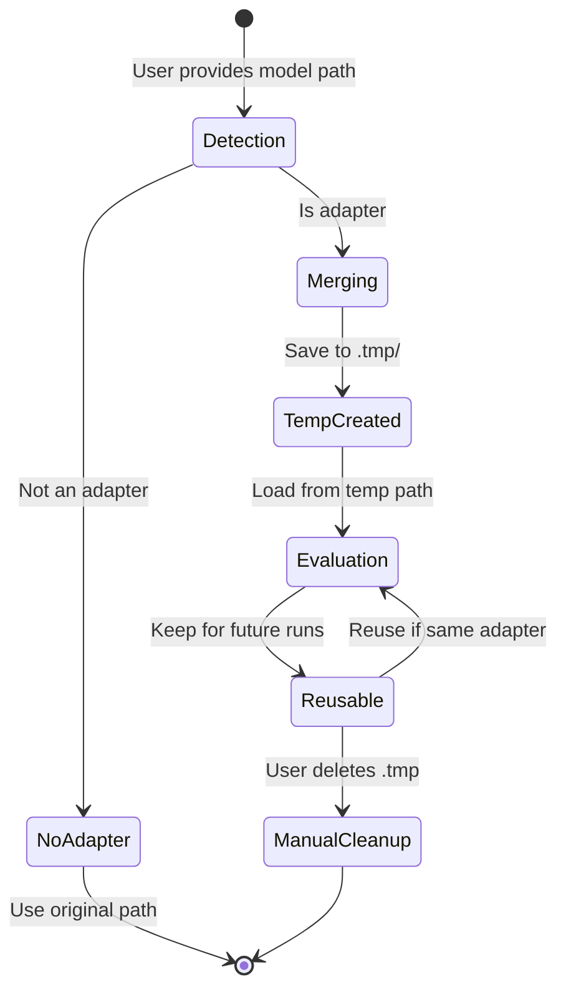
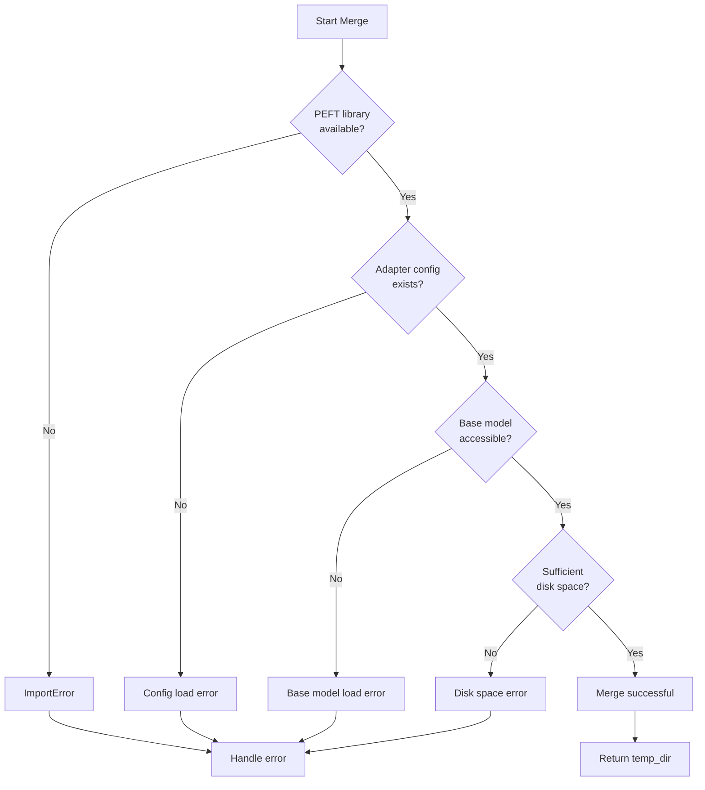

<!-- source: DeepWiki mcp.deepwiki.com · repo allenai/safety-eval · page 10.2 LoRA Adapter Support · fetched 2026-10-26 -->

# LoRA Adapter Support

<details>
<summary>Relevant source files</summary>

The following files were used as context for generating this wiki page:

- [evaluation/schemas.py](evaluation/schemas.py)
- [evaluation/tasks/generation/codex_eval/__init__.py](evaluation/tasks/generation/codex_eval/__init__.py)
- [evaluation/utils.py](evaluation/utils.py)

</details>


## Purpose and Scope

This page documents how the safety evaluation framework detects, merges, and evaluates LoRA (Low-Rank Adaptation) adapter models. LoRA adapters are parameter-efficient fine-tuning artifacts that must be merged with their base models before evaluation. This page covers the detection mechanism, weight merging process, temporary file management, and integration with the evaluation pipeline.

For information about model loading and evaluation workflow, see [Model Loading and Configuration](#5.3). For GPU orchestration that triggers LoRA merging, see [GPU Task Orchestration](#10.1).

---

## Overview

### What Are LoRA Adapters?

LoRA adapters are lightweight model modifications created through parameter-efficient fine-tuning. They consist of low-rank matrices that augment a base model's weights without requiring a full copy of the model parameters. When evaluating adapter models, the framework must:

1. **Detect** if a model path contains adapter weights rather than a full model
2. **Merge** the adapter weights with the base model to create a functional model
3. **Store** the merged model temporarily for evaluation
4. **Evaluate** using the merged model path
5. **Clean up** temporary files after evaluation

### Why Merging Is Required

Most inference engines (HuggingFace Transformers, vLLM) expect full model weights rather than adapter deltas. The framework merges adapters into full models transparently before evaluation to ensure compatibility across all evaluation backends.

**Sources:** [evaluation/utils.py:64-94]()

---

## Detection Mechanism

### Adapter Model Detection

The framework uses the `is_adapter_model()` function from `src.generation_utils` to determine if a model path contains LoRA adapter weights. This function checks for the presence of adapter configuration files that indicate a PEFT (Parameter-Efficient Fine-Tuning) model.



**Detection Flow:**
1. Function receives a model path or HuggingFace identifier
2. Checks for PEFT adapter configuration files (e.g., `adapter_config.json`)
3. Returns boolean indicating adapter presence

**Sources:** [evaluation/utils.py:9](), [evaluation/utils.py:65]()

---

## Weight Merging Process

### The `maybe_merge_lora_weights_and_save` Function

The core merging logic is implemented in `maybe_merge_lora_weights_and_save()`. This function conditionally merges adapter weights with the base model and returns a path to the merged model.

```mermaid
flowchart LR
    subgraph "Input"
        A["model_name_or_path"]
    end
    
    subgraph "Detection"
        B["is_adapter_model()"]
        C{"Is adapter<br/>model?"}
    end
    
    subgraph "Merging Process"
        D["PeftConfig.from_pretrained()"]
        E["Load AutoTokenizer"]
        F["Load base model<br/>AutoModelForCausalLM"]
        G["PeftModel.from_pretrained()"]
        H["model.merge_and_unload()"]
        I["Set generation_config"]
    end
    
    subgraph "Storage"
        J["Compute SHA1 hash<br/>of model path"]
        K["Create temp directory<br/>.tmp/<hash>"]
        L["model.save_pretrained()"]
        M["tokenizer.save_pretrained()"]
        N["Copy tokenizer files"]
    end
    
    subgraph "Output"
        O["Return temp_dir path"]
        P["Return None"]
    end
    
    A --> B
    B --> C
    C -->|"Yes"| D
    C -->|"No"| P
    D --> E
    E --> F
    F --> G
    G --> H
    H --> I
    I --> J
    J --> K
    K --> L
    L --> M
    M --> N
    N --> O
```



### Merging Steps

**1. Configuration Loading** [evaluation/utils.py:68]()
```python
peft_config = PeftConfig.from_pretrained(model_name_or_path)
```
Loads the adapter configuration which contains metadata about the base model and adapter parameters.

**2. Tokenizer Loading** [evaluation/utils.py:69]()
```python
_tokenizer = AutoTokenizer.from_pretrained(model_name_or_path)
```
Loads the tokenizer associated with the adapter model.

**3. Base Model Loading** [evaluation/utils.py:70-72]()
```python
base_model = AutoModelForCausalLM.from_pretrained(
    peft_config.base_model_name_or_path,
)
```
Loads the full base model specified in the adapter configuration.

**4. Adapter Loading** [evaluation/utils.py:73-76]()
```python
model = PeftModel.from_pretrained(
    base_model,
    model_name_or_path,
)
```
Wraps the base model with the adapter weights.

**5. Merging** [evaluation/utils.py:77-78]()
```python
model = model.merge_and_unload()
model.generation_config.do_sample = True
```
Merges the adapter weights into the base model and removes the adapter wrapper, resulting in a full model with integrated weights.

**6. Temporary Storage** [evaluation/utils.py:80-83]()
```python
hash_name = int(hashlib.sha1(model_name_or_path.encode("utf-8")).hexdigest(), 16) % (10 ** 8)
temp_dir = os.path.join(os.path.abspath(os.path.dirname(__file__)), ".tmp", str(hash_name))
model.save_pretrained(temp_dir)
_tokenizer.save_pretrained(temp_dir)
```
Creates a hash-based temporary directory and saves the merged model and tokenizer.

**7. Tokenizer File Copying** [evaluation/utils.py:86-90]()
```python
if os.path.exists(model_name_or_path):
    tokenizer_paths = Path(model_name_or_path).glob("token*")
    for path in tokenizer_paths:
        path = str(path)
        os.system(f"cp -r {path} {temp_dir}")
```
Copies additional tokenizer files from the original adapter directory if it exists locally.

**Sources:** [evaluation/utils.py:64-94]()

---

## File System Structure

### Directory Layout



### Hash-Based Naming

The temporary directory uses a truncated SHA1 hash of the model path to ensure:
- **Uniqueness:** Different adapter models get different directories
- **Consistency:** Same adapter model always maps to same directory
- **Collision Avoidance:** Hash space limited to 8 digits (100 million possibilities)

**Hash Computation** [evaluation/utils.py:80]()
```python
hash_name = int(hashlib.sha1(model_name_or_path.encode("utf-8")).hexdigest(), 16) % (10 ** 8)
```

### Example Directory Structure

```
evaluation/
├── .tmp/
│   ├── 12345678/          # Hash for adapter model A
│   │   ├── config.json
│   │   ├── pytorch_model.bin
│   │   ├── tokenizer_config.json
│   │   └── ...
│   └── 87654321/          # Hash for adapter model B
│       ├── config.json
│       └── ...
├── utils.py
└── schemas.py
```

**Sources:** [evaluation/utils.py:80-90]()

---

## Integration with Evaluation Pipeline

### Pipeline Integration Points

LoRA merging integrates at two key points in the evaluation workflow:

**1. Single Task Evaluation** (eval.py)

When evaluating a single task, merging happens before model loading:



**2. Batch Evaluation** (run_all_generation_benchmarks.py)

In batch evaluation with GPU orchestration, merging happens once at the start:



### Function Call Sites

| Location | Function | Purpose |
|----------|----------|---------|
| eval.py | `maybe_merge_lora_weights_and_save(model_name_or_path)` | Merge before single task evaluation |
| run_all_generation_benchmarks.py | `maybe_merge_lora_weights_and_save(model_name_or_path)` | Merge once before batch evaluation |
| Model loader functions | Uses returned path | Load merged or original model |

**Sources:** [evaluation/utils.py:64-94]()

---

## Usage Patterns

### Model Path Resolution



### Command Line Example

**Without LoRA Adapter:**
```bash
python eval.py generators \
    --model_name_or_path meta-llama/Llama-2-7b-chat-hf \
    --tasks harmbench
```

**With LoRA Adapter:**
```bash
python eval.py generators \
    --model_name_or_path path/to/lora-adapter \
    --tasks harmbench
```

In the second case:
1. Framework detects adapter configuration
2. Loads base model (specified in adapter config)
3. Merges adapter weights
4. Saves to `.tmp/<hash>/`
5. Evaluates using merged model
6. Temporary files remain for potential reuse

**Sources:** [evaluation/utils.py:64-94]()

---

## Temporary File Management

### Lifecycle



### Persistence Behavior

| Scenario | Behavior |
|----------|----------|
| **First evaluation** | Merges adapter, saves to `.tmp/<hash>/` |
| **Subsequent evaluations** | Reuses existing merged model if hash matches |
| **Different adapters** | Each gets unique hash-based directory |
| **Manual deletion** | User must manually remove `.tmp/` directories |
| **Automatic cleanup** | Not implemented; files persist for reuse |

### Storage Considerations

**Disk Space:**
- Merged model size ≈ base model size (adapters are small, merged model is full-sized)
- Multiple adapters = multiple full model copies in `.tmp/`
- Example: 7B model ≈ 14GB, 70B model ≈ 140GB

**Cleanup Strategy:**
```bash
# Remove all temporary merged models
rm -rf evaluation/.tmp/

# Remove specific merged model
rm -rf evaluation/.tmp/12345678/
```

**Sources:** [evaluation/utils.py:80-83]()

---

## Compatibility and Limitations

### Supported Backends

| Backend | LoRA Support | Notes |
|---------|--------------|-------|
| **HfGeneratorModel** | ✓ Yes | Full support via merge |
| **VllmGeneratorModel** | ✓ Yes | Full support via merge |
| **APIGeneratorModel** | ✗ N/A | API models don't use local adapters |

### Limitations

**1. Memory Requirements:**
- Merging requires loading both base model and adapter simultaneously
- Peak memory ≈ base model size (adapter weights are small)
- Base model loaded into memory temporarily during merge

**2. Merging Time:**
- Initial merge can take several minutes for large models
- Subsequent runs reuse merged model (instant)
- Time scales with model size

**3. No Streaming Merge:**
- Entire model must be saved before evaluation begins
- Cannot evaluate while merging

**4. PEFT Library Dependency:**
- Requires PEFT library for adapter handling
- Only supports PEFT-compatible adapters (LoRA, QLoRA, etc.)

**Sources:** [evaluation/utils.py:64-94]()

---

## Error Handling

### Common Issues

**Import Errors:**
```python
from peft import PeftConfig, PeftModel  # Line 66-67
```
If PEFT is not installed, merging will fail. Ensure PEFT is in dependencies.

**Base Model Access:**
- If base model specified in `peft_config.base_model_name_or_path` is not accessible
- Framework cannot complete merge without base model
- Ensure base model is available locally or on HuggingFace Hub

**Disk Space:**
- Insufficient space in `evaluation/.tmp/` directory
- Merge will fail during `save_pretrained()` call
- Monitor disk usage when merging large models

### Validation Steps



**Sources:** [evaluation/utils.py:64-94]()

---

## Performance Considerations

### Optimization Strategies

| Strategy | Impact | Implementation |
|----------|--------|----------------|
| **Hash-based caching** | Avoids re-merging same adapter | Automatic via hash-based directory names |
| **Reuse merged models** | Zero-cost for subsequent runs | Keep `.tmp/` directory between runs |
| **Parallel merging** | Not supported | Each merge is sequential |
| **Incremental saving** | Not supported | Full model saved atomically |

### Benchmarking

**Typical Merge Times** (approximate):

| Model Size | Merge Time | Disk Space |
|------------|------------|------------|
| 7B parameters | 2-5 minutes | ~14 GB |
| 13B parameters | 5-10 minutes | ~26 GB |
| 70B parameters | 20-40 minutes | ~140 GB |

**Evaluation Time Savings:**
- First run: merge time + evaluation time
- Subsequent runs: evaluation time only (merge skipped)
- Multi-task batch runs: merge once, evaluate many times

**Sources:** [evaluation/utils.py:64-94]()

---

## Summary

The LoRA adapter support system provides transparent weight merging for parameter-efficient fine-tuned models:

1. **Automatic Detection:** `is_adapter_model()` identifies adapter models
2. **Transparent Merging:** `maybe_merge_lora_weights_and_save()` handles all merging logic
3. **Hash-Based Caching:** Merged models stored in `.tmp/<hash>/` for reuse
4. **Universal Compatibility:** Works with all generator backends (HF, vLLM)
5. **Manual Cleanup:** Users manage temporary directory lifecycle

This system enables evaluation of adapter models with no changes to task definitions or evaluation logic, maintaining consistency across full models and adapter-based models.

**Sources:** [evaluation/utils.py:64-94](), [evaluation/utils.py:9]()

---

