<!-- source: DeepWiki mcp.deepwiki.com · repo allenai/safety-eval · page 10.3 Extending the Framework · fetched 2026-10-26 -->

# Extending the Framework

<details>
<summary>Relevant source files</summary>

The following files were used as context for generating this wiki page:

- [evaluation/schemas.py](evaluation/schemas.py)
- [evaluation/tasks/generation/base.py](evaluation/tasks/generation/base.py)
- [evaluation/tasks/generation/codex_eval/__init__.py](evaluation/tasks/generation/codex_eval/__init__.py)
- [evaluation/tasks/generation/harmbench/__init__.py](evaluation/tasks/generation/harmbench/__init__.py)
- [evaluation/tasks/generation/toxigen/__init__.py](evaluation/tasks/generation/toxigen/__init__.py)
- [evaluation/tasks/generation/wildguardtest/__init__.py](evaluation/tasks/generation/wildguardtest/__init__.py)
- [src/classifier_models/loader.py](src/classifier_models/loader.py)

</details>


## Purpose and Scope

This document provides technical guidance for extending the AI2 Safety Evaluation Framework by adding new evaluation tasks, generator model backends, and safety classifier implementations. It covers the abstract base classes that define extension points, required method implementations, and registration patterns.

For information about running existing evaluations, see [Running Evaluations](#7). For details about the existing task implementations, see [Evaluation Tasks](#4). For model loading and configuration, see [Model Loading and Configuration](#5.3).

---

## Extension Points Overview

The framework provides three primary extension points for customization:

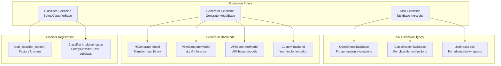

**Sources:** [evaluation/schemas.py:1-550](), [src/classifier_models/loader.py:1-183]()

---

## Adding New Evaluation Tasks

### Task Base Class Hierarchy

All evaluation tasks must inherit from `TaskBase` and implement its abstract methods. The framework provides two specialized base classes for common task patterns:

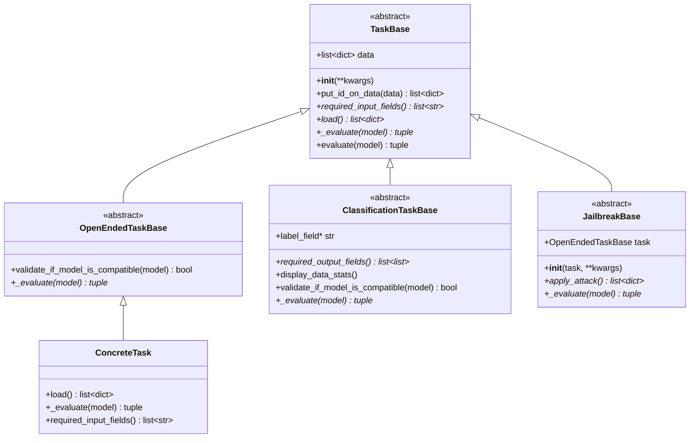

**Sources:** [evaluation/schemas.py:352-518]()

### Creating a Generation Task

To create a new generation task, extend `OpenEndedTaskBase` and implement the required methods:

| Method | Return Type | Purpose |
|--------|-------------|---------|
| `load()` | `list[dict]` | Load and return task data as list of dictionaries |
| `required_input_fields()` | `list[str]` | Specify which template fields are required (e.g., `["instruction"]`) |
| `_evaluate(model)` | `tuple[dict, list[dict]]` | Generate completions and compute metrics |

**Minimal Implementation Pattern:**

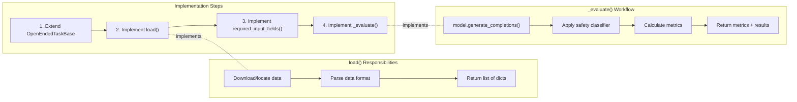

**Sources:** [evaluation/schemas.py:494-518](), [evaluation/tasks/generation/codex_eval/__init__.py:20-116]()

**Example: Simple Generation Task**

Reference the `CodexEval` implementation [evaluation/tasks/generation/codex_eval/__init__.py:20-116]() as a template. Key implementation details:

1. **Data Loading** [evaluation/tasks/generation/codex_eval/__init__.py:45-68]():
   - Download data if not present
   - Parse into list of dictionaries
   - Each dictionary must contain fields matching `required_input_fields()`

2. **Field Specification** [evaluation/tasks/generation/codex_eval/__init__.py:36-43]():
   - Return list of field names that must exist in `model.model_input_template`
   - Common pattern: `["instruction"]` for single-turn generation

3. **Evaluation Logic** [evaluation/tasks/generation/codex_eval/__init__.py:70-115]():
   - Call `model.generate_completions(self.data, max_new_tokens=..., temperature=..., top_p=...)`
   - Process outputs (extract answers, apply classifiers, etc.)
   - Return `(metrics_dict, individual_results_list)`

### Creating an Adversarial Safety Task

For tasks that test model robustness against harmful requests, use the `AdversarialTaskBase` pattern [evaluation/tasks/generation/base.py:12-164]():

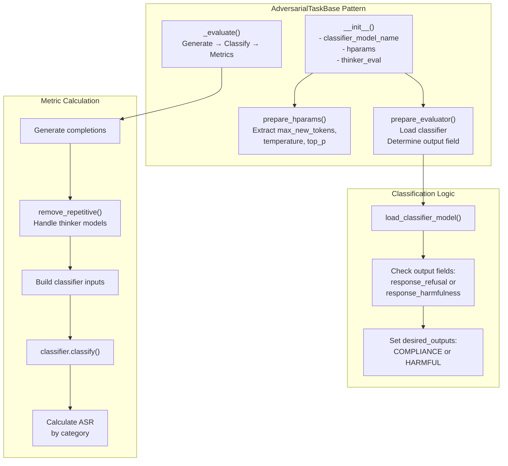

**Sources:** [evaluation/tasks/generation/base.py:12-164]()

**Key Implementation Details:**

1. **Constructor Pattern** [evaluation/tasks/generation/base.py:13-22]():
   - Accept `classifier_model_name` for safety evaluation
   - Accept `hparams` dict for generation parameters
   - Optional: `thinker_eval` for reasoning models, `local_model_path` for custom classifier paths

2. **Evaluator Preparation** [evaluation/tasks/generation/base.py:30-42]():
   - Load classifier via `load_classifier_model()`
   - Automatically detect appropriate output field (`response_refusal` or `response_harmfulness`)
   - Set `desired_outputs` based on field type

3. **Evaluation Workflow** [evaluation/tasks/generation/base.py:44-154]():
   - Generate completions using model
   - Handle reasoning extraction via `remove_repetitive()` if `thinker_eval` is set
   - Build classifier inputs with `prompt` and `response` fields
   - Calculate Attack Success Rate (ASR) per category
   - Track error metrics (truncations, parsing errors, empty responses)

**Example Pattern from HarmbenchBase:**

The `HarmbenchBase` class [evaluation/tasks/generation/harmbench/__init__.py:16-159]() demonstrates category-based metric tracking:

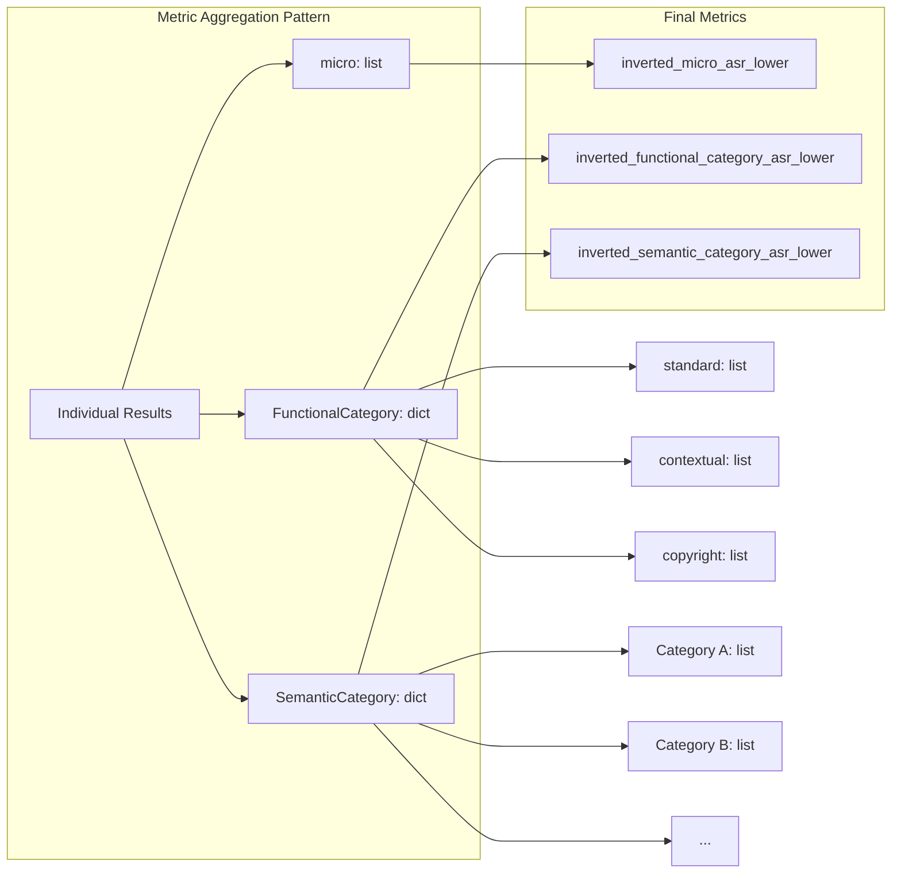

**Sources:** [evaluation/tasks/generation/harmbench/__init__.py:84-136]()

### Creating a Classification Task

To evaluate classifier models, extend `ClassificationTaskBase` [evaluation/schemas.py:432-492]():

| Method | Return Type | Purpose |
|--------|-------------|---------|
| `load()` | `list[dict]` | Load task data with ground truth labels |
| `required_input_fields()` | `list[str]` | Specify required input fields |
| `required_output_fields()` | `list[list[str]]` | Valid combinations of output fields |
| `label_field` (property) | `str` | Name of ground truth label field in data |
| `_evaluate(model)` | `tuple[dict, list[dict]]` | Run classifier and compute accuracy metrics |

**Compatibility Validation:**

The `validate_if_model_is_compatible()` method [evaluation/schemas.py:461-487]() automatically checks:
- Input fields: Model must support all `required_input_fields()`
- Output fields: Model must support at least one valid combination from `required_output_fields()`

**Sources:** [evaluation/schemas.py:432-492]()

### Creating a Jailbreak Attack Wrapper

To create adversarial attack wrappers that can be applied to any generation task, extend `JailbreakBase` [evaluation/schemas.py:520-550]():

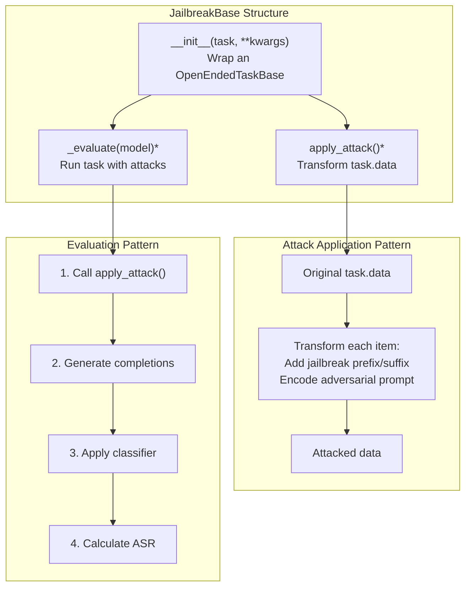

**Sources:** [evaluation/schemas.py:520-550]()

---

## Adding New Generator Models

### Generator Model Interface

To add a new generator backend, implement `GeneratorModelBase` [evaluation/schemas.py:30-97]():

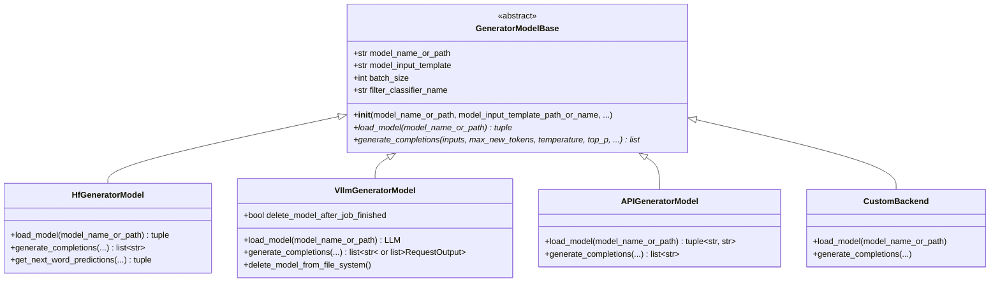

**Sources:** [evaluation/schemas.py:30-350]()

### Required Method Implementations

| Method | Parameters | Return Type | Purpose |
|--------|-----------|-------------|---------|
| `load_model()` | `model_name_or_path: str` | `tuple[object, object]` | Load model and tokenizer/config |
| `generate_completions()` | `inputs: list[dict]`, `max_new_tokens: int`, `temperature: float`, `top_p: float`, etc. | `list[str]` or `list[RequestOutput]` | Generate completions for batch of inputs |

**Constructor Requirements** [evaluation/schemas.py:31-58]():
- Accept `model_name_or_path`, `model_input_template_path_or_name`
- Optional: `hf_revision`, `batch_size`, `filter_classifier_name`, `filter_model_override_path`
- Load template from file or use `get_template()` function
- Store template in `self.model_input_template` for formatting

### Generation Workflow Pattern

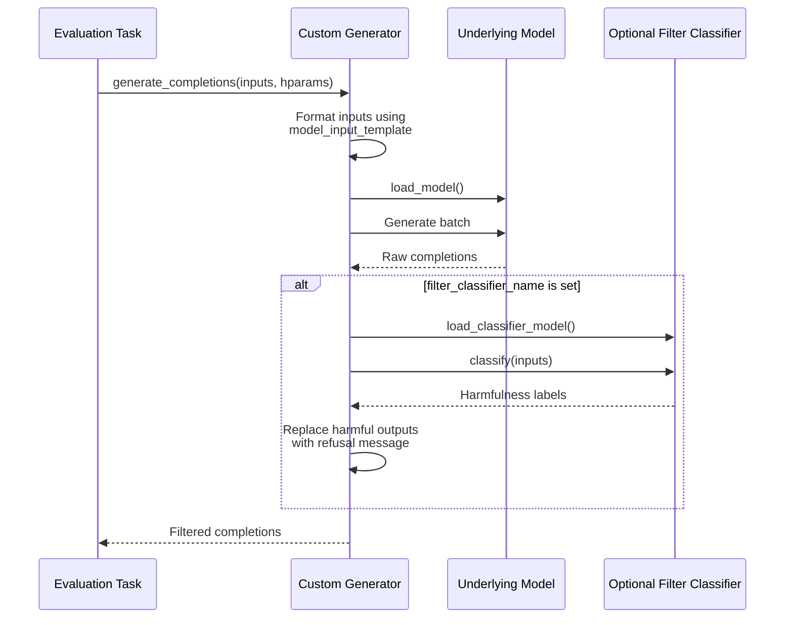

**Sources:** [evaluation/schemas.py:99-350]()

**Safety Filtering Implementation:**

All three existing backends implement optional pre/post-generation filtering [evaluation/schemas.py:145-164](), [evaluation/schemas.py:252-286](), [evaluation/schemas.py:329-347]():
1. Load classifier via `load_classifier_model(self.filter_classifier_name)`
2. Classify inputs/outputs for harmfulness
3. Replace harmful generations with `"I'm sorry, I can't help with that."`
4. Clean up classifier resources

### Example: Implementing a Custom Backend

Reference the `VllmGeneratorModel` implementation [evaluation/schemas.py:203-294]() for a complete example:

1. **Subprocess Execution Pattern** [evaluation/schemas.py:236-250]():
   - Use `subprocess_inference_with_vllm()` for isolated inference
   - Format inputs before passing to subprocess
   - Handle `return_full_outputs` flag for returning `RequestOutput` objects

2. **Resource Management** [evaluation/schemas.py:289-293]():
   - Implement cleanup methods if needed (e.g., `delete_model_from_file_system()`)
   - Use `torch.cuda.empty_cache()` and `gc.collect()` after generation

3. **Template Formatting** [evaluation/schemas.py:236]():
   - Apply `self.model_input_template.format(**d)` to each input dict
   - Ensure template placeholders match task's `required_input_fields()`

**Sources:** [evaluation/schemas.py:203-294]()

---

## Adding New Safety Classifiers

### Classifier Registration System

New classifiers are registered in the `load_classifier_model()` factory function [src/classifier_models/loader.py:37-124]():

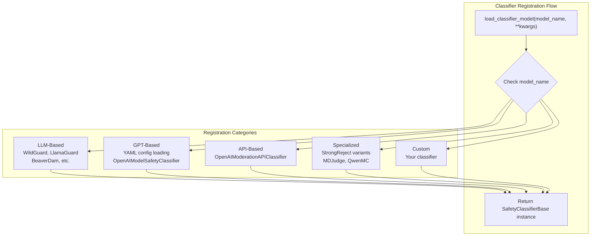

**Sources:** [src/classifier_models/loader.py:37-124]()

### Classifier Implementation Requirements

All classifiers must implement `SafetyClassifierBase` [src/classifier_models/base.py]():

| Method | Return Type | Purpose |
|--------|-------------|---------|
| `get_required_input_fields()` | `list[str]` | Fields required for classification (e.g., `["prompt", "response"]`) |
| `get_optional_input_fields()` | `list[str]` | Optional fields that can be used |
| `get_possible_input_fields()` | `list[str]` | Union of required and optional fields |
| `get_output_fields()` | `list[str]` | Output fields produced (e.g., `["response_harmfulness", "prompt_harmfulness"]`) |
| `classify()` | `list[ClassifierOutput]` | Main classification method |

### Adding a New Classifier Type

**Step 1: Implement Classifier Class**

Create a subclass of `SafetyClassifierBase` with the required methods:

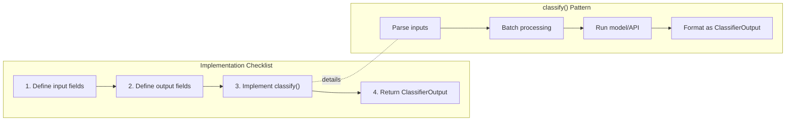

**Step 2: Register in Loader**

Add to `load_classifier_model()` [src/classifier_models/loader.py:37-124]():

```python
elif model_name == "YourClassifierName":
    return YourClassifier(**kwargs)
```

**Registration Patterns by Category:**

1. **Direct Instantiation** [src/classifier_models/loader.py:43-70]():
   - For simple classifiers with minimal configuration
   - Example: `WildGuard`, `LlamaGuardUserRequest`, `BeaverDam`

2. **YAML Configuration Loading** [src/classifier_models/loader.py:73-75]():
   - For GPT-based classifiers with complex prompts
   - Load config via `OpenAIModelSafetyClassifierConfig.from_yaml()`
   - Example: `GPTHarmfulDetectorV0UserRequestOnly`

3. **Dynamic Configuration** [src/classifier_models/loader.py:90-104]():
   - For classifiers with runtime configuration
   - Accept `config` or `config_path` in kwargs
   - Example: `OpenAIModelSafetyClassifier`

4. **API Classifiers** [src/classifier_models/loader.py:106-108]():
   - For external API services
   - Example: `OpenAIModerationAPIClassifier`

**Sources:** [src/classifier_models/loader.py:37-124]()

### Input/Output Field Specifications

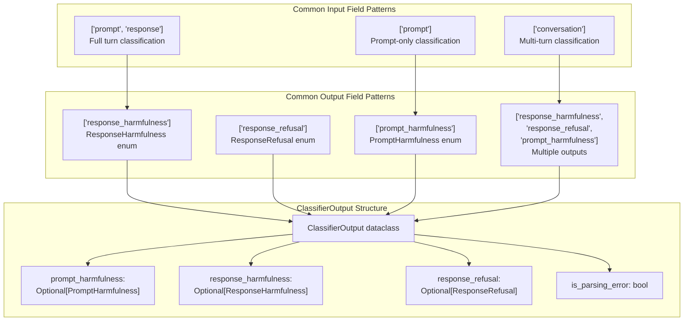

**Sources:** [src/classifier_models/base.py]()

### Example: ToxiGen Pattern

The `ToxiGen` task [evaluation/tasks/generation/toxigen/__init__.py:38-191]() demonstrates a specialized evaluation pattern:

1. **Custom Classifier Loading** [evaluation/tasks/generation/toxigen/__init__.py:54-59]():
   - Load external model via `AutoModelForSequenceClassification.from_pretrained()`
   - Not using standard `SafetyClassifierBase` pattern
   - Custom scoring function `score_generations()`

2. **Batch Classification** [evaluation/tasks/generation/toxigen/__init__.py:88-93]():
   - Process completions in batches
   - Return binary classifications per example

3. **Group-Based Metrics** [evaluation/tasks/generation/toxigen/__init__.py:126-132]():
   - Aggregate scores by target demographic groups
   - Calculate per-group and overall safety metrics

**Sources:** [evaluation/tasks/generation/toxigen/__init__.py:23-191]()

---

## Task Configuration Integration

### YAML Configuration Files

Once implemented, tasks can be configured via YAML files for use with the orchestration system. See [Task Configuration Files](#8.1) for details on:
- Specifying `task_class` pointing to your implementation
- Setting default `hparams` (max_new_tokens, temperature, top_p)
- Configuring `thinker_eval` for reasoning models

### Registration with Orchestration

For integration with `run_all_generation_benchmarks.py`, tasks must be:
1. Added to task configuration directory
2. Included in predefined task lists (`NON_REASONING_EVALS`, `REASONING_EVALS`, etc.)

See [GPU Task Orchestration](#10.1) for details on batch evaluation integration.

**Sources:** [evaluation/tasks/generation/harmbench/__init__.py:1-185](), [evaluation/tasks/generation/codex_eval/__init__.py:1-116]()