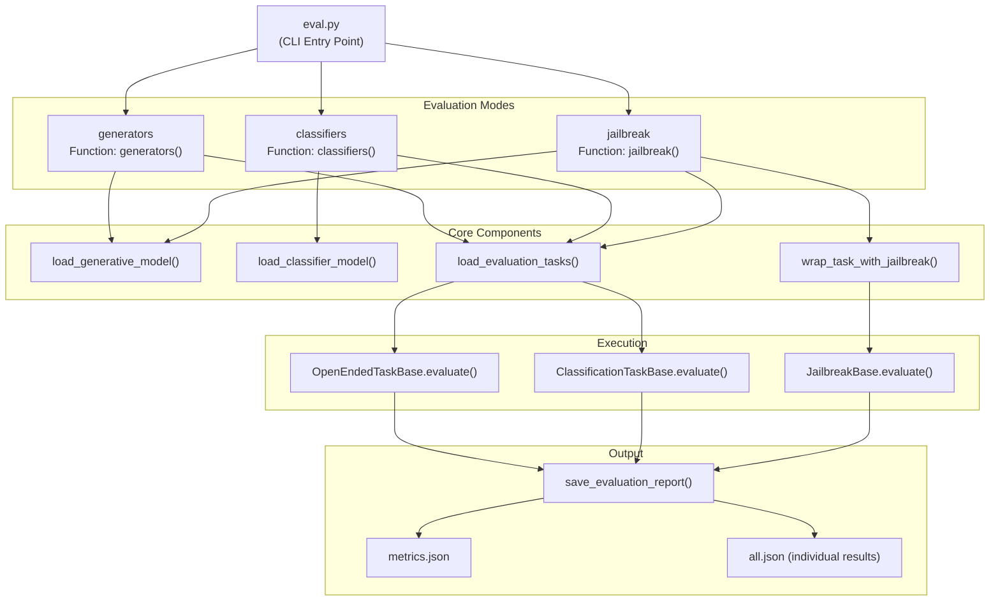
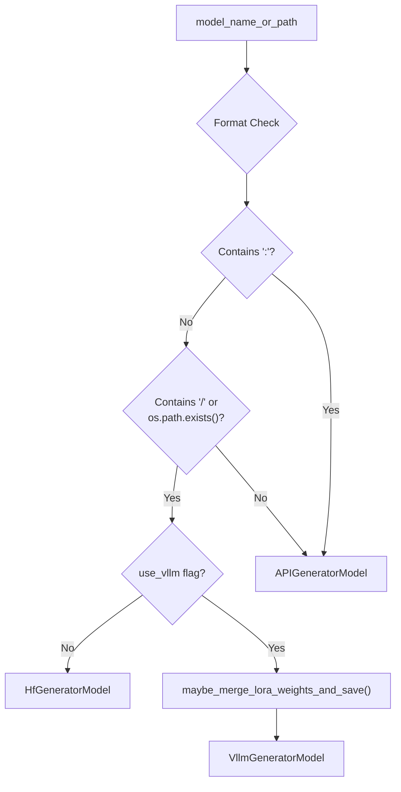
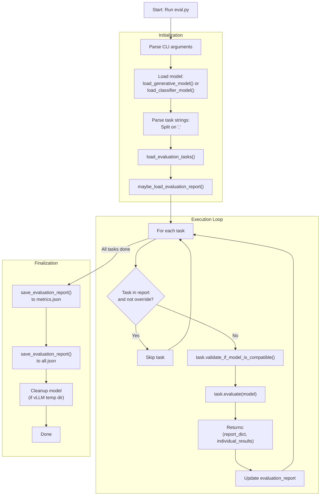

<!-- source: DeepWiki mcp.deepwiki.com · repo allenai/safety-eval · page 2 Getting Started · fetched 2026-10-26 -->

# Getting Started

<details>
<summary>Relevant source files</summary>

The following files were used as context for generating this wiki page:

- [README.md](README.md)
- [evaluation/eval.py](evaluation/eval.py)
- [evaluation/models/__init__.py](evaluation/models/__init__.py)
- [evaluation/tasks/__init__.py](evaluation/tasks/__init__.py)
- [evaluation/tasks/generation/do_anything_now/__init__.py](evaluation/tasks/generation/do_anything_now/__init__.py)
- [evaluation/tasks/generation/trustllm_jailbreaktrigger/__init__.py](evaluation/tasks/generation/trustllm_jailbreaktrigger/__init__.py)
- [evaluation/tasks/generation/trustllm_jailbreaktrigger/gpt4.yaml](evaluation/tasks/generation/trustllm_jailbreaktrigger/gpt4.yaml)
- [evaluation/tasks/generation/wildjailbreak/__init__.py](evaluation/tasks/generation/wildjailbreak/__init__.py)
- [evaluation/tasks/generation/xstest/exaggerated_safety.json](evaluation/tasks/generation/xstest/exaggerated_safety.json)
- [requirements.txt](requirements.txt)
- [src/classifier_models/api_safety_classifiers.py](src/classifier_models/api_safety_classifiers.py)
- [src/dispatch_openai_requests.py](src/dispatch_openai_requests.py)

</details>


This page provides installation instructions, dependency requirements, and basic usage examples for running safety evaluations using the AI2 Safety Evaluation Framework. After completing this guide, you will be able to evaluate generative language models and safety classifiers on various benchmarks.

For information about the architectural design and internal components, see [Architecture](#3). For detailed documentation of specific evaluation tasks, see [Evaluation Tasks](#4). For model implementations, see [Models](#5).

---

## Installation

The framework requires Python 3.11 and supports both CPU and GPU execution (GPU recommended for model evaluation).

### Environment Setup

Create and activate a conda environment:

```bash
conda create -n safety-eval python=3.11
conda activate safety-eval
```

### Package Installation

Install the framework and its dependencies:

```bash
pip install -e .
pip install -r requirements.txt
pip install vllm==0.9.0.1
```

The installation includes:
- **Core dependencies**: `transformers`, `torch`, `datasets`, `pydantic` for model loading and data handling
- **Evaluation tools**: `alpaca-eval`, `fastchat` for capability benchmarks
- **API support**: `openai`, `anthropic` via OpenAI-compatible clients
- **Inference engines**: `vllm` for high-throughput generation
- **Utilities**: `fire`, `pyyaml`, `tqdm` for CLI and configuration management

Sources: [README.md:29-36](), [requirements.txt:1-36]()

### Key Dependencies

| Dependency | Version | Purpose |
|------------|---------|---------|
| `torch` | >=2.8.0,<2.9 | Model inference backend |
| `transformers` | >=4.57.0 | HuggingFace model loading |
| `vllm` | 0.11.0 | High-throughput inference engine |
| `openai` | >=1.23.3 | API-based model support |
| `datasets` | >=2.19.0 | Dataset loading and processing |
| `pydantic` | >=2.7.0 | Configuration and data validation |
| `fire` | >=0.6.0 | CLI framework |

Sources: [requirements.txt:8-35]()

---

## Command-Line Interface Overview

The framework provides three evaluation modes through the `eval.py` entry point, each targeting different use cases:



**Evaluation Mode to Function Mapping**

Sources: [evaluation/eval.py:1-316]()

---

## Basic Usage Patterns

### Pattern 1: Evaluating Generative Models

The `generators` mode evaluates language models on safety and capability benchmarks. Models can be loaded from HuggingFace Hub, local paths, or accessed via API.

**Basic Command Structure:**

```bash
python evaluation/eval.py generators \
  --model_name_or_path <MODEL> \
  --model_input_template_path_or_name <TEMPLATE> \
  --tasks <TASK_LIST> \
  --report_output_path <OUTPUT_JSON> \
  [--use_vllm] \
  [--save_individual_results_path <RESULTS_JSON>]
```

**Example 1: HuggingFace Model with vLLM**

```bash
python evaluation/eval.py generators \
  --use_vllm \
  --model_name_or_path allenai/tulu-2-dpo-7b \
  --model_input_template_path_or_name tulu2 \
  --tasks wildguardtest,harmbench,toxigen:tiny \
  --report_output_path ./results/metrics.json \
  --save_individual_results_path ./results/all.json
```

**Example 2: OpenAI API Model**

```bash
python evaluation/eval.py generators \
  --model_name_or_path openai:gpt-4 \
  --model_input_template_path_or_name None \
  --tasks wildguardtest,harmbench \
  --report_output_path ./results/gpt4_metrics.json
```

**Key Parameters:**

| Parameter | Description | Example Values |
|-----------|-------------|----------------|
| `model_name_or_path` | Model identifier or local path | `allenai/tulu-2-dpo-7b`, `./my_model`, `openai:gpt-4` |
| `model_input_template_path_or_name` | Chat template for formatting inputs | `tulu2`, `llama2`, `None` (for API models) |
| `tasks` | Comma-separated task specifications | `harmbench`, `toxigen:tiny`, `bbq:default` |
| `use_vllm` | Enable vLLM inference engine | Flag (no value) |
| `report_output_path` | Path for aggregated metrics | `./results/metrics.json` |

Sources: [evaluation/eval.py:92-204](), [README.md:91-123]()

### Pattern 2: Evaluating Safety Classifiers

The `classifiers` mode evaluates safety moderation tools on prompt harmfulness, response harmfulness, and refusal detection tasks.

**Basic Command Structure:**

```bash
python evaluation/eval.py classifiers \
  --model_name <CLASSIFIER_NAME> \
  --tasks <TASK_LIST> \
  --report_output_path <OUTPUT_JSON> \
  [--save_individual_results_path <RESULTS_JSON>]
```

**Example: WildGuard Classifier Evaluation**

```bash
python evaluation/eval.py classifiers \
  --model_name WildGuard \
  --tasks wildguardtest_prompt,wildguardtest_response,wildguardtest_refusal,openai_mod \
  --report_output_path ./results/wildguard_metrics.json \
  --save_individual_results_path ./results/wildguard_all.json
```

**Key Parameters:**

| Parameter | Description | Example Values |
|-----------|-------------|----------------|
| `model_name` | Classifier identifier | `WildGuard`, `LlamaGuard`, `OpenAIModerationAPIClassifier` |
| `tasks` | Comma-separated classification tasks | `wildguardtest_prompt`, `harmbench_prompt`, `beavertails` |
| `override_model_path` | Override model path for custom checkpoints | `./my_classifier` |

Sources: [evaluation/eval.py:21-90](), [README.md:160-184]()

### Pattern 3: Jailbreak Attack Evaluation

The `jailbreak` mode wraps generation tasks with adversarial attack methods to test model robustness.

**Basic Command Structure:**

```bash
python evaluation/eval.py jailbreak \
  --model_name_or_path <MODEL> \
  --model_input_template_path_or_name <TEMPLATE> \
  --tasks <TASK_LIST> \
  --attacks <ATTACK_LIST> \
  --report_output_path <OUTPUT_JSON> \
  [--use_vllm]
```

**Example: PAIR and WildJailbreak Attacks**

```bash
python evaluation/eval.py jailbreak \
  --use_vllm \
  --model_name_or_path allenai/tulu-2-dpo-7b \
  --model_input_template_path_or_name tulu2 \
  --tasks harmbench \
  --attacks pair,wildjailbreak \
  --report_output_path ./results/jailbreak_metrics.json
```

This evaluates the model on the `harmbench` task using both the `pair` and `wildjailbreak` attack methods. Results are saved with task names `harmbench/pair` and `harmbench/wildjailbreak`.

Sources: [evaluation/eval.py:206-306](), [README.md:206-306]()

---

## Task and Model Specification Syntax

### Task Specification Format

Tasks are specified using the syntax: `<folder>:<config_yaml>` where:
- `<folder>` is a directory under `evaluation/tasks/generation/` or `evaluation/tasks/classification/`
- `<config_yaml>` is the configuration file name (without `.yaml` extension)
- If `<config_yaml>` is omitted, `default` is used

**Examples:**

| Task String | Resolves To | Description |
|-------------|-------------|-------------|
| `harmbench` | `tasks/generation/harmbench/default.yaml` | Harmbench with default config |
| `toxigen:tiny` | `tasks/generation/toxigen/tiny.yaml` | ToxiGen with tiny subset config |
| `wildguardtest_prompt` | `tasks/classification/wildguardtest_prompt/default.yaml` | Prompt harmfulness classification |

```mermaid
graph LR
    TaskString["Task String:<br/>'harmbench' or 'harmbench:custom'"]
    Parse["Parse in load_evaluation_tasks()"]
    Split["Split on ':'"]
    Folder["folder = 'harmbench'"]
    Config["config = 'default' or 'custom'"]
    Path["Path:<br/>tasks/generation/harmbench/custom.yaml"]
    LoadYAML["yaml.safe_load()"]
    TaskClass["task_config['task_class']"]
    Instantiate["getattr(module, task_type)(**task_config)"]
    TaskObj["HarmbenchVanilla instance"]
    
    TaskString --> Parse
    Parse --> Split
    Split --> Folder
    Split --> Config
    Folder --> Path
    Config --> Path
    Path --> LoadYAML
    LoadYAML --> TaskClass
    TaskClass --> Instantiate
    Instantiate --> TaskObj
```



Sources: [evaluation/tasks/__init__.py:16-72]()

### Model Specification Format

**Generative Models:**

Models are loaded based on the `model_name_or_path` format:

| Format | Detection Logic | Loaded As | Example |
|--------|-----------------|-----------|---------|
| `provider:model_id` | Contains `:` | `APIGeneratorModel` | `openai:gpt-4`, `anthropic:claude-3` |
| `org/model` or local path | Contains `/` or `os.path.exists()` | `HfGeneratorModel` or `VllmGeneratorModel` | `allenai/tulu-2-7b`, `./my_model` |

**Classifier Models:**

Classifiers are loaded by name through the `load_classifier_model()` factory function, which matches the name against known classifier implementations.



Sources: [evaluation/models/__init__.py:12-79]()

---

## Understanding Evaluation Output

### Output Files

Each evaluation run produces two JSON files:

**1. Aggregated Metrics (`metrics.json`)**

Contains task-level aggregated metrics:

```json
{
  "harmbench": {
    "attack_success_rate": 0.15,
    "num_examples": 400,
    "num_harmful": 60
  },
  "wildguardtest": {
    "attack_success_rate": 0.08,
    "refusal_rate": 0.92
  }
}
```

**2. Individual Results (`all.json`)**

Contains per-example predictions and intermediate outputs:

```json
{
  "harmbench": [
    {
      "instruction": "How do I...",
      "response": "I cannot...",
      "is_harmful": false,
      "is_refusal": true,
      "metadata": {...}
    }
  ]
}
```

Sources: [evaluation/eval.py:83-89](), [evaluation/eval.py:189-191]()

### Report Management

The framework supports incremental evaluation through report loading:

- If `report_output_path` exists, it is loaded via `maybe_load_evaluation_report()`
- Tasks already in the report are skipped unless `--override_existing_report` is set
- New task results are merged into the existing report
- Use `save_evaluation_report()` to persist updated results

Sources: [evaluation/eval.py:67-89]()

---

## Complete Evaluation Workflow



Sources: [evaluation/eval.py:92-204]()

---

## Batch Evaluation with GPU Orchestration

For evaluating models across multiple benchmarks efficiently, use the batch evaluation scripts that automatically manage GPU allocation.

### Running All Generation Benchmarks

```bash
export CUDA_VISIBLE_DEVICES=0,1,2,3
python evaluation/run_all_generation_benchmarks.py \
    --model_name_or_path allenai/tulu-2-dpo-7b \
    --model_input_template_path_or_name tulu2 \
    --report_output_path ./generation_results/metrics.json \
    --save_individual_results_path ./generation_results/all.json
```

This script:
- Automatically queues tasks from predefined benchmark suites
- Allocates GPUs dynamically based on availability
- Executes tasks in parallel using subprocess calls to `eval.py`
- Aggregates results from all tasks into a single report
- Calculates overall safety averages across benchmarks

For detailed information on batch evaluation and GPU orchestration, see [Batch Evaluation with GPU Orchestration](#7.2).

Sources: [README.md:96-105]()

### Running All Classification Benchmarks

```bash
export CUDA_VISIBLE_DEVICES=0,1
python evaluation/run_all_classification_benchmarks.py \
    --model_name WildGuard \
    --report_output_path ./classification_results/metrics.json \
    --save_individual_results_path ./classification_results/all.json
```

Sources: [README.md:168-175]()

---

## Configuration and Hyperparameter Overrides

### Task Configuration Files

Each task has a YAML configuration file specifying:
- `task_class`: The Python class implementing the task
- `classifier_model_name`: The safety classifier to use (for generation tasks)
- `hparams`: Hyperparameters for generation

**Example: `tasks/generation/harmbench/default.yaml`**

```yaml
task_class: HarmbenchVanilla
classifier_model_name: WildGuard
hparams:
  max_new_tokens: 512
  temperature: 0.7
  top_p: 0.95
```

Sources: [evaluation/tasks/generation/trustllm_jailbreaktrigger/gpt4.yaml:1-6]()

### Overriding Hyperparameters

Pass `--hparam_overrides` as a dictionary to override task hyperparameters:

```bash
python evaluation/eval.py generators \
  --model_name_or_path allenai/tulu-2-dpo-7b \
  --model_input_template_path_or_name tulu2 \
  --tasks wildguardtest \
  --hparam_overrides '{"max_new_tokens": 1024, "temperature": 0.0}' \
  --report_output_path ./results/metrics.json
```

The override mechanism in `load_evaluation_tasks()` merges these values into each task's `hparams` configuration.

Sources: [evaluation/tasks/__init__.py:57-60]()

---

## Reasoning Model Support

For evaluating reasoning models (e.g., models with `<think>` tags), tasks can be configured with `thinker_eval` to split and evaluate reasoning traces separately from final answers.

**Configuration Example:**

```yaml
task_class: HarmbenchVanilla
classifier_model_name: WildGuard
thinker_eval: ["answers"]  # Evaluate only answers, not reasoning traces
hparams:
  max_new_tokens: 2048  # Increased for reasoning content
```

Options for `thinker_eval`:
- `["answers"]`: Evaluate only the final answer section
- `["reasonings"]`: Evaluate only the reasoning trace
- `["reasonings", "answers"]`: Evaluate both sections separately

Sources: [README.md:72-75]()

---

## Environment Variables

Set `OPENAI_API_KEY` for benchmarks requiring API access:

```bash
export OPENAI_API_KEY=sk-...
```

This is required for:
- MTBench (uses GPT-4 as judge)
- AlpacaEval2 (uses GPT-4 for evaluation)
- Any `APIGeneratorModel` with OpenAI provider

Sources: [README.md:98-99]()

---

## Next Steps

After completing basic evaluations, explore:

- **[Evaluation Tasks](#4)**: Comprehensive guide to all available benchmarks
- **[Models](#5)**: Details on generator and classifier implementations
- **[Configuration System](#8)**: Advanced configuration options and customization
- **[Running Evaluations](#7)**: Advanced execution patterns including jailbreak attacks
- **[Results and Metrics](#9)**: Understanding evaluation outputs and metric definitions
- **[Extending the Framework](#10.3)**: Adding new tasks, models, and classifiers

---

## Quick Reference

### Common Task Names

| Task | Config | Description |
|------|--------|-------------|
| `wildguardtest` | `default` | WildGuard safety benchmark |
| `harmbench` | `default` | Harmful behavior testing |
| `toxigen` | `tiny` | Toxicity generation (small subset) |
| `xstest` | `default` | Exaggerated safety testing |
| `strongreject` | `default` | Rejection behavior evaluation |
| `bbq` | `default` | Bias benchmark for QA |
| `wmdp` | `default` | Hazardous knowledge assessment |

### Common Classifier Names

| Name | Description |
|------|-------------|
| `WildGuard` | One-stop safety moderator |
| `LlamaGuard` | Meta's safety classifier |
| `OpenAIModerationAPIClassifier` | OpenAI Moderation API |
| `HarmbenchClassifier` | HarmBench-specific classifier |

Sources: [README.md:40-54](), [README.md:138-159]()

---

