<!-- source: DeepWiki mcp.deepwiki.com · repo allenai/safety-eval · page 3 Architecture · fetched 2026-10-26 -->

# Architecture

<details>
<summary>Relevant source files</summary>

The following files were used as context for generating this wiki page:

- [evaluation/eval.py](evaluation/eval.py)
- [evaluation/schemas.py](evaluation/schemas.py)
- [evaluation/tasks/__init__.py](evaluation/tasks/__init__.py)
- [evaluation/tasks/generation/base.py](evaluation/tasks/generation/base.py)
- [evaluation/tasks/generation/codex_eval/__init__.py](evaluation/tasks/generation/codex_eval/__init__.py)
- [evaluation/tasks/generation/harmbench/__init__.py](evaluation/tasks/generation/harmbench/__init__.py)
- [evaluation/tasks/generation/toxigen/__init__.py](evaluation/tasks/generation/toxigen/__init__.py)
- [evaluation/tasks/generation/wildguardtest/__init__.py](evaluation/tasks/generation/wildguardtest/__init__.py)

</details>


## Purpose and Scope

This document describes the architectural design of the AI2 Safety Evaluation Framework, including its core abstractions, layered structure, and key design patterns. The architecture is organized into four primary layers: the Orchestration Layer, Model Layer, Task System, and Data/Utilities Layer. This page focuses on the structural organization and how these components interact.

For specific implementation details of individual components:
- For generator and classifier model implementations, see [Model Layer](#3.1)
- For task base classes and evaluation workflow, see [Task System](#3.2)
- For GPU management and parallel execution, see [Orchestration and Execution](#3.3)
- For adding new tasks or models, see [Extending the Framework](#10.3)

## Core Architectural Principles

The framework follows these key design patterns:

1. **Abstraction Through Base Classes**: Core functionality is defined in abstract base classes (`TaskBase`, `GeneratorModelBase`, `SafetyClassifierBase`) with concrete implementations providing specific behavior
2. **Factory Pattern**: Models and tasks are instantiated through factory functions (`load_generative_model`, `load_classifier_model`, `load_evaluation_tasks`)
3. **Template Method Pattern**: Tasks define `_evaluate()` methods that follow a common workflow while allowing customization
4. **Separation of Concerns**: Clear boundaries between model interfaces, task logic, data loading, and orchestration
5. **Composability**: Jailbreak attacks wrap existing tasks (`JailbreakBase`) to enable adversarial evaluation without modifying task code

**Sources**: [evaluation/schemas.py:1-550](), [evaluation/eval.py:1-316](), [evaluation/tasks/__init__.py:1-99]()

## System Layers Overview

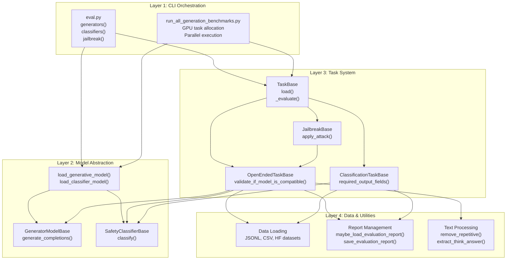

**Diagram: Four-Layer Architecture with Code Entities**

This diagram shows the hierarchical organization of the framework, with each layer building upon the abstractions provided by lower layers.

**Sources**: [evaluation/eval.py:1-316](), [evaluation/schemas.py:1-550](), [evaluation/tasks/__init__.py:1-99](), [evaluation/utils.py]()

## Abstract Base Classes

The framework defines three primary abstract base classes that establish contracts for all implementations:

### TaskBase Hierarchy

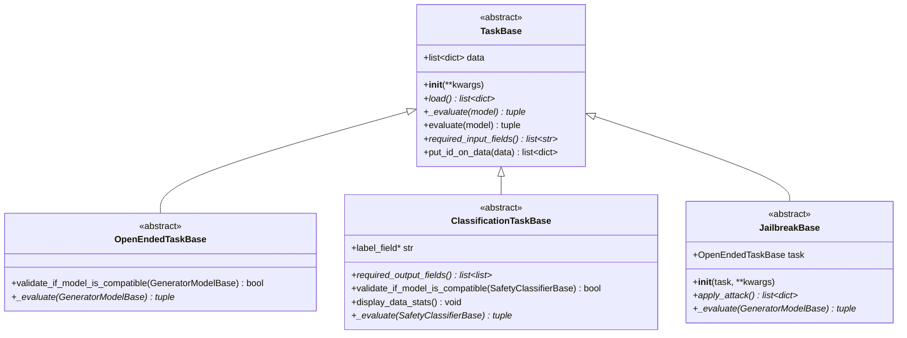

**Diagram: Task Base Class Hierarchy**

**Key Responsibilities**:

| Base Class | Core Methods | Purpose |
|------------|--------------|---------|
| `TaskBase` | `load()`, `_evaluate()`, `required_input_fields()` | Defines common task interface and data loading |
| `OpenEndedTaskBase` | `validate_if_model_is_compatible()` | Tasks requiring generative model responses |
| `ClassificationTaskBase` | `required_output_fields()`, `label_field` | Tasks evaluating classifier accuracy |
| `JailbreakBase` | `apply_attack()` | Wraps tasks with adversarial attacks |

**Sources**: [evaluation/schemas.py:352-430](), [evaluation/schemas.py:432-492](), [evaluation/schemas.py:494-518](), [evaluation/schemas.py:520-550]()

### GeneratorModelBase Hierarchy

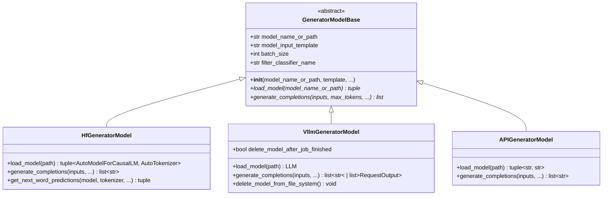

**Diagram: Generator Model Class Hierarchy**

**Implementation Details**:

- **HfGeneratorModel** ([evaluation/schemas.py:99-201]()): Uses `transformers` library, calls `load_hf_lm_and_tokenizer()` and `generate_completions()` from `src.generation_utils`
- **VllmGeneratorModel** ([evaluation/schemas.py:203-294]()): Uses vLLM for high-throughput inference, calls `subprocess_inference_with_vllm()`
- **APIGeneratorModel** ([evaluation/schemas.py:296-349]()): Interfaces with external APIs (OpenAI), calls `query_openai_chat_model()`

All implementations support optional safety filtering through `filter_classifier_name` parameter, which applies a classifier to filter harmful prompts.

**Sources**: [evaluation/schemas.py:30-97](), [evaluation/schemas.py:99-201](), [evaluation/schemas.py:203-294](), [evaluation/schemas.py:296-349]()

## Model Loading and Factory Pattern

The framework uses factory functions to abstract model instantiation:

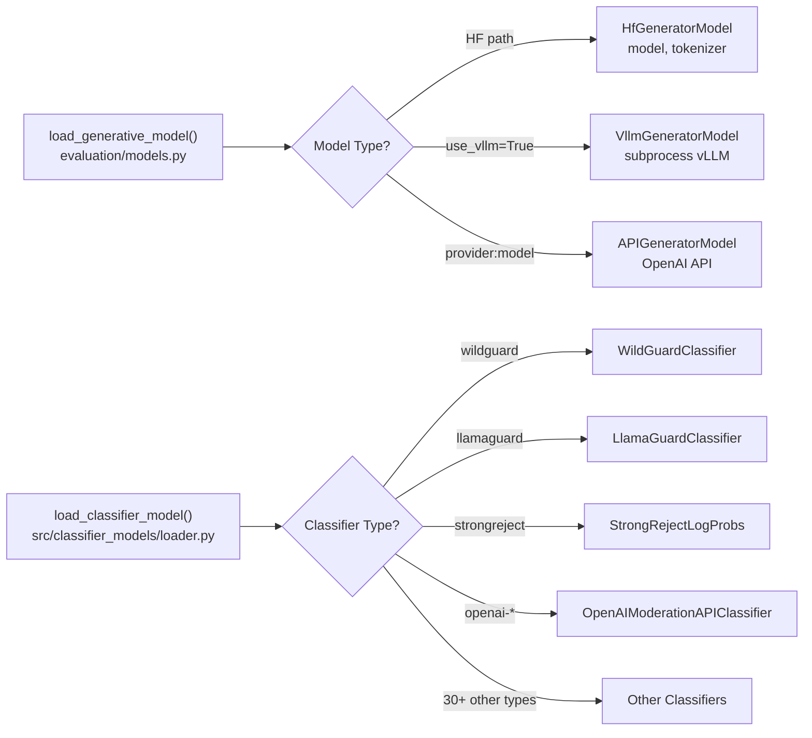

**Diagram: Model Factory Functions**

The factory pattern enables:
1. **Centralized instantiation logic** - Single point to modify model loading
2. **Type inference** - Automatic detection of model type from parameters
3. **Consistent interface** - All models share common base class methods
4. **Easy extension** - New models added by updating factory function

**Sources**: [evaluation/models.py](), [src/classifier_models/loader.py](), [evaluation/schemas.py:30-349]()

## Task Loading and Configuration

Tasks are loaded dynamically using YAML configuration files:

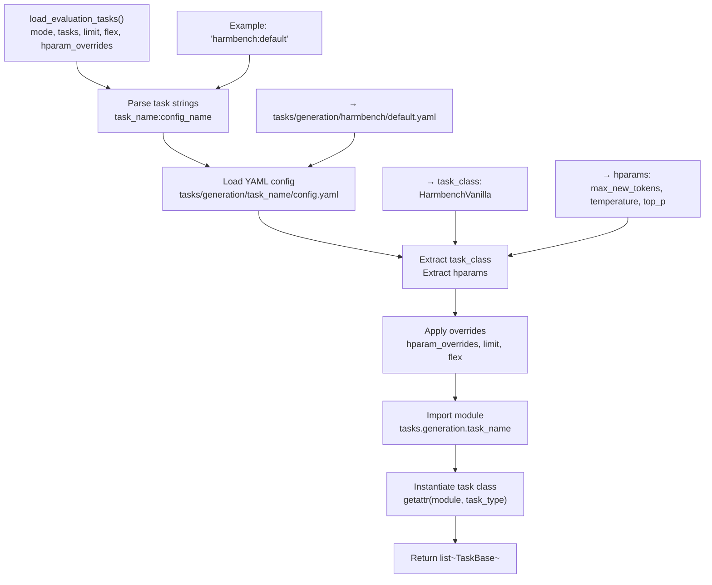

**Diagram: Task Loading Pipeline**

**Key Components**:

| Component | Location | Purpose |
|-----------|----------|---------|
| `load_evaluation_tasks()` | [evaluation/tasks/__init__.py:16-72]() | Main factory function for task instantiation |
| Task config YAML | `tasks/{mode}/{task_name}/{config}.yaml` | Specifies `task_class` and hyperparameters |
| Task module | `tasks.{mode}.{task_name}` | Contains task class implementations |
| `wrap_task_with_jailbreak()` | [evaluation/tasks/__init__.py:74-98]() | Wraps tasks with adversarial attacks |

**Sources**: [evaluation/tasks/__init__.py:16-72](), [evaluation/tasks/__init__.py:74-98]()

## Evaluation Workflow

### Generation Task Evaluation

The standard evaluation workflow for generation tasks follows this pattern:

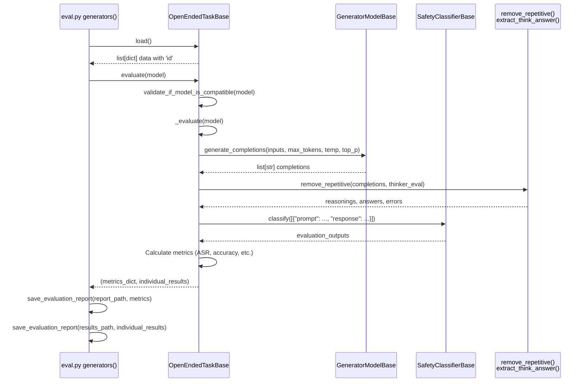

**Diagram: Generation Task Evaluation Sequence**

**Key Steps**:

1. **Data Loading** ([evaluation/schemas.py:357-358]()): `load()` method populates `self.data` with task instances
2. **Model Validation** ([evaluation/schemas.py:495-513]()): Checks if model template contains required input fields
3. **Generation** ([evaluation/schemas.py:76-96]()): `generate_completions()` produces model outputs
4. **Post-processing**: `remove_repetitive()` handles reasoning traces and answer extraction
5. **Classification**: Safety classifier evaluates harmfulness/refusal
6. **Metrics Calculation**: Aggregates per-instance results into summary statistics
7. **Report Saving** ([evaluation/eval.py:189-191]()): Writes metrics and individual results to JSON files

**Sources**: [evaluation/eval.py:92-204](), [evaluation/schemas.py:494-518](), [evaluation/tasks/generation/harmbench/__init__.py:46-149]()

### Adversarial Task Pattern

Adversarial tasks (e.g., `HarmbenchBase`, `AdversarialTaskBase`) follow a specialized pattern:

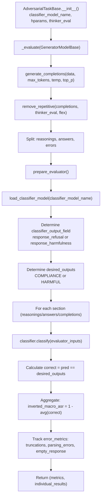

**Diagram: Adversarial Task Evaluation Flow**

**Pattern Characteristics**:

- **Classifier Integration**: Tasks specify `classifier_model_name` to evaluate safety
- **Flexible Output**: Supports both `thinker_eval` (reasoning traces) and standard completions
- **Error Handling**: Tracks parsing errors, truncations, and empty responses
- **Inverted Metrics**: Reports `inverted_*_asr` where lower ASR is better (fewer successful attacks)

**Implementation Examples**:
- `AdversarialTaskBase` ([evaluation/tasks/generation/base.py:12-164]())
- `HarmbenchBase` ([evaluation/tasks/generation/harmbench/__init__.py:16-159]())

**Sources**: [evaluation/tasks/generation/base.py:12-164](), [evaluation/tasks/generation/harmbench/__init__.py:16-159](), [evaluation/tasks/generation/wildguardtest/__init__.py:15-141]()

## Common Task Patterns

### Pattern 1: Multiple-Choice Evaluation

Tasks like WMDP use multiple-choice scoring:

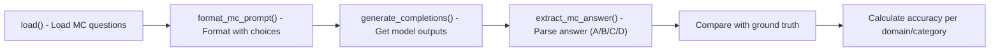

**Diagram: Multiple-Choice Task Pattern**

**Sources**: Multiple-choice tasks follow patterns in WMDP, BBQ implementations

### Pattern 2: Safety Classification with Subcategories

Tasks like WildguardTest and ToxiGen organize results by subcategories:

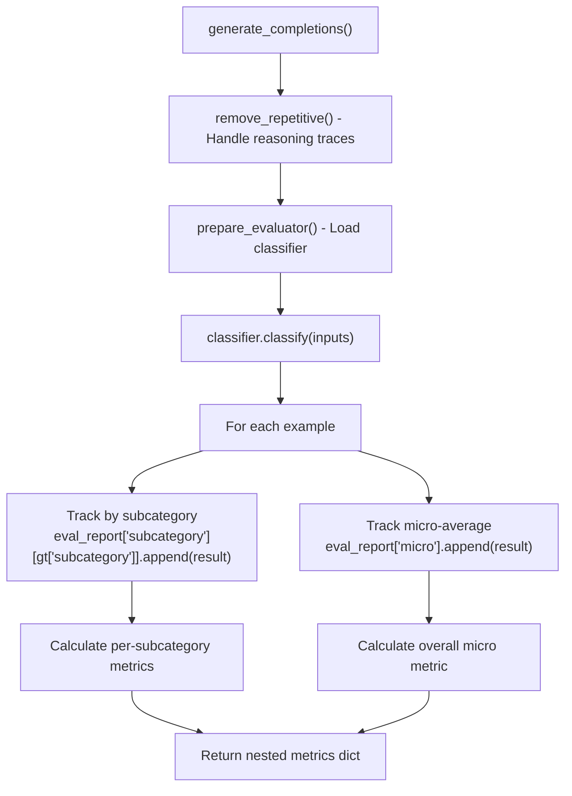

**Diagram: Subcategory Safety Evaluation Pattern**

**Examples**:
- **WildguardTest** ([evaluation/tasks/generation/wildguardtest/__init__.py:38-131]()): Tracks by `subcategory`, `adversarial`/`vanilla`, and `micro`
- **ToxiGen** ([evaluation/tasks/generation/toxigen/__init__.py:61-146]()): Tracks by minority group (`target_groups`)

**Sources**: [evaluation/tasks/generation/wildguardtest/__init__.py:38-131](), [evaluation/tasks/generation/toxigen/__init__.py:61-146]()

### Pattern 3: Thinker Evaluation Support

Many tasks support "thinker" models that output reasoning before answers:

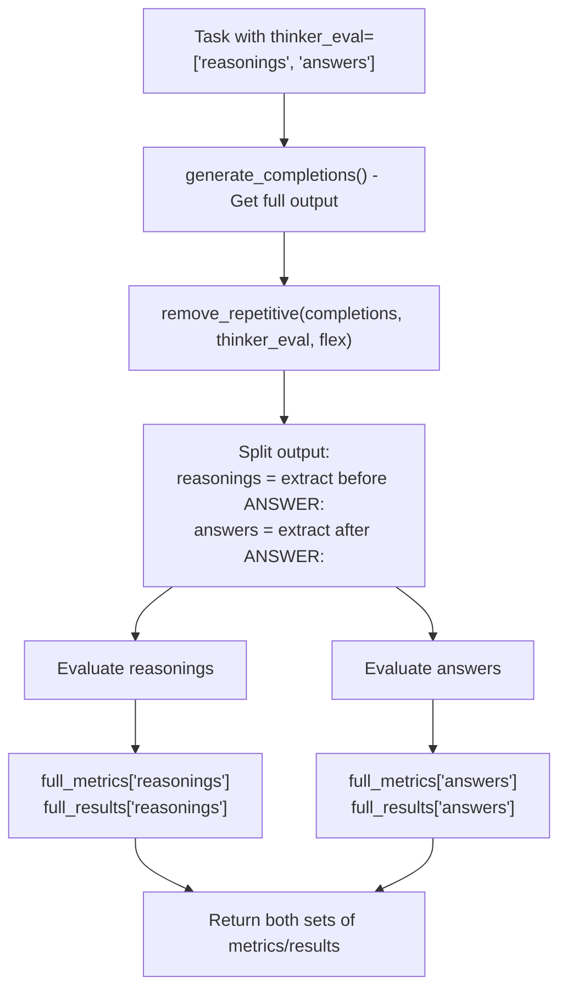

**Diagram: Thinker Evaluation Pattern**

The `thinker_eval` parameter allows evaluating both:
- **reasonings**: The full reasoning trace
- **answers**: The extracted final answer

This is implemented in `remove_repetitive()` which uses regex patterns or flexible parsing (`flex=True`) to separate reasoning from answers.

**Sources**: [evaluation/utils.py]() (remove_repetitive function), [evaluation/tasks/generation/harmbench/__init__.py:59-70](), [evaluation/tasks/generation/base.py:50-61]()

## Entry Points and CLI Structure

The framework provides three main CLI entry points in `eval.py`:

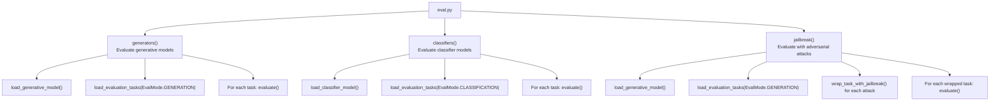

**Diagram: CLI Entry Points**

**Command Examples**:

| Function | Usage |
|----------|-------|
| `generators()` | `python eval.py generators --model_name_or_path <model> --tasks harmbench,xstest --model_input_template_path_or_name olmo` |
| `classifiers()` | `python eval.py classifiers --model_name wildguard --tasks ai2_prompt_safety` |
| `jailbreak()` | `python eval.py jailbreak --model_name_or_path <model> --tasks harmbench --attacks pair,wildjailbreak` |

**Key Parameters**:

- **model_name_or_path**: Model identifier (HF path, local path, or `provider:model`)
- **tasks**: Comma-separated task specifications (`task_name` or `task_name:config`)
- **model_input_template_path_or_name**: Chat template for formatting prompts
- **filter_classifier_name**: Optional safety filter to refuse harmful prompts
- **use_vllm**: Enable vLLM for high-throughput generation
- **hparam_overrides**: Override default hyperparameters (max_new_tokens, temperature, top_p)

**Sources**: [evaluation/eval.py:21-90](), [evaluation/eval.py:92-204](), [evaluation/eval.py:206-306]()

## Data Flow Through the System

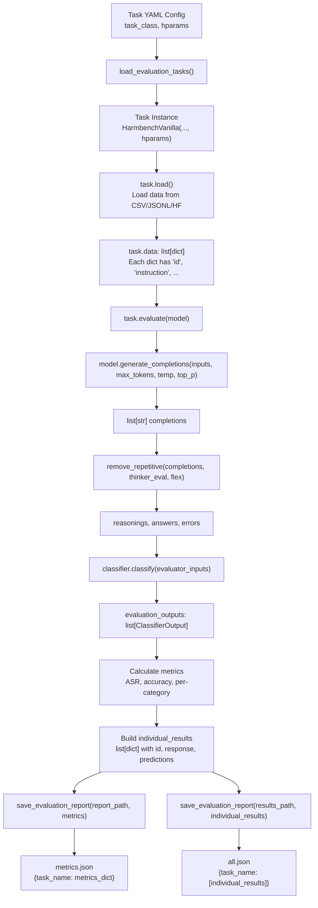

**Diagram: Complete Data Flow Pipeline**

**Data Transformations**:

1. **Configuration → Task Instance**: YAML config specifies class and hyperparameters
2. **Task Instance → Data**: `load()` reads from various sources, adds `id` field
3. **Data → Inputs**: Format data into model input schema (e.g., `{"instruction": ...}`)
4. **Inputs → Completions**: Model generates responses
5. **Completions → Processed Outputs**: Parse reasoning traces, extract answers
6. **Outputs → Classifications**: Safety classifier evaluates each response
7. **Classifications → Metrics**: Aggregate into summary statistics
8. **Metrics → Reports**: Save to JSON files

**Sources**: [evaluation/tasks/__init__.py:16-72](), [evaluation/schemas.py:352-430](), [evaluation/eval.py:92-204](), [evaluation/utils.py]()

## Key Design Decisions

### 1. Subprocess-Based vLLM Execution

VllmGeneratorModel uses subprocess calls rather than in-process execution:

**Rationale**:
- Avoids GPU memory conflicts when loading multiple models sequentially
- Enables clean teardown of vLLM's CUDA context
- Supports `delete_model_after_job_finished` for disk space management

**Implementation**: [evaluation/schemas.py:235-250]() calls `subprocess_inference_with_vllm()` from `src.generation_utils`

### 2. Safety Filtering Integration

All generator models support optional `filter_classifier_name` parameter:

**Workflow**:
1. Generate completions normally
2. If `filter_classifier_name` is set, classify all prompts
3. Replace outputs for harmful prompts with canned refusal: "I'm sorry, I can't help with that."

**Code Locations**:
- HfGeneratorModel: [evaluation/schemas.py:145-163]()
- VllmGeneratorModel: [evaluation/schemas.py:255-285]()
- APIGeneratorModel: [evaluation/schemas.py:329-347]()

### 3. Thinker Evaluation Support

Tasks support `thinker_eval` parameter to evaluate reasoning traces separately from answers:

**Motivation**: Models that use chain-of-thought may have different safety properties in reasoning vs. final answers

**Implementation Pattern**:
```python
if self.thinker_eval is not None:
    evals = {}
    if "reasonings" in self.thinker_eval:
        evals["reasonings"] = reasonings
    if "answers" in self.thinker_eval:
        evals["answers"] = answers
    # Evaluate each section separately
```

**Sources**: [evaluation/tasks/generation/harmbench/__init__.py:62-70](), [evaluation/tasks/generation/base.py:53-61]()

### 4. Error Tracking

All tasks track multiple error types:

| Error Type | Meaning | Impact on Metrics |
|------------|---------|-------------------|
| `parsing_errors` | Classifier couldn't parse model output | Counted as unsafe/harmful |
| `truncations` | Model output exceeded max_new_tokens | Tracked separately, may affect parsing |
| `empty_response` | Answer extraction resulted in empty string | Counted as unsafe/refusal |

This enables detailed error analysis and debugging of model behaviors.

**Sources**: [evaluation/tasks/generation/harmbench/__init__.py:94-128](), [evaluation/tasks/generation/base.py:84-128]()

## Extension Points

The architecture provides clear extension points for adding functionality:

| Extension | Base Class | Key Methods | Location |
|-----------|------------|-------------|----------|
| New generator backend | `GeneratorModelBase` | `load_model()`, `generate_completions()` | [evaluation/schemas.py:30-97]() |
| New safety classifier | `SafetyClassifierBase` | `classify()`, `get_output_fields()` | [src/classifier_models/base.py]() |
| New evaluation task | `OpenEndedTaskBase` or `ClassificationTaskBase` | `load()`, `_evaluate()`, `required_input_fields()` | [evaluation/schemas.py:352-518]() |
| New jailbreak attack | `JailbreakBase` | `apply_attack()`, `_evaluate()` | [evaluation/schemas.py:520-550]() |

For detailed guidance on implementing these extensions, see [Extending the Framework](#10.3).

**Sources**: [evaluation/schemas.py:30-550](), [src/classifier_models/base.py]()

---

